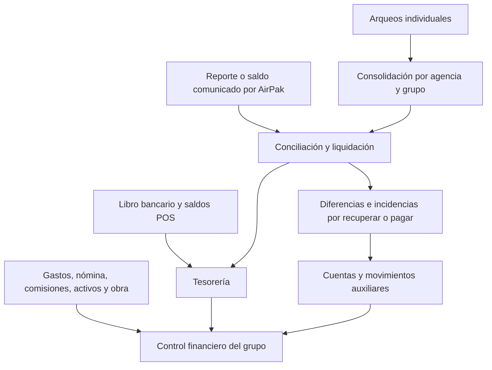

# Análisis funcional de Arqueo diario

Revisión del 4 de noviembre de 2026. Fuente: `C:\Users\jerlg\Downloads\Arqueo diario (1).xlsx`.

Este documento conserva el análisis de lectura del 4 de noviembre, previo a la autorización de implementación: las comparaciones de las secciones 23–25 describen el estado de esa fecha. La ampliación autorizada del 5 de noviembre está implementada y documentada en [API_ADMINISTRACION.md](API_ADMINISTRACION.md). El Excel original y las tablas protegidas permanecen sin modificaciones.

## 1. Alcance y evidencia revisada

El libro contiene **43 hojas**: una hoja de trabajo `00`, treinta hojas de cortes/archivos anteriores y doce auxiliares. Se examinaron sus valores, fórmulas, celdas combinadas, columnas ocultas, vínculos externos, comentarios e imágenes almacenadas. Hay **5904 celdas con fórmula**, **24 libros externos** y **259 fórmulas con vínculos externos activos** en `00`.

Los 24 libros son 23 archivos individuales de trabajadores y `Libro Diario AirPak.xlsm`. Las 259 fórmulas se distribuyen en 253 lecturas de trabajadores —11 indicadores por trabajador— y seis lecturas de saldos bancarios. Los vínculos históricos apuntan a una estructura de carpetas de Dropbox; no se intentó acceder a esas rutas ni actualizar las fuentes.

La revisión aritmética independiente de las 5904 fórmulas, usando los valores guardados y las cachés externas incluidas, coincidió con los resultados guardados dentro de una tolerancia de 0.000001. No se encontraron errores de celda guardados como `#REF!`, `#DIV/0!` u otros errores de Excel. Esto verifica la coherencia de las fórmulas con sus entradas guardadas; **no demuestra que las entradas estén actualizadas, que los rangos sean completos o que las clasificaciones sean correctas**. Los problemas de referencias y significado descritos más adelante existen aunque la fórmula calcule sin error.

No se recalculó con Excel ni se refrescaron vínculos. El archivo `.xlsx` no contiene proyecto VBA, conexiones de consulta, tablas dinámicas ni tablas estructuradas detectadas. No se observaron validaciones de datos. Las hojas históricas conservan principalmente valores: `00` tiene 457 fórmulas, mientras que cada corte anterior tiene entre 0 y 18. No hay una macro interna que permita atribuir con certeza el procedimiento de archivado; la estructura demuestra la conservación de valores, no quién ni cómo los pegó.

Se inspeccionaron las 29 imágenes del paquete: comprobantes de transferencias/retiros, confirmaciones de anulaciones y casos, contratos y calendarios de amortización. Algunas relaciones de imágenes no corresponden a objetos visibles actuales. El texto de esos documentos se interpreta como evidencia del negocio, no como instrucciones para ejecutar acciones. No se transcriben números completos de tarjetas o cuentas en este informe.

Identidad de la copia revisada: SHA-256 `8e2189a01a4251fa0ae1dd09ef879b3bba0daf4b726b93116a57ea372efeaf87`.

## 2. Qué sistema representa realmente

El archivo reúne varios procesos con periodos, responsables y reglas diferentes:

1. Consolidación diaria de las cajas individuales por sucursal y por grupo.
2. Conciliación de WU/Biller y de saldos de liquidación con la empresa matriz.
3. Tesorería: proyección, depósitos, anticipos, saldos arrastrados y bancos/POS.
4. Cuentas por cobrar y por pagar en NIO y USD, con cargos y abonos históricos.
5. Incidencias de servicios pendientes de anular, recuperar o reembolsar.
6. Gastos administrativos, operativos por agencia y personales.
7. Salarios, aguinaldo, deducciones, provisiones y anticipos a empleados.
8. Comisiones de AirPak, DHL, retiros y Servired, con naturalezas distintas.
9. Activos fijos, terrenos, edificios y equipo por ubicación.
10. Construcción, anticipos de mano de obra y recuperaciones por alquiler.
11. Préstamos, intereses, amortizaciones, cuotas, documentos y agenda de obligaciones.
12. Cuentas personales y fondos de terceros que pueden cambiar de naturaleza según su saldo.

El arqueo de un cajero proporciona parte de las entradas de este sistema. Una gran parte de las demás entradas procede de contratos, confirmaciones, bancos, clasificaciones administrativas y registros históricos independientes de la jornada de caja.



## 3. Inventario de hojas y responsabilidades

| Hoja o grupo | Función observada | Salidas principales |
| --- | --- | --- |
| `00` | Consolidación vinculada, comparación con matriz, proyección y resumen financiero. | `C41:N43`, `B47:C50`, `F46:F62`, `I46:I62`. |
| 30 hojas anteriores | Cortes de consolidación, depósitos y conciliación, principalmente conservados como valores. | Totales y anotaciones del corte. Las posiciones cambian entre hojas. |
| `Sob y Falt` | Sobrantes/faltantes por trabajador y fecha. | Totales por columna, fila 35; neto en `B36`. |
| `Gastos` | Administración, 14 agencias, salarios/aguinaldo, intereses y gastos personales. | `C4`, `P6`, `J47`, `C551`. |
| `Pendientes DOL` | CxC menos CxP en USD, además de flotantes e incidencias. | `B73`, inventario de anulaciones en `L67`. |
| `Pendientes COR` | CxC menos CxP en NIO; incorpora provisiones, anticipos, recargas y comisiones. | `B83`, anulaciones en `R96`, auxiliares inferiores/laterales. |
| `Comisiones` | Comisiones recibidas de AirPak y DHL; conversión auxiliar de DHL. | `C23`, `G18`, `C26`. |
| `Construcción` | Productos/costos, anticipos y pagos de mano de obra, devoluciones y alquileres cobrados. | `E544`, `I172`, `I174`. |
| `Activos Fijos` | Terrenos, edificios, cantidades/valor de equipo por agencia, moto y adquisiciones posteriores. | `B7`, `B16`, `M18`, `R3`, `D91`. |
| `C x C USD` | Auxiliares de AirPak, remodelaciones, personas, cargos bancarios y una cuenta histórica extensa. | Saldos que alimentan `Pendientes DOL`; incluye también un bloque expresado en C$. |
| `C x C CORD` | Auxiliares por deudor, abonos y saldos. | Entre otros, `P38` y `AB71` enlazados a pendientes. |
| `C x P USD` | Resumen de deuda, 30 espacios de auxiliares y agenda de compromisos. | `D35`; saldos de filas 119/140; fechas/observaciones. |
| `GONZALO` | Agenda de productos y tres cuentas de cuotas. | `E30`, `E49`, `E66`; no hay vínculo directo de salida hacia el consolidado. |
| `MAMA` | Fondo/cuenta corriente personal con entradas, salidas y cambios de signo. | `D88`, incorporado como obligación en `Pendientes COR!F14`. |

Las hojas anteriores son `03 NOV`, `02 NOV`, `31`, `30`, `29`, `28`, `27`, `26`, `24`, `23`, `22`, `21`, `20`, `19`, `17`, `16`, `15`, `14`, `13`, `12`, `10`, `09`, `08`, `07`, `07 viene de sept`, `06`, `05`, `03`, `02` y `01`. Sus nombres no son fechas completas y contienen un caso explícito de arrastre de septiembre. No todas las fechas del calendario tienen hoja; eso no demuestra por sí solo una omisión de operación.

## 4. Consolidación de trabajadores por subagencia

La hoja `00` distribuye 23 trabajadores con datos vinculados en 14 grupos de agencia:

| Subagencia del consolidado | Trabajadores vinculados en esta copia | Filas de datos / subtotal |
| --- | --- | --- |
| Río Blanco III | Eveling, Eunice, Marginne | 3:5 / 7. |
| Río Blanco IV | Paola | 8 / 9. |
| Siuna II | Heydi, Norma | 10:11 / 12. |
| La Dalia II | Ruth, Jorge, Jezer | 13:15 / 16. |
| Mulukukú III | Euridice | 17 / 18. |
| Mulukukú IV | Elmer | 19 / 20. |
| Siuna III | Carlos, Javiera, Ronald | 21:23 / 24. |
| Santa Rita I | Bexi | 25 / 26. |
| Coperna I | Yoharbin | 27 / 28. |
| San Pedro IV | Dina | 29 / 30. |
| Bonanza VI | Jenifer, Reyna | 31:32 / 33. |
| Matiguás III | Yuri | 34 / 35. |
| El Tuma I | Julissa | 36 / 37. |
| Bonanza VII | Yudith, Ingrid | 38:39 / 40. |

Los nombres reproducen la agrupación del archivo, no una consulta al catálogo real de agencias o trabajadores. `B6` contiene adicionalmente «PAOLA», pero sus importes están vacíos y el subtotal `C7:L7` suma solo 3:5. Por tanto no debe interpretarse como una segunda caja activa de Paola ni sumarse dos veces.

Las distintas hojas no usan exactamente la misma presentación. En `03 NOV`, por ejemplo, el total grupo está en la fila 40, y en `00` en la 41. El sistema deberá agrupar por IDs y fecha, no por posiciones rígidas ni por el nombre escrito de una persona. Las diferencias de plantilla o personal histórico deben conservarse como contexto, no corregirse asignando automáticamente la agencia actual del trabajador.

## 5. Los once indicadores que toma de cada trabajador

Ejemplo: la fila de Eveling `00!C3:M3` apunta al libro externo 1, hoja `00`. La misma distribución se repite para los otros 22 trabajadores.

| Columna en consolidado | Celda de trabajador | Cálculo observado en Eveling | Significado y unidad |
| --- | --- | --- | --- |
| C | `W15` | `=C17`. | Total contado NIO; incluye el principal de cheques contenido en C17. |
| D | `X15` | `=G17`. | Contado USD. |
| E | `X12` | `=(W9+X9)/X2`. | Utilidad de margen cambiario y cheques, expresada en USD equivalentes. |
| F | `W20` | Suma de USD comprados de los cuatro precios. | Volumen USD de compras; no NIO pagados. |
| G | `X20` | Suma de USD vendidos de los cuatro precios. | Volumen USD de ventas; no NIO recibidos. |
| H | `V24` | `=E4-H4`. | WU NIO: envíos menos pagos. |
| I | `V25` | `=H5-E5`. | WU USD: pagos menos envíos; signo opuesto al saldo físico por plataforma. |
| J | `W24` | `=E2`. | Total Biller NIO declarado. |
| K | `W25` | `=E3`. | Total Biller USD declarado, con su signo. |
| L | `W17` | Contado NIO menos esperado NIO. | Diferencia física individual NIO. |
| M | `X17` | Contado USD menos esperado USD. | Diferencia física individual USD. |

La etiqueta general «EFECTIVO» del consolidado no implica que todo C sea billetes: la fuente NIO incluye cheques. La API actual separa el detalle de efectivo y la custodia, y su final combinado permite reproducir esta columna. Sumar otra vez los cheques al final del arqueo duplicaría su principal.

La utilidad no es el Biller ni la suma de entradas de caja. En el formato de Eveling se obtiene, en NIO, de:

```text
Por compra: USD comprados × (tasa de referencia - precio de compra)
Por venta:  USD vendidos × (precio de venta - tasa de referencia)
Más:       ganancia de cheques incluida en W8/J13
Utilidad USD equivalente = total de esas ganancias NIO / tasa de referencia X2
```

La fuente puede utilizar hasta cuatro precios por tipo. El sistema ya guarda referencia, tasa aplicada, monto y ganancia de cheques, pero todavía no expone este indicador de utilidad consolidada. Si existen importes NIO aplicados distintos del producto, o ganancias de cheque en USD, deberá definirse su tratamiento sin perder el dato original. El cálculo histórico no debe cambiar por consultar la última cotización del proveedor.

La equivalencia de la estructura de Eveling se verificó contra el archivo individual disponible; sus valores actuales no necesariamente corresponden a la misma captura que las cachés externas de este libro. No se afirma haber conciliado en tiempo real todos los archivos de trabajadores.

## 6. Conciliación con la empresa matriz

La hoja mantiene tres comparaciones diferentes que deben representarse por separado:

1. **Diferencia física por trabajador:** columnas L/M, provenientes de su propio arqueo.
2. **Diferencia de totales de servicio:** suma del grupo frente a cuatro importes de referencia WU/Biller, separados por moneda.
3. **Diferencia de saldo de liquidación:** obligación o saldo comunicado por AirPak frente al saldo interno después de movimientos, arrastres, anticipos y depósitos.

En `00!H41:K41` se totalizan las declaraciones de los trabajadores. En `H42:K42` hay valores introducidos sin fórmula. `H43:K43` calcula **grupo menos referencia**. Según la función indicada por el usuario, esa referencia es el reporte de la matriz; el archivo no almacena aquí el reporte completo ni demuestra el método de copiado o la hora de corte.

Ejemplo de esta copia: `I41` tiene WU USD 59706.54 y `I42` aproximadamente 59707.04. `I43` muestra una diferencia de -0.50 USD. Esa diferencia no es un faltante físico de un cajero; debe investigarse respecto del reporte y del corte comparado.

En un sistema se requiere conservar reporte original, proveedor, agencia/código externo, moneda, servicio, periodo, hora de corte y versión, además de la correspondencia con los arqueos incluidos. Una conciliación de cuatro totales detecta diferencias agregadas, pero no identifica por sí sola la transacción causante.

### 6.1 Registro mensual de sobrantes y faltantes

`Sob y Falt` conserva fechas del 1 al 31 de octubre de 2026 en `A4:A34`, con parejas de columnas «SOBRANTE» y «FALTANTE» por trabajador. Existen columnas ocultas y espacios de personal histórico, por lo que la plantilla no coincide exactamente con los 23 archivos activos de `00`.

Los datos diarios están guardados como valores, sin enlaces a las hojas de consolidación. La fila 35 suma cada columna y `B36` obtiene la suma de sobrantes menos faltantes del conjunto: **9956.3484** en esta copia. El neto pasa a `Pendientes COR!F6`, bajo cuentas por pagar. Eso representa un criterio de reconocimiento de ese saldo en el control global, además de un registro de las diferencias diarias.

La hoja no identifica una moneda por cada dato ni una fórmula de conversión desde la diferencia NIO/USD del trabajador. El destino se trata como NIO, pero no debe asumirse cómo se obtuvo cada importe. El sistema debe conservar la diferencia original por moneda y, si se requiere un neto equivalente, su tasa y regla de reconocimiento. Tampoco se observa aquí una regla formal que convierta cada faltante en deuda del trabajador o descuento de nómina: son procesos distintos que necesitarían definición y aplicación explícitas.

## 7. Proyección diaria y equivalencias monetarias

Cada subtotal de agencia calcula una proyección equivalente NIO. Por ejemplo, `00!N7`:

```text
(WU USD - Biller USD) × tasa B1 - (WU NIO + Biller NIO)
```

No es la fórmula del saldo físico del cajero: combina el criterio de liquidación de la matriz y la inversión de signo del WU USD. La tasa de esta hoja, `B1 = 36.74` en la copia, es una referencia de conversión del control global; puede diferir de las tasas individuales.

`N41` suma proyecciones de agencia. El bloque `A45:C50` calcula:

- Movimientos del día en NIO (`B47 = N41`) y USD equivalente (`C47 = B47/B1`).
- Arrastre anterior declarado en USD (`C48`) y convertido a NIO (`B48 = C48*B1`).
- Anticipo más comisión declarado en USD (`C49`) y equivalente NIO (`B49`).
- Proyección neta: `B50 = B47-B48-B49` y `C50 = C47-C48-C49`.

El título «NEGATIVOS DEL DÍA ANTERIOR» representa un saldo de liquidación arrastrado; no es el saldo inicial físico del cajero. En esta copia `00!C48` coincide, con el signo invertido, con el pendiente de `03 NOV!C71`, pero está guardado como valor: no hay una fórmula de enlace que pruebe o asegure automáticamente esa continuidad.

En históricos aparece también «CUADRANTE DIFERENCIA», con entradas manuales en columnas Q/R por trabajador y tipo compra/venta. Se observaron importes en hojas `12`, `10`, `09`, `06` y `05`. No se encontró una fórmula que los calcule ni una vinculación automática a su operación original. Representa una revisión/ajuste auxiliar que necesita explicación de su base, unidad y relación con las diferencias por tasa o neteo.

## 8. Depósitos, anticipos y cierre de liquidación

En 26 cortes históricos se conservan filas de «Total depósitos», «Pendiente», «Saldo según AirPak», «Saldo según mis datos a ese momento» y «Faltante mío». Algunas hojas añaden depósitos anticipados y una comparación del saldo final comunicado.

Ejemplo de `03 NOV`:

| Resultado | Valor aproximado NIO | Evidencia |
| --- | ---: | --- |
| Proyección neta del día | -1990587.5716 | `B49`. |
| Total de depósitos | 1721311.96 | `B70 = SUM(B50:B69)`. |
| Pendiente tras depósitos | -269275.6116 | `B71 = B49+B70`. |
| Saldo comunicado por AirPak | 1958821.26 | `B73`, literal. |
| Saldo interno al mismo momento declarado | 1958803.994 | `B74`, literal. |
| Diferencia entre ambos saldos | 17.266 | `B75 = B73-B74`. |

Entre las filas 60:69 hay depósitos USD y conversión a NIO; las filas anteriores incluyen depósitos NIO directamente. Sin banco, referencia, fecha/hora y estado explícitos en cada fila no se puede establecer automáticamente si un depósito está acreditado, pendiente, anticipado o repetido con otra lista.

Se observan traspasos de diferencias a cuentas auxiliares. `28!A78` anota un faltante de C$5679.32 o USD154.58 que pasa a CxC AirPak; `C x C USD!C52` conserva USD154.58138268916255 con referencia al movimiento del 28/10. Este saldo continúa en `D59`, pasa a `Pendientes DOL!B5` y termina influyendo en el resumen global. Por tanto existe un proceso de **reconocer, trasladar y recuperar diferencias**, no solo de mostrarlas en pantalla.

En `01!A76:C83` también hay una explicación de saldo a favor o por pagar tras depósitos y comunicación de saldo. Los signos de las diferentes vistas deben normalizarse por naturaleza de cuenta; no convertir automáticamente todo valor negativo en error o toda diferencia en ingreso.

## 9. Saldos bancarios y canales POS

El resumen mantiene saldos en NIO y USD para Bancentro, Ficohsa, BAC, Banpro, Lafise POS y Banpro POS. Seis celdas se extraen del libro bancario adicional:

| Destino en `00` | Fuente en `Libro Diario AirPak.xlsm`, hoja `00` |
| --- | --- |
| `F48`, `I48` | `C72`, `C78`: Bancentro NIO/USD. |
| `F52`, `I52` | `C86`, `C92`: Lafise POS NIO/USD. |
| `F53`, `I53` | `C100`, `C106`: Banpro POS NIO/USD. |

Ficohsa, BAC y Banpro se presentan con valores o fórmulas que son constantes, como `=5250.8`; eso no es un vínculo actualizado al banco. Estas celdas representan **saldos de cuentas/canales**, no un listado de remesas bancarias de cajeros.

El backend actual puede registrar una entrega/retiro físico o una remesa, pero no mantiene un libro de cuentas bancarias con saldo inicial, movimientos, extractos, acreditación y conciliación. El siguiente Excel bancario será necesario para definir ese proceso completo. No es correcto sumar simultáneamente el saldo bancario y cada remesa como si ambos fueran activos adicionales distintos.

## 10. Cuentas por cobrar y pagar: saldos netos

`Pendientes COR` y `Pendientes DOL` resumen activos y obligaciones de distinta procedencia:

| Moneda | CxC resumidas | CxP resumidas | Pendiente neto |
| --- | ---: | ---: | ---: |
| NIO | `B82`: 1179856.70 | `F47`: 863669.873466… | `B83 = B82-F47`: 316186.826533… |
| USD | `B72`: 133854.226341… | `F42`: 73820.955 | `B73 = B72-F42`: 60033.271341… |

Los importes incluyen préstamos, depósitos de garantía, pagos pendientes de clasificar, gastos personales anticipados, devoluciones, alquileres, servicios, diferencias y otros conceptos. No todos los renglones son facturas comerciales ni todas las obligaciones son préstamos bancarios.

Se emplean dos modos de registro:

- Una fila resume una cuenta con saldo literal o una expresión larga de sumas/restas, y la historia se escribe dentro del texto.
- Un auxiliar lleva fecha, entrada, salida, saldo y concepto por movimiento; una celda del saldo se enlaza al resumen.

Ambos requieren representar cuenta, titular/contraparte, naturaleza, moneda, cargos, abonos, saldo y documentación. Un importe por clasificar debe quedar pendiente de clasificación; no convertirse inmediatamente en gasto operativo.

La hoja titulada USD incluye importes con más de dos decimales y un bloque explícitamente formateado en córdobas (`C x C USD!X56:X69`). La moneda debe ser atributo del registro y no deducirse solo del nombre de la hoja.

## 11. Incidencias, anulaciones y reembolsos de servicios

Los bloques «Flotantes pendientes de anulación AirPak» conservan operador, fecha, monto y detalle, por moneda. En NIO también existe un bloque independiente «pendientes de cobro a favor de AirPak».

Los registros detallados incluyen fecha, Biller, contrato/cliente/consejera/cuenta, agencia, ticket, caso y comentarios. Las imágenes contienen confirmaciones de casos, autorizaciones de anulación, descripciones de errores y comprobantes. Se observan situaciones como monto/cuenta erróneos, depósito duplicado, retiro no registrado en APOS, póliza no generada, DHL pendiente de anular y anulación ya confirmada sin reembolso.

Es importante distinguir los estados del proceso:

```text
Incidencia identificada
Solicitud de anulación o recuperación
Confirmación de la entidad/proveedor
Reembolso o cargo efectivamente aplicado
Saldo residual conciliado
```

La separación se deduce de registros y evidencias; no es una máquina de estados formal ya implementada en Excel. **Confirmar una anulación no equivale a haber recibido el dinero**. Se ven reembolsos como importes negativos dentro de las listas; deben aplicarse a casos concretos y admitir recuperaciones parciales o agrupadas, en lugar de borrar los casos originales.

`Pendientes COR!R96` totaliza 97900.08 NIO y alimenta la cuenta resumida `B5`. `Pendientes DOL!L67` totaliza 4544.92 USD y alimenta `B16`. Sus detalles y el resumen representan el mismo saldo: no deben volver a sumarse como activos independientes.

Las operaciones de caja actualmente guardan totales Biller y algunos datos DHL, pero no tienen el detalle de una transacción Biller, ticket, caso, devolución a cliente ni la aplicación de un reembolso del proveedor. Para conciliar a nivel de transacción hará falta incorporar esa granularidad mediante captura o importación autorizada.

## 12. Cuentas auxiliares por persona o concepto

`C x C USD` mantiene cuentas de AirPak, remodelaciones de locales, personas y comisiones bancarias por recuperar. El auxiliar AirPak recoge diferencias de liquidación y ajustes por tasa/neteo. Sus saldos pueden ser negativos aunque estén bajo el rótulo «por cobrar»; el rótulo no resuelve por sí mismo quién debe a quién.

`C x C CORD` conserva cargos, abonos y saldos por deudor. Hay columnas ocultas con cuentas y fórmulas. Una cuenta de cobro puede tener pagos en USD convertidos a NIO con una tasa anotada o incorporada en el cálculo; el movimiento debería conservar moneda e importe originales, tasa y aplicación en la moneda de la cuenta.

Las comisiones de retiro Lafise se registran en `C x C USD!AA:AE`: fecha de débito, comisión, monto retirado, fecha del retiro y agencia. Su total `AB161 = 747.83` pasa a `Pendientes DOL!B7`. En este libro se tratan como un saldo por recuperar, no se puede convertir automáticamente toda comisión bancaria en gasto definitivo. El débito y el retiro tienen fechas distintas en algunos registros: ambas son relevantes para conciliación.

Hay una cuenta personal histórica extensa en `AH:AL`, con movimientos desde 2018 y saldo final en `AK366`, y un auxiliar inferior de otra persona en `U53:Y69` con importes formateados en C$. No se deben fusionar por nombre ni incluir en USD sin comprobar su moneda y propósito.

## 13. Gastos administrativos, operativos y personales

`Gastos!C4` totaliza quince bloques: administración y catorce agencias. La fila de total de cada bloque aparece separada por 34 filas. En esta copia el total es **716030.358 NIO**, presentado con menos decimales según formato.

La clasificación contempla salarios, alquiler, papelería, limpieza, agua, luz, basura, matrícula/impuesto municipal, internet, celular, recargas, equipos, mantenimiento de equipo y local, transporte, viáticos, combustible, mantenimiento vehicular, otros gastos, gastos financieros, depreciación, INSS, Inatec e impuestos DGI. Que exista una categoría no significa que tenga datos o cálculo automático: la depreciación, por ejemplo, aparece como concepto de gasto, pero no hay un calendario de depreciación en el libro.

Hay repartición entre administración y sucursales, por lo que el sistema necesita centro de costo y periodo además de una categoría. Muchas celdas acumulan diversos pagos mediante expresiones como `60+80+60...` y explican las fechas en texto; no conservan una fila con identidad por comprobante. Una importación deberá preservar ese resumen como tal si no puede desglosarse con certeza.

El bloque `B495:D551` registra desembolsos personales. Su total `C551 = 138139.736` alimenta `C9`, bajo la etiqueta «Salario Gerencia», y por esa vía integra el gasto administrativo y el total del grupo. Incluye conceptos personales diferentes de un salario fijo. Esto es un criterio de presentación del archivo; para el sistema se deben distinguir remuneración, retiro del propietario, gasto personal pagado por el negocio y cuenta por cobrar, según la clasificación que se apruebe.

`Gastos!P6` calcula «Salarios Totales» con 357376.091 NIO. No es una nómina neta pagada independiente: agrega los renglones de salario de los bloques, algunos con provisión de aguinaldo, e incluye el renglón de gerencia descrito. No debe pagarse de nuevo a partir de ese total.

En fechas y notas aparecen gastos de octubre y noviembre y conceptos trasladados desde septiembre. No hay una fecha maestra de periodo para toda la hoja. El registro debería distinguir fecha del pago, fecha de origen, periodo al que se asigna y eventual reclasificación.

## 14. Nómina, anticipos y provisiones laborales

El libro cubre varios componentes que no equivalen entre sí:

| Proceso | Evidencia | Comportamiento |
| --- | --- | --- |
| Salarios por trabajador | Bloques F:G de `Gastos`. | Montos quincenales sumados y fechas en descripción. |
| Aguinaldo del periodo | Por ejemplo `Gastos!G35 = G29/12`. | Provisión calculada a partir del salario capturado; se suma al renglón salarial del gasto. |
| Reserva acumulada de aguinaldo | `Pendientes COR!D57:O91`. | Trabajadores por filas y meses/actual por columnas; `E91` agrega las provisiones y `F7` las reconoce en CxP. |
| Deducción laboral | `Pendientes COR!A137:F169`. | Matriz por trabajador y quincena, utilizada para saldos de INSS por pagar. |
| Provisión patronal e Inatec | `Pendientes COR!A206:C240`. | Importes por trabajador, totales de ambos conceptos y su suma. |
| Indemnización/vacaciones | `Pendientes COR!F13 = A203`. | Saldo/reserva reconocido entre obligaciones; el rótulo menciona febrero. |
| Anticipos a empleados | `Pendientes COR!B28 = B135`. | Lista de importes pendientes que se incorpora a CxC; total 13330.74 NIO. |

Las cifras y reglas se describen como están en el archivo; no se han verificado como reglas legales o tasas vigentes. No hay un motor completo de nómina que determine automáticamente devengado, deducciones, neto y cancelación por cada empleado y periodo.

Deben mantenerse separados gasto devengado, provisión, descuento al empleado, obligación con una entidad y pago efectivo. Un salario pagado desde caja es una salida financiera; clasificar esa salida en nómina no genera una segunda salida. Un anticipo posteriormente descontado del salario aplica contra la cuenta por cobrar, sin representar necesariamente otra entrada de efectivo.

Los trabajadores pueden ser los ya existentes en la tabla protegida, referenciados desde tablas nuevas de periodos, conceptos y aplicaciones. No es necesario alterar sus migraciones para modelar estos registros auxiliares.

## 15. Recargas y comisión Servired

### 15.1 Saldos de recargas por agencia

`Pendientes COR` lleva nueve auxiliares de recargas, con encabezados en filas 99, 119, 138, 165, 185, 204, 223, 242 y 261. Sus saldos finales se incorporan como cuentas por cobrar/saldos disponibles en `B11:B19`.

Los auxiliares conservan fecha, entrada, salida, saldo y concepto, y algunas notas explican el saldo de POS/Claro/Tigo. En la orientación utilizada, las cargas/salidas pueden incrementar el saldo por recuperar y los cobros/entradas reducirlo. No se puede aplicar la fórmula de saldo de efectivo sin respetar esa perspectiva.

Es un control de fondos adelantados o saldos por canal/agencia, no solo un conteo de servicios. Necesita agencia, proveedor/canal, saldo inicial, recargas, consumos/cobros y conciliación con el canal, vinculados al movimiento financiero cuando exista.

### 15.2 Comisión Servired por operador y día

`Pendientes COR!AK53:BD71` mantiene importes por operador y columnas diarias. El total `BA71` suma los montos del tramo `AL:AZ` —fechas 17 al 31 de octubre— y `F19` lo lleva a CxP bajo «COMISION SERVIRED». En la copia suma 18240 NIO.

No se observan aquí cantidades de transacciones y tarifa por unidad que permitan deducir automáticamente el monto. Tampoco basta un conteo de servicios del cajero para sustituirlo. Existen cantidades adicionales en `BB:BD`, sin encabezados de fecha visibles en la fila 53 y fuera del total `BA71`; pueden ser del periodo siguiente. Debe confirmarse su corte antes de considerarlas omitidas o sumarlas al mismo periodo.

## 16. Comisiones AirPak y DHL

`Comisiones` lleva dos registros:

- AirPak: fecha, detalle y monto en `A:C`. En esta copia hay pagos de octubre identificados como comisiones de septiembre por Biller y WU; `C23 = 284354.49`.
- DHL: fecha, detalle, monto en NIO, equivalente USD y tasa por fila en `E:I`. Los detalles incluyen intervalos semanales; `G18 = 17030.29`. La conversión es `H = G/I`, con tasa 36.6243 en las filas disponibles.

`C26 = C23+G18` totaliza **301384.78 NIO** y se utiliza como deducción en `00!F62`. Ese tratamiento es el observado en el control global y no autoriza por sí solo a clasificarlo como pasivo, gasto o ingreso del día del cajero.

Existe diferencia entre servicio realizado, comisión devengada por un periodo y comisión pagada por la matriz. El módulo DHL anterior no tenía tarifas ni cobros en los listados de envíos. Este archivo introduce liquidaciones de comisión por periodos, pero no una tarifa por guía ni una correspondencia individual con cada envío.

La ampliación necesita proveedor, servicio, periodo generado, fecha de liquidación/cobro, moneda original, tasa aplicada, monto y aplicaciones al banco/caja. Las comisiones de retiros por recuperar y la comisión Servired por pagar son otros procesos, aunque compartan la palabra «comisión».

## 17. Activos fijos y distribución por agencia

La hoja `Activos Fijos` registra:

1. Terrenos, fecha, monto y descripción: `B7 = 5650966 NIO`.
2. Edificios: `B16 = 3314110 NIO`.
3. Mobiliario y equipo por agencia: cantidades, precio y total por tipo de activo.
4. Resumen por categoría de equipo: `K2:M18`.
5. Una moto valorada desde un importe USD y tasa histórica: `R3 = 532221.58 NIO`.
6. Adquisiciones posteriores con fecha, agencia, detalle y precio: `A80:E91`; total `D91 = 52614.98 NIO`.

Las categorías de equipo incluyen muebles de caja, computadoras, impresoras, lectores de huella, cámaras, sillas, escritorios, baterías de respaldo, estabilizadores, cajas de seguridad, adaptadores y abanicos. Los valores son principalmente cantidad por precio, con conversiones a tasas históricas en terrenos/edificios/moto.

El resumen global incorpora `M18+R3` en mobiliario/equipos. La hoja mantiene localización y valor, pero no identificación individual/serie, custodio, fecha de puesta en uso, vida útil, depreciación acumulada, baja ni traslado documentado. Las adquisiciones posteriores solo agregan valor por una lista general; no actualizan todas las cantidades por tipo.

Una futura compra de un activo puede producir una salida de caja y un alta de activo. Son dos efectos del mismo hecho, unidos por su origen, no dos pagos. Lo mismo aplica a una compra financiada: activo, obligación y pagos posteriores deben mantenerse vinculados.

## 18. Construcción, anticipos y alquileres recuperados

`Construcción` tiene un registro de fecha/producto/cantidad/precio/total en `A:E`, con importes que llegan hasta la fila 540. En paralelo `H:J` registra fecha, monto adelantado y detalle de mano de obra. Algunos adelantos describen teléfonos, moto u otras entregas a una persona, por lo que no todos equivalen a un pago de mano de obra exclusivamente en efectivo.

El bloque de materiales también incluye servicios y mano de obra. Desde la fila 349 aparecen importes negativos por devolución/sobrante y, posteriormente, cobros de alquiler de módulos. Por eso:

| Concepto reconstruido | NIO aproximados |
| --- | ---: |
| Importes positivos del registro `E3:E543` | 3907482.77 |
| Importes negativos del mismo registro, 17 filas | -473002.00 |
| Neto guardado `E544` | 3434480.77 |
| Adelantos/pagos del bloque paralelo `I172` | 1371424.00 |
| Total de control `I174 = E544+I172` | 4805904.77 |

El total usado como «CONSTRUCCIÓN» en el resumen es una **inversión neta después de recuperaciones registradas**. No es el costo bruto de construcción ni una depreciación del edificio. Hay cobros identificados como alquiler de módulos que reducen el acumulado.

Para representarlo con claridad hacen falta proyecto/obra, proveedor o contratista, partida, cantidades/precios, anticipo, aplicación del anticipo, pago/cancelación, devolución, ingreso de alquiler y moneda/tasa. El costo bruto, la recuperación y el neto deben poder mostrarse por separado. No se puede determinar solo con estas celdas si algún gasto de mano de obra de ambos bloques representa el mismo pago; deberán conservarse los orígenes para verificarlo antes de importar.

## 19. Préstamos, tarjetas, cuotas y agenda

`C x P USD!A1:I35` resume entidad/contraparte, referencia del producto, saldo, fecha de emisión, vencimiento, estado, días restantes y observaciones. Hay 27 saldos no cero en `D2:D34`. El total es `D35 = -296831.146 USD`, con el signo de las obligaciones en sus auxiliares; `00!I56` invierte ese signo para restarlo como importe positivo.

El bloque horizontal de auxiliares tiene treinta espacios desde J hasta GH. La estructura es fecha, entrada, salida, saldo y concepto, con saldos finales en la fila 119, salvo una cuenta que continúa a 140. Existen espacios vacíos/cero además de cuentas activas. **Treinta auxiliares de plantilla no significa treinta préstamos vigentes.**

Se observan préstamos bancarios, personales, financiamientos de tarjeta y compras por cuotas. La fórmula usual es saldo anterior menos nuevas entradas de préstamo más abonos a principal. Hay observaciones con cuota total y, por separado, principal/interés; las imágenes de planes añaden comisión, seguro y fechas de pago. También hay capitalización de intereses: `K128` y `K131`, por ejemplo, incrementan principal en el auxiliar de la cuenta de la izquierda.

Los planes adjuntos demuestran modalidades diferentes: cuotas mensuales, cuotas decrecientes, seguros/comisiones, tasa variable y un préstamo con dos vencimientos anuales. El Excel no genera esos calendarios mediante un motor de amortización: casi todas las fórmulas son operaciones aritméticas y SUM, con dos cálculos porcentuales simples de interés. Las tasas a menudo están en el título o texto, no en un campo único validado.

Desde `A36:I54` también se conserva una agenda mensual: novedades INSS, solicitud de papelería/pago contable, comisiones de retiro, alquileres, tarjetas y pagos de INSS/Inatec/DGI. Los vencimientos son textos como «1 - 3 / MES» o «27/MES»; estado y días restantes no constituyen alertas automáticas verificadas.

El bloque `GONZALO` mantiene otra agenda y tres auxiliares de cuotas, además de reutilizar imágenes de documentos financieros. Sus importes y notas mezclan referencias C$/USD y no existe una fórmula de salida que los incorpore directamente al total global. Se necesita confirmar qué cuentas son informativas, cuáles ya están recogidas en otro auxiliar y en qué moneda se expresan; no sumar todo por estar en una hoja separada.

La futura estructura deberá conservar el contrato, moneda, principal, desembolsos, tasas/versiones, calendario, cuota, principal/interés/seguro/comisión, vencimiento y pago aplicado. Un interés capitalizado es un ajuste de deuda que puede no producir entrada de caja. El monto de la cuota no debe reducir íntegramente el principal si contiene interés y otros conceptos.

## 20. Fondos personales y de terceros

`MAMA` lleva una cuenta corriente con fecha, entradas, salidas, saldo y detalle. Empieza con un fondo positivo, registra gastos, cruza a negativo, recibe cancelaciones/aportes y vuelve a positivo. Algunas notas identifican la caja física de donde salió o entró el dinero.

Un saldo positivo puede representar fondos de esa persona mantenidos por el negocio y, por ello, una obligación; un saldo negativo puede representar un adelanto por cobrar. Esto debe configurarse por naturaleza de la cuenta, no por el nombre personal. En esta copia el saldo de `D88`, **25910 NIO**, está reconocido en `Pendientes COR!F14` como cuenta por pagar. La referencia a `MAMA!I65` en otra posición está vacía y da cero, pero no implica que el fondo total se haya omitido: sí existe la referencia válida a D88.

Los movimientos personales y empresariales aparecen relacionados en varios auxiliares. El sistema necesita titular/beneficiario, finalidad, clasificación y aplicación del movimiento original. No debe identificarse automáticamente toda contraparte con un cliente de remesas ni modificar el maestro protegido de clientes para representar estas cuentas.

## 21. Indicadores financieros globales

En `00!E45:I62` se prepara un control financiero del conjunto. La fórmula observada en NIO agrega contado del grupo, pendientes NIO netos, saldos bancarios/POS, gastos, edificio, terrenos, mobiliario/moto y construcción; después resta AirPak NIO y comisiones. En USD agrega contado, pendientes USD, saldos bancarios/POS y el saldo AirPak ajustado; luego combina el neto NIO convertido y descuenta deuda USD y Biller USD.

Las fórmulas centrales son:

```text
F59 = SUM(F46:F58)
F60 = H41 + J41                       [WU NIO + Biller NIO]
F61 = Comisiones!C26
F62 = F59 - F60 - F61

I54 = I41 - C48 - C49                [WU USD ajustado]
I55 = SUM(I46:I54)
I56 = -(C x P USD!D35)
I57 = K41                           [Biller USD]
I58 = I55 + F62/B1 - I56 - I57       [GRAN TOTAL USD]

I62 = (C41+F48)/B1 + (D41+I48) + C50 [CAPITAL DE TRABAJO según este archivo]
```

Resultados guardados en la copia: `I58 = 275793.137854… USD` e `I62 = 43111.239433… USD`. Son resultados del método del archivo, no una certificación de patrimonio, efectivo disponible o utilidad.

Se agregan gastos ya realizados, activos a valor registrado, obra neta de recuperaciones y saldos de diferente naturaleza. Atendiendo a la indicación posterior del usuario de inferir el significado de la fórmula, «GRAN TOTAL USD» se interpreta funcionalmente como **control de capital del grupo ajustado en USD**: reúne fondos, activos y cuentas netas, reintegra gastos y descuenta obligaciones de servicios, deuda y comisiones. Esa fórmula permite identificar su función sin atribuirle una certificación contable de patrimonio o utilidad. El «capital de trabajo» calculado considera expresamente caja y Bancentro, más la proyección; **no incluye todos los bancos listados** ni coincide automáticamente con una definición contable general de capital de trabajo.

Existe además `I60 = 161.53`, rotulado «EXTRA», sin inclusión en las fórmulas centrales anteriores. Debe aclararse su función antes de incluirlo en un reporte nuevo.

Un reporte histórico fiable debe conservar qué saldos, movimientos, tasas, clasificaciones y versiones se usaron al producir cada corte. Sumar balances diarios de bancos, préstamos o activos como si fueran ingresos del periodo duplicaría saldos; para saldos se utiliza un corte, y para flujos se agregan las operaciones del periodo.

## 22. Problemas y condiciones que afectan la comparación

### 22.1 Referencias y agregaciones comprobables

| Hallazgo | Evidencia | Consecuencia |
| --- | --- | --- |
| Diferencia USD global calculada desde celdas vacías. | `00!M41 = SUM(M28,M26,M24,M20,M16,M12,M7)`. Esas celdas de subtotal M están vacías, y faltan además otras agencias en la enumeración. Los 23 renglones individuales suman aproximadamente 0.35 USD; M41 guarda 0. | Oculta diferencias físicas USD; el cálculo no puede sustituirse por el cero guardado. |
| Cuenta por cobrar enlazada a un corte anterior. | `Pendientes COR!B8` usa `C x C CORD!P38 = 36145.95`. El auxiliar continúa con siete abonos de 1832 y termina en `P47 = 23321.95`. | Para un saldo actual se están dejando fuera 12824 NIO de abonos posteriores. Confirmar si había un motivo explícito para congelar ese corte antes de migrarlo. |
| Cantidades de activos incompletas respecto del valor agregado. | `Activos Fijos!L3` suma 23 computadoras sin B63; B63 registra 2 adicionales en Bonanza VII. El valor M3 sí incluye D63. | El resumen muestra 23 unidades mientras el detalle de los bloques suma 25. Hay la misma diferencia de alcance en otras categorías, como muebles. |
| Etiquetas de periodo de INSS no coinciden con sus fuentes. | `Pendientes COR!G10` dice octubre, pero F10 suma B168+C168 y sus encabezados B137/C137 dicen septiembre. G11 dice noviembre, pero F11 usa E168/F168 cuyos encabezados dicen octubre. | No se puede determinar solo por el rótulo a qué mes pertenece la deuda. Debe establecerse el periodo real del dato. |

Estos resultados no modifican automáticamente los importes del archivo. Se documentan para que la futura carga no consolide un error como regla de negocio.

### 22.2 Diferencias de significado y controles ausentes

| Condición observada | Tratamiento necesario en el sistema |
| --- | --- |
| `00` y las hojas de día no tienen fecha operativa completa en una celda maestra. | Guardar fecha, zona/corte y periodo explícitos. No inferirlos del nombre de pestaña o de la hora de modificación. |
| Se lee siempre la pestaña `00` de cada trabajador. | Comprobar fecha y estado de cada arqueo, cobertura de personas y agencia del día. Un enlace existente no prueba que sea el mismo corte. |
| Valores de matriz, depósitos y saldos comunicados están pegados o escritos. | Guardar fuente, referencia, fecha/hora de corte, importación y versión; distinguir pendiente, acreditado y anticipado. |
| La mayor parte de los históricos está congelada como valores. | Conservar versiones/snapshots y sus fuentes; una suma por fecha no reconstruye necesariamente qué se sabía al cerrar. |
| La hoja USD contiene un auxiliar C$; algunas cuotas tienen formato USD y texto C$. | Moneda explícita por cuenta y movimiento, con tasa aplicada cuando hay conversión. |
| «Construcción» descuenta alquileres y otras recuperaciones. | Separar costo bruto, devolución, ingreso y recuperación; preservar también el indicador neto si se desea reproducirlo. |
| «Salario Gerencia» recoge un bloque de gastos personales. | Conservar la presentación original y permitir una clasificación administrativa aprobada, sin confundirlo con nómina fija. |
| Los textos de las tasas no siempre coinciden. | Por ejemplo el resumen de una cuenta de Martha indica 2.5% y el auxiliar `CR36` indica 2%. Usar contrato/regla confirmada, no seleccionar una etiqueta arbitrariamente. |
| Hay una fila de observación por cantidad acumulada con varias fechas y pagos. | No inventar un desglose transaccional que el documento no permite verificar; conservar el saldo inicial y la descripción original si hace falta. |
| `C x P USD!D35 = SUM(D2:E34)` incluye también la columna «Fecha de emisión». | Hoy E está vacía en ese resumen, por lo que no altera el total. Una fecha numérica futura podría aumentar indebidamente la deuda; la nueva agregación debe sumar solo importes. |
| La matriz de comisión Servired tiene valores a la derecha de su total sin fechas visibles. | Definir fecha/periodo de esas columnas antes de incluirlas; no mezclar quincenas por posición. |
| «EXTRA» no interviene en los indicadores principales. | Mantenerlo separado hasta conocer su naturaleza y relación con otros saldos. |
| No hay vínculo automático entre cada auxiliar y el movimiento original de caja/banco. | Registrar origen y aplicaciones para detectar faltantes y duplicados sin generar otra salida o entrada. |
| No hay reglas visibles de aprobación ni evidencia de que un bloque esté completamente revisado. | Registrar estados de preparación, revisión y cierre, responsable, fecha y motivo de ajustes. |

Las diferencias de coma flotante del orden de 0.000000000001 son distintas de los faltantes reales. La revisión debe usar decimales y una tolerancia de presentación aprobada, conservando el importe original y sin compensar automáticamente diferencias entre monedas.

## 23. Comparativa con el proyecto actual

La base actual cubre captura y cierre individual. No hay todavía consolidación madre ni un libro contable de saldos auxiliares. Se revisaron las migraciones y los servicios de caja; `2026_03_05_232900_arqueo_madre.php` y `2026_03_05_232917_detalle_arqueo_madre.php` permanecen sin definición de tablas.

| Operación del Excel | Cobertura actual | Ampliación que se desprende del análisis |
| --- | --- | --- |
| Apertura, conteo y cierre individual | Implementada en arqueo, detalle y custodias. | Consumir esos resultados identificando fecha/estado; no recapturar el cierre en otra tabla como operación financiera. |
| Contado y diferencias individuales por moneda | Implementados y separados por moneda. | Agregación por agencia/grupo y control de cobertura de arqueos. |
| WU NIO/USD y Biller para matriz | Están los seis totales de plataforma. | Vista derivada con signos de matriz y persistencia del corte/versiones de consolidación. |
| Volúmenes de compra/venta USD | Se pueden obtener de operaciones de cambio. | Agregación por tipo, agencia, periodo y estado. |
| Utilidad cambiaria/cheques USD equivalente | Existen sus datos base principales. | Cálculo de utilidad y criterio de conversión/importe aplicado, sin recalcular historia con una tasa nueva. |
| Cuatro totales del reporte de matriz | No existe recurso específico. | Reportes de proveedor, conceptos, importes, mapeo, versiones y conciliaciones. |
| Diferencia de liquidación, arrastre y proyección | No equivale al saldo físico del arqueo. | Cuenta de liquidación y proyecciones con anticipos, depósitos, ajustes y arrastre propio. |
| Libro/saldos bancarios y POS | Se capturan movimientos bancarios/remesas, no saldos de cuenta conciliados. | Cuentas y canales financieros, libro de movimientos, extractos, aplicaciones y conciliación bancaria. |
| CxC/CxP por contraparte y contrato | No hay auxiliares de cuentas. | Cuentas, cargos, abonos, saldos iniciales, aplicaciones y moneda explícita. |
| Incidencias Biller/DHL y reembolsos | Totales Biller y seguimiento DHL; sin casos/aplicaciones financieras. | Incidencias, operación origen, caso/ticket, estados independientes y documentos. |
| Gastos diarios simples | `entradas_y_salidas` admite categoría gasto y concepto. | Clasificación por centro de costo, titular y periodo; detalle de comprobantes y aplicaciones. |
| Gastos personales, préstamos y retiros de propietario | Se puede preservar un movimiento de caja declarado, sin su cuenta auxiliar. | Titular/naturaleza y clasificación enlazada, sin volver a mover el efectivo. |
| Salarios, anticipos y provisiones | No hay liquidaciones ni auxiliares laborales. | Periodos/conceptos, devengado, descuentos, provisiones y pagos aplicados. |
| Comisiones de matriz/DHL y por pagar a operadores | Los conteos de servicios son cantidades independientes. | Liquidación monetaria por proveedor/servicio/beneficiario y periodo. |
| Recargas por agencia/canal | Puede existir la declaración de caja, no su saldo auxiliar. | Cuenta de fondos/saldo por canal y sus aplicaciones. |
| Activos fijos | No hay registro patrimonial. | Activos, adquisiciones, ubicación/custodia y eventos de traslado/baja; depreciación solo con reglas aprobadas. |
| Construcción y recuperaciones | No hay proyectos, partidas o anticipos de contratista. | Proyecto, costos, pagos, anticipos, recuperaciones y relación con activos/deuda. |
| Préstamos/cuotas/intereses | No hay contratos ni calendarios/aplicación de pagos. | Obligaciones, cronogramas, componentes de cuota y ajustes sin efectivo. |
| Historia de cambios | Existe `historial_caja` para escrituras del módulo. | Auditoría de los nuevos procesos y versiones de reporte, conservando el origen individual. |

Esta comparación no implica que las rutas documentadas para C# ya expongan cuentas por cobrar/pagar o consolidaciones. Esas API todavía no existen. La documentación de integración actual sigue describiendo exclusivamente lo implementado.

## 24. Datos y relaciones que hacen falta

Los siguientes son grupos conceptuales para diseñar después de validar las reglas. No son nombres de migración definitivos ni una autorización de implementación.

| Grupo | Datos mínimos que debe poder conservar |
| --- | --- |
| Consolidación de caja | Fecha/corte, agencia o grupo, responsable, estado, versión, tasa y arqueos incluidos con su estado al corte. |
| Detalle de consolidación | IDs de arqueo/usuario/agencia históricos, contado/esperado/diferencias por moneda, volúmenes, utilidad y seis totales originales. |
| Reporte de la matriz | Proveedor, archivo/origen, hash o identificación, fecha/hora/periodo, códigos externos, conceptos, moneda, importe y versión. |
| Conciliación | Criterio/regla, importes internos/externos, diferencia, estado, responsable y explicación. Aplicaciones a ajustes o cuentas. |
| Cuenta de liquidación | Proveedor, moneda, saldo de apertura, obligaciones diarias, depósitos acreditados/anticipados, comisiones y saldo al corte. |
| Cuenta financiera/bancaria/POS | Entidad/canal, moneda, identificación, titular, saldo inicial, movimientos y referencias de acreditación. |
| Cuenta auxiliar CxC/CxP/fondos | Contraparte/titular, naturaleza, moneda, contrato/concepto, apertura, estado y origen. |
| Movimiento de cuenta | Fecha de operación, periodo, cargo/abono/ajuste, importe y moneda originales, tasa aplicada, equivalente y documento. |
| Aplicación o liquidación | Qué cobro/pago cancela qué cargo, por cuánto, fecha y saldo residual; permitir varias aplicaciones en ambos sentidos. |
| Incidencia de servicio | Operación o registro de origen, operador/agencia, Biller, cliente/referencia externa, ticket/caso, monto, moneda, causa y estados de gestión/financiero. |
| Evidencia documental | Archivo, tipo, fecha, referencia del caso/contrato/pago, autor e identidad del archivo, sin depender de una ruta personal. |
| Gasto y distribución | Concepto, comprobante, beneficiario, origen financiero, centro de costo, periodo y clasificación empresarial/personal. |
| Obligación laboral | Trabajador existente, periodo, concepto, devengado/provisión/descuento, saldo y pagos/aplicaciones. |
| Comisión | Proveedor/servicio, titular, periodo generado, fecha de liquidación, moneda, tasa y pagos/cobros aplicados. |
| Activo y eventos | Categoría, ubicación, cantidad o identidad individual, adquisición, moneda/tasa/costo, custodio y referencias de financiación/pago. |
| Obra/proyecto | Partidas, contratista, cantidades/precios, anticipos, aplicaciones, devoluciones y recuperaciones separadas del costo bruto. |
| Contrato/cuota | Principal, moneda, tasa/configuración, vencimiento/calendario, principal/interés/seguro/comisión, desembolsos y pagos aplicados. |
| Cierre/versiones | Estado al corte y valores fuente/derivados utilizados, autor, fecha y justificación de correcciones posteriores. |

Una contraparte financiera no tiene por qué ser un cliente de remesas o un usuario del sistema: puede ser propietario, proveedor, contratista, arrendador, prestamista o beneficiario. Se puede diseñar un catálogo nuevo y enlazar opcionalmente a maestros existentes; no hace falta ampliar ni alterar las tablas protegidas para representar cada rol.

Debe preservarse la trazabilidad del hecho económico. Ejemplos:

- Un pago de alquiler desde caja se registra una vez como salida; luego se clasifica como gasto y se aplica a una obligación, conservando el mismo origen.
- Un desembolso de préstamo aumenta caja/banco y deuda; los pagos posteriores distinguen principal y los demás componentes.
- Un anticipo a contratista genera una cuenta/anticipo; aplicarlo contra una obra certificada puede ser una reclasificación sin nuevo efectivo.
- Una devolución de un servicio puede generar una cuenta por recuperar del proveedor y un pago al cliente; la autorización, el pago al cliente y el reembolso del proveedor son eventos diferentes.
- Un traslado de efectivo a banco o entre cajas tiene declaraciones de origen/destino y una identidad común; consolidar ambas no crea dinero nuevo.
- Registrar una diferencia de liquidación en CxC no debe añadirla otra vez al efectivo ni modificar silenciosamente el cierre individual.

Los cambios posteriores a un cierre deben representarse con nuevos eventos, aplicaciones o versiones de revisión y su fecha de efecto, manteniendo el cierre y la fuente originales. Los procesos de seguimiento administrativo pueden continuar después de cerrar una caja, como ya ocurre con DHL y cheques, sin editar los importes físicos históricos.

## 25. Orden sugerido para ampliar el proyecto

1. **Consolidación de arqueos individuales.** Identificar fecha/corte, arqueos esperados y recibidos, agencia histórica, estado preliminar/final y tasas. Derivar correctamente los once indicadores y mostrar diferencias por moneda. Definir después `arqueo_madre` y su detalle.
2. **Reporte y conciliación de la matriz.** Incorporar el formato real del reporte y sus códigos, conservar el original y comparar por servicio/moneda/agencia. Agregar saldo de liquidación, anticipos, depósitos y ajustes con trazabilidad.
3. **Cuentas auxiliares e incidencias.** Establecer cuentas, cargos/abonos, aplicaciones, reembolsos, casos, documentos y antigüedad de saldos. Los saldos heredados deben llevar su corte y evidencia.
4. **Clasificación de gastos y obligaciones.** Centros de costo, periodos, cuentas personales, anticipos, comisiones y conceptos laborales. Reutilizar el origen de caja/banco y definir las aprobaciones administrativas.
5. **Bancos/POS.** Completar el diseño con el libro bancario del que depende esta copia y los extractos reales. Evitar deducir todo su funcionamiento solo de seis saldos enlazados.
6. **Activos, construcción y financiación.** Modelar las adquisiciones, cuentas de contratista, recuperaciones, deuda y cronogramas. Separar los indicadores de control del archivo de informes contables que requieran otras reglas.

El consolidado puede tener una vista preliminar de jornadas abiertas, porque el Excel enlaza la hoja viva `00`; un cierre administrativo definitivo debería identificar qué arqueos cerrados/revisados utilizó y advertir cualquier fuente pendiente. No sustituir la fecha solicitada por «el último arqueo de cada usuario»: podrían mezclarse días diferentes.

El alcance no requiere alterar migraciones ni datos existentes de Clientes, User, Trabajador, SubAgencia o Mesa de cambio. Las relaciones y nuevas operaciones pueden definirse en la expansión, referenciando esos registros y los arqueos ya capturados.

## 26. Criterios pendientes de confirmar

La inspección permite describir las fórmulas y detectar sus referencias. Estos criterios necesitan una definición de uso antes de reproducirlos en el sistema:

1. Si los cuatro importes de referencia bajo «TOTAL GRUPO» se copian manualmente de AirPak, qué reporte es y a qué fecha/hora exactas corresponde.
2. Resuelto mediante la fórmula y la indicación posterior del usuario: «GRAN TOTAL USD» se implementa como control de capital del grupo ajustado en USD, con componentes y fuentes explícitos; ver sección 21 y API_ADMINISTRACION.md.
3. Si las hojas anteriores son cortes diarios definitivos, revisiones durante el día o archivos combinados, y qué procedimiento se usa para congelarlos.
4. Cómo se fija la tasa del consolidado y la base del «CUADRANTE DIFERENCIA» compra/venta, incluidos ajustes por neteo.
5. Qué unidad y conversión se usa al llevar diferencias a `Sob y Falt`; allí hay columnas sobrante/faltante, sin una moneda explícita por dato, y el neto alimenta pendientes NIO.
6. Qué periodos reales corresponden a las provisiones y deducciones con etiquetas desalineadas y a las columnas de Servired sin fecha visible.
7. Qué auxiliares repetidos/personales son control informativo y cuáles se deben integrar; por ejemplo, bloques de `GONZALO` y el bloque NIO dentro de `C x C USD`.
8. Qué conceptos personales son retiros/aportes, cuentas por cobrar/pagar o gasto reconocido, y quién los revisa.
9. Si la obra debe mantener costo bruto y recuperaciones por separado, además de reproducir el acumulado neto actual; cómo se aplican los adelantos en especie.
10. Qué política de precisión/redondeo se aplica a saldos convertidos y cuotas con fracciones de centavo. Hay saldos de USD con tres o más decimales; no importarlos a campos de dos decimales sin una regla explícita y conservar el original.

El punto 2 se resolvió con la fórmula. Para los demás criterios, la implementación usa datos explícitos de corte, moneda, periodo, tasa y clasificación; no convierte automáticamente saldos mixtos ni asume políticas legales, bancarias o de valoración que no estén definidas. El detalle actualizado de alcance y límites está en API_ADMINISTRACION.md.

## 27. Reglas de verificación para una futura implementación

| Verificación | Resultado que debe exigirse |
| --- | --- |
| Cobertura de consolidación | Lista explícita de arqueos previstos/recibidos/pendientes y su fecha, agencia y estado. Ausente no equivale a cero. |
| Suma de diferencias | Total por moneda igual a la suma de todos los individuos incluidos; no sumar subtotales vacíos. |
| Saldos auxiliares | Apertura más cargos menos aplicaciones igual a saldo; tomar el corte correcto, sin una referencia fija a una fila antigua. |
| Naturaleza y signo | Cada vista conserva su perspectiva: efectivo, WU de matriz, CxC, CxP y fondos no tienen necesariamente el mismo signo. |
| Moneda | No sumar NIO con USD; guardar moneda original y tasa aplicada, y distinguir equivalente de importe original. |
| Cierre y periodos | Las sumas de flujos usan periodos; los saldos usan un corte. No sumar saldos repetidos entre hojas diarias. |
| Aplicación de pagos | No superar el saldo pendiente sin registrar anticipo/saldo a favor; admitir aplicaciones parciales con identidad. |
| Reembolsos | Anulación confirmada y reembolso recibido son estados diferentes; total de aplicaciones coincide con el cobro real. |
| Gastos y capitalización | Una clasificación o alta de activo reutiliza el pago origen y no duplica la salida de caja. |
| Nómina | Distinguir salario, provisión, deducción, pago y anticipo/descuento; validar trabajador y periodo explícitos. |
| Activos | Cantidades y valores abarcan el mismo conjunto de ubicaciones; adquisiciones posteriores se clasifican correctamente. |
| Obra | Costo bruto, devoluciones, alquileres recuperados, anticipos y neto reconcilian sin ocultarse unos dentro de otros. |
| Deuda | Saldo principal reconcilia con desembolsos/amortizaciones/capitalizaciones; interés y seguro no reducen principal automáticamente. |
| Duplicados | Mismo movimiento no se importa de caja, banco, auxiliar y reporte como cuatro hechos distintos. |
| Trazabilidad | Se puede reconstruir el importe consolidado desde su documento/registro origen y saber con qué versión fue revisado. |

## 28. Referencias del repositorio

- [Comparativa y alcance actual de registros de caja](REGISTROS_CAJA.md).
- [Contrato actual de la API de caja](API_CAJA.md).
- [Guía actual para el consumidor C#](INTEGRACION_API_CAJA_CSHARP.md).
- [Servicio de apertura, resumen y cierre individual](../app/Services/ArqueoService.php).
- [Migración reservada para arqueo madre](migrations/2026_03_05_232900_arqueo_madre.php).
- [Migración reservada para detalle de arqueo madre](migrations/2026_03_05_232917_detalle_arqueo_madre.php).

El resultado de esta revisión es un mapa funcional y comparativo para definir la siguiente expansión. Las cifras del archivo son evidencia del funcionamiento observado y deben conservar su fecha de corte; este documento no introduce cambios operativos ni convierte los módulos propuestos en endpoints disponibles.
