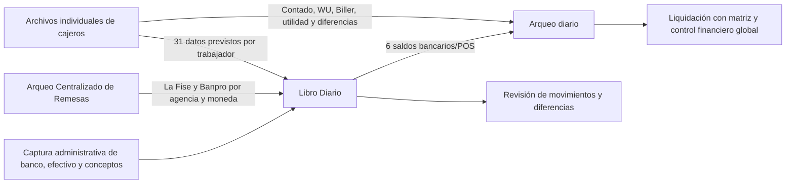

# Análisis funcional de Libro Diario AirPak

Revisión del 5 de noviembre de 2026. Fuente: **Libro Diario AirPak.xlsm**, proporcionado por el usuario. Este documento analiza el archivo y su conexión con los demás Excel y con el backend actual. No implementa módulos, no modifica los libros y no actualiza sus vínculos externos. Las macros se leyeron como código, sin ejecutarlas.

Aclaraciones confirmadas por el usuario e incorporadas en esta revisión: la columna C representa diferencias de efectivo encontradas en el arqueo del trabajador; el bloque AA47:AE63 debe detallar **todos los movimientos de CxC/CxP de los cajeros**, no una selección de pagos de administración. Las anotaciones históricas no cambian esas funciones.

Implementación posterior autorizada en esta misma fecha: [contrato y funcionamiento del módulo Libro Diario](API_LIBRO_DIARIO.md). La sección 19 se actualizó para distinguir lo incorporado al backend de los límites que continúan vigentes. Los hallazgos de los archivos originales se conservan como evidencia; no se corrigieron sus celdas ni vínculos.

## 1. Función del archivo

El Libro Diario es un **control operativo diario de movimientos y revisión de tesorería**. Reúne declaraciones de los trabajadores por categoría y moneda, las compara entre sí y con otras fuentes, incorpora movimientos registrados directamente por administración y calcula los saldos bancarios/POS que utiliza el Arqueo diario.

Su trabajo se divide en cinco grupos:

1. Resumir movimientos de cajeros por agencia y trabajador.
2. Conciliar pases, movimientos entre agencias y remesas contra el registro centralizado.
3. Revisar lo declarado por los cajeros frente a lo registrado para banco y entregas de efectivo a AirPak.
4. Registrar movimientos bancarios adicionales, cambios, gastos y movimientos de cuentas particulares que administra la oficina central.
5. Mantener saldos de banco/POS y evidencias de revisión/cortes anteriores.

La organización del libro es por categorías, fuentes, moneda y responsable. Los controles se basan en sumas, diferencias, detalles escritos y saldos acumulados por cuenta/canal.

## 2. Relación con los otros archivos



Los dos libros administrativos tienen funciones distintas y complementarias:

| Archivo | Datos que organiza | Resultado principal |
| --- | --- | --- |
| Individual del trabajador, como Eveling | Movimientos, plataformas, cambio, conteo y documentos de una caja. | Declaración y arqueo individual de la jornada. |
| Libro Diario | Movimientos de todos los trabajadores, fuentes centrales y captura administrativa. | Revisión operativa, conciliaciones y saldos bancarios/POS. |
| Arqueo diario | Contados, WU/Biller, utilidad, liquidación, auxiliares, activos y gastos acumulados. | Comparación con matriz y control financiero del grupo. |
| Arqueo Centralizado de Remesas | Segunda fuente de remesas de La Fise/Banpro por agencia. | Contraparte independiente para comprobar las declaraciones de cajeros. Su archivo original aún no fue proporcionado. |

El Libro Diario no tiene un vínculo directo de lectura hacia el Arqueo diario dentro de sus 25 referencias externas. La dirección comprobada entre ellos es **Libro Diario → Arqueo diario**, mediante seis saldos. Ambos leen por separado los archivos de los trabajadores. El detalle DHL/enrolamientos tampoco aparece como una fuente directa de este libro.

## 3. Inventario y alcance de la inspección

| Elemento | Resultado |
| --- | --- |
| Tamaño del archivo | 583487 bytes. |
| Hojas | 31: `00` y 30 cortes anteriores. |
| Hoja con fórmulas | Solo `00`. Las 30 históricas conservan valores, no fórmulas. |
| Extensión de la plantilla | `A1:AU119`. |
| Fórmulas actuales | 943: 824 vínculos externos, 70 SUM y 49 referencias/cálculos simples. |
| Libros externos | 25: 24 individuales y uno de remesas centralizadas. |
| Trabajadores de la tabla actual | 23, distribuidos en 14 agencias. |
| Comparación centralizada | 112 fórmulas: 14 agencias × 2 bancos × 2 monedas × 2 direcciones. |
| Campos de revisión | AS: estado; AT: diferencia/alerta; AU: observación administrativa. |
| Revisión guardada | 806 valores «Pendiente» entre las 31 hojas; no se encontraron alertas u observaciones llenas en AT/AU desde la fila 3. |
| Código VBA | 6 módulos/documentos extraídos; procedimientos funcionales `Libro` y `GenerarVinculos`. |
| Otros objetos | No se encontraron tablas estructuradas, tablas dinámicas, consultas, conexiones de datos, gráficos, imágenes ni comentarios de celda empaquetados. |

Las hojas anteriores son `01`, `02`, `03`, `05`, `06`, `07`, `08`, `09`, `10`, `12`, `13`, `14`, `15`, `16`, `17`, `19`, `20`, `21`, `22`, `23`, `24`, `26`, `27`, `28`, `29`, `30`, `31`, `02 NOV`, `03 NOV` y `04 NOV`. La secuencia y las fechas aisladas presentes son compatibles con octubre de 2026 seguido de noviembre. Sus nombres no sustituyen una fecha operativa completa validada por registro.

La hoja `00` tiene los mismos valores guardados que `04 NOV`; la diferencia es que `00` conserva fórmulas y `04 NOV` está congelada como valores. Por ello no deben sumarse como si fueran dos jornadas distintas.

La columna A de agencias está oculta y usa celdas combinadas para agrupar personas. El filtro abarca `B2:AU66`, incluyendo la tabla de operadores y los bloques de captura inferiores; las SUM siguen incluyendo todas sus filas aunque se filtre la vista. No se encontró una fecha operativa completa declarada como campo de la plantilla `00`.

## 4. Tabla de trabajadores y agencias

| Agencia | Trabajadores en esta copia | Filas |
| --- | --- | --- |
| Río Blanco III | Eveling, Eunice, Marginne | 3–5. |
| Río Blanco IV | Paola | 7. |
| Siuna II | Heydi, Norma | 9–10. |
| La Dalia II | Ruth, Jorge, Jezer | 12–14. |
| Mulukukú III | Euridice | 16. |
| Mulukukú IV | Elmer | 18. |
| Siuna III | Carlos, Javiera, Ronald | 20–22. |
| Santa Rita I | Bexi | 24. |
| Coperna I | Yoharbin | 26. |
| San Pedro IV | Dina | 28. |
| Bonanza VI | Jenifer, Reyna | 30–31. |
| Matigüás III | Yuri | 33. |
| El Tuma I | Julissa | 35. |
| Bonanza VII | Yudith, Ingrid | 37–38. |

Los nombres describen el archivo recibido; no se consultó ni se alteró el catálogo de trabajadores del sistema. Al trasladar el proceso deben usarse IDs, fecha y agencia histórica, conservando ausencias y sustituciones.

## 5. Los datos que obtiene de cada trabajador

Hay 31 datos previstos por operador. Ejemplo de origen: fila 3, libro externo de Eveling, hoja `00`. Las direcciones son las del registro del cajero, no necesariamente las del banco ni las del registro central.

| Columna en Diario | Campo / categoría | Celda del trabajador |
| --- | --- | --- |
| C | Sobrante/faltante equivalente en NIO | P12. |
| D, E | Saldo inicial NIO / USD | B2 / B3. |
| F, G, H, I | Bancario: entrada NIO, salida NIO, entrada USD, salida USD | F22:F25. |
| J, K, L, M | Pases: entrada NIO, salida NIO, entrada USD, salida USD | G32:G35. |
| N, O, P, Q | Entre agencias, mismas cuatro direcciones/monedas | G49:G52. |
| R, S, T, U | Gastos, mismas cuatro direcciones/monedas | G59:G62. |
| W, X, Y, Z | CxC/CxP, mismas cuatro direcciones/monedas | F80:F83. |
| AB, AC, AD, AE | Remesas La Fise, mismas cuatro direcciones/monedas | S59:S62. |
| AF, AG, AH, AI | Remesas Banpro, mismas cuatro direcciones/monedas | S63:S66. |

V y AA son detalles escritos en el propio Libro Diario; no se extraen por fórmula del trabajador. En ellos se mezclan varios conceptos e importes, incluso distintas monedas, dentro de un mismo texto. No existe un enlace individual entre cada fragmento del texto y su movimiento de origen.

La fila 40 totaliza el grupo. D/E son saldos de apertura y se deben tratar como saldos, no como ingresos del día. Los restantes bloques son flujos; no sumar todos los bloques y saldos como si fueran una sola clase de importe.

No hay bloques específicos para WU, Biller, volumen de compra/venta, detalle de clientes DHL ni enrolamientos en esta tabla. La revisión de WU/Biller contra matriz se realiza en el Arqueo diario; la columna C usa un resultado individual cuyo cálculo sí incorpora el funcionamiento completo de la caja.

## 6. Origen y significado de la diferencia de efectivo

El usuario confirmó que la columna C corresponde a las diferencias de efectivo encontradas. El caso de Eveling permite seguir la operación desde su origen, en lugar de deducir su función a partir de textos históricos:

```text
Libro Diario!00!C3 = '[1]00'!$P$12
    [1] identifica el libro externo Eveling.xlsm

Eveling!00!P12 = P11 × X2
    P11: diferencia equivalente en USD
    X2: tasa de referencia de la jornada, en NIO por USD
    P12: diferencia combinada expresada en NIO equivalentes
```

### 6.1. Qué compara el arqueo del trabajador

El cálculo se apoya en el dinero contado y en el dinero esperado según los movimientos registrados:

| Dato de Eveling | Origen y cálculo |
| --- | --- |
| Contado NIO, C17 / W15 | `SUM(C8:C16)+J12`: denominaciones de efectivo más el principal de cheques registrados. La plantilla incluye esos cheques en su contado NIO. |
| Contado USD, G17 / X15 | `SUM(G8:G14)`: conteo por denominación. |
| Esperado NIO, W16 | Apertura B2, Biller E2, envíos E4 menos pagos H4, entradas menos salidas bancarias, pases, entre agencias, gastos, CxC/CxP y remesas; además, las entradas/salidas NIO de compra/venta de dólares y la comisión de cheques J13. |
| Esperado USD, X16 | Apertura B3, Biller E3, envíos E5 menos pagos H5 y los mismos bloques de movimientos en USD, incluyendo las entradas/salidas USD de compra/venta. |
| Diferencia NIO, W17 | `W15-W16`: contado menos esperado en NIO. |
| Diferencia USD, X17 | `X15-X16`: contado menos esperado en USD. |

E2/E3 son los totales diarios realizados de Biller, según la aclaración previa del usuario; no se interpretan como un saldo de plataforma. Cada bloque de entradas/salidas conserva su signo en la fórmula, incluso el de gastos.

P11 expresa el contado combinado en USD (`C17/X2+G17`) y resta la apertura más las entradas netas no cambiarias, convertidas a esa misma unidad. También resta `(W9+X9)/X2`: la utilidad de compras/ventas de dólares frente a la tasa X2 y la comisión de cheques. W9 suma W4:W8, con J13 en W8; X9 suma X4:X8. Así, esa utilidad registrada queda incorporada en el esperado y no aparece indebidamente como sobrante. Al calcular el esperado con los movimientos cambiarios reales de W16/X16, no se vuelve a sumar esa utilidad: ya está incluida en sus entradas/salidas.

Las dos formas de cálculo son equivalentes:

```text
Diferencia NIO = contado NIO − esperado NIO
Diferencia USD = contado USD − esperado USD

P12 ≈ diferencia NIO + diferencia USD × X2
    = W17 + X17 × X2
```

Se contrastaron las 30 hojas de Eveling con los cuatro valores necesarios: todas coinciden dentro de 0.000001. Un resultado positivo representa sobrante combinado; uno negativo, faltante combinado. Un resultado cero no asegura que ambas monedas estén cuadradas, porque sus diferencias pueden compensarse en el equivalente.

### 6.2. Ejemplo completo guardado en Eveling, hoja 08

Este ejemplo usa exclusivamente datos de una misma hoja y no se presenta como el corte enlazado actualmente por el Diario:

| Concepto | NIO | USD |
| --- | ---: | ---: |
| Saldo inicial | 32924.00 | 410.00 |
| Entradas no cambiarias | 1025436.81 | 8447.96 |
| Salidas no cambiarias | 571917.33 | 16499.70 |
| Entradas por compra/venta | 64121.00 | 10986.38 |
| Salidas por compra/venta | 402459.07 | 1733.00 |
| Esperado W16 / X16 | 148105.41 | 1611.64 |
| Contado W15 / X15 | 148138.00 | 1611.00 |
| Diferencia W17 / X17 | +32.59 | −0.64 |

La comisión de cheques J13 es cero en este ejemplo. Con X2 = 36.70, el indicador resulta `32.59 + (−0.64 × 36.70) = +9.102 NIO equivalentes`, que coincide con P12 dentro del residuo numérico de Excel. P11 contiene aproximadamente `+0.2480108992 USD equivalentes`. Se conserva un faltante de USD 0.64 aunque el indicador combinado sea positivo.

### 6.3. Cortes de los archivos recibidos

En el Libro Diario recibido, `00!C3` guarda aproximadamente **+0.95 NIO equivalentes** y su caché externa de Eveling guarda el mismo P12. Sus aperturas enlazadas son NIO 41313 y USD 2100. En cambio, `Eveling (1).xlsm!00` recibido tiene aperturas NIO 27848 y USD 0, y P12 ≈ **−11179.844 NIO equivalentes**. Las dos copias no contienen el mismo estado guardado. La referencia demuestra de dónde procede el indicador, pero no permite reconstruir el +0.95 con los movimientos actuales de la otra copia; la caché del Diario no conserva sus conteos, P11 ni X2. No se actualizaron vínculos ni se mezclaron esos cortes.

El total guardado `Libro Diario!00!C40` es aproximadamente **179.001 NIO equivalentes**, sujeto al hallazgo de identidad de C4 señalado en la sección 18. Para reproducir el indicador en el sistema deben conservarse ambas diferencias por moneda, la referencia individual aplicada, la jornada y la versión de origen. No recalcular la historia con la tasa actual del proveedor ni con una tasa global de otro día.

La columna C histórica contiene también notas como «LIBRE», «1/2 LIBRE» y «TRABAJO». Se conservan como anotaciones del archivo; no constituyen evidencia suficiente para definir un módulo de asistencia ni para interpretar sus números como días trabajados. Su función monetaria queda confirmada por el usuario y por la fórmula de origen. Tampoco queda demostrado que todas las anotaciones de la hoja mensual «Sob y Falt» del Arqueo diario sean copias de esta columna.

## 7. Pases y movimientos entre agencias

El control global utiliza:

```text
J41 = J40 − K40    pases NIO
L41 = L40 − M40    pases USD
N41 = N40 − O40    entre agencias NIO
P41 = P40 − Q40    entre agencias USD
```

En `00`, las cuatro diferencias son cero. Los pases suman NIO 531171.58 por cada dirección y USD 6362 por cada dirección; los movimientos entre agencias, NIO 460024.01 y USD 2787 por dirección.

Esas igualdades comprueban compensación agregada. No identifican por sí solas qué salida corresponde a qué entrada ni detectan un cruce entre destinatarios equivocados. Las relaciones por ID que ya tiene el proyecto para pares de pases y entre agencias son una base más precisa y deben conservarse.

En los 30 cortes históricos, los pases no muestran diferencias agregadas no nulas. Entre agencias aparecen diferencias NIO en `28!N41 ≈ 0.05`, `31!N41 ≈ 0.18` y `02 NOV!N41 ≈ 0.99`. Son diferencias guardadas para revisar; este archivo no conserva una resolución estructurada por cada una.

## 8. Remesas frente al registro centralizado

AB:AI contiene lo declarado por los trabajadores. AJ:AQ contiene otra lectura, del **Arqueo Centralizado de Remesas.xlsm** ubicado bajo el archivo de Paola. Su original no fue proporcionado; el Libro Diario conserva 112 valores de caché y las referencias necesarias para revisar sus totales.

La fuente centralizada utiliza columnas L/N/P/R: entradas NIO, salidas NIO, entradas USD y salidas USD, distribuidas por banco/agencia. Por ejemplo, el bloque Río Blanco III lee las filas centrales 22/23 para La Fise/Banpro; Bonanza VII, 28/29. La ubicación de ese dato en el Diario puede ser una fila sin operador o una fila que sí tiene operador, según el grupo. No debe interpretarse como una segunda caja de esa persona.

La perspectiva de ambos registros es opuesta:

| Declaración del cajero | Contraparte central |
| --- | --- |
| Entrada de efectivo por remesa La Fise | Salida central La Fise. |
| Salida de efectivo por remesa La Fise | Entrada central La Fise. |
| Entrada/salida Banpro | Se compara con salida/entrada central Banpro. |

Ejemplos de fórmulas:

```text
AB41 = AB40 − AK40    La Fise, entrada cajero NIO − salida central NIO
AC41 = AJ40 − AC40    La Fise, entrada central NIO − salida cajero NIO
AD41 = AD40 − AM40    La Fise, entrada cajero USD − salida central USD
AE41 = AL40 − AE40    La Fise, entrada central USD − salida cajero USD
AF41 = AF40 − AO40    Banpro, entrada cajero NIO − salida central NIO
AG41 = AN40 − AG40    Banpro, entrada central NIO − salida cajero NIO
AH41 = AH40 − AQ40    Banpro, entrada cajero USD − salida central USD
AI41 = AP40 − AI40    Banpro, entrada central USD − salida cajero USD
```

AJ41:AQ41 repite comprobaciones equivalentes en la perspectiva central; algunos signos son inversos. No son ocho operaciones monetarias adicionales: son controles repetidos sobre los mismos totales.

En `00`, las ocho comparaciones son cero. Entre los históricos se encontró `10!AF41 ≈ 0.35 NIO` como diferencia no nula de este grupo de controles. No hay en el archivo una relación por número de remesa que identifique la transacción responsable.

## 9. Captura manual de banco y administración

Las filas 47:63 contienen bloques de movimientos introducidos directamente por administración:

| Rango | Rótulo | Función |
| --- | --- | --- |
| B:F | Movimientos bancarios / cajeros | Declaración de lo recibido/entregado desde la perspectiva bancaria; puede identificar agencia en B. |
| G:K | Movimientos bancarios / MC | Importes por moneda/dirección y agente cambiario en K. |
| L:P | Movimientos bancarios / adicionales | Movimientos adicionales con detalle. |
| Q:U | Gastos adicionales desde la cuenta | Entradas/salidas por moneda y concepto de gasto. |
| V:Z | CxC/CxP desde la cuenta | Movimientos de cuentas particulares realizados por banco. |
| AA:AE | Detalle de CxC/CxP | Detalle independiente que se contrasta con las declaraciones de los trabajadores. |

La fila 64 suma cada columna. Los bloques C:F, G:J, L:O, Q:T y V:Y intervienen en el saldo bancario. **AA:AD se usa en una comparación y no se agrega al saldo de banco**. Sumarlos también duplicaría un dato que no tiene ese tratamiento en el archivo.

«MC» no se desarrolla en una fórmula. El encabezado «Agente Cambiario» y sus anotaciones indican un uso de cambio/tesorería. En esta copia existen NIO 105811.2 y 220440 con notas de USD 2880 y 6000 respectivamente; los cocientes son compatibles con 36.74 NIO/USD. Los importes están escritos, no calculados por una tasa guardada en una columna formal. Esta lectura de su relación cambiaria es una inferencia, no un comprobante de la operación original.

Los movimientos manuales carecen de ID de operación, referencia bancaria obligatoria, fecha/hora individual y enlace estructurado a su caja/documento. La cifra y la observación permiten revisar, pero no garantizan por sí solas origen, acreditación ni ausencia de duplicados.

## 10. Cajeros frente a banco y entregas directas a AirPak

La fila 65 invierte la perspectiva de los movimientos bancarios de cajeros:

```text
C65 = G40   salidas NIO de cajeros, esperadas como entradas en banco
D65 = F40   entradas NIO de cajeros, esperadas como salidas de banco
E65 = I40   salidas USD de cajeros, esperadas como entradas en banco
F65 = H40   entradas USD de cajeros, esperadas como salidas de banco
```

La fila 66 resta registro bancario manual menos esas declaraciones. En el corte `00`:

| Concepto | Manual banco | Declarado por cajeros | Diferencia |
| --- | ---: | ---: | ---: |
| Entradas de banco NIO / salidas de cajeros | 271740.73 | 661740.73 | −390000. |
| Salidas de banco NIO / entradas de cajeros | 200000 | 200000 | 0. |
| Entradas de banco USD / salidas de cajeros | 1500 | 36334 | −34834. |
| Salidas de banco USD / entradas de cajeros | 0 | 0 | 0. |

El libro no trata automáticamente −390000 y −34834 como faltantes. Tiene otro bloque, `E68:G81`, titulado **«Salidas en efectivo a AirPak»**. Suma NIO 390000 en F80 y USD 34834 en G80; luego:

```text
F81 = C66 + F80 = 0
G81 = E66 + G80 = 0
```

La diferencia queda explicada porque una parte del dinero declarado por los cajeros fue entregada directamente en efectivo a AirPak, en lugar de entrar al banco. Este tratamiento es fundamental para distinguir destino y medio del movimiento.

El encabezado pide cajero en E69, pero E70:E79 está vacío en las 31 hojas, aunque existen importes en F/G. Se comprueba el total y no queda identificado cada responsable por fila. En el sistema debe enlazarse la entrega con su operación/jornada y receptor, no asignar un cajero por coincidencia de importe.

En cinco cortes históricos se conservan diferencias residuales después de este bloque: `06` (−1050000 NIO y −22000 USD), `08` (≈−0.02 NIO), `09` (≈−0.03 NIO), `13` (≈−74.30 NIO y −2 USD) y `02 NOV` (≈0.18 NIO). Falta el contexto para decidir si eran pendientes de revisión, diferencias reconocidas o registros incompletos. No deben borrarse ni trasladarse automáticamente a deuda de un trabajador.

## 11. Detalle de cuentas por cobrar/pagar

El usuario confirmó que AA47:AE63 debe detallar **todos los movimientos de CxC/CxP de los cajeros**. Por tanto, el objetivo de comparación es cobertura completa del mismo día/corte, sin limitarla a ciertos pagos revisados por administración.

AA47:AD63 captura cuatro columnas de importe; AE, sus conceptos. La fila 65 toma los cuatro totales W40:Z40 del conjunto de cajeros. Las diferencias son:

```text
AA66 = AA64 − W40
AB66 = AB64 − X40
AC66 = AC64 − Y40
AD66 = AD64 − Z40
```

En la copia actual:

| Movimiento de caja | Total de cajeros | Total detallado | Detalle menos cajeros |
| --- | ---: | ---: | ---: |
| Entrada NIO, W40 frente a AA64 | 2810.00 | 0.00 | −2810.00 |
| Salida NIO, X40 frente a AB64 | 25607.30 | 16219.14 | −9388.16 |
| Entrada USD, Y40 frente a AC64 | 21055.00 | 0.00 | −21055.00 |
| Salida USD, Z40 frente a AD64 | 2538.96 | 0.00 | −2538.96 |

Con el alcance confirmado, estas diferencias son **pendientes de conciliación del detalle completo**. Los 30 cortes históricos contienen al menos una diferencia no nula en este bloque. El objetivo declarado no es un detalle parcial; los datos guardados aún no demuestran su cumplimiento. Las diferencias pueden proceder de omisiones, clasificación incorrecta, duplicados u otros cortes, y no prueban por sí solas un faltante de efectivo ni una deuda de un cajero.

Una observación relevante: el detalle escrito actual suma **AB64 = 16219.14 NIO**, y coincide con **S4 = 16219.14**, que está dentro del bloque de gastos de Eunice, no del bloque W:Z de CxC/CxP. Sus textos incluyen INSS y pagos por agencias. Es una coincidencia verificable de importe y una posible clasificación incorrecta que debe contrastarse con las partidas de origen; no demuestra por sí sola que sean los mismos movimientos.

Al llevarlo al sistema, el detalle debe conservar movimiento origen, trabajador, jornada/agencia, cuenta o contraparte, moneda, dirección, concepto e importe. Cada partida de CxC/CxP debe poder localizarse desde el total y clasificarse sin volver a registrar el mismo dinero. La cobertura y la correspondencia individual deben comprobarse junto con los cuatro totales; entradas/salidas y monedas no se compensan entre sí para ocultar partidas ausentes. Las adiciones o reducciones de deuda sin movimiento de efectivo pertenecen al auxiliar de cuentas, pero no se agregan como entrada/salida de caja solo por cambiar el saldo de una cuenta.

Las 17 filas de captura de la plantilla son una limitación visual, no un límite funcional para la cantidad de operaciones del sistema. Una conciliación completa necesita diferencias cero o incidencias explícitamente documentadas con su resolución; no ajustes arbitrarios de saldos para forzar el cuadre.

## 12. Cálculo de banco principal

El Libro Diario llama a este bloque «Cuentas Bancarias». Su asociación a **Bancentro** se confirma por las celdas receptoras E48/H48 del Arqueo diario.

```text
C72 NIO = C70 + C64 + G64 + L64 + Q64 + V64
              − D64 − H64 − M64 − R64 − W64

C78 USD = C76 + E64 + I64 + N64 + S64 + X64
              − F64 − J64 − O64 − T64 − Y64
```

Se suma apertura y entradas bancarias de los cinco bloques pertinentes, y se restan salidas. No se agrega directamente otra vez lo declarado por los cajeros: se usa lo registrado en los bloques bancarios manuales.

En el corte actual:

```text
NIO = 41601.62 + 271740.73 + 326251.20 − 200000 − 330000
    = 109593.55

USD = 571.82 + 1500 − 1300 − 245
    = 526.82
```

Por tanto el control distingue declaración de cajero, registro bancario y destino efectivo AirPak. Un saldo calculado con estos registros no demuestra por sí solo conciliación con un extracto del banco; no hay un extracto importado ni una segunda columna formal de saldo comunicado en este bloque.

## 13. Saldos de canales POS La Fise y Banpro

El saldo se calcula desde la perspectiva central, no la del cajero:

| Canal/moneda | Apertura | Transaccionado | Retiro | Final |
| --- | --- | --- | --- | --- |
| La Fise NIO | C83 | C84 = AJ40 − AK40 | C85 | C86 = apertura + transaccionado − retiro. |
| La Fise USD | C89 | C90 = AL40 − AM40 | C91 | C92, misma regla. |
| Banpro NIO | C97 | C98 = AN40 − AO40 | C99 | C100, misma regla. |
| Banpro USD | C103 | C104 = AP40 − AQ40 | C105 | C106, misma regla. |

Resultados actuales: La Fise **75176.60 NIO / 605.14 USD**; Banpro **7256.49 NIO / 8510.18 USD**. Los cuatro retiros del corte están vacíos y las fórmulas los tratan como cero; una celda vacía no deja constancia de una confirmación administrativa explícita de «no hubo retiros».

Los rótulos de origen dicen La Fise/Banpro. El Arqueo diario los consume como **La Fise POS / Banpro POS**, diferenciados de otros saldos bancarios que también pueden aparecer bajo el nombre Banpro. La cuenta/canal y su titular deben ser explícitos para no mezclar esos saldos.

## 14. Alimentación del Arqueo diario

Se comprobaron estos seis enlaces y la coincidencia de sus valores guardados entre ambos archivos recibidos:

| Fuente Libro Diario `00` | Destino Arqueo diario `00` | Saldo |
| --- | --- | ---: |
| C72 | F48 | Bancentro NIO: 109593.55. |
| C78 | I48 | Bancentro USD: 526.82. |
| C86 | F52 | La Fise POS NIO: 75176.60. |
| C92 | I52 | La Fise POS USD: 605.14. |
| C100 | F53 | Banpro POS NIO: 7256.49. |
| C106 | I53 | Banpro POS USD: 8510.18. |

Estos saldos alimentan los componentes de bancos/canales del control financiero global. No son ingresos nuevos ni importes que se deban sumar otra vez junto a sus movimientos originales. La coincidencia confirma este corte guardado; no asegura actualización futura de los vínculos ni que todos los archivos individuales correspondan al mismo instante.

## 15. Revisión administrativa

La plantilla prevé estado, alerta y observación en AS/AU. En la copia actual y en las históricas todos los estados guardados siguen en «Pendiente», sin valores de alerta/observación. No hay fórmulas que determinen AS/AT/AU, validación de estados ni formato condicional que implemente un flujo automático.

Por ello el diseño expresa una intención de revisión, pero el libro no acredita revisiones completadas con fecha, usuario, resolución o evidencia. Un cero en la conciliación no cambia su estado a revisado ni registra una aprobación.

La aclaración del usuario resuelve el significado de la columna C: es la diferencia de efectivo del arqueo, equivalente en NIO según P12. Los textos históricos son anotaciones que deben preservarse aparte del importe y del resultado de revisión. No justifican por sí solos crear un proceso de asistencia ni extraer cantidades monetarias de fragmentos de texto ambiguos.

## 16. Macro Libro: archivo de jornada y limpieza

El procedimiento `Libro`, en Módulo3, tiene asignado Ctrl+M. Su código hace lo siguiente:

1. Selecciona `00`, la copia después de la primera hoja y renombra la copia a **«cambiar»**.
2. Regresa a `00` y limpia los siguientes grupos.

| Rangos/celdas limpiados | Efecto |
| --- | --- |
| C3:C40 | Elimina diferencias y también la fórmula total C40. En la copia actual comprende 24 fórmulas. |
| V3:V40 y AA3:AA40 | Borra detalles escritos de gastos y cuentas. |
| AT3:AU39 y AT45:AU46 | Borra alertas/observaciones de esos rangos. |
| B47:AE63 | Limpia la captura manual de banco, cambios, gastos y detalle de cuentas. |
| C70, C76, C83, C89, C97, C103 | Borra los seis saldos iniciales. |
| C85, C91, C99, C105 | Borra retiros de los canales POS. |
| E70:G79 | Borra las entregas en efectivo a AirPak. |

Las demás instrucciones son selecciones y desplazamientos visuales. El código no traslada los saldos finales anteriores a la nueva apertura; esas aperturas quedan vacías. Tampoco restaura los vínculos de la columna C ni su SUM, ni reinicia AS a «Pendiente».

La copia se realiza antes de la limpieza, pero **no incluye PasteSpecial de valores ni ruptura de vínculos**. Si se dejara tal cual, la copia seguiría apuntando a las hojas `00` externas. Las 30 hojas históricas actuales sí tienen cero fórmulas, de modo que hubo una congelación adicional fuera de este procedimiento. El renombrado «cambiar» y la fecha definitiva también requieren un paso posterior no codificado aquí.

La macro asume que la copia se llama `00 (2)` y que no existe una hoja «cambiar». No tiene manejo de errores para esos nombres. Al reproducir su intención en el proyecto deben sustituirse esas dependencias por fecha, versión, fuentes y cierre explícitos, conservando las identidades de los movimientos.

## 17. Macro GenerarVinculos: desajuste con la plantilla actual

El segundo procedimiento funcional usa `ActiveWorkbook.Worksheets(1)`, obtiene la última fila no vacía de B y, para cada B con texto, copia de la fila 2 las columnas D:K, sustituyendo la ruta y nombre de Eveling por el nombre del operador.

En el libro recibido:

- La primera hoja es **`01`**, no `00`.
- D2:K2 contiene encabezados de texto, no fórmulas de vínculos.
- La columna B contiene rótulos del banco hasta B106; el bucle no está limitado a los operadores.
- Solo recorre D:K, no todas las categorías ni los 31 campos del operador.

Por tanto este código no reproduce el mapa de vínculos actual. Ejecutarlo tal como está podría escribir encabezados sobre importes de la primera hoja, incluyendo filas que no son trabajadores. No se ejecutó ni se corrigió durante la inspección.

Los módulos de documento ThisWorkbook/Hoja2 solo contienen atributos; los otros dos módulos generales están vacíos. No se encontró un evento VBA que ejecute automáticamente estos procedimientos al abrir el archivo ni una llamada entre ellos.

## 18. Referencias y diferencias que requieren atención

| Hallazgo | Evidencia | Consecuencia |
| --- | --- | --- |
| Diferencia del operador tomada de otra persona | `00!B4` identifica Eunice; D4:AI4 lee mayoritariamente Eunice, pero C4 apunta a Vanessa (`[2]00!P12`). | No se puede atribuir esa diferencia a Eunice solo por su fila. Revisar el origen. |
| Falta un vínculo previsto | `00!AB5` de Marginne está vacío; las otras siete columnas de remesas de esa fila están enlazadas. | Ausente no demuestra importe cero. Falta confirmar el dato/alcance de esa columna. |
| Aperturas discontinuas | La Fise USD 06→07 cambia −40; La Fise NIO 13→14 cambia +1900; La Fise USD 03 NOV→04 NOV cambia +54. | No hay movimiento explícito de puente en el arrastre entre esos cortes. Puede ser ajuste/operación intermedia; hace falta su motivo y fuente. |
| Anotaciones sobre una columna monetaria | Textos en C y totales históricos C40 que ya no coinciden con el detalle guardado; el usuario confirma que su función es mostrar diferencias de efectivo. | Preservar importe y anotación por separado. No inferir asistencia ni reconstruir faltantes a partir de esos textos; mantener el corte original. |
| Efectivo AirPak sin responsable por fila | E70:E79 vacío en todos los cortes, con importes en F/G. | El cuadre agregado no identifica quién entregó el dinero. |
| Detalle de CxC/CxP diferente del total declarado | AA66:AD66 no nulo; AB64 coincide con un total de gastos del trabajador. El usuario confirma cobertura de todos los movimientos de CxC/CxP. | Conciliar las partidas completas y verificar su clasificación/origen. La diferencia no equivale automáticamente a deuda del trabajador. |
| Estados de revisión sin completar | 806 «Pendiente», sin alertas/observaciones AT/AU. | No existen evidencias estructuradas de aprobación/resolución final. |
| Limpieza de vínculos y aperturas en macro | `Libro` limpia C y saldos iniciales, sin restituir/arrastrar. | La preparación del día depende de intervención adicional. |
| Macro generadora no coincide con la plantilla | Hoja 1 histórica, fila 2 de encabezados y bucle hasta B106. | No utilizarla como especificación de generación correcta de enlaces. |

Los tres cambios de apertura se detectaron al comparar 174 pares de apertura/cierre entre los 30 cortes históricos consecutivos; 171 pares coinciden dentro de 0.000001. No se consideró `00` como un nuevo día después de `04 NOV`, porque sus valores están duplicados.

## 19. Relación con lo implementado en ControlTasasAPI

| Función del Diario | Implementación actual | Límites o tratamiento |
| --- | --- | --- |
| Recibir movimientos individuales | Diario con 31 indicadores por cajero, detalle original y cobertura explícita. | Fuentes ausentes/abiertas y arqueos fuera de la lista impiden cerrar el grupo. |
| Calcular diferencia combinada NIO | Conversión de diferencias originales usando la referencia de cada jornada. | No se pierde la diferencia USD ni se usa una tasa actual para reescribir la historia. |
| Consolidar grupo/agencias | Diario por fecha/versión, agrupación por agencia y fuentes con huella. | Su matriz y sus revisiones se conservan separadas de los otros indicadores del arqueo madre. |
| Comparar pases/entre agencias | Diferencias agregadas y controles de relaciones individuales, moneda, importe, medio y contraparte. | Una igualdad agregada no aprueba relaciones ausentes. Las incidencias requieren revisión y evidencia. |
| Comparar remesas con un registro central | Cabecera independiente, ocho combinaciones explícitas por agencia, confirmación y comparación inversa. | Captura por API; no se incluye importador del archivo central no proporcionado. |
| Llevar banco/POS | Seis cuentas diferenciadas, auxiliares existentes, continuidad y fotografías del corte. | No equivale a conciliación con un extracto bancario. |
| Registrar operación desde banco/caja | Clasificaciones enlazadas a operaciones existentes y movimientos de caja cerrada. | Clasificar/revisar no vuelve a ingresar o retirar dinero. |
| Registrar gastos/CxC/CxP desde banco | Bloques de clasificación y revisión, conectados a los módulos financieros existentes. | La segunda revisión habilita imputar reducciones manuales a cargos automáticos y limita el pago al saldo neto; la aplicación del gasto, abono o deuda sigue administrándose en su módulo. |
| Detallar todos los movimientos de CxC/CxP de cajeros | Detalle por movimiento `varios`, moneda/dirección e identificación de cuenta o contraparte. | Una partida ausente bloquea el cierre. Los cambios de deuda sin efectivo no se agregan a caja. |
| Entregar efectivo directamente a AirPak | Origen de caja identificado, receptor y comprobante/referencia; cuadre separado frente a banco. | No genera automáticamente deuda del trabajador ni movimiento bancario. |
| Banco frente a cambio/tesorería | Clasificación de operaciones reales por agente y referencia, con importes originales. | No se presupone una tasa desde texto ni se crea una mesa protegida. |
| Revisar/aprobar por operador/bloque | Revisiones sucesivas con autor, fecha, evidencia y huella del control. | Una revisión anterior no aprueba datos cambiados; justificar conserva la diferencia. |
| Conservar cortes diarios | Cierre propio inmutable, fuentes, versiones, saldo anterior y controles de continuidad. | Las correcciones usan nueva versión y ajustes financieros trazables. |
| Alimentar el control financiero | Enlace opcional del Diario cerrado al arqueo madre del mismo grupo, fecha y cajeros; seis saldos en capital. | Un saldo del auxiliar que cambie después se informa como pendiente y bloquea el cierre financiero hasta resolver el corte. |

La conciliación de matriz existente compara WU/Biller y no debe reutilizarse como si fuera una conciliación bancaria o de remesas centralizadas: sus fuentes y reglas son diferentes. El historial de cambios tampoco demuestra que un movimiento haya sido revisado o aprobado.

Las tablas protegidas no se modificaron. Se agregaron ocho tablas y una FK opcional en `arqueo_madre`; los procesos referencian jornadas, usuarios, agencias, operaciones y documentos existentes. Las rutas y condiciones exactas de lo implementado están en [API_LIBRO_DIARIO.md](API_LIBRO_DIARIO.md).

## 20. Reglas que deben conservarse al trasladarlo al sistema

1. Separar declaración del trabajador, declaración central y movimiento bancario real, conservando qué dos fuentes se comparan y su fecha de corte.
2. Registrar el movimiento económico una sola vez y enlazar sus declaraciones. Un pase, una entrega a banco o una remesa no crea dinero adicional al consolidarse.
3. Expresar dirección desde la perspectiva correcta. La salida de un cajero puede ser entrada de banco o salida central de POS, según el proceso.
4. Distinguir entrega en efectivo a AirPak, depósito/traslado bancario y acreditación. Las diferencias no se convierten automáticamente en faltantes de personas.
5. Conservar cada moneda y tasa aplicada. La diferencia equivalente NIO es un indicador derivado, no un reemplazo de los importes originales.
6. Separar anotaciones, observación, alerta, revisión y valores monetarios. La columna C representa diferencias de efectivo; sus textos históricos no definen un proceso de asistencia.
7. Identificar cuenta/canal, contraparte, operador, referencia y movimiento origen; no enlazar por nombre, posición de fila o importe coincidente.
8. Conservar apertura y cierre con ajustes explícitos de puente cuando no coincidan. No usar cambios del saldo inicial para ocultar movimientos no registrados.
9. Revisar cobertura y partidas individuales: un agregado cero no garantiza correspondencias correctas. El detalle AA:AE abarca todos los movimientos de CxC/CxP de los cajeros del corte, en las cuatro combinaciones de moneda y dirección.
10. Archivar datos/fuentes/versiones y permitir ajustes posteriores con trazabilidad, conservando los cortes originales.

## 21. Verificación y límites de la conclusión

- Se leyeron las 31 hojas, valores, fórmulas, vínculos externos, celdas combinadas, columnas ocultas, filtros y código VBA.
- Se evaluaron independientemente las **943 fórmulas** de `00` con las cachés incluidas: todas coinciden dentro de 0.000001, sin errores de celda ni cachés referenciadas ausentes.
- Se compararon **3567 resultados numéricos históricos** aplicando las reglas aritméticas de la plantilla actual a los valores de cada corte. Las 10 diferencias encontradas están en C40, cuya columna de detalle contiene cambios/anotaciones posteriores. Al no conservar fórmulas históricas, esto no prueba cuál era su fórmula o momento original de cálculo.
- Se verificaron los **seis saldos enlazados al Arqueo diario**, y sus valores guardados coinciden con los del Libro Diario recibido.
- Se contrastó la equivalencia P12 de las 30 hojas disponibles de Eveling, utilizando la extracción del mismo archivo original comprobada por hash.
- Se siguió `Libro Diario!00!C3` hasta `Eveling!00!P12`, P11, los conteos, los esperados por moneda y la utilidad; se verificó independientemente el ejemplo completo de la hoja `08`. El +0.95 guardado por el Diario no se reconstruye con la hoja `00` de la otra copia, que contiene un estado diferente.
- La consistencia aritmética no certifica que los movimientos estén completos, correctamente atribuidos o acreditados. Los hallazgos de identidad, cobertura, revisión y continuidad deben resolverse con sus fuentes.
- No se dispuso del original de Arqueo Centralizado de Remesas ni de extractos bancarios; se inspeccionaron las referencias y cachés que conserva este archivo.
- El usuario confirmó la función monetaria de C y la cobertura completa del detalle AA47:AE63; ambas aclaraciones están incorporadas. Siguen sin poder reconstruirse los importes originales reemplazados por textos históricos ni atribuirse las diferencias de conciliación a partidas concretas sin sus fuentes.

Huellas de los archivos usados como evidencia:

| Archivo | SHA-256 |
| --- | --- |
| Libro Diario AirPak.xlsm | `8fe8bc2efbaf04933dce257149f1255635d6fa2c19606cf8ba31ad11a30ccf40` |
| Arqueo diario (1).xlsx | `8e2189a01a4251fa0ae1dd09ef879b3bba0daf4b726b93116a57ea372efeaf87` |
| Eveling (1).xlsm | `a11e3b1728b4b0ed4f251b845ea23df982202a7d9e1ded33a8ab663124ad26ff` |

Referencias del proyecto: [análisis del Arqueo diario](ANALISIS_ARQUEO_DIARIO.md), [contrato actual de integración](INTEGRACION_API_CSHARP_V4.md), [resumen individual de caja](../app/Services/ArqueoService.php), [consolidación actual](../app/Services/Administracion/ConsolidacionService.php), [libro de cuentas](../app/Services/Administracion/LedgerService.php), [relaciones entre movimientos](../app/Support/Caja/References.php) y [remesas capturadas por caja](../app/Http/Controllers/Api/RemesaBancariaController.php).
