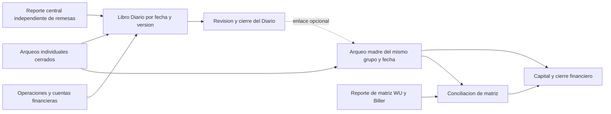
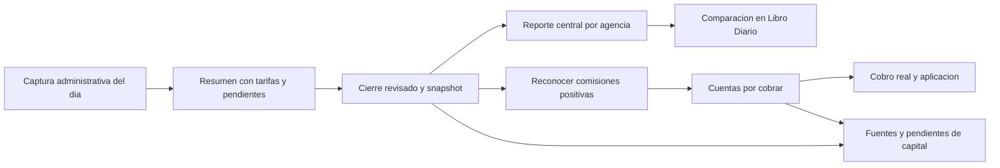

# Integración completa de ControlTasasAPI con C# — versión 4

**Entrega: 6 de noviembre de 2026.** Destino: «Ggrupo Systems - Control de Caja Wester - Sistema escritorio».

V4 sustituye V3 y su complemento como contrato principal. Es un documento autónomo: incorpora caja individual, administración, cuentas personales, Libro Diario y la terminal única LAFISE/BANPRO, con sus revisiones, tarifas confirmadas y movimientos sin comisión. Contiene los **39 recursos administrativos** y el inventario verificado de **248 combinaciones método/ruta**, además de los contratos individuales. No requiere adjuntar versiones anteriores ni el complemento por separado.

V4 es la versión de la documentación, no un prefijo HTTP. Se conserva `/api/administracion/...`, el login y el token existentes. `tarifario.version` es otro concepto: identifica las reglas congeladas del día. Los ejemplos utilizan datos ficticios. Este archivo describe el código actual y no acredita el despliegue del servidor. No se modificó código backend ni se ejecutaron migraciones reales para redactarlo.

## 1. Cómo utilizar esta entrega

1. Revisar primero los cambios de las secciones 2–5 y las limitaciones de la sección 6.
2. Conservar el cliente de caja. Revisar el comparativo V3 → V4 de 2.3 y los cambios anteriores de 2.1; integrar el cliente de 7, Diario en H y terminal en J–K, o adaptar a la arquitectura existente.
3. Implementar administracion con B, cuentas personales con C, Libro Diario con G y servicios externos con J. Este archivo incorpora los contratos completos; no requiere V3 ni su complemento separados.
4. Usar los campos y tipos del catálogo del apéndice D para completar DTOs y formularios. Los nombres JSON tienen que respetarse exactamente.
5. Ejecutar los casos de aceptación de 8, H.3, J.14 y K.3 contra un servidor de pruebas con este esquema. Las pruebas en memoria del backend no verifican conectividad ni login real del escritorio.

Accesos: [cambios](#cambios-v4), [respuestas y tipos](#contratos-v4), [acciones](#acciones-v4), [límites](#limites-v4), [cliente C#](#cliente-v4), [aceptación](#aceptacion-v4), [caja](#referencia-caja), [administración](#referencia-administracion), [cuentas personales](#referencia-personales), [tipos de respuesta](#catalogo-respuestas), [Libro Diario](#libro-diario-v4), [cliente C# del Diario](#cliente-diario-v4), [adopción](#migracion-v4), [cambios V3 → V4](#compatibilidad-v3-v4), [servicios externos](#terminal-v4), [DTOs de terminal](#terminal-dtos-v4).

<a id="cambios-v4"></a>
## 2. Diferencias que debe incorporar el escritorio

El contrato individual de caja se conserva. Esta sección recuerda las ampliaciones administrativas iniciales y sus diferencias con aquel contrato; 2.1 conserva los cambios V2 → V3. La comparación específica de la entrega V3 con esta V4 está en 2.3.

| Área / supuesto de la entrega anterior | Contrato actual | Cambio concreto en C# |
| --- | --- | --- |
| Solo registros individuales de caja | También existe `/api/administracion/*`. | Añadir navegación y servicios administrativos sin cambiar las rutas individuales. |
| Claves particulares como `Arqueo`, `Envio`, `Entrada salida` | Se conservan en caja; administración usa `Registro`, `Registros` y `Resultado`. | Separar envolturas. No intentar leer una respuesta administrativa como `Arqueo` ni buscar `data` universal. |
| Usuario cajero accede a sus registros | Todos los endpoints administrativos, también GET, exigen administrador activo. | Ocultar o deshabilitar módulos administrativos para cajeros y manejar 403. |
| Monedas de captura de caja admiten alias | Administración admite exactamente `NIO` y `USD`. | Enviar valores canónicos en formularios y filtros nuevos. |
| Importes habituales de caja con dos decimales | Los importes administrativos admiten ocho; tasas seis; cantidades de activos/obra seis. | Conservar precisión y enviar cadenas con punto. No redondear los datos antes de guardarlos. |
| Todos los saldos se podrían modelar como `decimal` | Los saldos personales guardados son `DECIMAL(32,8)` y los agregados pueden superar la precisión de `System.Decimal`. | Mantener esos saldos y agregados como cadenas o JSON, o implementar una conversión exacta validada; no usar `double`. |
| Cierre individual equivale al fin de todo el proceso | Existen cierre de caja, consolidado madre, confirmación de matriz, liquidación y cierre financiero. | Mostrar estados y acciones independientes; no intercambiar sus IDs. |
| Consolidación no implementada | `arqueosmadre` conserva fecha, alcance, usuarios previstos, fuentes y versiones. | Capturar la cobertura explícita y presentar ausentes/abiertos como pendientes. |
| Totales WU/Biller solo individuales | Se comparan cuatro totales con `reportesmatriz`/`conciliaciones`. | Implementar diferencias por servicio y moneda; revisar no borra la diferencia. |
| Pago y clasificación podrían ser el mismo POST | `operaciones` registra/reconoce dinero; `aplicaciones` y `movimientospersonales` clasifican ese dinero. | Guardar el ID de la operación y reutilizarlo; no volver a mover banco/caja al aplicar. |
| Se podría reconocer dinero de una jornada abierta | Los enlaces financieros a caja exigen jornada cerrada y fuente vigente. | Esperar al cierre para reconocer ese origen administrativo. No volver a editar la salida/entrada física. |
| Una operación solo se usaría en aplicaciones | Su disponibilidad también descuenta movimientos personales; hay reservas para matriz, anticipos y financiamientos. | Refrescar datos y manejar rechazo por dinero ya utilizado aunque el formulario mostrara un importe disponible. |
| `id_cargo` solo admitía cargos manuales | También admite cargos generados por préstamos personales vigentes. | Para cobrar un préstamo usar su `id_movimiento_generado`; los demás cargos automáticos mantienen destino específico. |
| Un fondo solo podría consumirse hasta cero | `movimientospersonales` permite retiros excedidos y reintegros. | Mostrar fondos del titular y deuda del titular en la misma cuenta, sin cambiar su tipo. |
| `cuentas/{id}/saldo` solo muestra saldo/movimientos | Para `fondo` agrega `posicion_personal`. | Añadir `fondos_del_titular` y `deuda_del_titular`; el saldo puede ser negativo. |
| Se podrían ajustar libremente antecedentes de cuenta | Movimientos personales posteriores protegen sus saldos anteriores. | Rechazar correcciones retroactivas y resolver dependencias en orden inverso antes de reclasificar. |
| Un depósito declarado ya está acreditado | `depositosliquidacion` separa pendiente y acreditado, con cuenta de tránsito. | Mostrar ambos estados y acreditar con fecha real, incluso en un periodo posterior. |
| Sueldo, anticipo y retención se registrarían como gastos equivalentes | Las obligaciones generan cargos y algunos gastos; las compensaciones no generan dinero. | Separar salario bruto, anticipo, descuento de anticipo, retención INSS laboral y pago neto. |
| Una cuota reduciría toda la deuda por su importe | Solo su componente capital reduce principal; interés/seguro/comisión generan gasto financiero. | En un pago parcial capturar los cuatro componentes. |
| DELETE podría eliminar datos o devolver dinero | En administración anula/desactiva con motivo; no revierte el dinero real de la operación. | Ofrecer anulación y devolución como procesos distintos; no inventar un egreso/ingreso al anular una clasificación. |
| El Excel «GRAN TOTAL USD» representaría efectivo disponible | Se expone como `capital_grupo_ajustado_usd`, con componentes y fuentes. | Etiquetarlo como control de capital ajustado, separado de efectivo, utilidad y capital de trabajo. |
| El servidor estaría ya actualizado | El contrato requiere las migraciones de esta versión. | Coordinar despliegue y pruebas del servidor; no aplicar migraciones desde el escritorio. |

El módulo de caja no fue renombrado ni reemplazado por la expansión administrativa. Los campos de apertura, conteos, continuidad, custodia de cheques, tasas, DHL y enrolamientos siguen descritos íntegramente en el apéndice A. Los cambios recientes se concentran en los recursos administrativos y su conexión con esas fuentes.

### 2.1 Cambios anteriores de V2 a V3 que permanecen vigentes

| Área | Contrato introducido en V3 y conservado | Cambio en el escritorio |
| --- | --- | --- |
| Libro Diario | Siete recursos nuevos y 43 combinaciones método/ruta. No existe prefijo `/v3`. | Añadir módulo administrativo por fecha/versión; conservar caja individual. |
| Fuentes | El Diario agrupa 31 indicadores por cajero y agencia y conserva los registros originales. | Mostrar cobertura, fuentes, moneda y dirección; no confundir un subtotal disponible con cobertura completa. |
| CxC/CxP de cajeros | El bloque `varios` se detalla íntegramente en `detallescuentasdiario`. | Identificar cada origen con cuenta o titular; no limitarlo a 17 filas ni compensar entradas/salidas o monedas. |
| Reporte central | `reportesremesascentrales` y `detallesremesascentrales` son independientes de lo declarado por cajeros. | Capturar ocho combinaciones por agencia, incluidos ceros explícitos. No generar sus importes copiando los de caja. |
| Perspectiva | Entrada del cajero se compara con salida central y viceversa. | Conservar dirección original de cada fuente y rotular su perspectiva. |
| Seis cuentas | Banco principal, POS La Fise y POS Banpro en NIO/USD; todas con `rubro_capital: banco`. | Seleccionar seis cuentas compatibles; POS y cuenta bancaria del mismo proveedor son identidades distintas. |
| Partidas | `partidasdiario` clasifica operaciones financieras ya existentes. | Guardar/reutilizar `id_operacion`; clasificar no registra otro ingreso/egreso ni aplica una deuda por sí solo. |
| AirPak en efectivo | Egreso bancario de caja en efectivo, con origen, receptor y documento/referencia, sin cuenta banco/POS. | Distinguirlo de depósito bancario y acreditación. |
| Revisiones | Cada revisión utiliza `clave_control` y `huella` actuales, con resultado `revisado`, `observado` o `justificado`. | Consultar resumen antes de revisar, conservar evidencia y refrescar tras 422 por huella. No aprobar automáticamente diferencias. |
| Cierre del Diario | Puede cerrarse con diferencias justificadas; conserva `con_diferencias: true`. | Mostrar coincidencia, revisión y estado de cabecera por separado. El éxito de cerrar devuelve `Resultado`, no una cabecera `Registro`. |
| Continuidad | El borrador usa el último cierre disponible anterior; se revisan saldo e historial, incluso con neto cero. | Mostrar `id_diario_anterior` del resumen; no imponer el `id_anterior` que quedó al abrir. Recalcular/cerrar persiste el utilizado. |
| Cuenta heredada inactiva | Se omite al preparar el siguiente borrador y queda pendiente de sustitución. | Completar las seis asignaciones; no tratar el borrador creado como cierre listo. |
| Referencias que cambian | Se revalidan partidas, asignaciones, titulares, documentos y cuentas al resumir/cerrar. | Un detalle registrado puede quedar inválido; resolver el pendiente estructural antes del cierre. |
| Arqueo madre | Nuevo `id_libro_diario` nullable, modificable en borrador con validación de mismo grupo/fecha/cajeros y Diario cerrado. | Añadir selector de corte y ejecutar resumen/recalcular tras asociar. No enviar un ID de Diario como ID de arqueo madre. |
| Capital | Recibe los seis saldos congelados del Diario enlazado y compara con las fuentes actuales. | Mostrar `saldo_distinto_libro_diario`, `movimientos_distintos_libro_diario` y `fuentes_distintas_libro_diario`; bloquean el cierre financiero. |
| Movimientos de neto cero | Una entrada/salida posterior compensada también puede invalidar el corte fuente. | No concluir que no cambió nada porque el saldo final siga igual. |
| Pases | El vínculo entre pases exige cajas de la misma agencia, aunque se omita la caja contraparte. | Para distintas sucursales usar `entradasysalidas` con `categoria: entre_agencias`; manejar el rechazo 422 del enlace incorrecto. |
| Reducción de deuda | `aplicacionescuenta` puede imputar un abono manual a cargo manual o automático de la misma cuenta; los abonos automáticos conservan su administración desde origen. | Implementar reducción sin dinero como abono manual con motivo + imputación; el pago real sigue en `aplicaciones`. |
| Límite de pago/cobro | Cargo o documento con cargo asociado comprueba pendiente y saldo neto a la fecha y considerando movimientos posteriores. | Una deuda 100 reducida en 20 rechaza pago 100; reducción imputada 20 + pago 80 deja saldo y pendiente cero. |
| Mapas vacíos | PHP puede devolver `saldos: []` al no existir asignaciones, y un objeto cuando existen. | Usar el convertidor C# del apéndice H; un array no vacío no equivale a un mapa válido. |
| Envoltura de confirmación | Confirmar reporte central devuelve `Registro`; confirmar reporte de matriz devuelve `Resultado`. | Usar el método de cliente apropiado; no generalizar que todas las acciones usan la misma clave. |

### 2.2 Qué se conserva y qué debe desplegarse

Caja, conteos, tasas, cambio, cheques/custodia, DHL, enrolamientos, cuentas personales y los módulos administrativos anteriores continúan incluidos en este documento. Las validaciones más estrictas de pases y pagos pueden rechazar capturas que versiones anteriores aceptaban; no reintentarlas modificando importes o cambiando la categoría para eludir la causa del error.

Para el Diario se conserva `2026_11_05_000004_libro_diario.php`, que crea ocho tablas y añade la FK nullable `arqueo_madre.id_libro_diario`. La V4 requiere tambien `2026_11_05_000005_servicios_externos.php`; ver 2.3.2. La segunda revisión del Diario corrigió servicios y validaciones sin añadir otra migración. No se alteraron las migraciones protegidas ni se ejecutó esta entrega sobre una base real. El escritorio no debe ejecutar migraciones ni escribir directamente las tablas del backend.

Los siete recursos del Diario incorporados anteriormente son `librosdiarios`, `reportesremesascentrales`, `detallesremesascentrales`, `cuentasdiario`, `partidasdiario`, `detallescuentasdiario` y `revisionesdiario`. `fuentes_libro_diario` es una fotografía generada por el servidor; no tiene CRUD manual. El inventario administrativo completo vigente está en el apéndice E; los campos de los siete recursos están en B.14 y D y sus procesos en G.


<a id="compatibilidad-v3-v4"></a>
### 2.3 Cambios de V3 a V4: campos, comportamiento y adaptación

Este comparativo toma como base la entrega V3 anterior a la terminal. Si el escritorio ya incorporó el complemento de servicios externos, revisar igualmente las filas de segunda revisión y `sin_comision`. Los nombres anteriores no se renombran ni se eliminan; las adiciones de lectura y los nuevos rechazos tienen efectos en formularios y cierres.

| Área / campo | Contrato anterior | Contrato actual en V4 | Adaptación concreta en C# |
| --- | --- | --- | --- |
| Versión | Documento V3; rutas `/api/...`. | Documento V4, mismas bases y autenticación. | No crear `/api/v4`, no enviar `version=4` y no confundirlo con `tarifario.version`. |
| Recursos administrativos | 37 recursos, 230 pares método/URI en el corte V3. | 39 recursos, 248 pares; 18 nuevos de terminal. | Añadir navegación de Servicios externos a administración. Conservar el módulo de cada caja. |
| Terminal | No existía registro administrativo transaccional de este servicio. | Una terminal `principal`, un registro vigente por día, responsable administrador. | No abrir una cabecera por cajero o agencia. Agencia/cajero son referencias de las filas. |
| `comisiones.id_arqueo_externo` | No existía. | Entero nullable de lectura, FK al registro diario de terminal. | Agregar `long?` al DTO y columna/enlace de procedencia. Nunca enviarlo en alta/edición manual. |
| `comisiones.banco_externo` | No existía. | Texto nullable de lectura: `lafise`/`banpro` para devengos generados. | Agregar `string?`. Los documentos manuales anteriores pueden conservar null. No deducirlo de `tipo=proveedor`. |
| `comisiones.clave_externa_activa` | No existía. | Texto nullable interno que identifica el devengo externo vigente; pasa a null al anular. | No generarlo, editarlo ni usarlo como referencia bancaria. Mantener `id_arqueo_externo` para consultar la historia anulada. |
| Filtros de `comisiones` | Filtros administrativos existentes. | Se añaden igualdad en `id_arqueo_externo` y `banco_externo`. | Recuperar la comisión tras un timeout mediante origen, banco y estado. No volver a crear una comisión manual por el mismo servicio. |
| `reportesremesascentrales.id_arqueo_externo` | No existía. | Entero nullable de lectura; el reporte generado conserva su origen. | Agregar `long?`; filtrar por ese ID para recuperar el reporte. Sigue siendo válido capturar reportes manuales con el contrato anterior. |
| `reportesremesascentrales.fecha/corte_at` | Captura manual de un reporte independiente del cajero. | Ese proceso se conserva; la acción nueva de emisión utiliza un registro externo cerrado y un corte de su misma fecha. | No modificar el formulario manual como si ahora exigiera un origen externo. Elegir captura manual o generación desde la terminal según la fuente real. |
| `generarreporte.corte_at` | Acción inexistente en V3. | Exige exactamente `yyyy-MM-dd HH:mm:ss`, sin fracciones, `Z` ni offset. | Enviar texto de hora local operativa. La validación estricta pertenece a esta acción; la captura manual anterior sigue con su propia regla `date`. |
| Totales del reporte generado | Sus importes se digitaban directamente. | Ocho combinaciones por agencia, incluidos ceros, calculadas del principal de todas las filas vigentes de la terminal. | No copiar las cajas para fabricar un reporte coincidente ni sumar la ganancia al principal. El corte representa el día completo, no un filtro intradiario. |
| Precisión de un total emitido | Cada captura de importe admitía 16 enteros y ocho decimales. | Se rechaza también una suma que no quepa en `DECIMAL(24,8)`. | Manejar 422 en `reporte`; no truncar la suma, partirla ni redondearla automáticamente. |
| `registrarcomisiones` | La comisión manual recibía un `monto`. | La acción de terminal toma el monto del cierre y recibe fecha/cuentas. | Enviar solo los mapeos y la fecha; conservar el ID del documento generado para sus cobros. |
| `cuentas.tipo/moneda/id_subagencia/rubro_capital` en el reconocimiento externo | Reglas generales de cuentas/comisiones manuales. | Para esta acción: cuenta activa, central, `por_cobrar`, NIO, `rubro_capital=pendiente`, con contraparte vigente. | Filtrar el selector de cuentas de esta pantalla. No imponer la restricción nueva a todos los usos de cuentas anteriores. |
| Cuenta del proveedor | Podía mezclarse entre dos llamadas de un proveedor cada una. | Una cuenta con comisión externa vigente de un banco no admite el otro, también entre fechas distintas. | Mantener auxiliares dedicados. El banco de la primera selección no se infiere por el nombre libre de la contraparte. |
| Anulación/reemisión de una comisión externa | Flujo nuevo sin tratamiento completo en la entrega inicial. | DELETE de `comisiones` anula su cargo y libera la clave activa, si no hay dependencias ni cierre que lo impida. Reemitir conserva el documento anterior anulado. | No editar el importe ya contabilizado ni reutilizar el ID anulado. La reemisión corrige un devengo; no revierte un servicio ni recalcula cantidades históricas. |
| Capital: `fuentes.servicios_externos` | No existía. | Lista de registros hasta el corte con fecha, estado, huella y comisiones reconocidas. | Agregar propiedad o conservarla con `JsonExtensionData`. Mostrar la procedencia, sin volver a sumar esa lista al capital calculado. |
| Capital: `pendientes[].tipo=servicios_externos_sin_cerrar` | No existía. | Señala cabecera de terminal en borrador hasta el corte; contiene `id_arqueo_externo`. | Abrir el registro administrativo y completarlo; no confundirlo con una caja sin cerrar. |
| Capital: `comisiones_externas_sin_reconocer` | No existía. | Señala ganancia positiva sin documento vigente reconocido hasta el corte; agrega banco y ganancia NIO. | Reconocer el devengo correcto en periodo abierto. Una fecha de reconocimiento posterior al corte no resuelve ese corte anterior. |
| Capital: `comision_externa_inconsistente` | No existía. | Señala importe/naturaleza/moneda/cuenta incompatibles o mezcla previa de proveedores; incluye origen, banco, comisión y cuenta. | Mostrar la inconsistencia y sus IDs; no aprobar el cierre por la mera existencia del documento. |
| Cierre financiero `cierres` | Rechazos anteriores por fuentes, conciliación, periodos y Diario. | Conserva todo lo anterior y rechaza los nuevos pendientes externos. | Actualizar la pantalla de capital/cierre para los tres tipos; no usar una enumeración exhaustiva que descarte tipos nuevos. |
| `tarifario.version` | V1 de servicios externos: `2026-11-05.v1`. | V2: `2026-11-06.v2`, agrega `sin_comision`; tarifas remuneradas iguales. | Es versión del tarifario, no de la API ni de este documento. Leer la copia del día y usar el catálogo actual para opciones de captura. |
| Borrador con tarifario V1 | Sin opción definitiva de movimiento no remunerado. | Al capturar el primer `sin_comision`, el servidor agrega esa clase con cero a ambos bancos y audita `habilitar_sin_comision`. | Refrescar cabecera/resumen; se invalida la huella anterior. No reenviar ni reemplazar manualmente el tarifario. |
| Cierre con tarifario V1 | Snapshot con solo servicios remunerados. | No se modifica ni completa su JSON para añadir campos. | En sus bloques, contadores nuevos ausentes se interpretan como con comisión=`cantidad`, sin comisión=0. No escribir para actualizar un cierre. |
| `transaccionesexternas.servicio=sin_comision` | No existía. | Clasificación definitiva para ambos bancos; tarifa/ganancia cero y principal conservado. | Presentar opción explícita y pedir motivo. No utilizar `sin_clasificar` como cero. |
| `motivo_sin_comision` | No existía. | Texto nullable en SQL y obligatorio/no vacío para esa clase; distinto de `motivo` de auditoría. | Mostrar campo condicional. Al reclasificar a servicio remunerado, enviar null. Al salir de extranjera NIO, limpiar además `monto_remesa_usd` si correspondía. |
| `ganancia_nio/tarifa_nio` | Una captura provisional puede ser null. | Cero confirmado es `"0.00000000"`; null sigue significando cálculo pendiente o no persistido. | No convertir null a cero. En borrador, el cálculo actual está en el resumen; los campos de cálculo de la fila se persisten al cerrar. |
| `cantidad` de terminal | Número de filas monetarias vigentes. | Incluye servicios con comisión y movimientos confirmados sin ella. | Rotularla como total de movimientos; no usarla para determinar el tramo BANPRO. |
| `cantidad_con_comision/cantidad_sin_comision` | Ausentes en los snapshots iniciales. | Se agregan a totales diarios, por banco, agencia/banco y servicio, y al agregado por periodo/banco. | DTO de bloque diario con `long?` para leer snapshots antiguos; normalizar solo para mostrar, sin reescribirlos. |
| `transacciones_cuenta_banpro` y tarifa | Interpretación comercial pendiente durante la revisión. | Confirmado: 11 cuentas × C$5.50 = C$60.50, tarifa única para todas las cuentas del día de la terminal. | No repartir por cajero, sucursal, página, moneda o dirección. Un fondeo sin comisión no hace subir el tramo. |
| `monto_remesa_usd` | No estaba en la captura básica del Excel. | Base original de dos decimales para extranjera BANPRO pagada en NIO, necesaria al cerrar. | Capturar del comprobante, no deducir con una tasa supuesta ni multiplicar la tarifa por el principal. |
| Filtros / resolución de timeout | Los recursos anteriores no tenían un filtro universal por `clave`. | `transaccionesexternas` sí admite `clave` junto con su padre; no extiende ese filtro a todos los recursos. | Mantener un GUID estable por captura. Tras perder respuesta, consultar padre+clave y manejar 409 sin generar otro GUID. |
| `fechas_sin_registro` | El periodo solo listaba cierres/borradores. | Lista todas las fechas sin cabecera vigente; no incluye borradores y una cabecera anulada no cubre el día. | Mostrar «sin registro» separado de «cerrado en cero». No forzar calendario laboral no definido. |
| `id_responsable/id_cajero/id_usuario_registro` | Se podía confundir quién captura con quién originó el movimiento. | Responsable de la cabecera es administrador; cajero de referencia es opcional por ID o nombre; actor lo determina la sesión. | No pedir nuevas capturas a cada cajero, no enviar el actor técnico ni cambiar roles para guardar estas filas. |
| Emisión / reconocimiento repetidos | No existían estas acciones en V3. | Mismo corte devuelve reporte existente; misma fecha/cuenta devuelve devengo vigente. Un cambio de parámetros puede rechazarse. | No generalizar esta idempotencia a cerrar, altas de filas, operaciones de dinero o todos los POST. |
| Envolturas | V3 ya diferenciaba `Registro` y `Resultado`. | Emitir reporte usa `Registro`; reconocer comisiones usa `Resultado.comisiones`; resumen/cierre externo usa `Resultado`. | Reutilizar el método V3 apropiado. No introducir otra sesión ni duplicar `administracion/` en las rutas. |

#### 2.3.1 Identidades que no deben mezclarse

| Clave | Identifica | Uso correcto |
| --- | --- | --- |
| `id_arqueo` | Jornada individual de caja. | Orígenes de los registros del cajero. |
| `id_arqueo_madre` | Consolidación por fecha/alcance/versión. | Matriz, liquidación y capital. |
| `id_libro_diario` | Corte administrativo del Diario. | Fuentes, seis cuentas, revisiones y enlace al madre. |
| `id_arqueo_externo` | Registro de una fecha de la terminal. | Padre de `transaccionesexternas` y procedencia de reporte/comisiones generados. |
| `id_remesa_caja` | Fila original de `remesas_bancarias`. | Enlace opcional de contraste, no ID del reporte ni del registro externo. |
| `id_reporte_remesas` | Cabecera `reportesremesascentrales`. | Enlace existente desde Libro Diario, incluso cuando se generó desde una terminal. |
| `id_comision` | Documento financiero de comisión. | Destino de un cobro mediante `aplicaciones`. |
| `id_movimiento_origen` | Cargo auxiliar generado por el documento. | No sustituye a `id_comision` en su cobro específico. |

#### 2.3.2 Correspondencia temporal y despliegue

Los periodos de servicio, reconocimiento y cobro pueden ser distintos: `arqueo_externo.fecha` es el día del servicio; `comision.periodo_desde/hasta` lo conservan; `comision.fecha` es el reconocimiento; `aplicacion.fecha` es la aplicación del dinero real. Una pantalla no debe reemplazar una fecha por otra para lograr que desaparezca un pendiente.

No se agregó `servicio_externo` a los valores admitidos de `operaciones.origen_tipo`. `id_arqueo_externo` no sustituye a `id_origen` de una entrega física de caja. La captura externa tampoco reemplaza el alta del movimiento real de fondos por las rutas financieras/caja vigentes. Usar los valores y relaciones de B y separar registro de principal, clasificación de servicio, devengo y cobro.

El esquema V4 necesita `2026_11_05_000005_servicios_externos.php`: dos tablas nuevas, `motivo_sin_comision` en el detalle y procedencia nullable en las tablas anteriores de reportes/comisiones. La definición inicial no protegida ya incluye el motivo. Si una instalación de pruebas ejecutó una revisión anterior de ese archivo, cambiar su contenido no altera una migración ya ejecutada; el responsable del backend debe comprobar y aplicar la diferencia por un procedimiento que preserve sus datos. El escritorio no ejecuta DDL ni elimina tablas. No se ejecutaron migraciones reales al preparar esta documentación.

En esta actualización no cambiaron las migraciones protegidas, los campos de mesas/clientes/usuarios/trabajadores/subagencias, ni las reglas de depósitos/retiros/préstamos personales. Se mantienen íntegros sus contratos en A–C y los cambios previos del Diario en G–H.


## 3. Módulos y orden funcional

| Módulo | Recursos relativos a `/api/administracion` | Flujo que debe implementar la interfaz |
| --- | --- | --- |
| Catálogos y evidencia | `contrapartes`, `documentos`, `centroscosto`, `cuentas` | Crear titular/centro/cuenta; los documentos son metadatos, no carga de archivos. |
| Cuentas y dinero | `operaciones`, `movimientoscuenta`, `aplicacionescuenta`, `aplicaciones` | Dinero real, ajustes sin dinero, cruce de partidas y aplicación a documentos. |
| Cuentas personales | `movimientospersonales` | Depósito, retiro, reintegro y préstamo entregado; cobro posterior mediante `aplicaciones`. |
| Consolidación | `arqueosmadre` | Elegir fecha, tasa y usuarios previstos; consultar, recalcular y cerrar. |
| Matriz | `reportesmatriz`, `detallesreporte`, `conciliaciones` | Capturar cuatro líneas, confirmar, comparar y revisar diferencias si corresponde. |
| Liquidación | `liquidaciones`, `depositosliquidacion` | Arrastre, anticipos, depósitos, acreditación y cierre. |
| Gastos | `gastos` | Reconocer gasto y, opcionalmente, su CxP; aplicar su pago sin duplicar el cargo. |
| Laboral | `obligacioneslaborales`, `compensacioneslaborales` | Obligaciones, anticipos, descuentos/retenciones y pagos. |
| Comisiones | `comisiones` | Devengado por cobrar/pagar y cobros/pagos parciales. |
| Construcción | `proyectos`, `movimientosobra`, `aplicacionesobra` | Costos, anticipos pagados, su aplicación, recuperaciones y devoluciones. |
| Activos | `activos`, `eventosactivos` | Adquisición/cantidad/costo y eventos de traslado o baja. |
| Financiamiento recibido | `financiamientos`, `cuotas` | Deuda, desembolso y calendario pactado con componentes. |
| Incidencias | `incidencias`, `gestionesincidencia` | Solicitud/confirmación separadas del reembolso o pago efectivo. |
| Libro Diario | `librosdiarios`, `reportesremesascentrales`, `detallesremesascentrales`, `cuentasdiario`, `partidasdiario`, `detallescuentasdiario`, `revisionesdiario` | Cobertura, conciliación, seis saldos, evidencia y corte revisado. |
| Terminal administrativa | `arqueosserviciosexternos`, `transaccionesexternas`, `serviciosexternos/catalogo`, `serviciosexternos/resumen` | Una terminal, registro por día, principal, tarifa, movimientos sin comisión, reporte central y devengos. |
| Control y auditoría | `capital`, `cierres`, `historial` | Revisar informe, confirmar fuentes, cerrar y consultar evidencia. `capital` es consulta, no un recurso CRUD. |

Un préstamo **entregado** a un particular usa `movimientospersonales` y CxC. Un financiamiento **recibido** usa `financiamientos` y CxP. No reutilizar el módulo de financiamiento recibido invirtiendo sus signos para representar un préstamo entregado.

<a id="contratos-v4"></a>
## 4. Transporte, envolturas y tipos

La dirección base del cliente debe ser la URL real de la API terminada en `/api/`, con barra final. Las rutas relativas nuevas empiezan por `administracion/`, sin barra inicial para no perder un eventual subdirectorio del servidor. No hay endpoint de versión/capacidades: `v4` es la revisión de este documento, no un prefijo HTTP ni un campo que deba enviarse.

La autenticación sigue siendo `POST login` con `usuario` y `contraseña`; usar `access_token` como Bearer. No hay otro inicio de sesión para administración. Los ejemplos C# del apartado 7 reutilizan el mismo `HttpClient` autenticado y no modifican su token.

| Operación administrativa | Código HTTP normal | Clave JSON que contiene los datos |
| --- | --- | --- |
| GET lista | 200 | `Registros` (array) y `Paginacion`. |
| GET detalle | 200 | `Registro` (objeto). |
| POST alta | 201 | `Registro` (objeto). |
| PATCH/PUT | 200 | `Registro` (objeto). |
| DELETE con motivo | 200 | `Registro` con estado resultante. |
| GET/POST de acción y GET capital | 200 | Normalmente `Resultado`; confirmar reporte central y emitirlo desde terminal usan `Registro`. |
| POST reconocimiento externo | 200 | `Resultado.comisiones`; es una lista, no una sola `Registro`. |

```json
{
  "Registros": [],
  "Paginacion": { "total": 0, "pagina": 1, "por_pagina": 50 },
  "Status": 200
}
```

Los listados administrativos aceptan `page`, `per_page` (1–100), `fecha_desde` y `fecha_hasta`. Los recursos base de B admiten los campos `id_*` del modelo y ciertos campos de igualdad; los siete del Diario utilizan G.15 y los dos de terminal, J.11. Los filtros desconocidos pueden ignorarse en recursos anteriores, pero se rechazan con 422 en los nuevos endpoints de terminal. No interpretar que un parámetro inventado se aplicó. Los registros anulados se incluyen si no se filtra el estado. No hay filtro universal `fecha` para todos los listados; usar `fecha_desde`/`fecha_hasta` o los parámetros específicos de las acciones.

`Paginacion` no incluye un enlace `next` ni `last_page`: avanzar `page` mientras `pagina × por_pagina < total`. La ordenación de listas es ID descendente; el estado de cuenta se ordena por fecha e ID. Las respuestas no cargan automáticamente todos los objetos relacionados: una FK no sustituye consultar su catálogo o el resumen correspondiente.

Los IDs se modelan como `long`/`long?`; referencias, números de cuenta, guías y códigos como `string`. Los campos de negocio de fecha se mantienen como `yyyy-MM-dd`; timestamps con cast explícito pueden ser `yyyy-MM-dd HH:mm:ss`, mientras `created_at`/`updated_at` pueden estar en ISO 8601. Respetar la configuración horaria del servidor; no convertir la fecha operativa a partir del timestamp técnico.

`DECIMAL(24,8)` y tasas `DECIMAL(12,6)` caben en `System.Decimal`, conservando los valores admitidos. **`saldo_anterior` y `saldo_posterior` de movimientos personales usan `DECIMAL(32,8)`**: mantenerlos como `string` si se pretende admitir toda la precisión del servidor. También se recomienda conservar como texto los saldos calculados y agregados financieros, que no tienen necesariamente el mismo límite que una sola captura. Un `TryParse` exitoso no garantiza por sí solo que no se haya redondeado una precisión superior. El cliente no necesita recalcular estos resultados para guardarlos.

Omitir una propiedad en PATCH conserva su valor; `null` solo limpia campos que lo admitan; cero es un dato declarado. No reenviar un DTO completo de lectura como escritura: los campos calculados, actor, IDs de origen internos y estados de cierre se rechazan. La administración valida monedas canónicas. El formato de tipo depende del recurso: ingreso/egreso/transferencia van en minúsculas, mientras las direcciones de remesas y terminal son exactamente Entrada/Salida. No aplicar una conversión global de mayúsculas/minúsculas ni trasladar la normalización de alias de caja a estos recursos.

Los errores de reglas/validación son 422 y usan `errors`; login conserva errores históricos `Mensaje`/`Errores` y puede devolver 400/401/404. Una restricción de integridad o clave duplicada puede devolver 409. El formato exacto exterior de errores depende del manejador Laravel del servidor; leer `message`, `Mensaje` o `error` cuando estén presentes, y usar el código HTTP. No deducir un fallo de red de un 422 ni reintentar automáticamente POST/DELETE.

No existe un filtro universal `clave` para todos los recursos administrativos anteriores. Para ellos, resolver un resultado incierto mediante IDs/fechas admitidos y paginación, comparando la clave conocida. La nueva `transaccionesexternas` sí admite `id_arqueo_externo` + `clave` para recuperar su propia captura; ver J.11. No extender esa excepción a operaciones de dinero u otros recursos.

<a id="acciones-v4"></a>
## 5. Cambios de proceso y formatos de acciones

### 5.1 Estados y acciones no intercambiables

| Estado/proceso | Acción o lectura | Datos bajo `Resultado` |
| --- | --- | --- |
| Consolidado madre en borrador | GET `arqueosmadre/{id}/resumen`; POST `.../recalcular`; POST `.../cerrar` | `Registro`, `Totales`, `Fuentes`. Las fuentes del borrador y las filas persistidas de un cerrado pueden contener campos adicionales. |
| Reporte de matriz | POST `reportesmatriz/{id}/confirmar` | El reporte directamente, no otro `Registro`. |
| Conciliación con diferencias | POST `conciliaciones/{id}/revisar` con motivo | La conciliación directamente, conservando `resultado`. |
| Liquidación | GET `liquidaciones/{id}/resumen`; POST `.../cerrar` | `Registro`, `Resumen`. |
| Depósito pendiente de matriz | POST `depositosliquidacion/{id}/acreditar` | El depósito actualizado directamente. |
| Cuenta financiera | GET `cuentas/{id}/saldo?fecha=...` | `Cuenta`, `fecha_corte`, `saldo`, `movimientos`; para fondos, `posicion_personal`. |
| Activo | GET `activos/{id}/inventario?fecha=...` | `Registro`, `fecha_corte`, `ubicaciones`; las claves son IDs de agencia como texto, y `0` significa sin agencia. |
| Proyecto | GET `proyectos/{id}/resumen?fecha=...` | `Registro`, `fecha_corte`, `Totales`. |
| Financiamiento | GET `financiamientos/{id}/resumen?fecha=...` | `Registro`, `Cuenta`, `Cuotas`; el calendario se devuelve completo. |
| Incidencia | GET `incidencias/{id}/resumen?fecha=...` | `Registro`, `Pendiente`, `Gestiones`; la ficha tiene gestión actual y el historial se filtra al corte. |
| Capital | GET `capital` con fecha/periodo/madre/liquidación | Componentes, fuentes, indicadores, pendientes, cuentas excluidas y versión de fórmula. |

El alta de un cierre financiero es POST `cierres`, por lo que su respuesta utiliza **`Registro`**, no `Resultado`. No hay una acción `cierres/{id}/cerrar` ni reapertura financiera.

### 5.2 Dinero único y destinos

Una `operacion` financiera representa el dinero. Crear `aplicaciones` o `movimientospersonales` después no crea otra entrada/salida bancaria o de caja. La disponibilidad se comparte entre ambas clasificaciones y las reservas específicas; no existe un campo/endpoint público universal llamado `saldo_disponible_operacion`. Los formularios pueden mostrar una estimación consultando sus asignaciones, pero el servidor decide si el importe continúa disponible al guardar.

El reconocimiento de caja guarda `origen_tipo` + `id_origen` y debe coincidir con la moneda/importe de una fuente vigente de un arqueo cerrado. Solo un reconocimiento activo por fuente/pata. En una operación de caja que ya representa ingreso/egreso no se agrega otra cuenta bancaria; un traslado de caja/banco utiliza solamente la contraparte bancaria correspondiente. No elegir una mesa histórica cualquiera para fabricar un nuevo origen.

Una aplicación indica exactamente un destino. Un `id_cargo` de préstamo personal es el `id_movimiento_generado` de su alta; el ID del registro `movimientospersonales` no es el ID del cargo. Las aplicaciones parciales conservan importe en moneda de origen y `monto_destino`. Para un movimiento personal, el equivalente se llama **`monto_cuenta`** y se acompaña de `moneda_origen`/`moneda`.

### 5.3 Fondos personales y préstamos

La pantalla de un fondo debe distinguir su saldo actual de los desgloses históricos de cada movimiento. `deuda_generada` y `saldo_posterior` describen esa captura, no el pendiente actual después de todos los movimientos siguientes. Consultar el saldo y sus dos campos de posición para la situación actual.

| Secuencia de fondo NIO | Efecto esperado |
| --- | --- |
| Depósito 100 desde cero | Fondo 100. |
| Retiro 150 | Consume fondos 100 y genera deuda 50; saldo −50. |
| Depósito 20 | Cancela deuda 20; saldo −30. |
| Depósito 50 | Cancela deuda 30 y genera fondos 20; saldo 20. |

Una CxC para préstamo entregado debe tener saldo no negativo al entregar un nuevo préstamo; regularizar previamente un saldo agregado a favor. El principal genera un cargo individual. Su cobro usa una operación de ingreso y `aplicaciones.id_cargo`. No hay generación automática de intereses ni calendario de cobro en este proceso.

La cronología y las dependencias también afectan a endpoints existentes: un ajuste manual o una anulación de abono financiero pueden rechazarse si alterarían el saldo anterior de un movimiento personal posterior de esa cuenta. Presentar la razón del servidor y resolver primero los registros posteriores en un periodo abierto.

### 5.4 Liquidación, nómina y cierres

La primera liquidación exige saldo anterior explícito y motivo; las siguientes heredan el negativo del pendiente de su cierre anterior, del mismo alcance. Un depósito pendiente de matriz usa CxC de tránsito; acreditarlo genera su abono y no otro egreso. Puede acreditarse después del cierre de su liquidación en fecha de periodo financiero abierto; el siguiente corte reconoce esa acreditación y el cierre anterior conserva su fotografía.

Una obligación salarial reconocida puede generar gasto automático; su pago no vuelve a ser gasto. Un anticipo laboral usa CxC y puede reservar su egreso mediante `id_operacion_anticipo`. Una compensación de anticipo reduce CxC y CxP sin dinero nuevo. Una retención INSS laboral utiliza `id_retencion` en lugar de `id_anticipo`: reduce el salario pendiente y conserva la deuda de INSS para pagarla posteriormente.

El cierre financiero utiliza consolidado de grupo completo/cerrado, liquidación cerrada del mismo corte, última conciliación conciliada/revisada, periodos de gasto resueltos, motivo y confirmación explícita de fuentes. Ahora exige además resolver borradores y devengos de la terminal existentes hasta el corte, y sus inconsistencias contables; ver 2.3 y J.10. Su protección temporal se aplica a las escrituras administrativas. El módulo individual mantiene sus propias reglas de jornada y continuidad: no asumir que un cierre financiero es una acción global que cierra todas las cajas o cambia estados de los maestros. La fotografía cerrada nunca se recalcula al consultar fuentes posteriores.

<a id="limites-v4"></a>
## 6. Limitaciones conocidas que no debe ocultar el cliente

**Reducciones de obligaciones automáticas corregidas en la segunda revisión del Libro Diario.** El pago/cobro de un cargo o documento con cargo asociado verifica su pendiente y el saldo neto de la cuenta a la fecha, incluyendo movimientos posteriores existentes. Una deuda de 100 con reducción manual de 20 ya no admite pagar 100. Para imputar la reducción, crear el abono manual con motivo y cruzarlo con el cargo manual o automático mediante `aplicacionescuenta`; después, pagar 80 cancela saldo y pendiente. El ajuste no genera dinero ni modifica automáticamente el importe nominal del gasto. Los abonos automáticos siguen administrándose desde su origen y las aplicaciones monetarias conservan sus destinos específicos. Consultar [la revisión](REVISION_LIBRO_DIARIO.md).

Otras condiciones de alcance:

- Un `saldo_inicial` agregado de CxC/CxP no crea partidas cobrables/pagables. Si se necesitan aplicaciones, usar apertura cero y cargos identificados o el desglose real, evitando duplicar inicial y cargo. Los fondos personales sí consideran su saldo inicial para retiro/reintegro.
- No hay compensación personal general entre cuentas ni estado conjunto nativo por persona; se listan sus cuentas y se consulta cada saldo, separado por moneda. La compensación laboral es específica.
- Los documentos son metadatos (`ubicacion`, hash, referencia), no carga/descarga de archivos. No hay importador de Excel ni sincronización con AirPak o bancos.
- Los reportes de matriz se capturan como cuatro totales. La comparación no identifica la transacción causante de una diferencia.
- No hay nómina legal automática, depreciación automática, cálculo general de intereses, amortización automática ni reprogramación de cuotas después de un abono extraordinario.
- No hay endpoint para reabrir cierres financieros, guardar todas las pestañas en una petición, consultar versión del servidor o garantizar idempotencia de todas las escrituras.
- Las rutas heredadas de maestros y mesas no se modernizaron en este trabajo. No asumir que comparten filtros, errores o permisos de administración; consultar sus contratos reales si el escritorio ya las usa.

**Referencia individual antes del cierre:** la API de caja permite jornadas sin `tasa_referencia`, pero el Diario exige esa tasa para el equivalente NIO y no utiliza una tasa global de reemplazo. En el escritorio que use Diario, exigir referencia válida antes de cerrar la caja. No hay endpoint para corregir la referencia de un arqueo ya cerrado ni para reabrirlo desde este módulo; una fuente cerrada sin tasa necesita tratamiento supervisado fuera del flujo normal del cliente.

**Terminal:** no se implementan reversos operacionales posteriores al cierre, control físico propio por denominaciones, calendario laboral obligatorio ni liquidación neta de comisiones/impuestos del proveedor. Una anulación financiera no recalcula las cantidades históricas de servicios. El reporte externo es del día completo; `corte_at` no filtra movimientos por hora. Ver J y 2.3.

Estos límites no impiden utilizar depósitos, retiros excedidos, reintegros y préstamos personales ya implementados. Las funciones pendientes deben conservarse como pendientes en la planificación del escritorio.

<a id="cliente-v4"></a>
## 7. Cliente C# administrativo y DTOs de referencia

El ejemplo utiliza C# 10 y APIs de .NET 6 o posterior, sin paquetes externos. No fija la versión real del escritorio: si usa .NET Framework o Newtonsoft.Json, conservar los nombres y las envolturas y adaptar el transporte a su arquitectura. Reutilizar el `HttpClient` con su dirección base `/api/` y Bearer ya configurados por la sesión; no crear otro login ni token.

Los DTOs son de lectura. Las escrituras usan objetos o DTOs específicos con solo campos admitidos. Los saldos calculados se mantienen como texto y los bloques variables como `JsonElement`; el catálogo del apéndice D permite tipar más recursos después.

Guardar como ApiAdministracionClient.cs o adaptar al servicio HTTP existente:

```csharp
#nullable enable
using System;
using System.Collections.Generic;
using System.Linq;
using System.Net;
using System.Net.Http;
using System.Text;
using System.Text.Json;
using System.Text.Json.Serialization;
using System.Threading;
using System.Threading.Tasks;

namespace ControlCaja.Integracion
{
    public sealed class ApiAdministracionException : Exception
    {
        public HttpStatusCode HttpStatus { get; }
        public Dictionary<string, string[]> Errores { get; }
        public string CuerpoOriginal { get; }

        public ApiAdministracionException(HttpStatusCode status, string mensaje,
            Dictionary<string, string[]> errores, string cuerpo) : base(mensaje)
        {
            HttpStatus = status;
            Errores = errores;
            CuerpoOriginal = cuerpo;
        }
    }

    public sealed class PaginaAdministrativa
    {
        [JsonPropertyName("total")] public long Total { get; set; }
        [JsonPropertyName("pagina")] public int Pagina { get; set; }
        [JsonPropertyName("por_pagina")] public int PorPagina { get; set; }
    }

    public sealed class ListaAdministrativa<T>
    {
        [JsonPropertyName("Registros")] public List<T> Registros { get; set; } = new();
        [JsonPropertyName("Paginacion")] public PaginaAdministrativa Paginacion { get; set; } = new();
        [JsonPropertyName("Status")] public int Status { get; set; }
    }

    public sealed class CuentaAdministrativaDto
    {
        [JsonPropertyName("id")] public long Id { get; set; }
        [JsonPropertyName("codigo")] public string Codigo { get; set; } = "";
        [JsonPropertyName("nombre")] public string Nombre { get; set; } = "";
        [JsonPropertyName("tipo")] public string Tipo { get; set; } = "";
        [JsonPropertyName("moneda")] public string Moneda { get; set; } = "";
        [JsonPropertyName("id_contraparte")] public long? IdContraparte { get; set; }
        [JsonPropertyName("saldo_inicial")] public decimal SaldoInicial { get; set; }
        [JsonExtensionData] public Dictionary<string, JsonElement>? Otros { get; set; }
    }

    public sealed class PosicionPersonalDto
    {
        [JsonPropertyName("fondos_del_titular")] public string FondosDelTitular { get; set; } = "";
        [JsonPropertyName("deuda_del_titular")] public string DeudaDelTitular { get; set; } = "";
    }

    public sealed class EstadoCuentaAdministrativaDto
    {
        [JsonPropertyName("Cuenta")] public CuentaAdministrativaDto Cuenta { get; set; } = new();
        [JsonPropertyName("fecha_corte")] public string FechaCorte { get; set; } = "";
        [JsonPropertyName("saldo")] public string Saldo { get; set; } = "";
        [JsonPropertyName("movimientos")] public List<JsonElement> Movimientos { get; set; } = new();
        [JsonPropertyName("posicion_personal")] public PosicionPersonalDto? PosicionPersonal { get; set; }
    }

    public sealed class MovimientoPersonalDto
    {
        [JsonPropertyName("id")] public long Id { get; set; }
        [JsonPropertyName("clave")] public string Clave { get; set; } = "";
        [JsonPropertyName("id_cuenta")] public long IdCuenta { get; set; }
        [JsonPropertyName("id_operacion")] public long IdOperacion { get; set; }
        [JsonPropertyName("fecha")] public string Fecha { get; set; } = "";
        [JsonPropertyName("tipo")] public string Tipo { get; set; } = "";
        [JsonPropertyName("monto")] public decimal Monto { get; set; }
        [JsonPropertyName("moneda_origen")] public string MonedaOrigen { get; set; } = "";
        [JsonPropertyName("tasa_cambio")] public decimal? TasaCambio { get; set; }
        [JsonPropertyName("moneda")] public string Moneda { get; set; } = "";
        [JsonPropertyName("monto_cuenta")] public decimal MontoCuenta { get; set; }
        [JsonPropertyName("saldo_anterior")] public string SaldoAnterior { get; set; } = "";
        [JsonPropertyName("saldo_posterior")] public string SaldoPosterior { get; set; } = "";
        [JsonPropertyName("fondos_utilizados")] public decimal FondosUtilizados { get; set; }
        [JsonPropertyName("fondos_incrementados")] public decimal FondosIncrementados { get; set; }
        [JsonPropertyName("deuda_generada")] public decimal DeudaGenerada { get; set; }
        [JsonPropertyName("deuda_cancelada")] public decimal DeudaCancelada { get; set; }
        [JsonPropertyName("id_movimiento_generado")] public long? IdMovimientoGenerado { get; set; }
        [JsonPropertyName("estado")] public string Estado { get; set; } = "";
        [JsonExtensionData] public Dictionary<string, JsonElement>? Otros { get; set; }
    }

    public sealed class CoberturaConsolidacionDto
    {
        [JsonPropertyName("esperados")] public int Esperados { get; set; }
        [JsonPropertyName("recibidos")] public int Recibidos { get; set; }
        [JsonPropertyName("cerrados")] public int Cerrados { get; set; }
    }

    public sealed class TotalesConsolidacionDto
    {
        [JsonPropertyName("completo")] public bool Completo { get; set; }
        [JsonPropertyName("cobertura")] public CoberturaConsolidacionDto Cobertura { get; set; } = new();
        [JsonPropertyName("metricas")] public Dictionary<string, JsonElement> Metricas { get; set; } = new();
        [JsonPropertyName("pendientes")] public List<JsonElement> Pendientes { get; set; } = new();
        [JsonPropertyName("por_agencia")] public List<JsonElement> PorAgencia { get; set; } = new();
        [JsonPropertyName("libro_diario")] public JsonElement? LibroDiario { get; set; }
    }

    public sealed class ResultadoConsolidacionDto
    {
        [JsonPropertyName("Registro")] public JsonElement Registro { get; set; }
        [JsonPropertyName("Totales")] public TotalesConsolidacionDto Totales { get; set; } = new();
        [JsonPropertyName("Fuentes")] public List<JsonElement> Fuentes { get; set; } = new();
    }

    public sealed class ApiAdministracionClient
    {
        private readonly HttpClient http;
        private readonly JsonSerializerOptions json = new()
        {
            PropertyNameCaseInsensitive = false,
            NumberHandling = JsonNumberHandling.AllowReadingFromString
        };

        public ApiAdministracionClient(HttpClient clienteAutenticado)
        {
            http = clienteAutenticado ?? throw new ArgumentNullException(nameof(clienteAutenticado));
            if (http.BaseAddress is null || !http.BaseAddress.IsAbsoluteUri ||
                !http.BaseAddress.AbsoluteUri.EndsWith("/", StringComparison.Ordinal))
                throw new ArgumentException("Configure la direccion base real terminada en /api/.");
        }

        public async Task<ListaAdministrativa<T>> ListarAsync<T>(string recurso,
            IReadOnlyDictionary<string, string?>? filtros = null, CancellationToken ct = default)
        {
            string body = await EnviarAsync(HttpMethod.Get, Ruta(recurso) + Consulta(filtros), null, ct).ConfigureAwait(false);
            using var doc = JsonDocument.Parse(body);
            if (!doc.RootElement.TryGetProperty("Registros", out var rows) || rows.ValueKind != JsonValueKind.Array ||
                !doc.RootElement.TryGetProperty("Paginacion", out var page) || page.ValueKind != JsonValueKind.Object)
                throw new JsonException("La lista administrativa no contiene Registros/Paginacion.");
            return Deserializar<ListaAdministrativa<T>>(body);
        }

        public async Task<T> ObtenerAsync<T>(string recurso, long id, CancellationToken ct = default) =>
            Extraer<T>(await EnviarAsync(HttpMethod.Get, Ruta(recurso + "/" + id), null, ct).ConfigureAwait(false), "Registro");

        public async Task<T> CrearAsync<T>(string recurso, object cuerpo, CancellationToken ct = default) =>
            Extraer<T>(await EnviarAsync(HttpMethod.Post, Ruta(recurso), cuerpo, ct).ConfigureAwait(false), "Registro");

        public async Task<T> ActualizarAsync<T>(string recurso, long id, object campos, CancellationToken ct = default) =>
            Extraer<T>(await EnviarAsync(HttpMethod.Patch, Ruta(recurso + "/" + id), campos, ct).ConfigureAwait(false), "Registro");

        public async Task<T> AnularAsync<T>(string recurso, long id, string motivo, CancellationToken ct = default) =>
            Extraer<T>(await EnviarAsync(HttpMethod.Delete, Ruta(recurso + "/" + id), new { motivo }, ct).ConfigureAwait(false), "Registro");

        public async Task<T> ConsultarResultadoAsync<T>(string rutaRelativa,
            IReadOnlyDictionary<string, string?>? filtros = null, CancellationToken ct = default) =>
            Extraer<T>(await EnviarAsync(HttpMethod.Get, Ruta(rutaRelativa) + Consulta(filtros), null, ct).ConfigureAwait(false), "Resultado");

        public async Task<T> EjecutarAccionAsync<T>(string recurso, long id, string accion,
            object? cuerpo = null, CancellationToken ct = default) =>
            Extraer<T>(await EnviarAsync(HttpMethod.Post, Ruta(recurso + "/" + id + "/" + accion), cuerpo, ct).ConfigureAwait(false), "Resultado");

        // Algunas acciones del Diario devuelven Registro, no Resultado.
        public async Task<T> EjecutarAccionRegistroAsync<T>(string recurso, long id, string accion,
            object? cuerpo = null, CancellationToken ct = default) =>
            Extraer<T>(await EnviarAsync(HttpMethod.Post, Ruta(recurso + "/" + id + "/" + accion), cuerpo, ct).ConfigureAwait(false), "Registro");

        private static string Ruta(string valor)
        {
            if (string.IsNullOrWhiteSpace(valor) || valor.StartsWith("/", StringComparison.Ordinal) ||
                valor.Contains("..", StringComparison.Ordinal) || valor.Contains('?') ||
                valor.Contains('#') || Uri.TryCreate(valor, UriKind.Absolute, out _))
                throw new ArgumentException("Use una ruta relativa administrativa y filtros separados.");
            return "administracion/" + valor;
        }

        private static string Consulta(IReadOnlyDictionary<string, string?>? filtros)
        {
            if (filtros is null || filtros.Count == 0) return "";
            var pares = filtros.Where(p => p.Value is not null)
                .Select(p => Uri.EscapeDataString(p.Key) + "=" + Uri.EscapeDataString(p.Value!));
            string query = string.Join("&", pares);
            return query.Length == 0 ? "" : "?" + query;
        }

        private T Deserializar<T>(string body)
        {
            T? value = JsonSerializer.Deserialize<T>(body, json);
            if (value is null) throw new JsonException("Respuesta JSON sin contenido.");
            return value;
        }

        private T Extraer<T>(string body, string clave)
        {
            using var doc = JsonDocument.Parse(body);
            if (!doc.RootElement.TryGetProperty(clave, out var value) ||
                value.ValueKind is JsonValueKind.Null or JsonValueKind.Undefined)
                throw new JsonException("La respuesta no contiene " + clave + ".");
            return Deserializar<T>(value.GetRawText());
        }

        private async Task<string> EnviarAsync(HttpMethod metodo, string ruta, object? cuerpo, CancellationToken ct)
        {
            using var request = new HttpRequestMessage(metodo, ruta);
            request.Headers.Accept.ParseAdd("application/json");
            if (cuerpo is not null)
                request.Content = new StringContent(JsonSerializer.Serialize(cuerpo, json), Encoding.UTF8, "application/json");
            using var response = await http.SendAsync(request, ct).ConfigureAwait(false);
            string body = await response.Content.ReadAsStringAsync(ct).ConfigureAwait(false);
            if (!response.IsSuccessStatusCode) throw CrearError(response.StatusCode, body);
            return body;
        }

        private static ApiAdministracionException CrearError(HttpStatusCode status, string body)
        {
            string message = "HTTP " + (int)status;
            var errors = new Dictionary<string, string[]>();
            try
            {
                using var doc = JsonDocument.Parse(body);
                if (doc.RootElement.ValueKind == JsonValueKind.Object)
                {
                    foreach (string key in new[] { "message", "Mensaje", "error" })
                        if (doc.RootElement.TryGetProperty(key, out var msg) && msg.ValueKind == JsonValueKind.String)
                        { message = msg.GetString() ?? message; break; }
                    foreach (string key in new[] { "errors", "Errores" })
                        if (doc.RootElement.TryGetProperty(key, out var map) && map.ValueKind == JsonValueKind.Object)
                        {
                            foreach (var field in map.EnumerateObject())
                                errors[field.Name] = field.Value.ValueKind == JsonValueKind.Array
                                    ? field.Value.EnumerateArray().Select(v => v.ToString()).ToArray()
                                    : new[] { field.Value.ToString() };
                            break;
                        }
                }
            }
            catch (JsonException) { /* El cuerpo original conserva errores no JSON del servidor. */ }
            return new ApiAdministracionException(status, message, errors, body);
        }
    }
}
```

## 7.1 Uso de las nuevas envolturas

```csharp
#nullable enable
using System;
using System.Collections.Generic;
using System.Net.Http;
using System.Text.Json;
using System.Threading;
using System.Threading.Tasks;

namespace ControlCaja.Integracion
{
    public static class EjemplosAdministracion
    {
        // idOperacionIngreso ya fue registrado/reconocido y guardado por el escritorio.
        public static async Task<MovimientoPersonalDto> ClasificarDepositoAsync(HttpClient http,
            long idFondo, long idOperacionIngreso, string clavePersistida,
            string fecha, string montoOrigen, string? tasaCambio = null, CancellationToken ct = default)
        {
            var api = new ApiAdministracionClient(http);
            return await api.CrearAsync<MovimientoPersonalDto>("movimientospersonales", new
            {
                clave = clavePersistida, id_cuenta = idFondo, id_operacion = idOperacionIngreso,
                fecha, tipo = "deposito", monto = montoOrigen, tasa_cambio = tasaCambio,
                concepto = "Deposito del titular"
            }, ct);
        }

        // Para otra moneda, tasaCambio se expresa como cadena NIO por USD.
        public static async Task<JsonElement> CobrarPrestamoAsync(ApiAdministracionClient api,
            MovimientoPersonalDto prestamo, long idOperacionIngreso, string fecha,
            string montoOrigen, string? tasaCambio = null, CancellationToken ct = default)
        {
            if (prestamo.Tipo != "prestamo_entregado" || prestamo.Estado != "registrado")
                throw new InvalidOperationException("Seleccione un prestamo personal vigente.");
            long cargo = prestamo.IdMovimientoGenerado
                ?? throw new InvalidOperationException("El prestamo no contiene su cargo generado.");
            return await api.CrearAsync<JsonElement>("aplicaciones", new
            {
                id_operacion = idOperacionIngreso, fecha, monto = montoOrigen, tasa_cambio = tasaCambio,
                id_cargo = cargo
            }, ct);
        }

        public static Task<EstadoCuentaAdministrativaDto> ConsultarSaldoAsync(ApiAdministracionClient api,
            long idCuenta, string fecha, CancellationToken ct = default) =>
            api.ConsultarResultadoAsync<EstadoCuentaAdministrativaDto>("cuentas/" + idCuenta + "/saldo",
                new Dictionary<string, string?> { ["fecha"] = fecha }, ct);

        // Invocar por la accion explicita del administrador; no al cargar la pantalla.
        public static Task<ResultadoConsolidacionDto> CerrarConsolidadoAsync(ApiAdministracionClient api,
            long idMadre, CancellationToken ct = default) =>
            api.EjecutarAccionAsync<ResultadoConsolidacionDto>("arqueosmadre", idMadre, "cerrar", null, ct);

        public static Task<ListaAdministrativa<MovimientoPersonalDto>> ListarMovimientosAsync(
            ApiAdministracionClient api, long idCuenta, int pagina, CancellationToken ct = default) =>
            api.ListarAsync<MovimientoPersonalDto>("movimientospersonales", new Dictionary<string, string?>
            {
                ["id_cuenta"] = idCuenta.ToString(System.Globalization.CultureInfo.InvariantCulture),
                ["estado"] = "registrado", ["page"] = pagina.ToString(System.Globalization.CultureInfo.InvariantCulture),
                ["per_page"] = "100"
            }, ct);
    }
}
```

Los ejemplos no ejecutan escrituras por sí solos. No llamar un flujo de demostración automáticamente al abrir una ventana ni usar los importes ilustrativos para inicializar producción. En la interfaz: conservar IDs entre pasos, deshabilitar doble clic durante la petición, esperar con `await`, conservar datos capturados ante validación y reconciliar resultados inciertos de red antes de repetir escrituras.

<a id="aceptacion-v4"></a>
## 8. Aceptación y verificación de la entrega

| Caso de integración | Resultado que debe verificar el escritorio |
| --- | --- |
| Cajero abre administración | 403; la sesión de caja sigue usando sus permisos propios. |
| Crear/consultar/listar un recurso administrativo | Leer `Registro`/`Registros`; respetar paginación. |
| Ejecutar resumen/cierre/confirmación | Leer `Resultado` y su forma específica; no asumir siempre `Resultado.Registro`. |
| Alta de cierre financiero | Leer `Registro`, no una acción inexistente. |
| Moneda alias en administración o campo calculado en POST | Presentar 422 por campo; no continuar con los siguientes pasos. |
| Jornada esperada ausente o abierta | Mostrar pendientes y no permitir el cierre madre. |
| Matriz sin una de cuatro líneas | Confirmación rechazada; un cero explícito cuenta como línea informada. |
| Diferencia revisada | Conservar importe y estado revisado, sin mostrar coincidencia falsa. |
| Primer y segundo día de liquidación | Capturar primer saldo; verificar arrastre negativo automático después. |
| Depósito de matriz no acreditado y acreditación posterior | Conservar tránsito al corte anterior y reconocer una vez en el siguiente. |
| Fondo: 100, retiro 150, reintegro 20, reintegro 50 | Saldos 100, −50, −30 y 20; desgloses correctos en una misma cuenta. |
| Préstamo 300 y cobro 120 | Cuenta/cargo quedan en 180; no se registra otra salida al clasificar. |
| Operación parcialmente usada en personal y aplicaciones | Rechazar cualquier exceso del total compartido. |
| Caja cerrada como origen | Conservar la jornada y sus importes físicos después de clasificar. |
| Anular préstamo con cobros o antecedente con movimiento posterior | Rechazo; no limpiar la pantalla como si se hubiera anulado. |
| Retención de salario bruto 500 por 50 | Salario pendiente 450 e INSS pendiente 50, con gasto salarial 500. |
| Cuota 100 de principal + 13 de costos | Reducir deuda 100; clasificar costos 13 sin otro egreso. |
| Confirmar incidencia sin reembolso | No cerrar financieramente hasta aplicar su dinero. |
| Saldo personal con más precisión que `decimal` | Conservar texto completo; no deserializar como `double`. |
| Ajuste manual de documento automático | Mostrar pendiente no resuelto; no asumir condonación aplicada. |
| Timeout después de un alta | Consultar por IDs/clave conocida; no repetir el dinero. |
| Cierre financiero y movimiento de día siguiente | Conservar fotografía y saldo históricos. |

Comprobaciones del backend y de los ejemplos C# se registran al final de este documento. La conectividad, el framework real, el manejo de tokens y los formularios del escritorio se validan en ese proyecto. No se conectó a producción para generar esta documentación.

## 9. Instrucciones para el chat que desarrolla el escritorio

Implementar esta versión del contrato sobre la arquitectura existente del proyecto C#. Leer primero los cambios, envolturas y limitaciones. Conservar autenticación, recuperación de sesión y módulo individual ya integrados; añadir la capa administrativa y adaptar los procesos existentes afectados. Usar los identificadores reales que devuelve la API y DTOs separados para lectura/escritura.

Priorizar: transporte y errores → catálogos/cuentas → dinero y aplicaciones → cuentas personales → consolidación/matriz/liquidación → auxiliares/gastos/laboral → activos/obras/financiamientos/incidencias → capital/cierre/auditoría. Mantener pendientes las capacidades señaladas en la sección 6. No introducir llamadas a endpoints propuestos que no figuren en este documento ni hacer escrituras directas a la base de datos.

Antes de probar escrituras, verificar con el responsable del backend que el servidor de pruebas tenga las migraciones correspondientes. No ejecutar `migrate:fresh`, reconstrucciones o alteraciones de maestros desde el cliente. Las tablas protegidas siguen siendo `users`, `trabajadores`, `subagencias`, `clientes` y `mesas_cambio`.


<a id="referencia-caja"></a>
## Apéndice A. Contrato individual de caja

Se conservan los números de los apartados 1–15 y 18–19 de la guía individual para facilitar la comparación. Los ejemplos de cliente de sus antiguos apartados 16–17 se sustituyen aquí por la integración de la sección 7; el cliente individual ya instalado puede mantenerse donde cumpla este contrato.

<a id="referencia-caja-1"></a>
### A.1 Alcance y condiciones de integración

El módulo representa la jornada de un cajero mediante un **arqueo**. A ese arqueo se vinculan los movimientos, operaciones de cambio, cheques, conteos de efectivo y registros auxiliares del día. El backend calcula el resumen y guarda el cierre.

La implementación reproduce los registros base del Excel individual de caja «Eveling», incluida la continuidad de apertura de la macro `AirPak1`. También permite registrar los envíos de los dos formatos DHL y los enrolamientos. La consolidación entre trabajadores y los nuevos procesos administrativos se describen en el apéndice B de este mismo documento. La importación automática de archivos sigue pendiente.

Las migraciones y datos existentes de `users`, `trabajadores`, `subagencias`, `clientes` y `mesas_cambio` están protegidos. Los nuevos registros pueden referenciar sus identificadores existentes. Registrar un enrolamiento no crea un cliente, y vincular una operación de caja a una mesa no modifica la mesa.

**Condición de despliegue:** los cambios están preparados en el repositorio; no se han aplicado a la base real durante este trabajo. Si ya se ejecutó una versión anterior de las migraciones de expansión, modificar sus archivos `create` no actualiza esa base: hará falta preparar y aplicar migraciones incrementales según su estado real. Esta guía no confirma que un servidor publicado ya tenga esta versión.

No existe una ruta de versión del contrato. Conviene coordinar la actualización del backend y del escritorio, y conservar esta fecha de revisión con la versión del cliente.

<a id="referencia-caja-2"></a>
### A.2 Dirección base, autenticación y permisos

<a id="referencia-caja-2-1"></a>
#### A.2.1 Transporte

La URL base es configurable y termina en `/api/`. Ejemplos ilustrativos:

```text
Desarrollo: http://localhost:8000/api/
Servidor:   https://servidor.example/api/
```

No se proporciona aquí una dirección de producción real. En C#, las rutas relativas deben escribirse sin `/` inicial: `arqueos/123/resumen`. Un `/` inicial puede descartar `/api/` al combinarse con `HttpClient.BaseAddress`.

```http
Accept: application/json
Content-Type: application/json
Authorization: Bearer <access_token>
```

`Content-Type` corresponde a peticiones con cuerpo. `Accept` debe enviarse también en consultas y errores para solicitar JSON. Los cuerpos se codifican en UTF-8.

<a id="referencia-caja-2-2"></a>
#### A.2.2 Inicio de sesión

`POST /api/login`, sin token:

```json
{
  "usuario": "cajero_demo",
  "contraseña": "CLAVE_DE_EJEMPLO"
}
```

La clave JSON es exactamente `contraseña`, con ñ. Respuesta HTTP 200, abreviada en los datos del usuario:

```json
{
  "usuario": {
    "id": 7,
    "usuario": "cajero_demo",
    "rol_usuario": "Cajero",
    "estado_usuario": "Activo",
    "id_trabajador": 12
  },
  "access_token": "TOKEN_DEVUELTO_POR_SANCTUM",
  "token_type": "Bearer",
  "Status": 200
}
```

Conservar el token para las siguientes peticiones. El backend actual no devuelve `expires_in` ni expone una ruta de renovación de token. La vigencia depende de la configuración del servidor. Un 401 en una petición protegida requiere recuperar la sesión mediante el flujo de autenticación del escritorio.

Particularidades del login existente: campos ausentes producen 400 con `Mensaje` y `Errores`; contraseña incorrecta para un usuario existente produce 401; un nombre de usuario inexistente puede producir 404 porque el controlador usa `firstOrFail`. El cliente debe manejar las tres situaciones. El módulo de caja comprueba además que el usuario esté activo; un token válido de un usuario inactivo recibe 403 al acceder a caja.

`POST /api/logout`, autenticado y sin cuerpo, devuelve 200 con `Mensaje`, `Status` textual y `response_code`. **El controlador actual revoca todos los tokens del usuario**, lo cual puede cerrar sus otras sesiones. No deserializar ese `Status` como entero usando el DTO de arqueos.

<a id="referencia-caja-2-3"></a>
#### A.2.3 Alcance de los datos

| Perfil | Lecturas y escrituras del módulo |
| --- | --- |
| Cajero activo | Consulta sus jornadas y registros; captura en sus jornadas abiertas. Consulta las cajas de su agencia, los precios de su agencia/globales y el catálogo de servicios. |
| Administrador activo | Consulta todas las jornadas; puede capturar en representación de un cajero y administrar cajas, servicios y precios. También realiza las vinculaciones supervisadas entre movimientos. |

El rol administrativo reconocido es `Administrador`, ignorando mayúsculas y espacios extremos. La agencia del cajero se obtiene de su trabajador asociado. La jornada conserva su propia agencia histórica.

Los filtros `id_usuario` o `id_arqueo` nunca conceden acceso a registros de terceros. Habitualmente un registro fuera del alcance devuelve 404; determinadas acciones explícitas devuelven 403 o 422. No interpretar un 404 como permiso para crear una copia del registro.

Las rutas existentes de alta, modificación y eliminación de usuarios requieren administrador. Esta guía no redefine los permisos ni los contratos de todos los módulos históricos.

<a id="referencia-caja-3"></a>
### A.3 Tipos de datos y reglas de serialización

| Dato | JSON de captura | Tipo sugerido en C# | Observaciones |
| --- | --- | --- | --- |
| Identificador | `123` | `long` / `long?` | No enviar objetos completos donde se espera una FK. |
| Importe | `"1000.25"` | `decimal` / `decimal?` | Respuestas monetarias de modelos: cadenas decimales. |
| Tasa | `"36.500000"` | `decimal` / `decimal?` | Hasta 6 decimales; positiva. |
| Cantidad de piezas o servicios | `10` | `uint` o `long` validado | Rango permitido habitual: 0 a 4294967295. |
| Fecha de negocio | `"2026-11-04"` | Cadena validada o tipo de fecha con conversor | Formato `yyyy-MM-dd`, sin conversión horaria. |
| Fecha y hora de captura | `"2026-11-04 09:30:00"` | Cadena validada o conversor específico | Véase la nota de zona horaria. |
| Confirmación | `true` | `bool` | Usar booleanos JSON. |
| Código, documento, guía, cuenta, teléfono | `"001234"` | `string` | Preservar ceros iniciales y caracteres originales. |

Los importes de dos decimales admiten hasta 16 dígitos enteros; las tasas, hasta 6 enteros y 6 decimales. `monto_cordobas` de una operación de cambio admite hasta 16 enteros y 8 decimales. El peso de un detalle DHL admite 9 enteros y 3 decimales.

Enviar decimales con punto, sin agrupación de miles, símbolo de moneda, espacios ni notación científica. `1.234,50` y `1,234.50` no son formatos de captura válidos. Usar `CultureInfo.InvariantCulture` para el transporte y la cultura local únicamente para la presentación. Evitar `double` y `float` en cálculos monetarios.

**Ausente, null y cero tienen significados distintos:**

- Omitir un campo en PATCH conserva su valor actual.
- Enviar `null` borra o deja pendiente un valor solamente si el campo admite null.
- Enviar `"0.00"` declara un importe cero. No debe usarse para sustituir un importe desconocido.
- Una fila de conteo de servicio con `cantidad: 0` significa informado sin operaciones; una fila ausente significa no informado.

No serializar automáticamente todas las propiedades null de un DTO de respuesta para construir una actualización. Usar DTOs de petición o un diccionario que contenga solo los campos que el usuario decidió modificar. A la inversa, un serializador que omite todos los null no puede expresar una limpieza intencional: en ese caso enviar la clave con null mediante un diccionario.

Los campos de fecha con cast explícito se devuelven como `yyyy-MM-dd`; los de fecha/hora de este módulo como `yyyy-MM-dd HH:mm:ss`. `created_at` y `updated_at` usan la serialización habitual de Laravel y pueden aparecer en ISO 8601. No asumir que todos los timestamps tienen el mismo formato ni que un timestamp sin sufijo representa UTC. La aplicación usa `APP_TIMEZONE`, cuyo valor predeterminado en el código es `UTC`; verificar la configuración del servidor. La fecha operativa la selecciona el cliente, no se deduce de `created_at`.

Las monedas canónicas son `NIO` y `USD`. La captura también normaliza `C$`/`CORDOBAS` a NIO y `$`/`US$`/`U$` a USD. Los filtros de consulta se aplican por igualdad y no realizan esa normalización: usar los valores canónicos. `Compra`, `Venta`, `Entrada` y `Salida` son los valores de tipo del módulo; los estados, categorías y medios se envían con las minúsculas indicadas en esta guía. El `tipo` de DHL conserva el texto original.

<a id="referencia-caja-4"></a>
### A.4 Inventario de rutas y claves de respuesta

Todas las rutas de la tabla tienen prefijo `/api`. Salvo historial, cada recurso admite:

```text
GET    /recurso             lista paginada
GET    /recurso/{id}        registro individual
POST   /recurso             creación
PUT    /recurso/{id}        actualización
PATCH  /recurso/{id}        actualización parcial recomendada
DELETE /recurso/{id}        anulación, inactivación o eliminación según recurso
```

| Recurso | Clave individual / POST / actualización | Clave de lista | DELETE |
| --- | --- | --- | --- |
| `arqueos` | `Arqueo` | `Arqueos` | Anula una jornada abierta; devuelve `Arqueo`. |
| `cajas` | `Caja` | `Cajas` | Inactiva. Administrador. |
| `detallearqueo` | `DetalleArqueo` | `DetallesArqueo` | Elimina el conteo de una moneda. |
| `cheques` | `Cheque` | `Cheques` | Anula si las custodias lo permiten. |
| `custodiascheques` | `Custodia` | `Custodias` | Elimina el detalle permitido de inventario. |
| `pases` | `Pase` | `Pases` | Anula. |
| `entradasysalidas` | `Entrada salida` | `Entradas y salidas` | Anula. |
| `tasascambioarqueo` | `Tasa` | `Tasas` | Elimina si no hay referencias que lo impidan. |
| `operacionescambiocaja` | `Operacion` | `Operaciones` | Anula. |
| `remesasbancarias` | `Remesa` | `Remesas` | Anula. |
| `precioproveedordolar` | `Precio proveedor dólar` | `Precios proveedor dólar` | Inactiva. Administrador. |
| `servicioscaja` | `Servicio` | `Servicios` | Inactiva. Administrador. |
| `conteosservicios` | `ConteoServicio` | `ConteosServicios` | Anula; no libera la combinación jornada/servicio. |
| `enrolamientos` | `Enrolamiento` | `Enrolamientos` | Anula. |
| `conteospapeleria` | `ConteoPapeleria` | `ConteosPapeleria` | Elimina. |
| `enviosdhl` | `Envio` | `Envios` | Anula. |
| `detallesenviosdhl` | `DetalleEnvio` | `DetallesEnvio` | Elimina si las referencias lo permiten. |
| `historialcaja` | `Historial` | `Historial` | Solo GET; no tiene rutas de escritura. |

**Las claves con espacios, acentos y mayúsculas son parte del contrato actual.** No reemplazar `Entrada salida` por `EntradaSalida`, ni `Operacion` por `Operación`, ni suponer una envoltura universal `data`.

<a id="referencia-caja-4-1"></a>
#### A.4.1 Respuestas comunes

Creación HTTP 201, con el registro bajo la clave de la tabla:

```json
{
  "Tasa": {"id": 31, "id_arqueo": 123, "tipo": "Compra", "numero_precio": 1, "tasa": "36.500000"},
  "Status": 201
}
```

El registro también puede incluir timestamps y otras columnas del modelo. Las respuestas individuales y actualizaciones usan HTTP 200 y `Status: 200`.

Lista HTTP 200:

```json
{
  "Arqueos": [],
  "Paginacion": {"total": 0, "pagina": 1, "por_pagina": 50},
  "Status": 200
}
```

No es el paginador estándar `{data, links, meta}`. La lista vacía responde 200, mientras una búsqueda individual inexistente responde 404. Las listas tienen 50 filas por defecto, máximo 100. Aumentar `page` hasta cubrir `total`; no asumir que la primera respuesta contiene todo el día.

DELETE exige un cuerpo JSON, también en C#:

```json
{"motivo": "Registro duplicado durante la captura"}
```

Los DELETE genéricos devuelven HTTP 200 con `Mensaje` y `Status`, sin registro individual. El mensaje genérico puede decir «Registro anulado» incluso cuando el catálogo queda `inactivo`. Arqueos es la excepción: su DELETE devuelve el objeto `Arqueo` anulado. No se utilizan respuestas 204 en estos procesos.

PUT y PATCH actuales aceptan campos parciales. Para reducir ambigüedad se recomienda PATCH. La API valida y toma los campos definidos por cada controlador; algunos campos desconocidos se ignoran, otros están prohibidos expresamente. No confiar en que todos los errores de nombre de campo producirán 422.

<a id="referencia-caja-4-2"></a>
#### A.4.2 Filtros y orden

| Consulta | Filtros disponibles |
| --- | --- |
| `/arqueos` | `id_usuario`, `id_subagencia`, `id_caja`, `fecha`, `fecha_desde`, `fecha_hasta`, `estado`, `page`, `per_page`. |
| Registros vinculados a jornadas | `id_arqueo`, `id_usuario`, `id_subagencia`, `fecha_desde`, `fecha_hasta`, `page`, `per_page`. El intervalo filtra la fecha de la jornada de origen. |
| Recursos genéricos | Además, por igualdad si existe la columna capturable: `moneda`, `tipo`, `categoria`, `estado`, `id_servicio`, `id_envio_dhl`, `momento`, `guia`, `numero_documento`. |
| `/conteospapeleria` | Campos propios `id_arqueo`, `id_usuario`, `id_subagencia`, `fecha_desde`, `fecha_hasta`, y filtros genéricos aplicables. |
| `/historialcaja` | `id_arqueo`, `entidad`, `id_registro`, `page`, `per_page`. |

Arqueos se ordena por fecha descendente y luego ID descendente. Las demás listas del módulo se ordenan por ID descendente. No hay búsqueda parcial, orden configurable ni filtro `estado_envio` implementado en el controlador genérico. Los filtros de claves como `id_servicio` también se aceptan como texto en la URL.

Ejemplos:

```text
GET /api/arqueos?fecha=2026-11-04&estado=abierto
GET /api/entradasysalidas?id_arqueo=123&categoria=gasto&per_page=100&page=1
GET /api/custodiascheques?id_arqueo=123&momento=cierre
GET /api/enviosdhl?id_arqueo=123&guia=0012345678
```

<a id="referencia-caja-4-3"></a>
#### A.4.3 Rutas especializadas y compatibles

| Método y ruta | Respuesta / finalidad |
| --- | --- |
| `GET /arqueos/ultimo/{id_usuario}` | `Arqueo`, ordenado por fecha operativa; puede estar abierto, cerrado o anulado. 404 si no hay uno visible. |
| `GET /arqueos/detalle/{id_arqueo}` | `DetalleArqueo`: **array** de conteos de monedas, sin paginación. |
| `GET /arqueos/{id}/resumen` | `Arqueo`, `Resumen`, `Status`. Recalcula la vista del arqueo. |
| `GET /arqueos/{id}/registros` | `Arqueo` con relaciones anidadas, `Status`. |
| `POST /arqueos/{id}/cerrar` | `Arqueo`, `Status`. Cierra y guarda los resultados. |
| `GET /cheques/arqueo/{id_arqueo}` | `Cheques`: array sin paginación de cheques **originados** en ese arqueo. |
| `GET /pases/ultimos/{id_usuario}` | `Pases` y `Paginacion`; es una lista paginada, no un objeto ni un número fijo de pases. |
| `GET /precioproveedordolar/ultimo` | `Precio proveedor dólar`, `Status`; 404 sin precio visible vigente. Acepta `id_subagencia`. |

El precio «último» excluye futuros e inactivos, incluye los globales y ordena por vigencia/creación descendente. No cambia las tasas ni los resultados de las jornadas ya capturadas.

<a id="referencia-caja-5"></a>
### A.5 Modelo de jornada y campos del arqueo

<a id="referencia-caja-5-1"></a>
#### A.5.1 Campos de apertura

| Campo | POST | Reglas |
| --- | --- | --- |
| `fecha` | Obligatorio | `yyyy-MM-dd`, posterior a todas las fechas registradas del usuario, incluso anuladas. |
| `id_usuario` | Opcional | Por defecto el autenticado. Otro usuario requiere administrador. |
| `id_subagencia` | Opcional | Por defecto la del trabajador del propietario. Debe existir; el cajero solo usa su agencia. |
| `id_caja` | Opcional/null | Caja activa de la agencia. Recomendable identificarla para las capturas nuevas. |
| `id_arqueo_anterior` | Opcional/null | Si se indica, debe ser el último cierre utilizable del mismo cajero. |
| `apertura_manual` | Opcional | Booleano; con una jornada previa requiere administrador. Es una opción de petición, no una columna de respuesta. |
| `caja_inicial_cordobas`, `caja_inicial_dolares` | Condicionales | Totales no negativos, **incluyen cheques**. Obligatorios en la primera apertura/manual. |
| `cheques_inicial_cordobas`, `cheques_inicial_dolares` | Opcionales/null | Principal de cheques contenido en el total inicial, nunca mayor que ese total. null = composición no conocida. |
| `tasa_referencia` | Opcional/null | Tasa positiva de hasta 6 decimales; no equivale a los cuatro precios de compra/venta. |
| `motivo_apertura_manual` | Condicional | Origen de los saldos; obligatorio en apertura manual. Hasta 10000 caracteres. |
| `observacion` | Opcional/null | Hasta 10000 caracteres. |

Los seis totales de plataforma también pueden informarse al abrir. Si no se conocen aún, omitirlos; se capturan durante el día.

Solo se admite una jornada abierta por usuario y una por caja identificada. Una fecha anulada sigue ocupada; no intentar reutilizarla. La API no implementa una apertura anterior a jornadas ya registradas.

<a id="referencia-caja-5-2"></a>
#### A.5.2 Primera apertura

`POST /api/arqueos`:

```json
{
  "fecha": "2026-11-04",
  "id_caja": 1,
  "caja_inicial_cordobas": "1000.00",
  "caja_inicial_dolares": "100.00",
  "cheques_inicial_cordobas": "0.00",
  "cheques_inicial_dolares": "0.00",
  "tasa_referencia": "36.700000",
  "motivo_apertura_manual": "Saldos iniciales verificados para iniciar el sistema"
}
```

El cliente conserva `Arqueo.id` devuelto y lo utiliza en todos los registros de esa jornada. No confundirlo con `id_caja`, `id_usuario` o el número de día de una hoja Excel.

Si el total inicial NIO fuese `"1000.00"` y su componente de cheques `"300.00"`, el efectivo inicial conocido sería `"700.00"`. No enviar `"700.00"` como total inicial. El inventario documental de los 300 se captura por separado en custodias de apertura.

<a id="referencia-caja-5-3"></a>
#### A.5.3 Apertura de un día posterior

Después de un cierre válido:

```json
{
  "fecha": "2026-11-05"
}
```

El servidor selecciona el último arqueo no anulado del usuario y exige que esté cerrado y pertenezca a la misma agencia. Copia:

- Los totales **contados** finales como saldos iniciales; no copia los esperados.
- El principal de cheques finales como componentes de cheques iniciales.
- Las identidades de los cheques de cierre a custodias de **apertura** de la nueva jornada.
- La caja, si no se indica otra activa válida, y la tasa de referencia disponible.

No copia movimientos, ganancias, conteos de efectivo, precios de compra/venta ni totales de plataforma. No crea automáticamente custodias de cierre del nuevo día. Es necesario confirmar al final qué documentos siguen físicamente en caja.

Si se envían saldos iniciales junto a una apertura trasladada, deben coincidir con el cierre. Es preferible omitirlos para evitar competir con el servidor. Cambiar la referencia trasladada requiere administrador. Un cambio de agencia o reinicio manual posterior se tramita con administrador, `apertura_manual: true`, saldos y motivo.

<a id="referencia-caja-5-4"></a>
#### A.5.4 Actualización durante la jornada

`PATCH /api/arqueos/123`:

```json
{
  "biller_cordobas": "50.00",
  "biller_dolares": "0.00",
  "envios_cordobas": "0.00",
  "envios_dolares": "0.00",
  "pagos_cordobas": "0.00",
  "pagos_dolares": "0.00",
  "observacion": "Totales de plataforma revisados"
}
```

| Grupo | Regla |
| --- | --- |
| `biller_cordobas`, `biller_dolares` | Total diario declarado; acepta signo negativo y conserva el signo de origen. No es un saldo de plataforma. |
| `envios_cordobas`, `envios_dolares` | Totales de envíos de remesas de plataforma, no envíos DHL. No negativos. |
| `pagos_cordobas`, `pagos_dolares` | Totales de pagos de plataforma, se restan del esperado. No negativos. |
| `tasa_referencia` | Cambiarla en un arqueo existente requiere administrador. |
| Saldos iniciales y componentes de cheques | Solo se corrigen sin predecesor y con `motivo_apertura_manual`; un saldo trasladado es inmutable. |
| `observacion`, `motivo` | Texto opcional; `motivo` registra la razón en auditoría, no es columna de arqueo. |

Después de crear no se permite cambiar `fecha`, `id_usuario`, `id_subagencia`, `id_caja`, `id_arqueo_anterior` ni `apertura_manual`. No enviar `estado` para cerrar o anular: usar las acciones correspondientes.

<a id="referencia-caja-5-5"></a>
#### A.5.5 Campos de respuesta calculados o administrativos

| Campos | Tipo / significado |
| --- | --- |
| `id`, `id_usuario`, `id_subagencia`, `id_caja`, `id_arqueo_anterior` | IDs; las dos últimas relaciones pueden ser null. |
| `fecha`, `estado` | Fecha operativa; `abierto`, `cerrado` o `anulado`. |
| `abierto_at`, `cerrado_at`, `cheques_confirmados_at`, `id_usuario_cierre` | Metadatos fijados por el servidor; los de cierre pueden ser null. |
| `caja_final_cordobas`, `caja_final_dolares` | Contado de efectivo más principal de cheques al cierre; 2 decimales. |
| `saldo_esperado_cordobas`, `saldo_esperado_dolares` | Esperado guardado en el cierre; 8 decimales. |
| `diferencia_cordobas`, `diferencia_dolares` | Contado menos esperado; 8 decimales, puede ser negativo. |
| `cantidad_cheques` | Número total de documentos en custodia de cierre, ambas monedas. |
| `monto_total_cheques`, `monto_total_cheques_dolares` | Principal de cierre: el nombre sin sufijo corresponde a **NIO**. |
| `ganancia_total_cheques`, `ganancia_total_cheques_dolares` | Ganancias de operaciones originadas en el día, separadas por moneda de ganancia. Sin sufijo = **NIO**. |
| `created_at`, `updated_at` | Timestamps de persistencia. |

Los resultados guardados pueden ser null mientras está abierto. Para una vista actual utilizar `/resumen`. El cliente no escribe resultados, totales derivados, autor, fechas de cierre ni timestamps.

<a id="referencia-caja-6"></a>
### A.6 Captura de movimientos financieros

En los recursos de esta sección `id_arqueo` es obligatorio al crear e inmutable. Los importes de movimiento son positivos; la dirección se expresa mediante `tipo`, no mediante un monto negativo. `estado` por defecto es `registrado`; también admite `anulado`. `observacion` admite texto/null hasta 10000 caracteres y `motivo` puede explicar una modificación en auditoría.

`fecha_operacion` es opcional y admite fecha/hora; si se informa, su fecha debe corresponder a la jornada. Omitirla no asigna automáticamente una hora real de operación: los timestamps de creación son otro dato.

<a id="referencia-caja-6-1"></a>
#### A.6.1 Entradas y salidas

`POST /api/entradasysalidas`:

```json
{
  "id_arqueo": 123,
  "categoria": "gasto",
  "tipo": "Salida",
  "moneda": "NIO",
  "monto": "10.00",
  "medio": "efectivo",
  "detalle": "Compra de materiales",
  "fecha_operacion": "2026-11-04 10:15:00"
}
```

| Campo | Requisito |
| --- | --- |
| `categoria` | Obligatorio: `bancario`, `entre_agencias`, `gasto`, `varios`. |
| `tipo` | Obligatorio: `Entrada` o `Salida`. |
| `moneda` | Obligatorio: `NIO` o `USD`. |
| `monto` | Obligatorio, mayor que cero, hasta 2 decimales. |
| `medio` | Opcional/null: `efectivo`, `cheque`, `transferencia`, `mixto`. |
| `monto_efectivo`, `monto_cheques` | Obligatorios cuando `medio` es `mixto`; no negativos, suma igual a `monto`. En los demás medios se omiten o dejan null. |
| `detalle` | Texto/null hasta 255; obligatorio y no vacío para `gasto`. |
| `banco`, `numero_cuenta`, `referencia` | Opcionales/null; hasta 100 caracteres cada uno. |
| `id_subagencia_contraparte` | Opcional/null; solo para `entre_agencias`, debe ser otra agencia existente. |
| `id_movimiento_relacionado` | Opcional/null; vínculo supervisado con la declaración opuesta de otra jornada/agencia. |

Una remesa bancaria identificada por número tiene su recurso específico. No capturar la misma entrega bancaria dos veces en `entradasysalidas` y `remesasbancarias`.

<a id="referencia-caja-6-2"></a>
#### A.6.2 Pases entre cajas

`POST /api/pases`:

```json
{
  "id_arqueo": 123,
  "tipo": "Salida",
  "moneda": "USD",
  "monto": "50.00",
  "medio": "efectivo",
  "id_caja_contraparte": 2,
  "detalle": "Caja 2",
  "referencia": "PASE-20261104-01"
}
```

Obligatorios: `id_arqueo`, `tipo`, `moneda`, `monto`. Opcionales/null: `medio`, `id_caja_contraparte`, `id_pase_relacionado`, `detalle` (255), `referencia` (100), `fecha_operacion`, `observacion`. `id_usuario` es opcional, pero si se envía debe coincidir con el propietario del arqueo; el servidor lo obtiene de la jornada.

Una caja contraparte debe ser distinta y de la misma agencia. El nombre textual se conserva aunque no se conozca el ID de caja histórica. Este recurso admite el medio `mixto` como clasificación, pero no tiene campos de desglose por componente.

**La API no crea automáticamente la entrada de la otra caja.** Cada cajero declara su movimiento. Relacionar o desvincular los IDs de las dos declaraciones requiere administrador. Deben pertenecer a jornadas distintas, tener moneda y monto iguales, direcciones opuestas y contrapartes compatibles. El enlace declarado no escribe automáticamente un enlace recíproco. No se permite anular mientras siga relacionado o referenciado por la contraparte; primero se desvincula con supervisión.

<a id="referencia-caja-6-3"></a>
#### A.6.3 Remesas bancarias

`POST /api/remesasbancarias`:

```json
{
  "id_arqueo": 123,
  "banco": "Lafise",
  "tipo": "Salida",
  "moneda": "USD",
  "numero_remesa": "00001234",
  "monto": "100.00",
  "medio": "efectivo"
}
```

Obligatorios: `id_arqueo`, `banco`, `tipo`, `moneda`, `numero_remesa` y `monto`. `banco` y `numero_remesa` son texto de hasta 100 caracteres. Opcionales/null: `medio`, `fecha_operacion`, `observacion`; admite `estado`. No confundir una salida de efectivo hacia el banco con una transferencia entre cuentas: en el primer caso el efectivo sale de la caja y debe afectar el esperado.

<a id="referencia-caja-6-4"></a>
#### A.6.4 Efecto del medio de movimiento

El resumen actual suma o resta el importe completo de movimientos `efectivo`, `cheque`, `mixto` y de aquellos con medio null. Un medio `transferencia` queda fuera del saldo físico combinado de efectivo y cheques. El desglose mixto preserva información, pero no provoca un segundo movimiento ni crea custodias de cheques.

Indicar el medio real cuando se conoce. No usar `transferencia` para ocultar una entrega física, ni generar movimientos adicionales a partir del desglose de uno ya registrado.

<a id="referencia-caja-7"></a>
### A.7 Cheques: operación e inventario documental

<a id="referencia-caja-7-1"></a>
#### A.7.1 Registro de la operación original

`POST /api/cheques`:

```json
{
  "id_arqueo": 123,
  "moneda": "NIO",
  "numero_cheque": "000456",
  "banco": "Banco de ejemplo",
  "monto": "500.00",
  "ganancia": "10.00",
  "moneda_ganancia": "NIO",
  "efectivo_entregado": "490.00",
  "estado": "en_custodia"
}
```

| Campo | Requisito |
| --- | --- |
| `id_arqueo`, `moneda` | Obligatorios; el arqueo es donde se registra por primera vez la operación. |
| `monto` | Principal positivo de 2 decimales, opcional/null si el Excel solo informa ganancia. |
| `ganancia` | Opcional, no negativa, 2 decimales; por defecto cero. |
| `moneda_ganancia` | Opcional/null; si falta toma la moneda del cheque. Puede diferir de ella. |
| `efectivo_entregado` | Opcional/null, no negativo, 2 decimales. Si la moneda de ganancia coincide, no puede superar el principal conocido. |
| `numero_cheque`, `banco` | Opcionales/null; texto hasta 100. |
| `id_cliente` | Opcional/null; cliente existente, no crea uno. |
| `fecha_operacion`, `fecha_liquidacion` | Opcionales/null; liquidación no anterior a operación si ambas existen. |
| `estado` | `registrado`, `en_custodia`, `depositado`, `transferido`, `devuelto`, `anulado`. |
| `observacion` | Opcional/null, hasta 10000. |

El resumen añade **solo la ganancia** de los cheques originados en el día y no anulados, en su moneda de ganancia. `monto` y `efectivo_entregado` no se suman/restan automáticamente como movimientos independientes: se controla el activo combinado efectivo + cheques. El efectivo físico y la custodia de cierre determinan el contado.

Ejemplo aislado: caja inicial 1000; se recibe cheque de 500, se entregan 490 y se cobra ganancia 10. El esperado combinado pasa a 1010. Si quedan 510 de efectivo y el cheque de 500 en custodia de cierre, el contado es 1010. Registrar además una salida independiente de 490 para el mismo cambio duplicaría su efecto en este esquema.

Si un cheque ya estaba contenido en la apertura manual, documentarlo con ganancia del día cero y una observación de origen, sin volver a cobrar una ganancia histórica.

<a id="referencia-caja-7-2"></a>
#### A.7.2 Custodia de apertura y cierre

`POST /api/custodiascheques`:

```json
{"id_arqueo": 123, "id_cheque": 40, "momento": "cierre"}
```

`id_arqueo`, `id_cheque` y `momento` son obligatorios. `momento` es `apertura` o `cierre`. Opcionales: `observacion`, `moneda`, `monto`; los dos últimos se obtienen del cheque y, si se envían, deben coincidir. El cheque debe estar vigente y tener principal conocido. La combinación arqueo/cheque/momento es única.

La custodia es la lista explícita de documentos presentes; no se deriva de `estado: en_custodia`. Consultar `/custodiascheques?id_arqueo=123&momento=cierre` o `/arqueos/123/registros` para obtener los documentos del cierre. `/cheques/arqueo/123` devuelve las operaciones originadas ese día y puede excluir cheques arrastrados de días anteriores.

En una apertura manual, capturar las custodias de apertura que expliquen el principal inicial declarado. Antes de cerrar, el servidor exige que su suma coincida si el componente inicial de cheques es conocido. Si es null, la API conserva esa incertidumbre y no inventa una composición cero.

En continuidad, las custodias de apertura se copian automáticamente y son inmutables. Al cierre se registran de nuevo los documentos que continúan presentes. Un cajero puede contar un cheque propio de la jornada o uno recibido en la apertura; los demás casos requieren supervisión. No crear otra operación de cheque para arrastrarlo: repetiría la ganancia del origen.

El principal y la moneda de un cheque no pueden cambiar mientras tenga custodias; tampoco puede anularse en ese caso. Los inventarios de jornadas cerradas quedan protegidos.

<a id="referencia-caja-7-3"></a>
#### A.7.3 Seguimiento después del cierre

Un cheque cuyo origen ya está cerrado permite PATCH únicamente con `estado`, `fecha_liquidacion`, `observacion` y `motivo`. No enviar `id_arqueo` ni otros campos, aunque conserven sus valores. No puede anularse ni reactivarse mediante seguimiento. Actualizar el estado documental no retira automáticamente el cheque de las custodias ni registra una salida bancaria; esas declaraciones se realizan explícitamente en la jornada correspondiente.

<a id="referencia-caja-8"></a>
### A.8 Tasas y operaciones de cambio de caja

<a id="referencia-caja-8-1"></a>
#### A.8.1 Precios del día

`POST /api/tasascambioarqueo`:

```json
{"id_arqueo": 123, "tipo": "Compra", "numero_precio": 1, "tasa": "36.500000"}
```

Los cuatro campos son obligatorios. `tipo` es `Compra`/`Venta`; `numero_precio` es un entero de 1 a 4; `tasa` es positiva y admite 6 decimales. Solo puede existir una combinación jornada/tipo/número. En PATCH solo cambia la tasa; jornada, tipo y número son inmutables. No acepta `observacion` como campo propio. DELETE elimina el precio si las operaciones referenciadas lo permiten.

<a id="referencia-caja-8-2"></a>
#### A.8.2 Operación individual

`POST /api/operacionescambiocaja`:

```json
{
  "id_arqueo": 123,
  "tipo": "Compra",
  "monto_dolares": "5.83",
  "tasa": "36.500000",
  "id_tasa_arqueo": 31,
  "medio_entrada": "efectivo",
  "medio_salida": "efectivo"
}
```

| Campo | Requisito |
| --- | --- |
| `id_arqueo`, `tipo`, `monto_dolares`, `tasa` | Obligatorios. USD positivo, hasta 2 decimales; tasa positiva, hasta 6. |
| `monto_cordobas` | Opcional; si se envía debe ser positivo y admite hasta 8 decimales. No admite null explícito. |
| `id_tasa_arqueo` | Opcional/null; debe pertenecer a esta jornada y tipo. En una nueva operación su precio debe coincidir con `tasa`. |
| `id_mesa_cambio` | Opcional/null; enlace único a una mesa existente compatible. |
| `id_cliente` | Opcional/null; cliente existente. |
| `medio_entrada`, `medio_salida` | Opcionales/null; `efectivo`, `cheque`, `transferencia`, `mixto`. |
| `fecha_operacion`, `observacion`, `estado` | Según reglas comunes de captura. |

Omitir `monto_cordobas` calcula el producto exacto: el ejemplo devuelve `"212.79500000"`. Se puede capturar un importe aplicado distinto del producto para conservar el registro de origen. No hay una política de redondeo de pagos impuesta por este módulo. El escritorio no debe redondear a dos decimales un valor histórico al volver a guardarlo.

En PATCH, si cambia `tasa` o `monto_dolares` y se omite `monto_cordobas`, se recalcula este último. Modificar posteriormente el precio configurado no recalcula operaciones existentes; cada operación conserva su tasa aplicada.

Desde la perspectiva de la caja:

| Tipo | Entrada | Salida |
| --- | --- | --- |
| `Compra` | USD | NIO |
| `Venta` | NIO | USD |

Cada lado se excluye del esperado físico cuando su medio es `transferencia`. El medio `mixto` de esta operación es una clasificación sin desglose de componentes en este recurso.

<a id="referencia-caja-8-3"></a>
#### A.8.3 Convivencia con las mesas existentes

Los registros históricos de `mesas_cambio` no se incorporan automáticamente al resumen de caja. Para incorporar una mesa existente se crea una operación de caja con `id_mesa_cambio`; el servidor valida propietario, fecha, tipo, estado, importes, tasa y cliente. El enlace es único y no altera la mesa. No generar dos operaciones de caja para el mismo hecho.

El alta histórica de una mesa y el alta de su operación de caja son peticiones diferentes; no existe una transacción HTTP conjunta ni compensación automática entre ambos módulos. El escritorio debe mostrar y reconciliar una creación parcial si falla la segunda petición. Un borrado/anulación en un módulo no sincroniza automáticamente el otro.

<a id="referencia-caja-9"></a>
### A.9 Conteo físico por denominaciones

`POST /api/detallearqueo`, una vez por moneda:

```json
{
  "id_arqueo": 123,
  "moneda": "NIO",
  "estado": "contado",
  "mil": 1,
  "veinte": 2
}
```

```json
{"id_arqueo": 123, "moneda": "USD", "estado": "contado", "cien": 1}
```

| Campo de cantidad | Valor por pieza | NIO | USD |
| --- | --- | --- | --- |
| `mil` | 1000 | Sí | Solo cero |
| `quinientos` | 500 | Sí | Solo cero |
| `doscientos` | 200 | Sí | Solo cero |
| `cien` | 100 | Sí | Sí |
| `cincuenta` | 50 | Sí | Sí |
| `veinte` | 20 | Sí | Sí |
| `diez` | 10 | Sí | Sí |
| `cinco` | 5 | Sí | Sí |
| `dos` | 2 | Solo cero | Sí |
| `uno` | 1 | Sí | Sí |

`id_arqueo` y `moneda` son obligatorios al crear e inmutables. Las cantidades son enteras no negativas hasta 4294967295. Los campos de cantidad omitidos al crear se guardan en cero. En PATCH, los omitidos conservan su valor: para limpiar una denominación es necesario enviarla con cero.

`estado` es `borrador` o `contado`; por defecto `borrador`. `observacion` es opcional/null. El servidor calcula `total` con dos decimales y asigna `contado_at` cuando está contado. En borrador ambos quedan null. **No enviar `total` ni `contado_at`**, pues están prohibidos.

La apertura no crea automáticamente estos conteos. Para corregir un conteo existente utilizar PATCH con su ID; un segundo POST de la misma moneda falla. Un conteo de cero piezas sigue necesitando su fila con `estado: contado`. Los cheques se cuentan en custodias y no se incluyen como piezas.

El formato actual reproduce las denominaciones enteras del Excel revisado. No expone campos para centavos o monedas fraccionarias. No inventar columnas como `centavos` o alterar `total` para compensarlos; una ampliación requerirá un cambio de contrato.

<a id="referencia-caja-10"></a>
### A.10 Resumen y cierre

<a id="referencia-caja-10-1"></a>
#### A.10.1 Resumen actualizado

`GET /api/arqueos/123/resumen` devuelve:

```json
{
  "Arqueo": {"id": 123, "fecha": "2026-11-04", "estado": "abierto"},
  "Resumen": {
    "pendientes": [],
    "esperado": {"NIO": "1040.00000000", "USD": "100.00000000"},
    "contado": {"NIO": "1040.00000000", "USD": "100.00000000"},
    "diferencia": {"NIO": "0.00000000", "USD": "0.00000000"},
    "cheques": {"NIO": "0.00000000", "USD": "0.00000000"},
    "cantidad_cheques": 0,
    "ganancias_cheques": {"NIO": "0.00000000", "USD": "0.00000000"}
  },
  "Status": 200
}
```

El objeto `Arqueo` del ejemplo está abreviado; en la respuesta se devuelve el modelo con sus columnas. Estos números corresponden al ejemplo continuo: apertura 1000 NIO/100 USD, biller 50 NIO, gasto 10 NIO, demás totales cero, sin otros movimientos y conteos del apartado A.9. Los ejemplos aislados de pases, cheques y remesas no deben añadirse a este escenario si se esperan estos resultados.

La fórmula por moneda es:

```text
esperado = saldo inicial que incluye cheques
         + biller con su signo + envíos de plataforma - pagos de plataforma
         + entradas - salidas de movimientos, pases y remesas bancarias
         + entradas - salidas de operaciones de cambio
         + ganancias de cheques originados ese día

contado = efectivo por denominaciones + principal en custodias de cierre
diferencia = contado - esperado
```

Se excluyen operaciones anuladas y los lados expresamente identificados como transferencia. Las ganancias se agregan en su moneda de ganancia. DHL, enrolamientos, papelería y conteos de servicios no generan ingresos automáticos. NIO y USD se mantienen separados; una diferencia positiva significa sobrante, una negativa faltante. No compensar una moneda con la otra mediante `tasa_referencia`.

`pendientes` contiene nombres de totales no informados y/o `conteo_NIO`, `conteo_USD`. Si falta cualquiera de los seis totales, ambos esperados y ambas diferencias son null. Si están los seis pero falta un conteo, el esperado está disponible y el contado/diferencia de esa moneda queda null. null se presenta como pendiente, no como cero.

**Alcance de la vista previa:** `pendientes: []` no garantiza por sí solo que el cierre será aceptado. La coincidencia documental de cheques de apertura se valida estrictamente en el cierre; la confirmación de cheques también se exige entonces. El cliente debe manejar un eventual 422 después de consultar el resumen.

<a id="referencia-caja-10-2"></a>
#### A.10.2 Cierre definitivo

`POST /api/arqueos/123/cerrar`:

```json
{"confirmar_cheques": true, "motivo": "Conteo físico y documentos de caja verificados"}
```

`confirmar_cheques` es obligatorio y debe aceptarse explícitamente, incluso si el inventario es cero; `motivo` es opcional/null hasta 10000 caracteres. La interfaz debe presentar la lista final de cheques y la confirmación al cajero.

El servidor exige jornada abierta, seis totales informados, ambos conteos contados y coherencia del inventario inicial conocido. Recalcula y guarda finales, esperados, diferencias, principal y ganancias de cheques, autor y timestamps del cierre. La transacción incluye auditoría.

La respuesta es HTTP 200 con `Arqueo` cerrado y `Status: 200`, **sin clave `Resumen`**. No enviar finales ni diferencias en el cierre esperando sobrescribir el cálculo. Una diferencia por sí misma no impide cerrar: el escritorio debe mostrarla antes de confirmar. No hay endpoint de reapertura.

Los registros financieros quedan bloqueados después del cierre, también para administrador. Solo se permite el seguimiento específico de DHL y cheques descrito en esta guía. Anular un arqueo usa DELETE con motivo y solo admite jornadas abiertas; el estado anulado también bloquea nuevas capturas.

<a id="referencia-caja-10-3"></a>
#### A.10.3 Secuencia de pantallas sugerida

1. Iniciar sesión y consultar `/arqueos?estado=abierto`. Recuperar el arqueo existente si lo hay, sin crear otro al abrir una ventana.
2. Si no hay jornada abierta, consultar `/arqueos/ultimo/{id_usuario}` y abrir según primera apertura o continuidad. Un último anulado no debe elegirse manualmente como predecesor.
3. Cargar catálogos y `/arqueos/{id}/registros`. Conservar los IDs devueltos para ediciones.
4. Capturar registros y seis totales. Tras cada escritura confirmada, actualizar la vista o volver a pedir resumen.
5. Cargar/guardar conteos de ambas monedas y custodias de cierre. Revisar pendientes, diferencias y documentos.
6. Solicitar confirmación de cierre al cajero; enviar la acción de cierre una sola vez y volver a leer la jornada.
7. Habilitar consultas del histórico y seguimientos permitidos. La nueva fecha usa una nueva apertura, sin reutilizar el ID anterior.

No ejecutar simultáneamente guardados pendientes y cierre desde botones diferentes. Las escrituras individuales están protegidas por transacciones; no existe una transacción que abarque toda una pantalla o varias peticiones HTTP.

<a id="referencia-caja-11"></a>
### A.11 DHL y sus detalles

`POST /api/enviosdhl` representa un envío realizado, tanto para el formato detallado como para el listado abreviado del Excel de enrolamientos:

```json
{
  "id_arqueo": 123,
  "guia": "0012345678",
  "fecha_envio": "2026-11-04",
  "nombre_contacto": "Persona de ejemplo",
  "telefono_contacto": "00000000",
  "tipo": "DOC",
  "destino": "Destino de ejemplo",
  "estado_envio": "ENVIADO"
}
```

| Campo | Regla |
| --- | --- |
| `id_arqueo`, `guia` | Obligatorios; guía texto hasta 100. |
| `id_cliente` | Opcional/null; cliente existente. |
| `fecha_envio` | Opcional/null, `yyyy-MM-dd`; no se deduce automáticamente del arqueo. |
| `fecha_original` | Opcional/null, texto hasta 100; conserva una fecha no normalizable. |
| `nombre_remitente`, `nombre_beneficiario`, `nombre_contacto` | Opcionales/null, hasta 255 cada uno. No inventar personas faltantes. |
| `telefono_contacto` | Opcional/null, texto hasta 50. |
| `tipo` | Opcional/null, texto hasta 30; conserva `DOC`, `PAQ` u otro valor original, sin normalización de tipo financiero. |
| `descripcion` | Opcional/null, hasta 10000. |
| `destino` | Opcional/null, hasta 255. |
| `estado_envio`, `confirmacion_original` | Opcionales/null, texto hasta 100. Son datos de seguimiento. |
| `fecha_entrega` | Opcional/null, fecha/hora válida; no anterior a envío si ambas fechas están informadas. |
| `fecha_entrega_original` | Opcional/null, texto hasta 150. |
| `estado` | Estado de captura: `borrador`, `registrado`, `anulado`. Distinto de `estado_envio`. |
| `observacion` | Opcional/null, hasta 10000. |

Si no se indica estado al crear, con fecha de envío válida toma `registrado` y sin ella `borrador`. Se permiten guías repetidas para revisión posterior: que un POST sea aceptado no demuestra que el envío no estuviera ya capturado. No hay verificación externa de DHL ni cobro monetario automático.

`POST /api/detallesenviosdhl` añade un desglose opcional:

```json
{
  "id_envio_dhl": 80,
  "descripcion": "Documentos",
  "cantidad": 1,
  "unidad": "sobre",
  "peso": "0.250"
}
```

Obligatorios: `id_envio_dhl` y `descripcion` (hasta 10000). Opcionales/null: `cantidad` (entero de 1 a 4294967295), `unidad` (50), `peso` (positivo, hasta 3 decimales), `observacion` (10000). El ID del envío es inmutable; la jornada se obtiene del envío, no se envía `id_arqueo` como sustituto. No tiene campo de estado.

Después del cierre solo se admite PATCH del envío con `estado_envio`, `confirmacion_original`, `fecha_entrega`, `fecha_entrega_original`, `observacion` y `motivo`. El cuerpo debe contener exclusivamente esas claves. No se permite cambiar guía, personas, fecha de envío, detalles ni relaciones, ni anular la captura cerrada.

<a id="referencia-caja-12"></a>
### A.12 Enrolamientos, conteos de servicios y papelería

<a id="referencia-caja-12-1"></a>
#### A.12.1 Enrolamientos por persona

`POST /api/enrolamientos`:

```json
{
  "id_arqueo": 123,
  "nombre_completo": "Persona de ejemplo",
  "tipo_documento": "Cédula",
  "numero_documento": "001-000000-0000A",
  "fecha_enrolamiento": "2026-11-04",
  "usuario_servicio": "14514",
  "estado": "registrado"
}
```

| Campo | Regla |
| --- | --- |
| `id_arqueo`, `nombre_completo`, `numero_documento` | Obligatorios. Nombre hasta 255; documento texto hasta 100. |
| `tipo_documento` | Opcional/null, texto hasta 50. |
| `id_cliente`, `id_servicio` | Opcionales/null; referencias existentes. |
| `fecha_enrolamiento` | Opcional/null, `yyyy-MM-dd`; obligatoria para `estado: registrado`. No se toma automáticamente de la jornada. |
| `fecha_original` | Opcional/null, texto hasta 100 para preservar el valor de origen. |
| `usuario_servicio` | Opcional/null, código externo como texto hasta 100. **No es `users.id`**. |
| `estado` | `borrador`, `registrado`, `anulado`; por defecto borrador. |
| `observacion` | Opcional/null, hasta 10000. |

Vincular un cliente verifica su documento, ignorando espacios, guiones y diferencias de mayúsculas. No crea ni actualiza clientes. Se permiten varios eventos de la misma persona; el documento no es una clave única de enrolamiento.

Los listados personales y los totales por servicio del Excel son fuentes independientes; no asociar personas a servicios por coincidencia de número de fila. Una fecha de origen inválida se conserva en `fecha_original` y se deja la normalizada pendiente, en lugar de inventar la fecha actual.

<a id="referencia-caja-12-2"></a>
#### A.12.2 Conteos diarios de servicios

`POST /api/conteosservicios`:

```json
{"id_arqueo": 123, "id_servicio": 9, "cantidad": 0, "estado": "registrado"}
```

Los primeros tres campos son obligatorios; `cantidad` es un entero entre 0 y 4294967295. Admite `observacion` y estado `registrado`/`anulado`. La combinación jornada/servicio es única, incluso después de anular; actualizar la fila existente en lugar de crear otra. Si procede reactivarla mientras está abierto, PATCH `estado: registrado` con el contexto de corrección.

Estos conteos no se calculan contando enrolamientos ni operaciones financieras y no producen importes en caja. El servicio se obtiene del catálogo y no de una lista de IDs fijos en el escritorio.

<a id="referencia-caja-12-3"></a>
#### A.12.3 Papelería

`POST /api/conteospapeleria`:

```json
{"id_arqueo": 123, "concepto": "Sobres", "cantidad": 12}
```

Obligatorios: `concepto` (texto hasta 100), `cantidad` (entero 0 a 4294967295). Opcionales/null: `id_arqueo`, `id_subagencia`, `id_servicio`, `fecha` y `observacion` (10000). `id_usuario` es opcional, por defecto el autenticado; otro usuario requiere administrador.

Con arqueo, el servidor toma propietario, agencia y fecha de la jornada. Una fecha/agencia proporcionada debe coincidir. Sin arqueo puede conservarse fecha null para un dato sin periodo conocido; no se transforma automáticamente en un movimiento del día. Propietario y arqueo son inmutables tras la creación. No se interpreta automáticamente como inventario inicial, consumo o saldo, ni se valorizan las cantidades.

<a id="referencia-caja-13"></a>
### A.13 Catálogos administrables

Las lecturas siguen las reglas de alcance del apartado A.2. Las escrituras de estos tres recursos requieren administrador.

| Recurso | Campos POST obligatorios | Opcionales y reglas |
| --- | --- | --- |
| `cajas` | `id_subagencia`, `codigo` (30), `nombre` (100) | `estado`: activo/inactivo, por defecto activo. Código único por agencia. |
| `servicioscaja` | `codigo` (50), `nombre` (100) | `categoria` texto/null (100), `estado`: activo/inactivo. Código único global, inmutable cuando ya fue utilizado. |
| `precioproveedordolar` | `proveedor_actual` (255), `precio_dolar` positivo de hasta 6 decimales | `id_subagencia` null = global; `vigente_desde` fecha/hora, por defecto ahora; `estado` activo/inactivo; `id_usuario` es autor autenticado e inmutable. |

Todos admiten PATCH parcial y DELETE con motivo, que los inactiva conservando referencias. No hay seeds de servicios ni correspondencias automáticas entre nombres de Excel y códigos; configurar el catálogo real antes de usar IDs en el escritorio.

La tasa de referencia del arqueo, los precios diarios compra/venta y la cotización del proveedor son datos separados. Consultar el último proveedor puede ayudar a mostrar una referencia actual, pero no reemplaza la tasa histórica de una operación ni modifica jornadas.

<a id="referencia-caja-14"></a>
### A.14 Extracción para verificación e historial

<a id="referencia-caja-14-1"></a>
#### A.14.1 Todos los registros de una jornada

`GET /api/arqueos/123/registros` devuelve una envoltura `Arqueo`, no un archivo Excel ni un array independiente por endpoint. Dentro del arqueo se cargan:

| Propiedad JSON anidada | Contenido |
| --- | --- |
| `caja` | Caja o null. |
| `subagencia` | Agencia de la jornada. |
| `detalle_arqueo` | Array de conteos de efectivo. |
| `cheques` | Array de operaciones de cheque originadas en el día. |
| `custodias` | Array de inventarios apertura/cierre; cada elemento contiene su objeto `cheque`. |
| `tasas` | Precios del día. |
| `operaciones_cambio` | Operaciones individuales de compra/venta. |
| `pases` | Pases declarados. |
| `entradas_y_salidas` | Movimientos por categoría. |
| `remesas` | Remesas bancarias. |
| `envios_dhl` | Envíos; cada uno contiene un array `detalles`. |
| `enrolamientos` | Eventos de enrolamiento. |
| `conteos_servicios` | Conteos; cada uno contiene su objeto `servicio`. |
| `papeleria` | Conteos vinculados a esta jornada. |

Las relaciones se entregan sin paginación en esta consulta; las listas generales sí se paginan. No incluye el objeto `Resumen`, el historial ni papelería que no esté vinculada a la jornada. Las listas anidadas no tienen un orden de negocio explícito garantizado: ordenar por ID u otro criterio en el consumidor si es necesario.

La extracción incluye estados borrador y anulado para que el proceso verificador distinga datos originales. Filtrar sus estados según el informe; no sumarlos indiscriminadamente. Las tablas protegidas se consultan a través de relaciones, sin transformarlas ni escribirlas.

<a id="referencia-caja-14-2"></a>
#### A.14.2 Auditoría

```text
GET /api/historialcaja?id_arqueo=123&per_page=100&page=1
GET /api/historialcaja?entidad=operaciones_cambio_caja&id_registro=55
GET /api/historialcaja/200
```

La lista y la consulta individual comparten el nombre `Historial`; la primera contiene un array y `Paginacion`, la segunda un objeto. Campos del registro: `id`, `id_usuario` (actor), `id_arqueo` nullable, `entidad` (nombre real de tabla), `id_registro`, `accion`, `antes`, `despues`, `motivo`, `ip`, `created_at`, `updated_at`.

Acciones actuales: `abrir`, `arrastrar`, `crear`, `actualizar`, `anular`, `eliminar`, `cerrar`. `antes` puede ser null al crear; `despues` es null al eliminar físicamente. Los snapshots conservan atributos de persistencia y no garantizan los mismos casts de tipos que la respuesta del modelo: tratarlos como JSON dinámico. No hay rutas para escribir o eliminar historial.

<a id="referencia-caja-15"></a>
### A.15 Errores, conflictos y repetición de peticiones

| HTTP | Tratamiento del escritorio |
| --- | --- |
| 200 | Operación o consulta correcta. Leer la envoltura correspondiente. |
| 201 | Registro creado. Conservar el ID del cuerpo. |
| 400 | Contrato histórico de validación de login; leer `Errores`. |
| 401 | Sesión no válida, ausente o revocada; solicitar autenticación. También contraseña incorrecta en login. |
| 403 | Falta de privilegio o usuario inactivo; no reintentar sin cambio de condiciones. |
| 404 | Registro inexistente/no visible, consulta «último» sin resultados, o usuario de login inexistente. |
| 409 | Restricción de unicidad o dependencia SQL que impide el cambio. Consultar el recurso y reconciliar. |
| 422 | Campos o reglas de negocio inválidos. Mostrar mensajes por campo. |
| 500 u otro 5xx | Fallo del servidor. Conservar información para soporte y comprobar el estado antes de repetir escrituras. |

Ejemplo representativo de Laravel para 422 con `Accept: application/json`:

```json
{
  "message": "Faltan datos: biller_cordobas, conteo_USD",
  "errors": {
    "cierre": ["Faltan datos: biller_cordobas, conteo_USD"]
  }
}
```

El texto superior exacto depende de Laravel, traducciones y número de errores. Los campos `message`, `errors`, `Mensaje` y `Errores` no son intercambiables por un único contrato histórico. Los errores no están obligados a incluir `Status`; la fuente principal del estado es el código HTTP. Un proxy también puede responder texto o HTML: conservar el cuerpo sin asumir JSON válido.

Reglas de negocio como segunda apertura, conteo duplicado o cierre incompleto suelen devolver 422 antes de llegar a una restricción SQL; otros conflictos pueden dar 409. La interfaz debe manejar ambos. Un cierre repetido devuelve error de jornada ya cerrada; consultar el arqueo para determinar si la primera petición terminó correctamente.

El módulo individual no expone `Idempotency-Key`, ETag ni control general de versión para sus escrituras. Los consolidados administrativos sí tienen versiones de corte. No hay captura por lotes. No hay garantía general contra duplicados por repetir un POST: algunas combinaciones son únicas, otras (como guías DHL o enrolamientos) deliberadamente no. Tras un timeout o pérdida de red, el resultado de la escritura es desconocido; consultar los registros antes de reenviar. Evitar reintentos automáticos de escrituras y bloquear el doble clic mientras se procesa una operación.

<a id="referencia-caja-18"></a>
### A.18 Cambios que debe incorporar el escritorio existente

| Comportamiento anterior o supuesto | Adaptación necesaria |
| --- | --- |
| Crear arqueo solo con usuario y fecha | Primera apertura exige saldos totales y motivo; las siguientes siguen la continuidad validada. |
| Editar libremente el estado y los resultados | Usar la acción `/cerrar` o DELETE para anular; resultados y metadatos los calcula el backend. |
| Entradas/salidas sin clasificación o moneda explícita | Enviar categoría, tipo, moneda, monto y medio conocido. |
| Capturar un único total físico | Crear un conteo por moneda y custodias por documento; servidor calcula el contado combinado. |
| Repetir POST para guardar un conteo | Consultar/conservar su ID y usar PATCH; solo hay una fila por jornada/moneda. |
| Copiar o recrear cheques al iniciar el día | El backend arrastra identidades de custodia; no duplicar operación ni ganancia. |
| Usar último precio para recalcular historia | Respetar la referencia del arqueo y las tasas aplicadas de cada operación. |
| Deserializar todas las respuestas como `data` | Respetar las claves exactas y las diferencias entre lista/objeto. |
| Tratar todo decimal como número JSON/double | Aceptar cadenas decimales, usar decimal y conservar hasta 8 decimales cuando corresponde. |
| Convertir null a cero | Representar «pendiente» y exigir captura explícita antes de cerrar. |
| Sumar todas las mesas históricas al arqueo | El resumen usa operaciones de caja; enlazar una mesa compatible sin modificarla ni duplicar el hecho. |
| Asumir ingresos por DHL o número de servicios | Mantener registros auxiliares sin crear movimientos monetarios automáticos. |
| Cargar solamente la primera página | Recorrer `Paginacion` o usar la extracción específica de una jornada. |
| Permitir guardar después del cierre | Bloquear captura financiera y ofrecer únicamente seguimientos permitidos. |
| Reenviar automáticamente toda petición fallida | Distinguir fallo de validación de resultado incierto por red y reconciliar antes de repetir. |

No existe un endpoint universal `guardarArqueoCompleto` que persista todos los formularios en una sola petición. Una implementación con pestañas puede guardar cada recurso por separado y mantener visible el estado de sus peticiones pendientes.

<a id="referencia-caja-19"></a>
### A.19 Comprobaciones de aceptación del cliente

Ejecutar estos casos con una base de pruebas cuya estructura ya corresponda a esta versión:

| Caso | Resultado esperado |
| --- | --- |
| Login válido y consulta autenticada | Se obtiene token y se consultan los datos visibles. |
| Token ausente o revocado | Se maneja 401 sin intentar deserializar un arqueo. |
| Usuario inactivo / cajero administra catálogo | Se maneja 403. |
| Consultar arqueo de otro cajero | No se muestran sus datos; habitualmente 404. |
| Primera apertura sin saldo o motivo | 422 con error asociado al campo. |
| Abrir otra jornada del mismo cajero o de la misma caja ocupada | Error sin crear otro registro. |
| Totales no informados frente a totales cero | Pendientes/null frente a valores declarados, diferenciados en pantalla. |
| Actualizar solo un total | Los demás conservan sus valores. |
| Gasto sin concepto / movimiento mixto sin suma válida | 422. |
| Compra 5.83 a 36.5 sin NIO explícito | Se conserva `212.79500000`. |
| Conteo borrador / segunda fila de misma moneda | No permite cerrar / rechaza el duplicado. |
| USD con piezas de 1000 o NIO con piezas de 2 | 422 si la cantidad no es cero. |
| Cheque de ganancia sin principal | Se conserva monto null; no puede incluirse en custodia. |
| Componente inicial de cheques conocido sin sus documentos | El cierre devuelve 422 aunque el resumen no tenga pendientes básicos. |
| Diferencia distinta de cero | Se muestra por moneda y se puede cerrar tras confirmar. |
| Cierre sin `confirmar_cheques` / cierre correcto | 422 / resultados finales y estado cerrado. |
| Editar o anular movimiento de jornada cerrada | Rechazado; la interfaz conserva el estado anterior. |
| Nuevo día después del cierre | Saldo inicial = contado final y documentos arrastrados una sola vez. |
| Seguimiento de DHL cerrado | Permite campos de seguimiento; rechaza guía o detalles. |
| Guía o enrolamiento repetido | Puede aceptarse; el consumidor detecta y presenta la posible repetición. |
| Más de 100 registros en una lista | Se recorren páginas sin omisiones. |
| Timeout después de un POST o cierre | No se duplica al recuperar la pantalla; se consulta el estado real. |

La verificación del cliente debe añadir una prueba de autenticación Sanctum contra un servidor de pruebas. Las pruebas aisladas del repositorio usan usuarios ficticios y SQLite en memoria para reglas de negocio; no prueban conectividad del escritorio ni tokens reales de un despliegue.

La validación vigente de esta entrega se indica al final del documento; las verificaciones anteriores del ejemplo individual no sustituyen las del servidor o del escritorio actual.


<a id="referencia-administracion"></a>
## Apéndice B. Contrato administrativo completo

<a id="referencia-administracion-1"></a>
### B.1 Alcance y conexión con caja

La consolidación toma jornadas de una fecha exacta, agrupadas por la agencia que conserva cada arqueo. Calcula contado, utilidad, compras/ventas de USD, WU, Biller y diferencias físicas. La comparación con matriz y la liquidación son procesos separados: una diferencia de servicio no se convierte automáticamente en faltante de un cajero.

Las cuentas bancarias/POS y auxiliares se registran en tablas nuevas. Una **operación financiera** representa el dinero recibido, pagado o trasladado; una **aplicación financiera** explica a qué gasto, cargo, comisión, activo, cuota o incidencia corresponde. Aplicar un pago no mueve el banco por segunda vez.

Los registros de caja ya cerrados pueden vincularse como origen. El enlace conserva su importe, moneda, ID y una copia de sus datos; no escribe sobre la jornada ni sobre la operación original. Los nuevos procesos no modifican `users`, `trabajadores`, `clientes`, `subagencias` ni `mesas_cambio`.

La captura de los datos administrativos y del reporte de matriz es explícita. No hay importador de Excel, búsqueda de libros externos, sincronización con AirPak, carga de archivos ni generación de hojas de cálculo. `documentos` conserva metadatos y SHA-256 de una evidencia que ya existe; no almacena ni descarga su contenido.

<a id="referencia-administracion-2"></a>
### B.2 Autenticación, valores y respuestas

Todas las rutas siguientes llevan **`/api/administracion`**, usan Sanctum y requieren un usuario activo con rol **Administrador**. Los cajeros continúan utilizando las rutas individuales anteriores. Enviar:

```http
Authorization: Bearer <token>
Accept: application/json
Content-Type: application/json
```

Usar IDs existentes, fechas `YYYY-MM-DD`, monedas exactamente `NIO` o `USD`, y cantidades monetarias como cadenas decimales con punto. Los importes administrativos admiten hasta 16 enteros y 8 decimales; las tasas NIO por USD, hasta 6 enteros y 6 decimales. Las cantidades de activos y obra admiten 6 decimales. La API usa aritmética decimal; conversiones/divisiones derivadas se redondean `HALF_UP` a 8 decimales. Esta precisión técnica no establece una política de pago en centavos.

No enviar resultados calculados, autor, estado de cierre ni claves internas. Los campos no admitidos se rechazan con 422. El estado de un catálogo sí puede ser `activo` o `inactivo`.

| Petición | Respuesta |
| --- | --- |
| GET listado | `{"Registros":[],"Paginacion":{"total":0,"pagina":1,"por_pagina":50},"Status":200}` |
| GET detalle; PATCH/PUT; DELETE | `{"Registro":{...},"Status":200}` |
| POST alta | HTTP 201; `{"Registro":{...},"Status":201}` |
| Acción; GET capital | `{"Resultado":{...},"Status":200}` |

Los listados aceptan `page`, `per_page` (1–100), `fecha_desde`, `fecha_hasta`, y los campos `id_*` presentes en el modelo. También filtran por `moneda`, `tipo`, `estado`, `servicio`, `naturaleza`, `rubro_capital`, `gestion`, `entidad`, `referencia` o `codigo` cuando pertenecen al recurso. Los filtros son por igualdad. Los estados anulados se incluyen salvo que se filtre `estado`. Las fechas filtran `fecha`, `fecha_apertura` o, si no existen, `created_at`. No asumir que un filtro desconocido se aplicó.

Errores: 401 sin sesión, 403 usuario inactivo o sin permiso, 404 ID/ruta inexistente, 422 validación o regla de negocio, 409 duplicado o restricción de integridad. Las validaciones usan el formato JSON de Laravel (`message`, `errors`). No depender del texto exacto traducido del error.

PUT y PATCH son actualizaciones parciales. Las relaciones y las identidades (`id_*`, `codigo`, `clave`, origen) son inmutables. Los datos financieros contabilizados se corrigen anulando y creando el registro correcto cuando el periodo esté abierto. Los catálogos se desactivan; los demás registros se anulan sin borrar la evidencia. DELETE exige `{"motivo":"Explicación"}`. No se anulan cierres, conciliaciones, eventos de activos ni gestiones de incidencias; estos conservan su evidencia. Un reporte confirmado y un consolidado o liquidación cerrados quedan inmutables.

Una operación con `clave` repetida se rechaza, no devuelve automáticamente el alta anterior. Tras una desconexión, consultar por los identificadores conocidos y verificar el resultado antes de repetir una captura. Las aplicaciones, compensaciones y acciones no tienen una clave general de idempotencia del cliente.

<a id="referencia-administracion-3"></a>
### B.3 Consolidación diaria y reporte de matriz

1. Cerrar los arqueos individuales con sus datos completos.
2. POST `arqueosmadre`, indicando fecha, tasa y lista explícita de usuarios esperados. Omitir `id_subagencia` para todo el grupo; informarla para una agencia. No se deducen los cajeros esperados a partir de los usuarios actuales.
3. Consultar `arqueosmadre/{id}/resumen`; un ausente o un arqueo abierto aparece como pendiente. `recalcular` guarda una nueva lectura del borrador. `cerrar` exige que todos los previstos estén cerrados y completos, y guarda su versión y detalle.
4. Crear `reportesmatriz`, sus cuatro `detallesreporte` y ejecutar `confirmar`. Deben existir WU y Biller para NIO y USD, incluso si sus importes son cero.
5. Crear `conciliaciones` con el consolidado cerrado y el reporte confirmado de la misma fecha y alcance. Cada línea conserva **interno − matriz**. El resultado es `conciliado` o `con_diferencias`.
6. Si se revisa una diferencia, POST `conciliaciones/{id}/revisar` con motivo. El estado pasa a `revisado`; la diferencia original sigue guardada.

```json
{
  "fecha": "2026-11-05",
  "tasa_referencia": "36.74",
  "usuarios_esperados": [12, 18, 23],
  "observacion": "Personal previsto para el corte"
}
```

El POST anterior es ilustrativo: sustituir los IDs por los existentes. El alta devuelve un borrador con cobertura y totales preliminares. Las versiones se numeran por fecha y alcance; un grupo y una agencia son alcances distintos. No sumar sus totales entre sí: podrían incluir las mismas jornadas.

En `arqueosmadre/{id}/resumen`, `recalcular` y `cerrar`, `Resultado` contiene `Registro`, `Totales` y `Fuentes`. `Totales` incluye `completo`, `cobertura`, `metricas` y `por_agencia`. Cada fuente conserva el ID y estado de la jornada, los datos usados y su huella.

| Métrica | Regla |
| --- | --- |
| Contado NIO/USD | Conteo final combinado de efectivo y cheques de cada jornada; no sumar otra vez los cheques. |
| Diferencia NIO/USD | Contado − esperado, separado por moneda. |
| WU NIO | Envíos NIO − pagos NIO. |
| WU USD | Pagos USD − envíos USD; perspectiva de liquidación del Excel. |
| Biller NIO/USD | Total declarado con su signo, no saldo de una plataforma. |
| Compras/ventas USD | Volumen USD de las operaciones de cambio vigentes. |
| Utilidad USD | Margen NIO aplicado y ganancia de cheques NIO / referencia individual, más ganancia de cheques USD. Si falta referencia individual, se utiliza la del consolidado y se identifica esa elección en el detalle. |
| Proyección NIO | `(WU_USD − Biller_USD) × TC − (WU_NIO + Biller_NIO)`. |

Los importes NIO efectivamente aplicados se usan para el margen cuando existen, conservando las fracciones del registro individual. No se consulta una cotización actual para recalcular una jornada histórica.

<a id="referencia-administracion-4"></a>
### B.4 Liquidación y depósitos en tránsito

POST `liquidaciones` requiere `id_arqueo_madre` cerrado. La primera liquidación de cada alcance necesita `saldo_anterior_usd` explícito, incluso cero, y `motivo_saldo_inicial`. Las siguientes heredan **el negativo del pendiente** del cierre anterior del mismo alcance. No se permite saltarse un borrador anterior ni reemplazar ese arrastre.

```text
proyección_USD = proyección_NIO / TC − saldo_anterior_USD − anticipo_USD − comisión_anticipo_USD
pendiente_USD = proyección_USD + depósitos_acreditados_USD
```

`anticipo_usd` y `comision_anticipo_usd` son datos declarados, por defecto cero. Para comparar el saldo comunicado se deben enviar juntos `saldo_matriz_nio`, `saldo_interno_nio` y `corte_comparacion_at` de esa fecha. La diferencia de esos saldos no sustituye la conciliación de cuatro totales.

Un depósito utiliza un `egreso` financiero real, sin aplicaciones previas. POST `depositosliquidacion` lleva liquidación, operación y fecha. Mientras esté pendiente exige `id_cuenta_transito`: cuenta **por cobrar**, de la misma moneda y con `rubro_capital: pendiente`. Se genera un cargo por el dinero aún no acreditado. Si se informa `fecha_acreditacion` al crearlo, debe estar dentro del corte.

POST `depositosliquidacion/{id}/acreditar` recibe `{"fecha_acreditacion":"2026-11-06"}`. Genera el abono y su aplicación contra el cargo de tránsito; no genera otro egreso bancario. Puede ocurrir después del cierre de su liquidación, con fecha de efecto de un periodo financiero abierto. El saldo de tránsito del corte anterior se conserva, y la acreditación se reconoce una vez en la siguiente liquidación del mismo alcance. La conversión del depósito a USD utiliza la tasa del corte donde se reconoce.

POST `liquidaciones/{id}/cerrar` guarda `resultado` y devuelve `Resultado.Registro` y `Resultado.Resumen`. Los resúmenes posteriores de esa liquidación devuelven la fotografía cerrada; para el estado actual consultar también los depósitos y el siguiente corte. No se permite anular un depósito de una liquidación cerrada.

<a id="referencia-administracion-5"></a>
### B.5 Cuentas, operaciones y aplicaciones

`contrapartes` separa proveedores, propietarios, colaboradores, bancos y otras personas del catálogo protegido de clientes. Una cuenta tiene naturaleza, moneda, apertura, saldo inicial y clasificación explícita para capital. La clasificación por defecto es `excluido`.

| Tipo de cuenta | Rubros permitidos | Efecto de saldo en capital |
| --- | --- | --- |
| banco / pos | banco, excluido | Se agrega en su moneda si está en banco. |
| por_cobrar / recargas | pendiente, excluido | Se agrega al pendiente neto. |
| por_pagar | pendiente, deuda, excluido | Se resta como pendiente o como deuda. |
| fondo | pendiente, excluido | Se resta como fondos de terceros; un saldo negativo representa saldo a favor del negocio. |
| liquidacion | excluido | La liquidación se toma de su módulo, evitando duplicarla. |

El saldo es `inicial + cargos − abonos` a la fecha solicitada. Desactivar una cuenta no borra su saldo histórico del reporte. Un saldo inicial agregado no constituye un cargo individual al cual aplicar un cobro: para cobrar partidas heredadas, capturarlas como cargos identificados, sin duplicarlas también en el inicial.

Los ajustes auxiliares manuales se crean en `movimientoscuenta` con `motivo`, `clave`, cargo/abono, importe, cuenta y fecha. No admiten banco/POS ni la asignación manual de `id_operacion`. `aplicacionescuenta` cruza un abono manual con un cargo manual o automático de la misma cuenta y dentro de sus pendientes; no mueve dinero. Los abonos automáticos se administran desde su origen. Para pagar un cargo manual mediante banco/caja, utilizar `aplicaciones` con `id_cargo`; los documentos automáticos mantienen sus destinos específicos.

Una operación bancaria manual de ingreso necesita solamente destino; un egreso, solamente origen; un traslado, ambas cuentas distintas. Deben ser banco/POS de la misma moneda y ya abiertas en esa fecha. La operación genera sus movimientos de cuenta automáticamente. El modelo no impone una prohibición general de sobregiro bancario.

Para reconocer una operación ya capturada por un cajero, enviar `origen_tipo` e `id_origen`:

| origen_tipo | Fuente |
| --- | --- |
| entrada_salida | `entradas_y_salidas` |
| pase | `pases` |
| remesa | `remesas_bancarias` |
| cambio_entrada / cambio_salida | Pata correspondiente de `operaciones_cambio_caja`. |

La jornada fuente debe estar cerrada, el movimiento vigente y el importe/moneda deben coincidir exactamente. Una fuente marcada como transferencia bancaria no representa una nueva entrega física y no admite este reconocimiento. Un ingreso/egreso de caja no lleva cuenta bancaria adicional. Si es traslado de caja hacia banco, usar `tipo: transferencia` y solo el destino bancario; en la dirección contraria, solo el origen. No se cambia el movimiento original para clasificarlo.

Solo puede existir un reconocimiento activo por fuente/pata. Anularlo libera esa fuente para una clasificación correcta con otra `clave`, conservando el reconocimiento anulado. No se puede anular una operación mientras tenga aplicaciones, depósitos o desembolsos asociados.

POST `aplicaciones` exige operación, fecha, `monto` en la moneda de la operación y **exactamente un destino**:

```json
{
  "id_operacion": 81,
  "fecha": "2026-11-05",
  "monto": "367.40",
  "tasa_cambio": "36.74",
  "id_gasto": 16
}
```

En este ejemplo la operación paga NIO 367.40 y el gasto es USD 10. La API calcula `monto_destino`. La tasa es obligatoria si las monedas difieren; no se envía `monto_destino`. La suma aplicada no puede superar ni la operación ni el pendiente del destino. Se permiten aplicaciones parciales; los traslados no pagan gastos o deudas. Anular una aplicación revierte los abonos y clasificaciones que generó, manteniendo el movimiento de dinero original disponible para reclasificar.

Destinos: `id_gasto`, `id_obligacion`, `id_comision`, `id_obra`, `id_activo`, `id_cuota`, `id_financiamiento`, `id_incidencia` o `id_cargo`. `id_cargo` admite cargos manuales y cargos generados por préstamos personales vigentes; los demás cargos automáticos usan su destino específico. No duplicar un gasto manual y un cargo auxiliar por el mismo hecho esperando que una aplicación a uno cancele también el otro. Los conceptos con obligación auxiliar propia generan su cargo automáticamente. La disponibilidad del dinero también descuenta los movimientos personales activos de la misma operación.

<a id="referencia-administracion-6"></a>
### B.6 Gastos, obligaciones laborales y comisiones

`gastos` registra fecha, periodo, ámbito administrativo/operativo/personal, categoría, concepto, importe y moneda; permite contraparte, agencia y centro de costo. Reconocer el gasto no implica que ya se haya pagado. Su pago se vincula desde `aplicaciones`. Si el periodo de un gasto cruza el intervalo del informe de capital, aparece como pendiente de distribución; el sistema no inventa un prorrateo.

Si el gasto queda por pagar, informar `id_cuenta` de una CxP de la misma moneda: se genera su cargo y `id_movimiento_origen`. Aplicar el pago a `id_gasto` reduce automáticamente esa deuda y permite pagos parciales; no crear otro cargo manual por el mismo gasto. La cuenta es opcional para capturas que no requieren auxiliar individual.

`obligacioneslaborales` conserva trabajador, periodo, concepto, importe, moneda y cuenta auxiliar. Un anticipo usa CxC; salario, prestaciones y otras obligaciones usan CxP. Salario, aguinaldo, vacaciones, indemnización, INSS patronal e INATEC generan una clasificación automática de gasto. El anticipo y el INSS laboral no generan ese gasto adicional. `descuento` no se captura como obligación: se registra mediante compensación. No hay cálculo legal de nómina ni tasas legales precargadas.

Al entregar un anticipo, registrar su egreso bancario o reconocer su salida de caja y vincularlo mediante `id_operacion_anticipo`. Debe ser el importe completo, de la misma moneda, sin otra clasificación; queda reservado para ese anticipo. El enlace es opcional para admitir saldos heredados identificados documentalmente. Recuperar un anticipo en dinero utiliza una aplicación de ingreso contra `id_obligacion`.

POST `compensacioneslaborales` cruza `id_anticipo` e `id_obligacion` de un mismo trabajador y moneda, por fecha e importe. Disminuye CxC del anticipo y CxP de la obligación **sin nuevo movimiento de dinero**. El salario restante se paga con un egreso y una aplicación; no volver a clasificar como gasto el anticipo ni la compensación.

Para descontar INSS laboral de un salario bruto, usar `id_retencion` en lugar de `id_anticipo`, junto con `id_obligacion` del salario. La retención debe ser una obligación `inss_laboral` del mismo trabajador y moneda. Esta compensación disminuye solo el salario pendiente: conserva la obligación de INSS para su pago posterior al destinatario. Así, salario bruto 500 y retención 50 dejan salario por pagar 450 e INSS por pagar 50, con gasto salarial 500; no dos gastos ni una deuda salarial adicional. Se permiten descuentos parciales sin superar el importe de la retención. La tasa y el importe de la retención son datos declarados.

`comisiones` distingue proveedor/operador/bancaria y naturaleza cobrar/pagar, periodo, servicio y beneficiario. Genera un cargo en CxC o CxP de su moneda. El cobro o pago utiliza una operación y una aplicación. El indicador global descuenta solo las comisiones de proveedor por cobrar que hayan sido efectivamente aplicadas como cobradas dentro del periodo, no toda comisión devengada ni todo ingreso sin aplicar.

<a id="referencia-administracion-7"></a>
### B.7 Obras, activos y financiamientos

`proyectos` identifica una obra. Sus `movimientosobra` separan costo, anticipo, recuperación y devolución. Admiten importe o cantidad/precio; si se informa cantidad o precio, deben enviarse ambos. El importe explícito se conserva; si falta, se deriva del producto. No se usa un alquiler recuperado para modificar silenciosamente el costo bruto.

`aplicacionesobra` cruza un anticipo **ya pagado** con un costo certificado, del mismo proyecto y moneda, sin otro egreso. El reporte utiliza `costo + anticipo − anticipo_aplicado − recuperación − devolución`. Los pagos de costos, anticipos y recuperaciones se documentan mediante `aplicaciones`; el registro de obra conserva el reconocimiento aunque aún no esté pagado.

`activos` conserva costo unitario, cantidad y moneda de adquisición; `monto` se calcula en el servidor. `eventosactivos` registra traslados o bajas con cantidades por ubicación, en orden cronológico. La consulta `inventario` muestra las cantidades al corte; el indicador global utiliza solo cantidades vigentes por su costo registrado. No hay depreciación automática, reclasificación automática de obra a edificio, ni cambio automático de costo histórico. Si se quiere conservar una valoración histórica ya fijada en NIO, registrar ese costo en NIO con su evidencia.

`financiamientos` requiere una cuenta CxP nueva de la misma moneda, inicial cero y sin movimientos para no duplicar el principal. Registra contrato, principal, tasa informativa/base, periodicidad y vencimiento. Puede vincular `id_operacion_desembolso` a un ingreso real por el principal completo, reservado para ese contrato; la deuda también puede ser heredada, sin ese enlace.

`cuotas` recibe el calendario pactado y sus componentes capital/interés/seguro/comisión. El servidor calcula el total y evita programar más principal que el registrado. La tasa del contrato no genera un calendario automáticamente. No se presupone sistema francés, interés simple ni otra fórmula de amortización.

Una aplicación a `id_cuota` reduce la deuda **solo por el capital**. Interés/seguro/comisión generan un gasto financiero automático en la fecha del pago. Un pago parcial exige `componentes` con los cuatro importes, cuya suma equivale a `monto_destino`; un pago por el saldo completo puede omitirlos. Se puede abonar directamente principal mediante `id_financiamiento`; no se reprograman automáticamente las cuotas tras ese abono.

<a id="referencia-administracion-8"></a>
### B.8 Incidencias y recuperación de servicios

`incidencias` conserva servicio, importe/moneda, causa, Biller, referencia del cliente, caso/ticket y documento. Puede vincular jornada, operador y envío DHL. Si hay jornada, el operador y la agencia corresponden a esa jornada; si hay envío, debe corresponder al servicio DHL y a la misma jornada. Una cuenta CxC/CxP opcional genera el cargo correspondiente.

`gestionesincidencia` registra eventos de solicitud, confirmación, apertura o cierre y actualiza el estado de gestión del caso. Confirmar una anulación con el proveedor **no registra un reembolso**. Para registrar el dinero recuperado/pagado, crear la operación y aplicarla a `id_incidencia`. El caso solo admite gestión de cierre con pendiente financiero cero. Para retirar una aplicación de reembolso de un caso cerrado, registrar primero una gestión de reapertura, en periodo abierto.

<a id="referencia-administracion-9"></a>
### B.9 Indicadores globales y cierre financiero

GET `capital` requiere `fecha`, `periodo_desde`, `id_arqueo_madre` de grupo completo/cerrado e `id_liquidacion` cerrada del mismo corte. Responde con componentes, valores fuente e indicador `capital_grupo_ajustado_usd`, interpretación funcional de `00!I58` («GRAN TOTAL USD»). Es un control de capital ajustado que incorpora gastos y saldos/activos; no es una medición de utilidad disponible.

```text
neto_NIO = contado + bancos + pendientes_netos + gastos + activos + obra_neta
           − WU_NIO − Biller_NIO − comisiones_proveedor_cobradas_NIO − deudas_NIO
AirPak_USD = WU_USD − saldo_anterior_USD − anticipo_USD − comisión_anticipo_USD
neto_USD = contado + bancos + pendientes_netos + gastos + activos + obra_neta
           + AirPak_USD − deudas_USD − Biller_USD − comisiones_proveedor_cobradas_USD
capital_grupo_ajustado_USD = neto_USD + neto_NIO / TC
```

Saldos, activos y obra se consultan a la fecha; gastos y comisiones cobradas corresponden al periodo indicado. La fórmula extiende ambos componentes a las dos monedas para no descartar adquisiciones/gastos USD. Las cuentas excluidas con saldo se muestran expresamente en `cuentas_excluidas`. Los depósitos pendientes figuran mediante su cuenta de tránsito; no se agregan una segunda vez como dinero bancario.

Para el indicador `00!I62`, se puede enviar `cuentas_capital_trabajo[]` con los IDs de los bancos/POS que deben intervenir. Entonces `capital_trabajo_excel` conserva selección, saldos y valor:

```text
(contado_NIO + bancos_seleccionados_NIO)/TC
 + contado_USD + bancos_seleccionados_USD + proyección_USD
```

Sin selección, devuelve `null`: no se supone que todos los bancos participaban en la fórmula del archivo. La selección se admite también al crear el cierre y queda en su fotografía.

POST `cierres` utiliza los mismos cuatro parámetros, `motivo` y `confirmar_fuentes: true`. Requiere una conciliación cuya última revisión esté conciliada o revisada, y gastos con periodos completamente distribuidos. Guarda datos, fuentes, versión de fórmula y SHA-256. La confirmación declara que el administrador revisó la cobertura de las fuentes; no prueba una importación automática de todos los libros.

Los cierres avanzan en fecha. Desde el cierre, no se crean, anulan ni cambian datos financieros con fecha igual o anterior; tampoco se puede mover a una fecha futura un registro del periodo cerrado. Los ajustes se capturan en un periodo abierto. Las fotografías anteriores permanecen inmutables. No hay reapertura de un cierre financiero mediante API.

<a id="referencia-administracion-10"></a>
### B.10 Acciones y consultas adicionales

Todas estas respuestas están bajo `Resultado`. Las consultas a cuentas/activos/proyectos/financiamientos/incidencias requieren `?fecha=YYYY-MM-DD`.

| Método y ruta relativa | Cuerpo adicional | Resultado |
| --- | --- | --- |
| GET `arqueosmadre/{id}/resumen` | — | Registro, Totales y Fuentes. |
| POST `arqueosmadre/{id}/recalcular` | — | Guarda la lectura del borrador. |
| POST `arqueosmadre/{id}/cerrar` | — | Cierra el consolidado completo. |
| POST `reportesmatriz/{id}/confirmar` | — | Reporte confirmado. |
| POST `conciliaciones/{id}/revisar` | `motivo` | Conciliación revisada sin borrar diferencias. |
| GET `liquidaciones/{id}/resumen` | — | Registro y Resumen. |
| POST `liquidaciones/{id}/cerrar` | — | Fotografía de liquidación. |
| POST `depositosliquidacion/{id}/acreditar` | `fecha_acreditacion` | Depósito actualizado. |
| GET `cuentas/{id}/saldo` | — | Cuenta, fecha_corte, saldo y movimientos. |
| GET `activos/{id}/inventario` | — | Registro, fecha_corte y ubicaciones (clave 0 = sin agencia). |
| GET `proyectos/{id}/resumen` | — | Registro, fecha_corte y Totales por moneda. |
| GET `financiamientos/{id}/resumen` | — | Registro, Cuenta al corte y Cuotas del contrato. |
| GET `incidencias/{id}/resumen` | — | Registro, Pendiente y Gestiones hasta el corte. |
| GET `capital` | Parámetros de consulta del apartado B.9. | Componentes, fuentes e indicadores. |

La consulta de financiamiento muestra el calendario completo; no interpreta todas sus cuotas como vencidas a la fecha de saldo. La ficha de incidencia contiene el estado de gestión actual y el historial filtrado, mientras que el pendiente se calcula al corte solicitado.

<a id="referencia-administracion-11"></a>
### B.11 Consumo desde C#

El inicio de sesión y el token son los de [la guía del cliente](#referencia-caja). Este módulo utiliza claves uniformes distintas de las claves particulares de algunos endpoints antiguos de caja. Usar `decimal`, cultura invariante y lectura de números JSON entre comillas; no convertir importes a `double`. No recalcular saldos ni escribir campos derivados en el cliente.

```csharp
using System.Net.Http.Headers;
using System.Net.Http.Json;
using System.Text.Json;

// http.BaseAddress debe terminar en /api/.
http.DefaultRequestHeaders.Authorization = new AuthenticationHeaderValue("Bearer", token);
http.DefaultRequestHeaders.Accept.ParseAdd("application/json");
using var response = await http.PostAsJsonAsync("administracion/arqueosmadre", new
{
    fecha = "2026-11-05",
    tasa_referencia = "36.74",
    usuarios_esperados = new[] { 12, 18, 23 }
});
string body = await response.Content.ReadAsStringAsync();
if (!response.IsSuccessStatusCode)
    throw new InvalidOperationException($"HTTP {(int)response.StatusCode}: {body}");
using var json = JsonDocument.Parse(body);
long id = json.RootElement.GetProperty("Registro").GetProperty("id").GetInt64();
// GET administracion/arqueosmadre/{id}/resumen -> Resultado.Totales.
// POST administracion/arqueosmadre/{id}/cerrar -> Resultado.Registro y Resultado.Totales.
```

Una pantalla administrativa puede seguir el orden consolidado → reporte → conciliación → liquidación/depósitos → revisión de capital → cierre financiero. Cuentas, gastos y los demás auxiliares alimentan ese cierre. Las peticiones son transacciones individuales, no un guardado global de todas las pestañas.

<a id="referencia-administracion-12"></a>
### B.12 Implementación, esquema y validación

Las rutas están en [routes/administracion.php](../routes/administracion.php), cargadas dentro del grupo Sanctum existente. [AdministracionController](../app/Http/Controllers/Api/AdministracionController.php) proporciona el contrato común; los servicios de [administración](../app/Services/Administracion) separan consolidación, matriz, cuentas, aplicaciones y capital. [Recursos.php](../app/Support/Administracion/Recursos.php) define las capturas admitidas y sus validaciones. Los modelos están en [Models/Administracion](../app/Models/Administracion).

Se completaron las dos migraciones vacías de `arqueo_madre` y `detalle_arqueo_madre`, y se agregaron las migraciones administrativas `2026_11_05_000000`, `000001`, `000002` y `000003` (movimientos personales). Las migraciones protegidas no se editaron. **No se ejecutaron migraciones en una base real.** Las definiciones modificadas corresponden a tablas que el usuario indicó sin datos en producción; si otra instalación ya ejecutó un esquema anterior, se requiere adaptar ese esquema mediante migraciones incrementales antes de desplegar.

```powershell
php tests/Schema/caja_migrations.php
php tests/Schema/administracion_api.php
```

La segunda prueba incluye la regresión de caja. Ambas usan SQLite en memoria y datos ficticios; la primera también compila DDL MySQL con una conexión bloqueada, sin servidor. Verifican creación/reversión, claves foráneas, protección de maestros, permisos, cálculos, aplicaciones parciales, compensaciones, depósitos posteriores y cierres. No sustituyen una validación en MySQL aislado ni una prueba del login/Sanctum o del cliente de escritorio.

Quedan como integraciones posteriores el importador de los libros, el detalle transaccional del reporte externo, la conciliación bancaria contra extractos y la exportación de reportes. No se inventaron reglas para convertir automáticamente sobrantes/faltantes mixtos a una deuda NIO, calcular nómina legal, depreciar activos ni amortizar préstamos. Los movimientos y conceptos identificados sí pueden capturarse con moneda, fecha, naturaleza y evidencia explícitas.

<a id="referencia-administracion-13"></a>
### B.13 Referencia de recursos y campos de captura

Para cada recurso se admiten GET listado/detalle y POST alta, excepto `historial` (solo lectura). PATCH/PUT y DELETE tienen las restricciones de estado y dependencias descritas; `cierres` solo admite alta y lectura. `gestionesincidencia` y `eventosactivos` se conservan como eventos y no admiten cambios financieros ni anulación. El detalle del consolidado es interno y se consulta mediante su resumen.

En las tablas siguientes, «requerido» se refiere a POST; en PATCH/PUT se omiten los campos que no cambian. «Opcional» permite omisión; solo se acepta `null` si se indica. Los campos calculados/internos no forman parte del cuerpo de captura. `motivo` se acepta para auditoría en las capturas y es obligatorio en DELETE, ajustes manuales y cierres según lo descrito. Los IDs y timestamps de respuesta no deben reenviarse como cuerpo completo.


#### B.13.movimientospersonales

Modelo `MovimientoPersonal`; tabla `movimientos_personales`. Ver [flujo, desgloses y ejemplos](#referencia-personales).

| Campo | Captura POST | Tipo / restricción |
| --- | --- | --- |
| `clave` | Requerido | Texto único, hasta 100 caracteres. |
| `id_cuenta` | Requerido | Fondo para depósito/retiro o CxC para préstamo, con contraparte vigente. |
| `id_operacion` | Requerido | Ingreso para depósito; egreso para retiro/préstamo; dinero disponible. |
| `fecha` | Requerido | Fecha `YYYY-MM-DD`, en orden cronológico de la cuenta. |
| `tipo` | Requerido | `deposito`, `retiro`, `prestamo_entregado`. |
| `monto` | Requerido | Importe positivo en moneda de la operación, hasta 8 decimales. |
| `tasa_cambio` | Opcional, admite null | Obligatoria entre monedas distintas; NIO por USD, hasta 6 decimales. |
| `concepto` | Requerido | Texto, hasta 1000 caracteres. |
| `id_documento` | Opcional, admite null | Documento vigente. |
| `observacion` | Opcional, admite null | Texto, hasta 10000 caracteres. |

#### B.13.arqueosmadre

Modelo `ArqueoMadre`; tabla `arqueo_madre`.

| Campo | Captura POST | Tipo / restricción |
| --- | --- | --- |
| `fecha` | Requerido | Fecha `YYYY-MM-DD`. |
| `id_subagencia` | Opcional, admite null | ID de `subagencias`. |
| `tasa_referencia` | Requerido | Decimal, hasta 6 decimales; positivo. |
| `usuarios_esperados` | Requerido | Array no vacío de IDs de usuarios distintos. |
| `id_libro_diario` | Opcional, admite null | Diario cerrado del mismo grupo, fecha y exactamente los mismos usuarios; modificable solo en borrador. |
| `observacion` | Opcional, admite null | Texto; máximo 10000 caracteres. |

#### B.13.contrapartes

Modelo `ContraparteFinanciera`; tabla `contrapartes_financieras`.

| Campo | Captura POST | Tipo / restricción |
| --- | --- | --- |
| `codigo` | Requerido | Texto; máximo 60 caracteres. |
| `nombre` | Requerido | Texto; máximo 255 caracteres. |
| `tipo` | Requerido | `persona`, `empresa`, `banco`, `proveedor`, `propietario`, `colaborador`, `otro`. |
| `id_cliente` | Opcional, admite null | ID de `clientes`. |
| `id_trabajador` | Opcional, admite null | ID de `trabajadores`. |
| `observacion` | Opcional, admite null | Texto; máximo 10000 caracteres. |
| `estado` | Opcional | `activo`, `inactivo`; por defecto `activo`. |

#### B.13.documentos

Modelo `DocumentoFinanciero`; tabla `documentos_financieros`.

| Campo | Captura POST | Tipo / restricción |
| --- | --- | --- |
| `nombre` | Requerido | Texto; máximo 255 caracteres. |
| `referencia` | Opcional, admite null | Texto; máximo 255 caracteres. |
| `ubicacion` | Requerido | Texto; máximo 2000 caracteres. |
| `sha256` | Requerido | Texto; máximo 64 caracteres. |
| `tipo` | Requerido | Texto; máximo 100 caracteres. |
| `fecha_documento` | Opcional, admite null | Fecha `YYYY-MM-DD`. |
| `observacion` | Opcional, admite null | Texto; máximo 10000 caracteres. |

#### B.13.cuentas

Modelo `CuentaFinanciera`; tabla `cuentas_financieras`.

| Campo | Captura POST | Tipo / restricción |
| --- | --- | --- |
| `codigo` | Requerido | Texto; máximo 60 caracteres. |
| `nombre` | Requerido | Texto; máximo 255 caracteres. |
| `tipo` | Requerido | `banco`, `pos`, `por_cobrar`, `por_pagar`, `fondo`, `recargas`, `liquidacion`. |
| `moneda` | Requerido | `NIO`, `USD`. |
| `id_contraparte` | Opcional, admite null | ID de `contrapartes_financieras`. |
| `id_subagencia` | Opcional, admite null | ID de `subagencias`. |
| `rubro_capital` | Opcional | `banco`, `pendiente`, `deuda`, `excluido`; por defecto `excluido`. |
| `fecha_apertura` | Requerido | Fecha `YYYY-MM-DD`. |
| `saldo_inicial` | Requerido | Decimal, hasta 8 decimales. |
| `observacion` | Opcional, admite null | Texto; máximo 10000 caracteres. |
| `estado` | Opcional | `activo`, `inactivo`; por defecto `activo`. |

#### B.13.operaciones

Modelo `OperacionFinanciera`; tabla `operaciones_financieras`.

| Campo | Captura POST | Tipo / restricción |
| --- | --- | --- |
| `fecha` | Requerido | Fecha `YYYY-MM-DD`. |
| `tipo` | Requerido | `ingreso`, `egreso`, `transferencia`. |
| `moneda` | Requerido | `NIO`, `USD`. |
| `monto` | Requerido | Decimal, hasta 8 decimales; positivo. |
| `concepto` | Requerido | Texto; máximo 1000 caracteres. |
| `clave` | Requerido | Texto; máximo 100 caracteres. |
| `id_cuenta_origen` | Opcional, admite null | ID de `cuentas_financieras`. |
| `id_cuenta_destino` | Opcional, admite null | ID de `cuentas_financieras`. |
| `origen_tipo` | Opcional, admite null | `entrada_salida`, `pase`, `remesa`, `cambio_entrada`, `cambio_salida`. |
| `id_origen` | Opcional, admite null | Entero. |
| `id_documento` | Opcional, admite null | ID de `documentos_financieros`. |
| `observacion` | Opcional, admite null | Texto; máximo 10000 caracteres. |

#### B.13.movimientoscuenta

Modelo `MovimientoCuenta`; tabla `movimientos_cuenta_financiera`.

| Campo | Captura POST | Tipo / restricción |
| --- | --- | --- |
| `id_cuenta` | Requerido | ID de `cuentas_financieras`. |
| `fecha` | Requerido | Fecha `YYYY-MM-DD`. |
| `tipo` | Requerido | `cargo`, `abono`. |
| `monto` | Requerido | Decimal, hasta 8 decimales; positivo. |
| `concepto` | Requerido | Texto; máximo 1000 caracteres. |
| `id_operacion` | Opcional, admite null | ID de `operaciones_financieras`. |
| `clave` | Requerido | Texto; máximo 100 caracteres. |
| `id_documento` | Opcional, admite null | ID de `documentos_financieros`. |
| `observacion` | Opcional, admite null | Texto; máximo 10000 caracteres. |

#### B.13.aplicacionescuenta

Modelo `AplicacionCuenta`; tabla `aplicaciones_cuenta_financiera`.

| Campo | Captura POST | Tipo / restricción |
| --- | --- | --- |
| `id_cargo` | Requerido | ID de `movimientos_cuenta_financiera`. |
| `id_abono` | Requerido | ID de `movimientos_cuenta_financiera`. |
| `fecha` | Requerido | Fecha `YYYY-MM-DD`. |
| `monto` | Requerido | Decimal, hasta 8 decimales; positivo. |
| `observacion` | Opcional, admite null | Texto; máximo 10000 caracteres. |

#### B.13.reportesmatriz

Modelo `ReporteMatriz`; tabla `reportes_matriz`.

| Campo | Captura POST | Tipo / restricción |
| --- | --- | --- |
| `fecha` | Requerido | Fecha `YYYY-MM-DD`. |
| `corte_at` | Requerido | Fecha/hora. |
| `proveedor` | Requerido | Texto; máximo 100 caracteres. |
| `referencia` | Requerido | Texto; máximo 100 caracteres. |
| `id_subagencia` | Opcional, admite null | ID de `subagencias`. |
| `id_documento` | Opcional, admite null | ID de `documentos_financieros`. |
| `observacion` | Opcional, admite null | Texto; máximo 10000 caracteres. |

#### B.13.detallesreporte

Modelo `DetalleReporteMatriz`; tabla `detalles_reporte_matriz`.

| Campo | Captura POST | Tipo / restricción |
| --- | --- | --- |
| `id_reporte` | Requerido | ID de `reportes_matriz`. |
| `servicio` | Requerido | `wu`, `biller`. |
| `moneda` | Requerido | `NIO`, `USD`. |
| `monto` | Requerido | Decimal, hasta 8 decimales. |
| `observacion` | Opcional, admite null | Texto; máximo 10000 caracteres. |

#### B.13.conciliaciones

Modelo `ConciliacionMatriz`; tabla `conciliaciones_matriz`.

| Campo | Captura POST | Tipo / restricción |
| --- | --- | --- |
| `id_arqueo_madre` | Requerido | ID de `arqueo_madre`. |
| `id_reporte` | Requerido | ID de `reportes_matriz`. |
| `observacion` | Opcional, admite null | Texto; máximo 10000 caracteres. |

#### B.13.liquidaciones

Modelo `LiquidacionMatriz`; tabla `liquidaciones_matriz`.

| Campo | Captura POST | Tipo / restricción |
| --- | --- | --- |
| `id_arqueo_madre` | Requerido | ID de `arqueo_madre`. |
| `id_anterior` | Opcional, admite null | ID de `liquidaciones_matriz`. |
| `saldo_anterior_usd` | Opcional, admite null | Decimal, hasta 8 decimales. |
| `motivo_saldo_inicial` | Opcional, admite null | Texto; máximo 1000 caracteres. |
| `anticipo_usd` | Opcional | Decimal, hasta 8 decimales; no negativo; por defecto `0`. |
| `comision_anticipo_usd` | Opcional | Decimal, hasta 8 decimales; no negativo; por defecto `0`. |
| `saldo_matriz_nio` | Opcional, admite null | Decimal, hasta 8 decimales. |
| `saldo_interno_nio` | Opcional, admite null | Decimal, hasta 8 decimales. |
| `corte_comparacion_at` | Opcional, admite null | Fecha/hora. |
| `observacion` | Opcional, admite null | Texto; máximo 10000 caracteres. |

#### B.13.depositosliquidacion

Modelo `DepositoLiquidacion`; tabla `depositos_liquidacion`.

| Campo | Captura POST | Tipo / restricción |
| --- | --- | --- |
| `id_liquidacion` | Requerido | ID de `liquidaciones_matriz`. |
| `id_operacion` | Requerido | ID de `operaciones_financieras`. |
| `fecha` | Requerido | Fecha `YYYY-MM-DD`. |
| `fecha_acreditacion` | Opcional, admite null | Fecha `YYYY-MM-DD`. |
| `observacion` | Opcional, admite null | Texto; máximo 10000 caracteres. |
| `id_cuenta_transito` | Opcional, admite null | ID de `cuentas_financieras`. |

#### B.13.centroscosto

Modelo `CentroCosto`; tabla `centros_costo`.

| Campo | Captura POST | Tipo / restricción |
| --- | --- | --- |
| `codigo` | Requerido | Texto; máximo 60 caracteres. |
| `nombre` | Requerido | Texto; máximo 255 caracteres. |
| `id_subagencia` | Opcional, admite null | ID de `subagencias`. |
| `observacion` | Opcional, admite null | Texto; máximo 10000 caracteres. |
| `estado` | Opcional | `activo`, `inactivo`; por defecto `activo`. |

#### B.13.gastos

Modelo `GastoAdministrativo`; tabla `gastos_administrativos`.

| Campo | Captura POST | Tipo / restricción |
| --- | --- | --- |
| `id_cuenta` | Opcional, admite null | ID de CxP de la misma moneda; genera el cargo del gasto. |
| `fecha` | Requerido | Fecha `YYYY-MM-DD`. |
| `periodo_desde` | Requerido | Fecha `YYYY-MM-DD`. |
| `periodo_hasta` | Requerido | Fecha `YYYY-MM-DD`. |
| `id_centro_costo` | Opcional, admite null | ID de `centros_costo`. |
| `id_subagencia` | Opcional, admite null | ID de `subagencias`. |
| `id_contraparte` | Opcional, admite null | ID de `contrapartes_financieras`. |
| `ambito` | Requerido | `administrativo`, `operativo`, `personal`. |
| `categoria` | Requerido | Texto; máximo 100 caracteres. |
| `concepto` | Requerido | Texto; máximo 1000 caracteres. |
| `moneda` | Requerido | `NIO`, `USD`. |
| `monto` | Requerido | Decimal, hasta 8 decimales; positivo. |
| `id_documento` | Opcional, admite null | ID de `documentos_financieros`. |
| `observacion` | Opcional, admite null | Texto; máximo 10000 caracteres. |

#### B.13.obligacioneslaborales

Modelo `ObligacionLaboral`; tabla `obligaciones_laborales`.

| Campo | Captura POST | Tipo / restricción |
| --- | --- | --- |
| `id_operacion_anticipo` | Opcional, admite null | ID de `operaciones_financieras`. |
| `fecha` | Requerido | Fecha `YYYY-MM-DD`. |
| `periodo_desde` | Requerido | Fecha `YYYY-MM-DD`. |
| `periodo_hasta` | Requerido | Fecha `YYYY-MM-DD`. |
| `id_trabajador` | Requerido | ID de `trabajadores`. |
| `id_subagencia` | Opcional, admite null | ID de `subagencias`. |
| `id_cuenta` | Requerido | ID de `cuentas_financieras`. |
| `concepto` | Requerido | `salario`, `aguinaldo`, `vacaciones`, `indemnizacion`, `inss_laboral`, `inss_patronal`, `inatec`, `anticipo`, `descuento`, `otro`. |
| `moneda` | Requerido | `NIO`, `USD`. |
| `monto` | Requerido | Decimal, hasta 8 decimales; positivo. |
| `id_documento` | Opcional, admite null | ID de `documentos_financieros`. |
| `observacion` | Opcional, admite null | Texto; máximo 10000 caracteres. |

#### B.13.comisiones

Las tres propiedades externas de lectura están en D.comisiones y 2.3. No se agregan a este POST manual; el devengo generado usa J.9.

Modelo `ComisionAdministrativa`; tabla `comisiones_administrativas`.

| Campo | Captura POST | Tipo / restricción |
| --- | --- | --- |
| `fecha` | Requerido | Fecha `YYYY-MM-DD`. |
| `periodo_desde` | Requerido | Fecha `YYYY-MM-DD`. |
| `periodo_hasta` | Requerido | Fecha `YYYY-MM-DD`. |
| `tipo` | Requerido | `proveedor`, `operador`, `bancaria`. |
| `naturaleza` | Requerido | `cobrar`, `pagar`. |
| `id_contraparte` | Opcional, admite null | ID de `contrapartes_financieras`. |
| `id_servicio` | Opcional, admite null | ID de `servicios_caja`. |
| `id_trabajador` | Opcional, admite null | ID de `trabajadores`. |
| `id_subagencia` | Opcional, admite null | ID de `subagencias`. |
| `id_cuenta` | Requerido | ID de `cuentas_financieras`. |
| `moneda` | Requerido | `NIO`, `USD`. |
| `monto` | Requerido | Decimal, hasta 8 decimales; positivo. |
| `id_documento` | Opcional, admite null | ID de `documentos_financieros`. |
| `observacion` | Opcional, admite null | Texto; máximo 10000 caracteres. |

#### B.13.proyectos

Modelo `ProyectoObra`; tabla `proyectos_obra`.

| Campo | Captura POST | Tipo / restricción |
| --- | --- | --- |
| `codigo` | Requerido | Texto; máximo 60 caracteres. |
| `nombre` | Requerido | Texto; máximo 255 caracteres. |
| `fecha` | Requerido | Fecha `YYYY-MM-DD`. |
| `id_subagencia` | Opcional, admite null | ID de `subagencias`. |
| `id_contraparte` | Opcional, admite null | ID de `contrapartes_financieras`. |
| `observacion` | Opcional, admite null | Texto; máximo 10000 caracteres. |
| `estado` | Opcional | `activo`, `inactivo`; por defecto `activo`. |

#### B.13.movimientosobra

Modelo `MovimientoObra`; tabla `movimientos_obra`.

| Campo | Captura POST | Tipo / restricción |
| --- | --- | --- |
| `id_proyecto` | Requerido | ID de `proyectos_obra`. |
| `fecha` | Requerido | Fecha `YYYY-MM-DD`. |
| `tipo` | Requerido | `costo`, `anticipo`, `recuperacion`, `devolucion`. |
| `partida` | Requerido | `material`, `mano_obra`, `servicio`, `otro`. |
| `concepto` | Requerido | Texto; máximo 1000 caracteres. |
| `moneda` | Requerido | `NIO`, `USD`. |
| `monto` | Opcional | Decimal, hasta 8 decimales; positivo. |
| `cantidad` | Opcional, admite null | Decimal, hasta 6 decimales; positivo. |
| `precio_unitario` | Opcional, admite null | Decimal, hasta 8 decimales; positivo. |
| `id_contraparte` | Opcional, admite null | ID de `contrapartes_financieras`. |
| `id_documento` | Opcional, admite null | ID de `documentos_financieros`. |
| `observacion` | Opcional, admite null | Texto; máximo 10000 caracteres. |

#### B.13.aplicacionesobra

Modelo `AplicacionAnticipoObra`; tabla `aplicaciones_anticipo_obra`.

| Campo | Captura POST | Tipo / restricción |
| --- | --- | --- |
| `id_anticipo` | Requerido | ID de `movimientos_obra`. |
| `id_costo` | Requerido | ID de `movimientos_obra`. |
| `fecha` | Requerido | Fecha `YYYY-MM-DD`. |
| `monto` | Requerido | Decimal, hasta 8 decimales; positivo. |
| `observacion` | Opcional, admite null | Texto; máximo 10000 caracteres. |

#### B.13.activos

Modelo `ActivoAdministrativo`; tabla `activos_administrativos`.

| Campo | Captura POST | Tipo / restricción |
| --- | --- | --- |
| `codigo` | Requerido | Texto; máximo 60 caracteres. |
| `nombre` | Requerido | Texto; máximo 255 caracteres. |
| `categoria` | Requerido | `terreno`, `edificio`, `equipo`, `vehiculo`, `otro`. |
| `fecha` | Requerido | Fecha `YYYY-MM-DD`. |
| `id_subagencia` | Opcional, admite null | ID de `subagencias`. |
| `id_contraparte` | Opcional, admite null | ID de `contrapartes_financieras`. |
| `moneda` | Requerido | `NIO`, `USD`. |
| `cantidad` | Opcional | Decimal, hasta 6 decimales; positivo; por defecto `1`. |
| `precio_unitario` | Requerido | Decimal, hasta 8 decimales; positivo. |
| `id_documento` | Opcional, admite null | ID de `documentos_financieros`. |
| `observacion` | Opcional, admite null | Texto; máximo 10000 caracteres. |

#### B.13.eventosactivos

Modelo `EventoActivo`; tabla `eventos_activo`.

| Campo | Captura POST | Tipo / restricción |
| --- | --- | --- |
| `id_activo` | Requerido | ID de `activos_administrativos`. |
| `fecha` | Requerido | Fecha `YYYY-MM-DD`. |
| `tipo` | Requerido | `traslado`, `baja`. |
| `cantidad` | Requerido | Decimal, hasta 6 decimales; positivo. |
| `id_subagencia_origen` | Opcional, admite null | ID de `subagencias`. |
| `id_subagencia_destino` | Opcional, admite null | ID de `subagencias`. |
| `concepto` | Requerido | Texto; máximo 1000 caracteres. |
| `id_documento` | Opcional, admite null | ID de `documentos_financieros`. |
| `observacion` | Opcional, admite null | Texto; máximo 10000 caracteres. |

#### B.13.financiamientos

Modelo `Financiamiento`; tabla `financiamientos`.

| Campo | Captura POST | Tipo / restricción |
| --- | --- | --- |
| `referencia` | Requerido | Texto; máximo 100 caracteres. |
| `id_cuenta` | Requerido | ID de `cuentas_financieras`. |
| `id_contraparte` | Requerido | ID de `contrapartes_financieras`. |
| `fecha` | Requerido | Fecha `YYYY-MM-DD`. |
| `moneda` | Requerido | `NIO`, `USD`. |
| `principal` | Requerido | Decimal, hasta 8 decimales; positivo. |
| `tasa_interes` | Opcional, admite null | Decimal, hasta 6 decimales; no negativo. |
| `base_tasa` | Opcional, admite null | `mensual`, `anual`, `otra`. |
| `periodicidad` | Requerido | `mensual`, `anual`, `otra`. |
| `numero_cuotas` | Opcional, admite null | Entero. |
| `fecha_vencimiento` | Opcional, admite null | Fecha `YYYY-MM-DD`. |
| `id_operacion_desembolso` | Opcional, admite null | ID de `operaciones_financieras`. |
| `id_documento` | Opcional, admite null | ID de `documentos_financieros`. |
| `observacion` | Opcional, admite null | Texto; máximo 10000 caracteres. |

#### B.13.cuotas

Modelo `CuotaFinanciamiento`; tabla `cuotas_financiamiento`.

| Campo | Captura POST | Tipo / restricción |
| --- | --- | --- |
| `id_financiamiento` | Requerido | ID de `financiamientos`. |
| `numero` | Requerido | Entero. |
| `fecha` | Requerido | Fecha `YYYY-MM-DD`. |
| `capital` | Requerido | Decimal, hasta 8 decimales; no negativo. |
| `interes` | Opcional | Decimal, hasta 8 decimales; no negativo; por defecto `0`. |
| `seguro` | Opcional | Decimal, hasta 8 decimales; no negativo; por defecto `0`. |
| `comision` | Opcional | Decimal, hasta 8 decimales; no negativo; por defecto `0`. |
| `observacion` | Opcional, admite null | Texto; máximo 10000 caracteres. |

#### B.13.incidencias

Modelo `IncidenciaFinanciera`; tabla `incidencias_financieras`.

| Campo | Captura POST | Tipo / restricción |
| --- | --- | --- |
| `fecha` | Requerido | Fecha `YYYY-MM-DD`. |
| `referencia` | Requerido | Texto; máximo 100 caracteres. |
| `servicio` | Requerido | `biller`, `dhl`, `remesa`, `cambio`, `otro`. |
| `id_arqueo` | Opcional, admite null | ID de `arqueo`. |
| `id_envio_dhl` | Opcional, admite null | ID de `envios_dhl`. |
| `id_subagencia` | Opcional, admite null | ID de `subagencias`. |
| `id_operador` | Opcional, admite null | ID de `users`. |
| `biller` | Opcional, admite null | Texto; máximo 100 caracteres. |
| `referencia_cliente` | Opcional, admite null | Texto; máximo 255 caracteres. |
| `ticket` | Opcional, admite null | Texto; máximo 100 caracteres. |
| `caso` | Opcional, admite null | Texto; máximo 100 caracteres. |
| `motivo_incidencia` | Requerido | Texto; máximo 1000 caracteres. |
| `moneda` | Requerido | `NIO`, `USD`. |
| `monto` | Requerido | Decimal, hasta 8 decimales; positivo. |
| `id_cuenta` | Opcional, admite null | ID de `cuentas_financieras`. |
| `id_documento` | Opcional, admite null | ID de `documentos_financieros`. |
| `observacion` | Opcional, admite null | Texto; máximo 10000 caracteres. |

#### B.13.gestionesincidencia

Modelo `GestionIncidencia`; tabla `gestiones_incidencia`.

| Campo | Captura POST | Tipo / restricción |
| --- | --- | --- |
| `id_incidencia` | Requerido | ID de `incidencias_financieras`. |
| `fecha` | Requerido | Fecha `YYYY-MM-DD`. |
| `gestion` | Requerido | `abierto`, `solicitado`, `confirmado`, `cerrado`. |
| `detalle` | Requerido | Texto; máximo 10000 caracteres. |
| `id_documento` | Opcional, admite null | ID de `documentos_financieros`. |

#### B.13.aplicaciones

Modelo `AplicacionFinanciera`; tabla `aplicaciones_financieras`.

| Campo | Captura POST | Tipo / restricción |
| --- | --- | --- |
| `id_operacion` | Requerido | ID de `operaciones_financieras`. |
| `fecha` | Requerido | Fecha `YYYY-MM-DD`. |
| `monto` | Requerido | Decimal, hasta 8 decimales; positivo. |
| `tasa_cambio` | Opcional, admite null | Decimal, hasta 6 decimales; positivo. |
| `id_gasto` | Opcional, admite null | ID de `gastos_administrativos`. |
| `id_obligacion` | Opcional, admite null | ID de `obligaciones_laborales`. |
| `id_comision` | Opcional, admite null | ID de `comisiones_administrativas`. |
| `id_obra` | Opcional, admite null | ID de `movimientos_obra`. |
| `id_activo` | Opcional, admite null | ID de `activos_administrativos`. |
| `id_cuota` | Opcional, admite null | ID de `cuotas_financiamiento`. |
| `id_financiamiento` | Opcional, admite null | ID de `financiamientos`. |
| `id_incidencia` | Opcional, admite null | ID de `incidencias_financieras`. |
| `componentes` | Opcional, admite null | Objeto/array; ver las reglas del proceso. |
| `observacion` | Opcional, admite null | Texto; máximo 10000 caracteres. |
| `id_cargo` | Opcional, admite null | ID de `movimientos_cuenta_financiera`. |

#### B.13.cierres

Modelo `CierreFinanciero`; tabla `cierres_financieros`.

| Campo | Captura POST | Tipo / restricción |
| --- | --- | --- |
| `cuentas_capital_trabajo` | Opcional | Array no vacío de IDs distintos de bancos/POS seleccionados. |
| `fecha` | Requerido | Fecha `YYYY-MM-DD`. |
| `periodo_desde` | Requerido | Fecha `YYYY-MM-DD`. |
| `id_arqueo_madre` | Requerido | ID de `arqueo_madre`. |
| `id_liquidacion` | Requerido | ID de `liquidaciones_matriz`. |
| `motivo` | Requerido | Texto; máximo 10000 caracteres. |
| `confirmar_fuentes` | Requerido | `true`; confirmación explícita del administrador. |

#### B.13.compensacioneslaborales

Modelo `CompensacionLaboral`; tabla `compensaciones_laborales`.

| Campo | Captura POST | Tipo / restricción |
| --- | --- | --- |
| `id_anticipo` | Opcional, admite null | ID de `obligaciones_laborales`. |
| `id_retencion` | Opcional, admite null | ID de obligacion de INSS laboral; excluyente con id_anticipo. |
| `id_obligacion` | Requerido | ID de `obligaciones_laborales`. |
| `fecha` | Requerido | Fecha `YYYY-MM-DD`. |
| `monto` | Requerido | Decimal, hasta 8 decimales; positivo. |
| `observacion` | Opcional, admite null | Texto; máximo 10000 caracteres. |

#### B.13.historial

Modelo `HistorialFinanciero`; tabla `historial_financiero`.

Solo lectura. Devuelve entidad, id_registro, acción, antes/después, motivo, IP, autor y timestamps. Puede filtrarse por entidad e id_registro.


<a id="referencia-personales"></a>

### B.14 Recursos añadidos por Libro Diario

Las condiciones de negocio y estados están en G; estas tablas enumeran las claves de escritura exactas del código. `motivo` es texto opcional de auditoría en POST/PATCH/PUT, aunque no sea una columna del recurso. DELETE exige `motivo`. No enviar campos calculados. En PATCH/PUT los campos requeridos de POST son opcionales si se omiten, pero se validan cuando se envían.

#### B.14.librosdiarios

Modelo `LibroDiario`; tabla `libros_diarios`.

| Campo | Validación de POST |
| --- | --- |
| `fecha` | required · date_format:Y-m-d |
| `usuarios_esperados` | required · array · min:1 |
| `usuarios_esperados.*` | required · integer · distinct · min:1 · exists:users,id |
| `id_reporte_remesas` | nullable · integer · exists:reportes_remesa_central,id |
| `motivo_apertura` | nullable · string · max:10000 |
| `observacion` | nullable · string · max:10000 |

#### B.14.reportesremesascentrales

La procedencia externa es de solo lectura; no se envía como parte de este alta manual. La generación desde terminal está en J.7.

Modelo `ReporteRemesaCentral`; tabla `reportes_remesa_central`.

| Campo | Validación de POST |
| --- | --- |
| `fecha` | required · date_format:Y-m-d |
| `corte_at` | required · date |
| `referencia` | required · string · max:100 |
| `fuente` | required · string · max:255 |
| `agencias_esperadas` | required · array · min:1 |
| `agencias_esperadas.*` | required · integer · distinct · min:1 · exists:subagencias,id |
| `id_documento` | nullable · integer · exists:documentos_financieros,id |
| `observacion` | nullable · string · max:10000 |

#### B.14.detallesremesascentrales

Modelo `DetalleRemesaCentral`; tabla `detalles_remesa_central`.

| Campo | Validación de POST |
| --- | --- |
| `id_reporte` | required · integer · exists:reportes_remesa_central,id |
| `id_subagencia` | required · integer · exists:subagencias,id |
| `banco` | required · in:lafise,banpro |
| `moneda` | required · in:NIO,USD |
| `tipo` | required · in:Entrada,Salida |
| `monto` | required · numeric · regex:/^\d{1,16}(?:\.\d{1,8})?$/D · min:0 |
| `observacion` | nullable · string · max:10000 |

#### B.14.cuentasdiario

Modelo `CuentaLibroDiario`; tabla `cuentas_libro_diario`.

| Campo | Validación de POST |
| --- | --- |
| `id_libro_diario` | required · integer · exists:libros_diarios,id |
| `id_cuenta` | required · integer · exists:cuentas_financieras,id |
| `canal` | required · in:bancentro,lafise,banpro |

#### B.14.partidasdiario

Modelo `PartidaLibroDiario`; tabla `partidas_libro_diario`.

| Campo | Validación de POST |
| --- | --- |
| `id_libro_diario` | required · integer · exists:libros_diarios,id |
| `id_operacion` | required · integer · exists:operaciones_financieras,id |
| `bloque` | required · in:banco_cajeros,cambio_tesoreria,adicional,gasto,cuenta_particular,remesa_pos,efectivo_airpak |
| `id_contraparte` | nullable · integer · exists:contrapartes_financieras,id |
| `id_documento` | nullable · integer · exists:documentos_financieros,id |
| `receptor` | nullable · string · max:255 |
| `referencia` | nullable · string · max:100 |
| `observacion` | nullable · string · max:10000 |

#### B.14.detallescuentasdiario

Modelo `DetalleCuentaDiario`; tabla `detalles_cuenta_diario`.

| Campo | Validación de POST |
| --- | --- |
| `id_libro_diario` | required · integer · exists:libros_diarios,id |
| `id_entrada_salida` | required · integer · exists:entradas_y_salidas,id |
| `id_cuenta_auxiliar` | nullable · integer · exists:cuentas_financieras,id |
| `id_contraparte` | nullable · integer · exists:contrapartes_financieras,id |
| `id_operacion` | nullable · integer · exists:operaciones_financieras,id |
| `id_documento` | nullable · integer · exists:documentos_financieros,id |
| `observacion` | nullable · string · max:10000 |

#### B.14.revisionesdiario

Modelo `RevisionLibroDiario`; tabla `revisiones_libro_diario`.

| Campo | Validación de POST |
| --- | --- |
| `id_libro_diario` | required · integer · exists:libros_diarios,id |
| `clave_control` | required · string · max:150 |
| `huella` | required · string · regex:/^[a-f0-9]{64}$/D |
| `resultado` | required · in:revisado,observado,justificado |
| `detalle` | required · string · max:10000 |
| `id_documento` | nullable · integer · exists:documentos_financieros,id |
| `referencia` | nullable · string · max:100 |


### B.15 Recursos de la terminal administrativa

Las tablas son las claves exactas admitidas en escritura. Las condiciones de negocio están en J. Un campo nullable en SQL puede ser obligatorio condicionalmente, como `motivo_sin_comision`. En PATCH/PUT, omitir conserva el valor; las condiciones se validan sobre el registro resultante. `motivo` de auditoria es opcional en altas/ediciones y obligatorio en DELETE.

#### B.15.arqueosserviciosexternos

Modelo `ArqueoServicioExterno`; tabla `arqueos_servicios_externos`.

| Campo | Validación de POST |
| --- | --- |
| `fecha` | required · date_format:Y-m-d |
| `agencias_esperadas` | required · array · min:1 |
| `agencias_esperadas.*` | required · integer · min:1 · distinct · exists:subagencias,id |
| `id_responsable` | nullable · integer · min:1 · exists:users,id |
| `id_documento` | nullable · integer · min:1 · exists:documentos_financieros,id |
| `observacion` | nullable · string · max:10000 |

#### B.15.transaccionesexternas

Modelo `TransaccionServicioExterno`; tabla `transacciones_servicios_externos`.

| Campo | Validación de POST |
| --- | --- |
| `id_arqueo_externo` | required · integer · min:1 · exists:arqueos_servicios_externos,id |
| `clave` | required · string · max:100 |
| `id_subagencia` | required · integer · min:1 · exists:subagencias,id |
| `id_cajero` | nullable · integer · min:1 · exists:users,id |
| `nombre_cajero` | nullable · string · max:255 |
| `banco` | required · in:lafise,banpro |
| `servicio` | required · in:sin_clasificar,sin_comision,transaccion_cuenta,remesa,recepcion_empresa,servicio_publico,remesa_local,remesa_extranjera |
| `motivo_sin_comision` | nullable · string · max:10000 |
| `tipo` | required · in:Entrada,Salida |
| `moneda` | required · in:NIO,USD |
| `numero_referencia` | required · string · max:100 |
| `monto` | required · numeric · regex:/^\d{1,16}(?:\.\d{1,8})?$/D · gt:0 |
| `monto_remesa_usd` | nullable · numeric · regex:/^\d{1,16}(?:\.\d{1,2})?$/D · gt:0 |
| `id_remesa_caja` | nullable · integer · min:1 · exists:remesas_bancarias,id |
| `id_documento` | nullable · integer · min:1 · exists:documentos_financieros,id |
| `observacion` | nullable · string · max:10000 |

## Apéndice C. Contrato de cuentas personales

<a id="referencia-personales-1"></a>
### C.1 Cuenta, dinero y movimiento personal

La cuenta financiera debe tener `id_contraparte` vigente. Depósitos y retiros utilizan `tipo: fondo`; los préstamos entregados, `tipo: por_cobrar`. Crear la cuenta y su titular con las rutas administrativas existentes. Una misma contraparte puede tener varios fondos o CxC, separados por contrato y moneda.

El dinero se representa mediante una `operacion` financiera existente:

- Depósito del titular: operación `ingreso`.
- Retiro del titular: operación `egreso`.
- Préstamo que entregamos a una persona: operación `egreso`.

La operación puede provenir de banco/POS o reconocer una entrada/salida ya registrada en una jornada cerrada de caja, siguiendo las reglas del módulo administrativo. Un traslado entre fondos (`transferencia`) no sirve como origen de estos movimientos.

Primero se registra/reconoce la operación financiera y se conserva su ID. Después se registra el movimiento personal contra ella. Son dos peticiones: la operación bancaria ya mueve su cuenta; el movimiento personal actualiza únicamente el auxiliar del particular. Si falla esta segunda captura, se debe consultar/reutilizar la operación original, no volver a registrar el ingreso/egreso.

El alta personal y su movimiento auxiliar se guardan en una misma transacción. Su importe ocupa parte del dinero disponible de la operación, compartiendo el límite con las aplicaciones financieras existentes. Se pueden distribuir importes de una operación entre varios destinos, pero nunca superar el total. Una operación reservada para depósito de matriz, anticipo laboral o desembolso de financiamiento no puede reutilizarse.

<a id="referencia-personales-2"></a>
### C.2 Rutas y captura

| Método | Ruta relativa a `/api/administracion` | Uso |
| --- | --- | --- |
| GET | `movimientospersonales` | Lista paginada; filtros `id_cuenta`, `id_operacion`, `tipo`, `estado`, `moneda` y fechas, entre otros del contrato común. |
| GET | `movimientospersonales/{id}` | Consulta del movimiento y sus resultados guardados. |
| POST | `movimientospersonales` | Depósito, retiro o préstamo entregado. |
| PATCH/PUT | `movimientospersonales/{id}` | Solo metadatos admitidos, como concepto, observación y documento. Los datos financieros son inmutables. |
| DELETE | `movimientospersonales/{id}` | Anula la clasificación con `motivo`; conserva la evidencia. |
| GET | `cuentas/{id}/saldo?fecha=YYYY-MM-DD` | Saldo al corte, movimientos y posición del titular para fondos. |

POST devuelve HTTP 201, `{"Registro":{...},"Status":201}`. Detalle/actualización/anulación usan `Registro`; listados usan `Registros` y `Paginacion`. La consulta de saldo utiliza `Resultado`.

| Campo POST | Requerido | Significado |
| --- | --- | --- |
| `clave` | Sí | Identidad única de la captura, hasta 100 caracteres. Se conserva incluso después de anular. |
| `id_cuenta` | Sí | Cuenta del particular, con contraparte identificada. |
| `id_operacion` | Sí | Dinero ya recibido/entregado, vigente y disponible. |
| `fecha` | Sí | Fecha de efecto `YYYY-MM-DD`, no anterior al dinero ni a la apertura de la cuenta. |
| `tipo` | Sí | `deposito`, `retiro` o `prestamo_entregado`. |
| `monto` | Sí | Parte aplicada del dinero, en la moneda de la operación. Positivo, hasta 8 decimales. |
| `tasa_cambio` | Si difieren las monedas | NIO por USD, positiva, hasta 6 decimales. |
| `concepto` | Sí | Descripción, hasta 1000 caracteres. |
| `id_documento` | No | Documento vigente registrado en el módulo administrativo. |
| `observacion` | No | Texto adicional, hasta 10000 caracteres. |

Los importes se envían como cadenas decimales con punto. Se utiliza conversión decimal `HALF_UP` a 8 decimales. El equivalente debe caber en `DECIMAL(24,8)`. Los campos calculados no se envían: `moneda_origen`, `moneda`, `monto_cuenta`, saldos, desgloses, movimiento generado, autor y estado los determina el servidor.

Una clave repetida devuelve 409. Si se intenta usar una operación sin importe disponible, una naturaleza incompatible o una fecha no admitida, devuelve 422. Tras perder una respuesta, consultar los registros por la operación conocida y comprobar la clave antes de repetir el alta.

<a id="referencia-personales-3"></a>
### C.3 Depósito y reintegro del titular

Ejemplo: la operación 81 representa un ingreso NIO 100 ya registrado; la cuenta 24 es el fondo del titular.

```json
{
  "clave": "PERSONA-24-DEPOSITO-001",
  "id_cuenta": 24,
  "id_operacion": 81,
  "fecha": "2026-11-10",
  "tipo": "deposito",
  "monto": "100.00",
  "concepto": "Dinero recibido del titular"
}
```

El movimiento genera un **cargo** en el fondo. Si el saldo era positivo/cero, aumenta los fondos del titular. Si era negativo, cancela primero su deuda y el remanente vuelve a ser fondos del titular.

| Saldo anterior | Depósito | Deuda cancelada | Fondos incrementados | Saldo posterior |
| --- | --- | --- | --- | --- |
| 0 | 100 | 0 | 100 | 100 |
| −50 | 20 | 20 | 0 | −30 |
| −30 | 50 | 30 | 20 | 20 |

No se necesita cambiar la cuenta a CxC para recibir el reintegro de un fondo negativo. También se reconocen fondos y deudas existentes en el `saldo_inicial`, sin volver a crearlos como cargos.

<a id="referencia-personales-4"></a>
### C.4 Retiro y deuda del titular

El cuerpo es igual, con `tipo: retiro` y una operación de egreso. El movimiento genera un **abono** en el fondo. Consume primero el saldo positivo; el importe que lo exceda se convierte en deuda del titular, expresada como saldo negativo de esa misma cuenta.

| Saldo anterior | Retiro | Fondos utilizados | Deuda generada | Saldo posterior |
| --- | --- | --- | --- | --- |
| 100 | 40 | 40 | 0 | 60 |
| 100 | 150 | 100 | 50 | −50 |
| −50 | 20 | 0 | 20 | −70 |

Este proceso permite el excedente solicitado: no impone un límite de crédito adicional. El permiso de administrador y la evidencia del egreso identifican la operación autorizada.

<a id="referencia-personales-5"></a>
### C.5 Préstamo entregado y cobro posterior

Crear/reutilizar una cuenta **por cobrar** del particular. La cuenta debe tener saldo neto no negativo antes de entregar el préstamo; si existe un saldo agregado a favor del titular, debe regularizarse primero.

```json
{
  "clave": "PERSONA-24-PRESTAMO-001",
  "id_cuenta": 31,
  "id_operacion": 82,
  "fecha": "2026-11-10",
  "tipo": "prestamo_entregado",
  "monto": "300.00",
  "concepto": "Entrega de préstamo al particular"
}
```

La operación 82 es un egreso real de 300. El servidor crea un cargo en CxC por el equivalente y devuelve su **`id_movimiento_generado`**. Puede haber varios préstamos en la misma cuenta, cada uno con su cargo y origen.

Para cobrar, registrar un ingreso financiero y utilizar la API existente de aplicaciones:

```json
{
  "id_operacion": 83,
  "fecha": "2026-11-11",
  "monto": "120.00",
  "id_cargo": 205
}
```

POST a `/api/administracion/aplicaciones`. El valor 205 se sustituye por el movimiento generado del préstamo. Un cobro parcial de 120 deja pendiente 180 de un préstamo de 300. Se admite otra moneda con tasa y equivalente. Se comprueban el pendiente del cargo y la deuda neta de la cuenta para evitar cobrar por encima de lo debido. No se generan intereses, calendarios ni gastos automáticamente al entregar este préstamo.

La excepción de aplicar a un cargo automático queda limitada al cargo de un préstamo personal vigente. No habilita aplicaciones manuales a cargos automáticos de gastos, nómina u otros módulos.

<a id="referencia-personales-6"></a>
### C.6 Resultados, saldo y capital

Cada registro conserva:

- `monto` y `moneda_origen`: dinero utilizado de la operación.
- `monto_cuenta` y `moneda`: equivalente en la moneda del auxiliar.
- `saldo_anterior` y `saldo_posterior`: saldo de la cuenta al registrar la captura.
- `fondos_utilizados`, `fondos_incrementados`, `deuda_generada` y `deuda_cancelada`: desglose del efecto de ese movimiento.
- `id_movimiento_generado`: cargo/abono automático enlazado con la operación financiera.

Los desgloses de un registro describen el momento de su captura. Para la posición actual o a otra fecha, consultar el saldo de la cuenta. En fondos, `Resultado.posicion_personal` contiene `fondos_del_titular` y `deuda_del_titular`, ambos no negativos:

```json
{
  "saldo": "-50.00000000",
  "posicion_personal": {
    "fondos_del_titular": "0.00000000",
    "deuda_del_titular": "50.00000000"
  }
}
```

El capital utiliza el saldo del auxiliar existente, sin sumar nuevamente el préstamo ni el movimiento personal. Con `rubro_capital: pendiente`, un fondo positivo resta como obligación y uno negativo agrega una cuenta por recuperar; una CxC positiva agrega su saldo por cobrar. La clasificación de la cuenta debe definirse al crearla.

<a id="referencia-personales-7"></a>
### C.7 Correcciones y cierres

Los importes, tipo, cuenta, operación, fecha y tasa no se editan después de contabilizar. La corrección consiste en anular y reclasificar en periodo abierto con otra clave. La anulación revierte el movimiento auxiliar y libera el importe de la operación, pero **no devuelve dinero ni anula el movimiento bancario o de caja**. Una devolución efectiva requiere su operación real.

No se puede anular el préstamo mientras tenga cobros/aplicaciones activos. Tampoco se puede retirar o modificar una entrada anterior si alteraría el saldo anterior guardado por un movimiento personal posterior. Los movimientos personales se registran en orden cronológico de su cuenta; los del mismo día se ordenan por su registro. Para corregir antecedentes en un periodo abierto, resolver primero los movimientos personales posteriores.

Los cierres financieros mantienen su protección: no se anulan ni registran efectos en una fecha ya cerrada. Un movimiento del día siguiente no cambia los saldos ni las fotografías de cierres anteriores.

<a id="referencia-personales-8"></a>
### C.8 Esquema y comprobaciones

Se agrega [la migración de movimientos personales](migrations/2026_11_05_000003_movimientos_personales.php), [MovimientoPersonal](../app/Models/Administracion/MovimientoPersonal.php) y [CuentaPersonalService](../app/Services/Administracion/CuentaPersonalService.php). El controlador administrativo común y sus rutas dinámicas exponen el nuevo recurso; los límites compartidos y guardas de origen se integran en los servicios existentes.

```powershell
php tests/Schema/caja_migrations.php
php tests/Schema/cuentas_personales_api.php
```

La segunda prueba incluye las regresiones de caja y administración. Comprueba depósitos, retiros excedidos, reintegros, apertura positiva/negativa de fondos, préstamos y cobros parciales, moneda distinta, límites compartidos de dinero, vínculos de caja, anulaciones, permisos, cronología e integración con capital/cierre. Se utiliza SQLite en memoria y el esquema MySQL se compila sin conectar a un servidor.

No se modifican los maestros ni las migraciones protegidas, y no se aplicaron migraciones en una base real. Esta entrega completa los tres procesos solicitados; los ajustes de reducción de obligaciones automáticas y la compensación general entre cuentas del informe anterior siguen siendo trabajos distintos.


<a id="catalogo-respuestas"></a>
## Apéndice D. Campos y tipos de respuesta de los 39 recursos administrativos

Los nombres son las claves JSON reales de cada tabla/modelo. El catálogo se contrastó con sus columnas y casts actuales. `long?`, `string?` y `JsonElement?` indican null permitido en SQL; en snapshots antiguos una propiedad agregada después también puede estar ausente. Mantener las reglas de compatibilidad de 2.3/J. Los campos de dinero se muestran como cadenas de lectura para conservar precisión, aunque una captura acotada admita `decimal`.

Las relaciones pueden aparecer como propiedades adicionales en resúmenes. Los timestamps técnicos son del servidor y no son la fecha operativa. No serializar el objeto de lectura completo como body; las columnas internas/fillable no equivalen a permisos de captura. B.13–B.15 enumeran las claves de escritura.

### D.movimientospersonales

Modelo `MovimientoPersonal`; tabla `movimientos_personales`.

| Campo | Tipo JSON / C# | Nullable SQL | Escritura / semántica |
| --- | --- | --- | --- |
| `id` | Número entero / `long` | No | Servidor; no reenviar en POST/PATCH. |
| `clave` | Cadena / `string` | No | Campo de captura; ver B.13 y reglas de actualización. |
| `id_cuenta` | Número entero / `long` | No | Campo de captura; ver B.13 y reglas de actualización. |
| `id_operacion` | Número entero / `long` | No | Campo de captura; ver B.13 y reglas de actualización. |
| `fecha` | Cadena / `string` | No | Campo de captura; ver B.13 y reglas de actualización. |
| `tipo` | Cadena / `string` | No | Campo de captura; ver B.13 y reglas de actualización. |
| `monto` | Cadena decimal / `string`; captura acotada en `decimal` | No | Campo de captura; ver B.13 y reglas de actualización. |
| `moneda_origen` | Cadena / `string` | No | Servidor/interno; no reenviar en POST/PATCH. |
| `tasa_cambio` | Cadena decimal / `string?`; captura acotada en `decimal` | Sí | Campo de captura; ver B.13 y reglas de actualización. |
| `moneda` | Cadena / `string` | No | Servidor/interno; no reenviar en POST/PATCH. |
| `monto_cuenta` | Cadena decimal / `string`; captura acotada en `decimal` | No | Servidor/interno; no reenviar en POST/PATCH. |
| `saldo_anterior` | Cadena decimal / `string`; captura acotada en `decimal` | No | Servidor/interno; no reenviar en POST/PATCH. |
| `saldo_posterior` | Cadena decimal / `string`; captura acotada en `decimal` | No | Servidor/interno; no reenviar en POST/PATCH. |
| `fondos_utilizados` | Cadena decimal / `string`; captura acotada en `decimal` | No | Servidor/interno; no reenviar en POST/PATCH. |
| `fondos_incrementados` | Cadena decimal / `string`; captura acotada en `decimal` | No | Servidor/interno; no reenviar en POST/PATCH. |
| `deuda_generada` | Cadena decimal / `string`; captura acotada en `decimal` | No | Servidor/interno; no reenviar en POST/PATCH. |
| `deuda_cancelada` | Cadena decimal / `string`; captura acotada en `decimal` | No | Servidor/interno; no reenviar en POST/PATCH. |
| `id_movimiento_generado` | Número entero / `long?` | Sí | Servidor/interno; no reenviar en POST/PATCH. |
| `concepto` | Cadena / `string` | No | Campo de captura; ver B.13 y reglas de actualización. |
| `id_documento` | Número entero / `long?` | Sí | Campo de captura; ver B.13 y reglas de actualización. |
| `observacion` | Cadena / `string?` | Sí | Campo de captura; ver B.13 y reglas de actualización. |
| `estado` | Cadena / `string` | No | Servidor/interno; no reenviar en POST/PATCH. |
| `id_usuario_registro` | Número entero / `long` | No | Autor determinado por la sesión. |
| `created_at` | Cadena / `string?` | Sí | Servidor; no reenviar en POST/PATCH. |
| `updated_at` | Cadena / `string?` | Sí | Servidor; no reenviar en POST/PATCH. |

### D.arqueosmadre

Modelo `ArqueoMadre`; tabla `arqueo_madre`.

| Campo | Tipo JSON / C# | Nullable SQL | Escritura / semántica |
| --- | --- | --- | --- |
| `id` | Número entero / `long` | No | Servidor; no reenviar en POST/PATCH. |
| `fecha` | Cadena / `string` | No | Campo de captura; ver B.13 y reglas de actualización. |
| `id_subagencia` | Número entero / `long?` | Sí | Campo de captura; ver B.13 y reglas de actualización. |
| `alcance` | Cadena / `string` | No | Servidor/interno; no reenviar en POST/PATCH. |
| `version` | Entero / `long` | No | Servidor/interno; no reenviar en POST/PATCH. |
| `tasa_referencia` | Cadena decimal / `string`; captura acotada en `decimal` | No | Campo de captura; ver B.13 y reglas de actualización. |
| `usuarios_esperados` | Array de enteros / `List<long>` | No | Campo de captura; ver B.13 y reglas de actualización. |
| `estado` | Cadena / `string` | No | Servidor/interno; no reenviar en POST/PATCH. |
| `totales` | Objeto/array JSON / `JsonElement?` o DTO | Sí | Servidor/interno; no reenviar en POST/PATCH. |
| `cerrado_at` | Cadena / `string?` | Sí | Servidor/interno; no reenviar en POST/PATCH. |
| `observacion` | Cadena / `string?` | Sí | Campo de captura; ver B.13 y reglas de actualización. |
| `id_usuario_registro` | Número entero / `long` | No | Autor determinado por la sesión. |
| `created_at` | Cadena / `string?` | Sí | Servidor; no reenviar en POST/PATCH. |
| `updated_at` | Cadena / `string?` | Sí | Servidor; no reenviar en POST/PATCH. |
| `id_libro_diario` | Número entero / `long?` | Sí | Enlace opcional al Diario; ver G.11. |

### D.contrapartes

Modelo `ContraparteFinanciera`; tabla `contrapartes_financieras`.

| Campo | Tipo JSON / C# | Nullable SQL | Escritura / semántica |
| --- | --- | --- | --- |
| `id` | Número entero / `long` | No | Servidor; no reenviar en POST/PATCH. |
| `codigo` | Cadena / `string` | No | Campo de captura; ver B.13 y reglas de actualización. |
| `nombre` | Cadena / `string` | No | Campo de captura; ver B.13 y reglas de actualización. |
| `tipo` | Cadena / `string` | No | Campo de captura; ver B.13 y reglas de actualización. |
| `id_cliente` | Número entero / `long?` | Sí | Campo de captura; ver B.13 y reglas de actualización. |
| `id_trabajador` | Número entero / `long?` | Sí | Campo de captura; ver B.13 y reglas de actualización. |
| `observacion` | Cadena / `string?` | Sí | Campo de captura; ver B.13 y reglas de actualización. |
| `estado` | Cadena / `string` | No | Campo de captura; ver B.13 y reglas de actualización. |
| `id_usuario_registro` | Número entero / `long` | No | Autor determinado por la sesión. |
| `created_at` | Cadena / `string?` | Sí | Servidor; no reenviar en POST/PATCH. |
| `updated_at` | Cadena / `string?` | Sí | Servidor; no reenviar en POST/PATCH. |

### D.documentos

Modelo `DocumentoFinanciero`; tabla `documentos_financieros`.

| Campo | Tipo JSON / C# | Nullable SQL | Escritura / semántica |
| --- | --- | --- | --- |
| `id` | Número entero / `long` | No | Servidor; no reenviar en POST/PATCH. |
| `nombre` | Cadena / `string` | No | Campo de captura; ver B.13 y reglas de actualización. |
| `referencia` | Cadena / `string?` | Sí | Campo de captura; ver B.13 y reglas de actualización. |
| `ubicacion` | Cadena / `string` | No | Campo de captura; ver B.13 y reglas de actualización. |
| `sha256` | Cadena / `string` | No | Campo de captura; ver B.13 y reglas de actualización. |
| `tipo` | Cadena / `string` | No | Campo de captura; ver B.13 y reglas de actualización. |
| `fecha_documento` | Cadena / `string?` | Sí | Campo de captura; ver B.13 y reglas de actualización. |
| `observacion` | Cadena / `string?` | Sí | Campo de captura; ver B.13 y reglas de actualización. |
| `estado` | Cadena / `string` | No | Servidor/interno; no reenviar en POST/PATCH. |
| `id_usuario_registro` | Número entero / `long` | No | Autor determinado por la sesión. |
| `created_at` | Cadena / `string?` | Sí | Servidor; no reenviar en POST/PATCH. |
| `updated_at` | Cadena / `string?` | Sí | Servidor; no reenviar en POST/PATCH. |

### D.cuentas

Modelo `CuentaFinanciera`; tabla `cuentas_financieras`.

| Campo | Tipo JSON / C# | Nullable SQL | Escritura / semántica |
| --- | --- | --- | --- |
| `id` | Número entero / `long` | No | Servidor; no reenviar en POST/PATCH. |
| `codigo` | Cadena / `string` | No | Campo de captura; ver B.13 y reglas de actualización. |
| `nombre` | Cadena / `string` | No | Campo de captura; ver B.13 y reglas de actualización. |
| `tipo` | Cadena / `string` | No | Campo de captura; ver B.13 y reglas de actualización. |
| `moneda` | Cadena / `string` | No | Campo de captura; ver B.13 y reglas de actualización. |
| `id_contraparte` | Número entero / `long?` | Sí | Campo de captura; ver B.13 y reglas de actualización. |
| `id_subagencia` | Número entero / `long?` | Sí | Campo de captura; ver B.13 y reglas de actualización. |
| `rubro_capital` | Cadena / `string` | No | Campo de captura; ver B.13 y reglas de actualización. |
| `fecha_apertura` | Cadena / `string` | No | Campo de captura; ver B.13 y reglas de actualización. |
| `saldo_inicial` | Cadena decimal / `string`; captura acotada en `decimal` | No | Campo de captura; ver B.13 y reglas de actualización. |
| `observacion` | Cadena / `string?` | Sí | Campo de captura; ver B.13 y reglas de actualización. |
| `estado` | Cadena / `string` | No | Campo de captura; ver B.13 y reglas de actualización. |
| `id_usuario_registro` | Número entero / `long` | No | Autor determinado por la sesión. |
| `created_at` | Cadena / `string?` | Sí | Servidor; no reenviar en POST/PATCH. |
| `updated_at` | Cadena / `string?` | Sí | Servidor; no reenviar en POST/PATCH. |

### D.operaciones

Modelo `OperacionFinanciera`; tabla `operaciones_financieras`.

| Campo | Tipo JSON / C# | Nullable SQL | Escritura / semántica |
| --- | --- | --- | --- |
| `id` | Número entero / `long` | No | Servidor; no reenviar en POST/PATCH. |
| `clave_origen_activa` | Cadena / `string?` | Sí | Servidor/interno; no reenviar en POST/PATCH. |
| `fecha` | Cadena / `string` | No | Campo de captura; ver B.13 y reglas de actualización. |
| `tipo` | Cadena / `string` | No | Campo de captura; ver B.13 y reglas de actualización. |
| `moneda` | Cadena / `string` | No | Campo de captura; ver B.13 y reglas de actualización. |
| `monto` | Cadena decimal / `string`; captura acotada en `decimal` | No | Campo de captura; ver B.13 y reglas de actualización. |
| `concepto` | Cadena / `string` | No | Campo de captura; ver B.13 y reglas de actualización. |
| `clave` | Cadena / `string` | No | Campo de captura; ver B.13 y reglas de actualización. |
| `id_cuenta_origen` | Número entero / `long?` | Sí | Campo de captura; ver B.13 y reglas de actualización. |
| `id_cuenta_destino` | Número entero / `long?` | Sí | Campo de captura; ver B.13 y reglas de actualización. |
| `origen_tipo` | Cadena / `string?` | Sí | Campo de captura; ver B.13 y reglas de actualización. |
| `id_origen` | Número entero / `long?` | Sí | Campo de captura; ver B.13 y reglas de actualización. |
| `id_entrada_salida` | Número entero / `long?` | Sí | Servidor/interno; no reenviar en POST/PATCH. |
| `id_pase` | Número entero / `long?` | Sí | Servidor/interno; no reenviar en POST/PATCH. |
| `id_remesa` | Número entero / `long?` | Sí | Servidor/interno; no reenviar en POST/PATCH. |
| `id_operacion_cambio` | Número entero / `long?` | Sí | Servidor/interno; no reenviar en POST/PATCH. |
| `lado` | Cadena / `string?` | Sí | Servidor/interno; no reenviar en POST/PATCH. |
| `origen_snapshot` | Objeto/array JSON / `JsonElement?` o DTO | Sí | Servidor/interno; no reenviar en POST/PATCH. |
| `id_documento` | Número entero / `long?` | Sí | Campo de captura; ver B.13 y reglas de actualización. |
| `observacion` | Cadena / `string?` | Sí | Campo de captura; ver B.13 y reglas de actualización. |
| `estado` | Cadena / `string` | No | Servidor/interno; no reenviar en POST/PATCH. |
| `id_usuario_registro` | Número entero / `long` | No | Autor determinado por la sesión. |
| `created_at` | Cadena / `string?` | Sí | Servidor; no reenviar en POST/PATCH. |
| `updated_at` | Cadena / `string?` | Sí | Servidor; no reenviar en POST/PATCH. |

### D.movimientoscuenta

Modelo `MovimientoCuenta`; tabla `movimientos_cuenta_financiera`.

| Campo | Tipo JSON / C# | Nullable SQL | Escritura / semántica |
| --- | --- | --- | --- |
| `id` | Número entero / `long` | No | Servidor; no reenviar en POST/PATCH. |
| `id_cuenta` | Número entero / `long` | No | Campo de captura; ver B.13 y reglas de actualización. |
| `fecha` | Cadena / `string` | No | Campo de captura; ver B.13 y reglas de actualización. |
| `tipo` | Cadena / `string` | No | Campo de captura; ver B.13 y reglas de actualización. |
| `monto` | Cadena decimal / `string`; captura acotada en `decimal` | No | Campo de captura; ver B.13 y reglas de actualización. |
| `concepto` | Cadena / `string` | No | Campo de captura; ver B.13 y reglas de actualización. |
| `id_operacion` | Número entero / `long?` | Sí | Campo de captura; ver B.13 y reglas de actualización. |
| `origen_automatico` | Cadena / `string?` | Sí | Servidor/interno; no reenviar en POST/PATCH. |
| `clave` | Cadena / `string` | No | Campo de captura; ver B.13 y reglas de actualización. |
| `id_documento` | Número entero / `long?` | Sí | Campo de captura; ver B.13 y reglas de actualización. |
| `observacion` | Cadena / `string?` | Sí | Campo de captura; ver B.13 y reglas de actualización. |
| `estado` | Cadena / `string` | No | Servidor/interno; no reenviar en POST/PATCH. |
| `id_usuario_registro` | Número entero / `long` | No | Autor determinado por la sesión. |
| `created_at` | Cadena / `string?` | Sí | Servidor; no reenviar en POST/PATCH. |
| `updated_at` | Cadena / `string?` | Sí | Servidor; no reenviar en POST/PATCH. |

### D.aplicacionescuenta

Modelo `AplicacionCuenta`; tabla `aplicaciones_cuenta_financiera`.

| Campo | Tipo JSON / C# | Nullable SQL | Escritura / semántica |
| --- | --- | --- | --- |
| `id` | Número entero / `long` | No | Servidor; no reenviar en POST/PATCH. |
| `id_cargo` | Número entero / `long` | No | Campo de captura; ver B.13 y reglas de actualización. |
| `id_abono` | Número entero / `long` | No | Campo de captura; ver B.13 y reglas de actualización. |
| `fecha` | Cadena / `string` | No | Campo de captura; ver B.13 y reglas de actualización. |
| `monto` | Cadena decimal / `string`; captura acotada en `decimal` | No | Campo de captura; ver B.13 y reglas de actualización. |
| `observacion` | Cadena / `string?` | Sí | Campo de captura; ver B.13 y reglas de actualización. |
| `estado` | Cadena / `string` | No | Servidor/interno; no reenviar en POST/PATCH. |
| `id_usuario_registro` | Número entero / `long` | No | Autor determinado por la sesión. |
| `created_at` | Cadena / `string?` | Sí | Servidor; no reenviar en POST/PATCH. |
| `updated_at` | Cadena / `string?` | Sí | Servidor; no reenviar en POST/PATCH. |

### D.reportesmatriz

Modelo `ReporteMatriz`; tabla `reportes_matriz`.

| Campo | Tipo JSON / C# | Nullable SQL | Escritura / semántica |
| --- | --- | --- | --- |
| `id` | Número entero / `long` | No | Servidor; no reenviar en POST/PATCH. |
| `fecha` | Cadena / `string` | No | Campo de captura; ver B.13 y reglas de actualización. |
| `corte_at` | Cadena / `string` | No | Campo de captura; ver B.13 y reglas de actualización. |
| `proveedor` | Cadena / `string` | No | Campo de captura; ver B.13 y reglas de actualización. |
| `referencia` | Cadena / `string` | No | Campo de captura; ver B.13 y reglas de actualización. |
| `id_subagencia` | Número entero / `long?` | Sí | Campo de captura; ver B.13 y reglas de actualización. |
| `id_documento` | Número entero / `long?` | Sí | Campo de captura; ver B.13 y reglas de actualización. |
| `estado` | Cadena / `string` | No | Servidor/interno; no reenviar en POST/PATCH. |
| `observacion` | Cadena / `string?` | Sí | Campo de captura; ver B.13 y reglas de actualización. |
| `id_usuario_registro` | Número entero / `long` | No | Autor determinado por la sesión. |
| `created_at` | Cadena / `string?` | Sí | Servidor; no reenviar en POST/PATCH. |
| `updated_at` | Cadena / `string?` | Sí | Servidor; no reenviar en POST/PATCH. |

### D.detallesreporte

Modelo `DetalleReporteMatriz`; tabla `detalles_reporte_matriz`.

| Campo | Tipo JSON / C# | Nullable SQL | Escritura / semántica |
| --- | --- | --- | --- |
| `id` | Número entero / `long` | No | Servidor; no reenviar en POST/PATCH. |
| `id_reporte` | Número entero / `long` | No | Campo de captura; ver B.13 y reglas de actualización. |
| `servicio` | Cadena / `string` | No | Campo de captura; ver B.13 y reglas de actualización. |
| `moneda` | Cadena / `string` | No | Campo de captura; ver B.13 y reglas de actualización. |
| `monto` | Cadena decimal / `string`; captura acotada en `decimal` | No | Campo de captura; ver B.13 y reglas de actualización. |
| `observacion` | Cadena / `string?` | Sí | Campo de captura; ver B.13 y reglas de actualización. |
| `estado` | Cadena / `string` | No | Servidor/interno; no reenviar en POST/PATCH. |
| `id_usuario_registro` | Número entero / `long` | No | Autor determinado por la sesión. |
| `created_at` | Cadena / `string?` | Sí | Servidor; no reenviar en POST/PATCH. |
| `updated_at` | Cadena / `string?` | Sí | Servidor; no reenviar en POST/PATCH. |

### D.conciliaciones

Modelo `ConciliacionMatriz`; tabla `conciliaciones_matriz`.

| Campo | Tipo JSON / C# | Nullable SQL | Escritura / semántica |
| --- | --- | --- | --- |
| `id` | Número entero / `long` | No | Servidor; no reenviar en POST/PATCH. |
| `id_arqueo_madre` | Número entero / `long` | No | Campo de captura; ver B.13 y reglas de actualización. |
| `id_reporte` | Número entero / `long` | No | Campo de captura; ver B.13 y reglas de actualización. |
| `resultado` | Objeto/array JSON / `JsonElement` o DTO | No | Servidor/interno; no reenviar en POST/PATCH. |
| `estado` | Cadena / `string` | No | Servidor/interno; no reenviar en POST/PATCH. |
| `motivo_revision` | Cadena / `string?` | Sí | Servidor/interno; no reenviar en POST/PATCH. |
| `revisado_at` | Cadena / `string?` | Sí | Servidor/interno; no reenviar en POST/PATCH. |
| `observacion` | Cadena / `string?` | Sí | Campo de captura; ver B.13 y reglas de actualización. |
| `id_usuario_registro` | Número entero / `long` | No | Autor determinado por la sesión. |
| `created_at` | Cadena / `string?` | Sí | Servidor; no reenviar en POST/PATCH. |
| `updated_at` | Cadena / `string?` | Sí | Servidor; no reenviar en POST/PATCH. |

### D.liquidaciones

Modelo `LiquidacionMatriz`; tabla `liquidaciones_matriz`.

| Campo | Tipo JSON / C# | Nullable SQL | Escritura / semántica |
| --- | --- | --- | --- |
| `id` | Número entero / `long` | No | Servidor; no reenviar en POST/PATCH. |
| `id_arqueo_madre` | Número entero / `long` | No | Campo de captura; ver B.13 y reglas de actualización. |
| `fecha` | Cadena / `string` | No | Servidor/interno; no reenviar en POST/PATCH. |
| `id_anterior` | Número entero / `long?` | Sí | Campo de captura; ver B.13 y reglas de actualización. |
| `saldo_anterior_usd` | Cadena decimal / `string?`; captura acotada en `decimal` | Sí | Campo de captura; ver B.13 y reglas de actualización. |
| `motivo_saldo_inicial` | Cadena / `string?` | Sí | Campo de captura; ver B.13 y reglas de actualización. |
| `anticipo_usd` | Cadena decimal / `string`; captura acotada en `decimal` | No | Campo de captura; ver B.13 y reglas de actualización. |
| `comision_anticipo_usd` | Cadena decimal / `string`; captura acotada en `decimal` | No | Campo de captura; ver B.13 y reglas de actualización. |
| `saldo_matriz_nio` | Cadena decimal / `string?`; captura acotada en `decimal` | Sí | Campo de captura; ver B.13 y reglas de actualización. |
| `saldo_interno_nio` | Cadena decimal / `string?`; captura acotada en `decimal` | Sí | Campo de captura; ver B.13 y reglas de actualización. |
| `corte_comparacion_at` | Cadena / `string?` | Sí | Campo de captura; ver B.13 y reglas de actualización. |
| `resultado` | Objeto/array JSON / `JsonElement?` o DTO | Sí | Servidor/interno; no reenviar en POST/PATCH. |
| `estado` | Cadena / `string` | No | Servidor/interno; no reenviar en POST/PATCH. |
| `observacion` | Cadena / `string?` | Sí | Campo de captura; ver B.13 y reglas de actualización. |
| `id_usuario_registro` | Número entero / `long` | No | Autor determinado por la sesión. |
| `created_at` | Cadena / `string?` | Sí | Servidor; no reenviar en POST/PATCH. |
| `updated_at` | Cadena / `string?` | Sí | Servidor; no reenviar en POST/PATCH. |

### D.depositosliquidacion

Modelo `DepositoLiquidacion`; tabla `depositos_liquidacion`.

| Campo | Tipo JSON / C# | Nullable SQL | Escritura / semántica |
| --- | --- | --- | --- |
| `id` | Número entero / `long` | No | Servidor; no reenviar en POST/PATCH. |
| `id_cuenta_transito` | Número entero / `long?` | Sí | Campo de captura; ver B.13 y reglas de actualización. |
| `id_movimiento_transito` | Número entero / `long?` | Sí | Servidor/interno; no reenviar en POST/PATCH. |
| `id_movimiento_acreditacion` | Número entero / `long?` | Sí | Servidor/interno; no reenviar en POST/PATCH. |
| `clave_operacion_activa` | Cadena / `string?` | Sí | Servidor/interno; no reenviar en POST/PATCH. |
| `id_liquidacion` | Número entero / `long` | No | Campo de captura; ver B.13 y reglas de actualización. |
| `id_operacion` | Número entero / `long` | No | Campo de captura; ver B.13 y reglas de actualización. |
| `fecha` | Cadena / `string` | No | Campo de captura; ver B.13 y reglas de actualización. |
| `fecha_acreditacion` | Cadena / `string?` | Sí | Campo de captura; ver B.13 y reglas de actualización. |
| `estado` | Cadena / `string` | No | Servidor/interno; no reenviar en POST/PATCH. |
| `observacion` | Cadena / `string?` | Sí | Campo de captura; ver B.13 y reglas de actualización. |
| `id_usuario_registro` | Número entero / `long` | No | Autor determinado por la sesión. |
| `created_at` | Cadena / `string?` | Sí | Servidor; no reenviar en POST/PATCH. |
| `updated_at` | Cadena / `string?` | Sí | Servidor; no reenviar en POST/PATCH. |

### D.centroscosto

Modelo `CentroCosto`; tabla `centros_costo`.

| Campo | Tipo JSON / C# | Nullable SQL | Escritura / semántica |
| --- | --- | --- | --- |
| `id` | Número entero / `long` | No | Servidor; no reenviar en POST/PATCH. |
| `codigo` | Cadena / `string` | No | Campo de captura; ver B.13 y reglas de actualización. |
| `nombre` | Cadena / `string` | No | Campo de captura; ver B.13 y reglas de actualización. |
| `id_subagencia` | Número entero / `long?` | Sí | Campo de captura; ver B.13 y reglas de actualización. |
| `observacion` | Cadena / `string?` | Sí | Campo de captura; ver B.13 y reglas de actualización. |
| `estado` | Cadena / `string` | No | Campo de captura; ver B.13 y reglas de actualización. |
| `id_usuario_registro` | Número entero / `long` | No | Autor determinado por la sesión. |
| `created_at` | Cadena / `string?` | Sí | Servidor; no reenviar en POST/PATCH. |
| `updated_at` | Cadena / `string?` | Sí | Servidor; no reenviar en POST/PATCH. |

### D.gastos

Modelo `GastoAdministrativo`; tabla `gastos_administrativos`.

| Campo | Tipo JSON / C# | Nullable SQL | Escritura / semántica |
| --- | --- | --- | --- |
| `id` | Número entero / `long` | No | Servidor; no reenviar en POST/PATCH. |
| `origen_automatico` | Cadena / `string?` | Sí | Servidor/interno; no reenviar en POST/PATCH. |
| `fecha` | Cadena / `string` | No | Campo de captura; ver B.13 y reglas de actualización. |
| `periodo_desde` | Cadena / `string` | No | Campo de captura; ver B.13 y reglas de actualización. |
| `periodo_hasta` | Cadena / `string` | No | Campo de captura; ver B.13 y reglas de actualización. |
| `id_centro_costo` | Número entero / `long?` | Sí | Campo de captura; ver B.13 y reglas de actualización. |
| `id_subagencia` | Número entero / `long?` | Sí | Campo de captura; ver B.13 y reglas de actualización. |
| `id_contraparte` | Número entero / `long?` | Sí | Campo de captura; ver B.13 y reglas de actualización. |
| `ambito` | Cadena / `string` | No | Campo de captura; ver B.13 y reglas de actualización. |
| `categoria` | Cadena / `string` | No | Campo de captura; ver B.13 y reglas de actualización. |
| `concepto` | Cadena / `string` | No | Campo de captura; ver B.13 y reglas de actualización. |
| `moneda` | Cadena / `string` | No | Campo de captura; ver B.13 y reglas de actualización. |
| `monto` | Cadena decimal / `string`; captura acotada en `decimal` | No | Campo de captura; ver B.13 y reglas de actualización. |
| `id_cuenta` | Número entero / `long?` | Sí | Campo de captura; ver B.13 y reglas de actualización. |
| `id_movimiento_origen` | Número entero / `long?` | Sí | Servidor/interno; no reenviar en POST/PATCH. |
| `id_documento` | Número entero / `long?` | Sí | Campo de captura; ver B.13 y reglas de actualización. |
| `observacion` | Cadena / `string?` | Sí | Campo de captura; ver B.13 y reglas de actualización. |
| `estado` | Cadena / `string` | No | Servidor/interno; no reenviar en POST/PATCH. |
| `id_usuario_registro` | Número entero / `long` | No | Autor determinado por la sesión. |
| `created_at` | Cadena / `string?` | Sí | Servidor; no reenviar en POST/PATCH. |
| `updated_at` | Cadena / `string?` | Sí | Servidor; no reenviar en POST/PATCH. |

### D.obligacioneslaborales

Modelo `ObligacionLaboral`; tabla `obligaciones_laborales`.

| Campo | Tipo JSON / C# | Nullable SQL | Escritura / semántica |
| --- | --- | --- | --- |
| `id` | Número entero / `long` | No | Servidor; no reenviar en POST/PATCH. |
| `fecha` | Cadena / `string` | No | Campo de captura; ver B.13 y reglas de actualización. |
| `periodo_desde` | Cadena / `string` | No | Campo de captura; ver B.13 y reglas de actualización. |
| `periodo_hasta` | Cadena / `string` | No | Campo de captura; ver B.13 y reglas de actualización. |
| `id_trabajador` | Número entero / `long` | No | Campo de captura; ver B.13 y reglas de actualización. |
| `id_subagencia` | Número entero / `long?` | Sí | Campo de captura; ver B.13 y reglas de actualización. |
| `id_cuenta` | Número entero / `long` | No | Campo de captura; ver B.13 y reglas de actualización. |
| `concepto` | Cadena / `string` | No | Campo de captura; ver B.13 y reglas de actualización. |
| `moneda` | Cadena / `string` | No | Campo de captura; ver B.13 y reglas de actualización. |
| `monto` | Cadena decimal / `string`; captura acotada en `decimal` | No | Campo de captura; ver B.13 y reglas de actualización. |
| `id_operacion_anticipo` | Número entero / `long?` | Sí | Campo de captura; ver B.13 y reglas de actualización. |
| `id_movimiento_origen` | Número entero / `long?` | Sí | Servidor/interno; no reenviar en POST/PATCH. |
| `id_documento` | Número entero / `long?` | Sí | Campo de captura; ver B.13 y reglas de actualización. |
| `observacion` | Cadena / `string?` | Sí | Campo de captura; ver B.13 y reglas de actualización. |
| `estado` | Cadena / `string` | No | Servidor/interno; no reenviar en POST/PATCH. |
| `id_usuario_registro` | Número entero / `long` | No | Autor determinado por la sesión. |
| `created_at` | Cadena / `string?` | Sí | Servidor; no reenviar en POST/PATCH. |
| `updated_at` | Cadena / `string?` | Sí | Servidor; no reenviar en POST/PATCH. |

### D.comisiones

Modelo `ComisionAdministrativa`; tabla `comisiones_administrativas`.

| Campo | Tipo JSON / C# | Nullable SQL | Escritura / semántica |
| --- | --- | --- | --- |
| `id` | Número entero / `long` | No | Servidor; no reenviar en POST/PATCH. |
| `fecha` | Cadena / `string` | No | Campo de captura; ver B.13 y reglas de actualización. |
| `periodo_desde` | Cadena / `string` | No | Campo de captura; ver B.13 y reglas de actualización. |
| `periodo_hasta` | Cadena / `string` | No | Campo de captura; ver B.13 y reglas de actualización. |
| `tipo` | Cadena / `string` | No | Campo de captura; ver B.13 y reglas de actualización. |
| `naturaleza` | Cadena / `string` | No | Campo de captura; ver B.13 y reglas de actualización. |
| `id_contraparte` | Número entero / `long?` | Sí | Campo de captura; ver B.13 y reglas de actualización. |
| `id_servicio` | Número entero / `long?` | Sí | Campo de captura; ver B.13 y reglas de actualización. |
| `id_trabajador` | Número entero / `long?` | Sí | Campo de captura; ver B.13 y reglas de actualización. |
| `id_subagencia` | Número entero / `long?` | Sí | Campo de captura; ver B.13 y reglas de actualización. |
| `id_cuenta` | Número entero / `long` | No | Campo de captura; ver B.13 y reglas de actualización. |
| `moneda` | Cadena / `string` | No | Campo de captura; ver B.13 y reglas de actualización. |
| `monto` | Cadena decimal / `string`; captura acotada en `decimal` | No | Campo de captura; ver B.13 y reglas de actualización. |
| `id_movimiento_origen` | Número entero / `long?` | Sí | Servidor/interno; no reenviar en POST/PATCH. |
| `id_documento` | Número entero / `long?` | Sí | Campo de captura; ver B.13 y reglas de actualización. |
| `observacion` | Cadena / `string?` | Sí | Campo de captura; ver B.13 y reglas de actualización. |
| `estado` | Cadena / `string` | No | Servidor/interno; no reenviar en POST/PATCH. |
| `id_usuario_registro` | Número entero / `long` | No | Autor determinado por la sesión. |
| `created_at` | Cadena / `string?` | Sí | Servidor; no reenviar en POST/PATCH. |
| `updated_at` | Cadena / `string?` | Sí | Servidor; no reenviar en POST/PATCH. |
| `id_arqueo_externo` | Número entero / `long?` | Sí | Procedencia de terminal, nullable para manuales/históricos; solo servidor; ver 2.3 y J.9. |
| `banco_externo` | Cadena / `string?` | Sí | Proveedor externo del devengo generado; solo servidor; filtro de igualdad admitido. |
| `clave_externa_activa` | Cadena / `string?` | Sí | Clave interna del devengo vigente; null tras anular; no enviar como captura. |

### D.proyectos

Modelo `ProyectoObra`; tabla `proyectos_obra`.

| Campo | Tipo JSON / C# | Nullable SQL | Escritura / semántica |
| --- | --- | --- | --- |
| `id` | Número entero / `long` | No | Servidor; no reenviar en POST/PATCH. |
| `codigo` | Cadena / `string` | No | Campo de captura; ver B.13 y reglas de actualización. |
| `nombre` | Cadena / `string` | No | Campo de captura; ver B.13 y reglas de actualización. |
| `fecha` | Cadena / `string` | No | Campo de captura; ver B.13 y reglas de actualización. |
| `id_subagencia` | Número entero / `long?` | Sí | Campo de captura; ver B.13 y reglas de actualización. |
| `id_contraparte` | Número entero / `long?` | Sí | Campo de captura; ver B.13 y reglas de actualización. |
| `observacion` | Cadena / `string?` | Sí | Campo de captura; ver B.13 y reglas de actualización. |
| `estado` | Cadena / `string` | No | Campo de captura; ver B.13 y reglas de actualización. |
| `id_usuario_registro` | Número entero / `long` | No | Autor determinado por la sesión. |
| `created_at` | Cadena / `string?` | Sí | Servidor; no reenviar en POST/PATCH. |
| `updated_at` | Cadena / `string?` | Sí | Servidor; no reenviar en POST/PATCH. |

### D.movimientosobra

Modelo `MovimientoObra`; tabla `movimientos_obra`.

| Campo | Tipo JSON / C# | Nullable SQL | Escritura / semántica |
| --- | --- | --- | --- |
| `id` | Número entero / `long` | No | Servidor; no reenviar en POST/PATCH. |
| `id_proyecto` | Número entero / `long` | No | Campo de captura; ver B.13 y reglas de actualización. |
| `fecha` | Cadena / `string` | No | Campo de captura; ver B.13 y reglas de actualización. |
| `tipo` | Cadena / `string` | No | Campo de captura; ver B.13 y reglas de actualización. |
| `partida` | Cadena / `string` | No | Campo de captura; ver B.13 y reglas de actualización. |
| `concepto` | Cadena / `string` | No | Campo de captura; ver B.13 y reglas de actualización. |
| `moneda` | Cadena / `string` | No | Campo de captura; ver B.13 y reglas de actualización. |
| `monto` | Cadena decimal / `string`; captura acotada en `decimal` | No | Campo de captura; ver B.13 y reglas de actualización. |
| `cantidad` | Cadena decimal / `string?`; captura acotada en `decimal` | Sí | Campo de captura; ver B.13 y reglas de actualización. |
| `precio_unitario` | Cadena decimal / `string?`; captura acotada en `decimal` | Sí | Campo de captura; ver B.13 y reglas de actualización. |
| `id_contraparte` | Número entero / `long?` | Sí | Campo de captura; ver B.13 y reglas de actualización. |
| `id_documento` | Número entero / `long?` | Sí | Campo de captura; ver B.13 y reglas de actualización. |
| `observacion` | Cadena / `string?` | Sí | Campo de captura; ver B.13 y reglas de actualización. |
| `estado` | Cadena / `string` | No | Servidor/interno; no reenviar en POST/PATCH. |
| `id_usuario_registro` | Número entero / `long` | No | Autor determinado por la sesión. |
| `created_at` | Cadena / `string?` | Sí | Servidor; no reenviar en POST/PATCH. |
| `updated_at` | Cadena / `string?` | Sí | Servidor; no reenviar en POST/PATCH. |

### D.aplicacionesobra

Modelo `AplicacionAnticipoObra`; tabla `aplicaciones_anticipo_obra`.

| Campo | Tipo JSON / C# | Nullable SQL | Escritura / semántica |
| --- | --- | --- | --- |
| `id` | Número entero / `long` | No | Servidor; no reenviar en POST/PATCH. |
| `id_anticipo` | Número entero / `long` | No | Campo de captura; ver B.13 y reglas de actualización. |
| `id_costo` | Número entero / `long` | No | Campo de captura; ver B.13 y reglas de actualización. |
| `fecha` | Cadena / `string` | No | Campo de captura; ver B.13 y reglas de actualización. |
| `monto` | Cadena decimal / `string`; captura acotada en `decimal` | No | Campo de captura; ver B.13 y reglas de actualización. |
| `observacion` | Cadena / `string?` | Sí | Campo de captura; ver B.13 y reglas de actualización. |
| `estado` | Cadena / `string` | No | Servidor/interno; no reenviar en POST/PATCH. |
| `id_usuario_registro` | Número entero / `long` | No | Autor determinado por la sesión. |
| `created_at` | Cadena / `string?` | Sí | Servidor; no reenviar en POST/PATCH. |
| `updated_at` | Cadena / `string?` | Sí | Servidor; no reenviar en POST/PATCH. |

### D.activos

Modelo `ActivoAdministrativo`; tabla `activos_administrativos`.

| Campo | Tipo JSON / C# | Nullable SQL | Escritura / semántica |
| --- | --- | --- | --- |
| `id` | Número entero / `long` | No | Servidor; no reenviar en POST/PATCH. |
| `codigo` | Cadena / `string` | No | Campo de captura; ver B.13 y reglas de actualización. |
| `nombre` | Cadena / `string` | No | Campo de captura; ver B.13 y reglas de actualización. |
| `categoria` | Cadena / `string` | No | Campo de captura; ver B.13 y reglas de actualización. |
| `fecha` | Cadena / `string` | No | Campo de captura; ver B.13 y reglas de actualización. |
| `id_subagencia` | Número entero / `long?` | Sí | Campo de captura; ver B.13 y reglas de actualización. |
| `id_contraparte` | Número entero / `long?` | Sí | Campo de captura; ver B.13 y reglas de actualización. |
| `moneda` | Cadena / `string` | No | Campo de captura; ver B.13 y reglas de actualización. |
| `cantidad` | Cadena decimal / `string`; captura acotada en `decimal` | No | Campo de captura; ver B.13 y reglas de actualización. |
| `precio_unitario` | Cadena decimal / `string`; captura acotada en `decimal` | No | Campo de captura; ver B.13 y reglas de actualización. |
| `monto` | Cadena decimal / `string`; captura acotada en `decimal` | No | Servidor/interno; no reenviar en POST/PATCH. |
| `id_documento` | Número entero / `long?` | Sí | Campo de captura; ver B.13 y reglas de actualización. |
| `observacion` | Cadena / `string?` | Sí | Campo de captura; ver B.13 y reglas de actualización. |
| `estado` | Cadena / `string` | No | Servidor/interno; no reenviar en POST/PATCH. |
| `id_usuario_registro` | Número entero / `long` | No | Autor determinado por la sesión. |
| `created_at` | Cadena / `string?` | Sí | Servidor; no reenviar en POST/PATCH. |
| `updated_at` | Cadena / `string?` | Sí | Servidor; no reenviar en POST/PATCH. |

### D.eventosactivos

Modelo `EventoActivo`; tabla `eventos_activo`.

| Campo | Tipo JSON / C# | Nullable SQL | Escritura / semántica |
| --- | --- | --- | --- |
| `id` | Número entero / `long` | No | Servidor; no reenviar en POST/PATCH. |
| `id_activo` | Número entero / `long` | No | Campo de captura; ver B.13 y reglas de actualización. |
| `fecha` | Cadena / `string` | No | Campo de captura; ver B.13 y reglas de actualización. |
| `tipo` | Cadena / `string` | No | Campo de captura; ver B.13 y reglas de actualización. |
| `cantidad` | Cadena decimal / `string`; captura acotada en `decimal` | No | Campo de captura; ver B.13 y reglas de actualización. |
| `id_subagencia_origen` | Número entero / `long?` | Sí | Campo de captura; ver B.13 y reglas de actualización. |
| `id_subagencia_destino` | Número entero / `long?` | Sí | Campo de captura; ver B.13 y reglas de actualización. |
| `concepto` | Cadena / `string` | No | Campo de captura; ver B.13 y reglas de actualización. |
| `id_documento` | Número entero / `long?` | Sí | Campo de captura; ver B.13 y reglas de actualización. |
| `observacion` | Cadena / `string?` | Sí | Campo de captura; ver B.13 y reglas de actualización. |
| `estado` | Cadena / `string` | No | Servidor/interno; no reenviar en POST/PATCH. |
| `id_usuario_registro` | Número entero / `long` | No | Autor determinado por la sesión. |
| `created_at` | Cadena / `string?` | Sí | Servidor; no reenviar en POST/PATCH. |
| `updated_at` | Cadena / `string?` | Sí | Servidor; no reenviar en POST/PATCH. |

### D.financiamientos

Modelo `Financiamiento`; tabla `financiamientos`.

| Campo | Tipo JSON / C# | Nullable SQL | Escritura / semántica |
| --- | --- | --- | --- |
| `id` | Número entero / `long` | No | Servidor; no reenviar en POST/PATCH. |
| `referencia` | Cadena / `string` | No | Campo de captura; ver B.13 y reglas de actualización. |
| `id_cuenta` | Número entero / `long` | No | Campo de captura; ver B.13 y reglas de actualización. |
| `id_contraparte` | Número entero / `long` | No | Campo de captura; ver B.13 y reglas de actualización. |
| `fecha` | Cadena / `string` | No | Campo de captura; ver B.13 y reglas de actualización. |
| `moneda` | Cadena / `string` | No | Campo de captura; ver B.13 y reglas de actualización. |
| `principal` | Cadena decimal / `string`; captura acotada en `decimal` | No | Campo de captura; ver B.13 y reglas de actualización. |
| `tasa_interes` | Cadena decimal / `string?`; captura acotada en `decimal` | Sí | Campo de captura; ver B.13 y reglas de actualización. |
| `base_tasa` | Cadena / `string?` | Sí | Campo de captura; ver B.13 y reglas de actualización. |
| `periodicidad` | Cadena / `string` | No | Campo de captura; ver B.13 y reglas de actualización. |
| `numero_cuotas` | Entero / `long?` | Sí | Campo de captura; ver B.13 y reglas de actualización. |
| `fecha_vencimiento` | Cadena / `string?` | Sí | Campo de captura; ver B.13 y reglas de actualización. |
| `id_operacion_desembolso` | Número entero / `long?` | Sí | Campo de captura; ver B.13 y reglas de actualización. |
| `id_movimiento_origen` | Número entero / `long?` | Sí | Servidor/interno; no reenviar en POST/PATCH. |
| `id_documento` | Número entero / `long?` | Sí | Campo de captura; ver B.13 y reglas de actualización. |
| `observacion` | Cadena / `string?` | Sí | Campo de captura; ver B.13 y reglas de actualización. |
| `estado` | Cadena / `string` | No | Servidor/interno; no reenviar en POST/PATCH. |
| `id_usuario_registro` | Número entero / `long` | No | Autor determinado por la sesión. |
| `created_at` | Cadena / `string?` | Sí | Servidor; no reenviar en POST/PATCH. |
| `updated_at` | Cadena / `string?` | Sí | Servidor; no reenviar en POST/PATCH. |

### D.cuotas

Modelo `CuotaFinanciamiento`; tabla `cuotas_financiamiento`.

| Campo | Tipo JSON / C# | Nullable SQL | Escritura / semántica |
| --- | --- | --- | --- |
| `id` | Número entero / `long` | No | Servidor; no reenviar en POST/PATCH. |
| `id_financiamiento` | Número entero / `long` | No | Campo de captura; ver B.13 y reglas de actualización. |
| `numero` | Entero / `long` | No | Campo de captura; ver B.13 y reglas de actualización. |
| `fecha` | Cadena / `string` | No | Campo de captura; ver B.13 y reglas de actualización. |
| `capital` | Cadena decimal / `string`; captura acotada en `decimal` | No | Campo de captura; ver B.13 y reglas de actualización. |
| `interes` | Cadena decimal / `string`; captura acotada en `decimal` | No | Campo de captura; ver B.13 y reglas de actualización. |
| `seguro` | Cadena decimal / `string`; captura acotada en `decimal` | No | Campo de captura; ver B.13 y reglas de actualización. |
| `comision` | Cadena decimal / `string`; captura acotada en `decimal` | No | Campo de captura; ver B.13 y reglas de actualización. |
| `monto` | Cadena decimal / `string`; captura acotada en `decimal` | No | Servidor/interno; no reenviar en POST/PATCH. |
| `moneda` | Cadena / `string` | No | Servidor/interno; no reenviar en POST/PATCH. |
| `observacion` | Cadena / `string?` | Sí | Campo de captura; ver B.13 y reglas de actualización. |
| `estado` | Cadena / `string` | No | Servidor/interno; no reenviar en POST/PATCH. |
| `id_usuario_registro` | Número entero / `long` | No | Autor determinado por la sesión. |
| `created_at` | Cadena / `string?` | Sí | Servidor; no reenviar en POST/PATCH. |
| `updated_at` | Cadena / `string?` | Sí | Servidor; no reenviar en POST/PATCH. |

### D.incidencias

Modelo `IncidenciaFinanciera`; tabla `incidencias_financieras`.

| Campo | Tipo JSON / C# | Nullable SQL | Escritura / semántica |
| --- | --- | --- | --- |
| `id` | Número entero / `long` | No | Servidor; no reenviar en POST/PATCH. |
| `fecha` | Cadena / `string` | No | Campo de captura; ver B.13 y reglas de actualización. |
| `referencia` | Cadena / `string` | No | Campo de captura; ver B.13 y reglas de actualización. |
| `servicio` | Cadena / `string` | No | Campo de captura; ver B.13 y reglas de actualización. |
| `id_arqueo` | Número entero / `long?` | Sí | Campo de captura; ver B.13 y reglas de actualización. |
| `id_envio_dhl` | Número entero / `long?` | Sí | Campo de captura; ver B.13 y reglas de actualización. |
| `id_subagencia` | Número entero / `long?` | Sí | Campo de captura; ver B.13 y reglas de actualización. |
| `id_operador` | Número entero / `long?` | Sí | Campo de captura; ver B.13 y reglas de actualización. |
| `biller` | Cadena / `string?` | Sí | Campo de captura; ver B.13 y reglas de actualización. |
| `referencia_cliente` | Cadena / `string?` | Sí | Campo de captura; ver B.13 y reglas de actualización. |
| `ticket` | Cadena / `string?` | Sí | Campo de captura; ver B.13 y reglas de actualización. |
| `caso` | Cadena / `string?` | Sí | Campo de captura; ver B.13 y reglas de actualización. |
| `motivo_incidencia` | Cadena / `string` | No | Campo de captura; ver B.13 y reglas de actualización. |
| `moneda` | Cadena / `string` | No | Campo de captura; ver B.13 y reglas de actualización. |
| `monto` | Cadena decimal / `string`; captura acotada en `decimal` | No | Campo de captura; ver B.13 y reglas de actualización. |
| `id_cuenta` | Número entero / `long?` | Sí | Campo de captura; ver B.13 y reglas de actualización. |
| `id_movimiento_origen` | Número entero / `long?` | Sí | Servidor/interno; no reenviar en POST/PATCH. |
| `gestion` | Cadena / `string` | No | Servidor/interno; no reenviar en POST/PATCH. |
| `id_documento` | Número entero / `long?` | Sí | Campo de captura; ver B.13 y reglas de actualización. |
| `observacion` | Cadena / `string?` | Sí | Campo de captura; ver B.13 y reglas de actualización. |
| `estado` | Cadena / `string` | No | Servidor/interno; no reenviar en POST/PATCH. |
| `id_usuario_registro` | Número entero / `long` | No | Autor determinado por la sesión. |
| `created_at` | Cadena / `string?` | Sí | Servidor; no reenviar en POST/PATCH. |
| `updated_at` | Cadena / `string?` | Sí | Servidor; no reenviar en POST/PATCH. |

### D.gestionesincidencia

Modelo `GestionIncidencia`; tabla `gestiones_incidencia`.

| Campo | Tipo JSON / C# | Nullable SQL | Escritura / semántica |
| --- | --- | --- | --- |
| `id` | Número entero / `long` | No | Servidor; no reenviar en POST/PATCH. |
| `id_incidencia` | Número entero / `long` | No | Campo de captura; ver B.13 y reglas de actualización. |
| `fecha` | Cadena / `string` | No | Campo de captura; ver B.13 y reglas de actualización. |
| `gestion` | Cadena / `string` | No | Campo de captura; ver B.13 y reglas de actualización. |
| `detalle` | Cadena / `string` | No | Campo de captura; ver B.13 y reglas de actualización. |
| `id_documento` | Número entero / `long?` | Sí | Campo de captura; ver B.13 y reglas de actualización. |
| `estado` | Cadena / `string` | No | Servidor/interno; no reenviar en POST/PATCH. |
| `id_usuario_registro` | Número entero / `long` | No | Autor determinado por la sesión. |
| `created_at` | Cadena / `string?` | Sí | Servidor; no reenviar en POST/PATCH. |
| `updated_at` | Cadena / `string?` | Sí | Servidor; no reenviar en POST/PATCH. |

### D.aplicaciones

Modelo `AplicacionFinanciera`; tabla `aplicaciones_financieras`.

| Campo | Tipo JSON / C# | Nullable SQL | Escritura / semántica |
| --- | --- | --- | --- |
| `id` | Número entero / `long` | No | Servidor; no reenviar en POST/PATCH. |
| `id_operacion` | Número entero / `long` | No | Campo de captura; ver B.13 y reglas de actualización. |
| `fecha` | Cadena / `string` | No | Campo de captura; ver B.13 y reglas de actualización. |
| `monto` | Cadena decimal / `string`; captura acotada en `decimal` | No | Campo de captura; ver B.13 y reglas de actualización. |
| `tasa_cambio` | Cadena decimal / `string?`; captura acotada en `decimal` | Sí | Campo de captura; ver B.13 y reglas de actualización. |
| `monto_destino` | Cadena decimal / `string`; captura acotada en `decimal` | No | Servidor/interno; no reenviar en POST/PATCH. |
| `id_gasto` | Número entero / `long?` | Sí | Campo de captura; ver B.13 y reglas de actualización. |
| `id_obligacion` | Número entero / `long?` | Sí | Campo de captura; ver B.13 y reglas de actualización. |
| `id_comision` | Número entero / `long?` | Sí | Campo de captura; ver B.13 y reglas de actualización. |
| `id_obra` | Número entero / `long?` | Sí | Campo de captura; ver B.13 y reglas de actualización. |
| `id_activo` | Número entero / `long?` | Sí | Campo de captura; ver B.13 y reglas de actualización. |
| `id_cuota` | Número entero / `long?` | Sí | Campo de captura; ver B.13 y reglas de actualización. |
| `id_financiamiento` | Número entero / `long?` | Sí | Campo de captura; ver B.13 y reglas de actualización. |
| `id_incidencia` | Número entero / `long?` | Sí | Campo de captura; ver B.13 y reglas de actualización. |
| `id_cargo` | Número entero / `long?` | Sí | Campo de captura; ver B.13 y reglas de actualización. |
| `componentes` | Objeto/array JSON / `JsonElement?` o DTO | Sí | Campo de captura; ver B.13 y reglas de actualización. |
| `id_movimiento_generado` | Número entero / `long?` | Sí | Servidor/interno; no reenviar en POST/PATCH. |
| `id_aplicacion_cuenta_generada` | Número entero / `long?` | Sí | Servidor/interno; no reenviar en POST/PATCH. |
| `observacion` | Cadena / `string?` | Sí | Campo de captura; ver B.13 y reglas de actualización. |
| `estado` | Cadena / `string` | No | Servidor/interno; no reenviar en POST/PATCH. |
| `id_usuario_registro` | Número entero / `long` | No | Autor determinado por la sesión. |
| `created_at` | Cadena / `string?` | Sí | Servidor; no reenviar en POST/PATCH. |
| `updated_at` | Cadena / `string?` | Sí | Servidor; no reenviar en POST/PATCH. |

### D.cierres

Modelo `CierreFinanciero`; tabla `cierres_financieros`.

| Campo | Tipo JSON / C# | Nullable SQL | Escritura / semántica |
| --- | --- | --- | --- |
| `id` | Número entero / `long` | No | Servidor; no reenviar en POST/PATCH. |
| `fecha` | Cadena / `string` | No | Campo de captura; ver B.13 y reglas de actualización. |
| `periodo_desde` | Cadena / `string` | No | Campo de captura; ver B.13 y reglas de actualización. |
| `id_arqueo_madre` | Número entero / `long` | No | Campo de captura; ver B.13 y reglas de actualización. |
| `id_liquidacion` | Número entero / `long` | No | Campo de captura; ver B.13 y reglas de actualización. |
| `cuentas_capital_trabajo` | Array de enteros / `List<long>?` | Sí | Campo de captura; ver B.13 y reglas de actualización. |
| `datos` | Objeto/array JSON / `JsonElement` o DTO | No | Servidor/interno; no reenviar en POST/PATCH. |
| `huella` | Cadena / `string` | No | Servidor/interno; no reenviar en POST/PATCH. |
| `cerrado_at` | Cadena / `string` | No | Servidor/interno; no reenviar en POST/PATCH. |
| `motivo` | Cadena / `string` | No | Campo de captura; ver B.13 y reglas de actualización. |
| `estado` | Cadena / `string` | No | Servidor/interno; no reenviar en POST/PATCH. |
| `id_usuario_registro` | Número entero / `long` | No | Autor determinado por la sesión. |
| `created_at` | Cadena / `string?` | Sí | Servidor; no reenviar en POST/PATCH. |
| `updated_at` | Cadena / `string?` | Sí | Servidor; no reenviar en POST/PATCH. |

### D.compensacioneslaborales

Modelo `CompensacionLaboral`; tabla `compensaciones_laborales`.

| Campo | Tipo JSON / C# | Nullable SQL | Escritura / semántica |
| --- | --- | --- | --- |
| `id` | Número entero / `long` | No | Servidor; no reenviar en POST/PATCH. |
| `id_anticipo` | Número entero / `long?` | Sí | Campo de captura; ver B.13 y reglas de actualización. |
| `id_retencion` | Número entero / `long?` | Sí | Campo de captura; ver B.13 y reglas de actualización. |
| `id_obligacion` | Número entero / `long` | No | Campo de captura; ver B.13 y reglas de actualización. |
| `fecha` | Cadena / `string` | No | Campo de captura; ver B.13 y reglas de actualización. |
| `monto` | Cadena decimal / `string`; captura acotada en `decimal` | No | Campo de captura; ver B.13 y reglas de actualización. |
| `id_abono_anticipo` | Número entero / `long?` | Sí | Servidor/interno; no reenviar en POST/PATCH. |
| `id_abono_obligacion` | Número entero / `long?` | Sí | Servidor/interno; no reenviar en POST/PATCH. |
| `observacion` | Cadena / `string?` | Sí | Campo de captura; ver B.13 y reglas de actualización. |
| `estado` | Cadena / `string` | No | Servidor/interno; no reenviar en POST/PATCH. |
| `id_usuario_registro` | Número entero / `long` | No | Autor determinado por la sesión. |
| `created_at` | Cadena / `string?` | Sí | Servidor; no reenviar en POST/PATCH. |
| `updated_at` | Cadena / `string?` | Sí | Servidor; no reenviar en POST/PATCH. |

### D.historial

Modelo `HistorialFinanciero`; tabla `historial_financiero`.

| Campo | Tipo JSON / C# | Nullable SQL | Escritura / semántica |
| --- | --- | --- | --- |
| `id` | Número entero / `long` | No | Servidor; no reenviar en POST/PATCH. |
| `entidad` | Cadena / `string` | No | Servidor/interno; no reenviar en POST/PATCH. |
| `id_registro` | Número entero / `long` | No | Servidor/interno; no reenviar en POST/PATCH. |
| `accion` | Cadena / `string` | No | Servidor/interno; no reenviar en POST/PATCH. |
| `antes` | Objeto/array JSON / `JsonElement?` o DTO | Sí | Servidor/interno; no reenviar en POST/PATCH. |
| `despues` | Objeto/array JSON / `JsonElement?` o DTO | Sí | Servidor/interno; no reenviar en POST/PATCH. |
| `motivo` | Cadena / `string?` | Sí | Servidor/interno; no reenviar en POST/PATCH. |
| `ip` | Cadena / `string?` | Sí | Servidor/interno; no reenviar en POST/PATCH. |
| `estado` | Cadena / `string` | No | Servidor/interno; no reenviar en POST/PATCH. |
| `id_usuario_registro` | Número entero / `long` | No | Autor determinado por la sesión. |
| `created_at` | Cadena / `string?` | Sí | Servidor; no reenviar en POST/PATCH. |
| `updated_at` | Cadena / `string?` | Sí | Servidor; no reenviar en POST/PATCH. |

### D.librosdiarios

Modelo `LibroDiario`; tabla `libros_diarios`.

| Campo | Tipo JSON / C# | Nullable SQL | Escritura / semántica |
| --- | --- | --- | --- |
| `id` | Número entero / `long` | No | Servidor; no reenviar en POST/PATCH. |
| `fecha` | Cadena / `string` | No | Según B.14 y estados de G. |
| `version` | Entero / `long` | No | Servidor; no reenviar en POST/PATCH. |
| `id_anterior` | Número entero / `long?` | Sí | Servidor; no reenviar en POST/PATCH. |
| `id_reporte_remesas` | Número entero / `long?` | Sí | Según B.14 y estados de G. |
| `usuarios_esperados` | Array de enteros / `List<long>` | No | Según B.14 y estados de G. |
| `motivo_apertura` | Cadena / `string?` | Sí | Según B.14 y estados de G. |
| `observacion` | Cadena / `string?` | Sí | Según B.14 y estados de G. |
| `estado` | Cadena / `string` | No | Servidor; no reenviar en POST/PATCH. |
| `resultado` | Objeto/array JSON / `JsonElement?` o DTO | Sí | Servidor; no reenviar en POST/PATCH. |
| `huella` | Cadena / `string?` | Sí | Servidor; no reenviar en POST/PATCH. |
| `cerrado_at` | Cadena / `string?` | Sí | Servidor; no reenviar en POST/PATCH. |
| `id_usuario_cierre` | Número entero / `long?` | Sí | Servidor; no reenviar en POST/PATCH. |
| `id_usuario_registro` | Número entero / `long` | No | Servidor; no reenviar en POST/PATCH. |
| `created_at` | Cadena / `string?` | Sí | Servidor; no reenviar en POST/PATCH. |
| `updated_at` | Cadena / `string?` | Sí | Servidor; no reenviar en POST/PATCH. |

### D.reportesremesascentrales

Modelo `ReporteRemesaCentral`; tabla `reportes_remesa_central`.

| Campo | Tipo JSON / C# | Nullable SQL | Escritura / semántica |
| --- | --- | --- | --- |
| `id` | Número entero / `long` | No | Servidor; no reenviar en POST/PATCH. |
| `fecha` | Cadena / `string` | No | Según B.14 y estados de G. |
| `corte_at` | Cadena / `string` | No | Según B.14 y estados de G. |
| `referencia` | Cadena / `string` | No | Según B.14 y estados de G. |
| `fuente` | Cadena / `string` | No | Según B.14 y estados de G. |
| `agencias_esperadas` | Array de enteros / `List<long>` | No | Según B.14 y estados de G. |
| `id_documento` | Número entero / `long?` | Sí | Según B.14 y estados de G. |
| `estado` | Cadena / `string` | No | Servidor; no reenviar en POST/PATCH. |
| `confirmado_at` | Cadena / `string?` | Sí | Servidor; no reenviar en POST/PATCH. |
| `observacion` | Cadena / `string?` | Sí | Según B.14 y estados de G. |
| `id_usuario_registro` | Número entero / `long` | No | Servidor; no reenviar en POST/PATCH. |
| `created_at` | Cadena / `string?` | Sí | Servidor; no reenviar en POST/PATCH. |
| `updated_at` | Cadena / `string?` | Sí | Servidor; no reenviar en POST/PATCH. |
| `id_arqueo_externo` | Número entero / `long?` | Sí | Registro de terminal que generó el reporte; solo servidor, filtro admitido; ver J.7. |

### D.detallesremesascentrales

Modelo `DetalleRemesaCentral`; tabla `detalles_remesa_central`.

| Campo | Tipo JSON / C# | Nullable SQL | Escritura / semántica |
| --- | --- | --- | --- |
| `id` | Número entero / `long` | No | Servidor; no reenviar en POST/PATCH. |
| `id_reporte` | Número entero / `long` | No | Según B.14 y estados de G. |
| `id_subagencia` | Número entero / `long` | No | Según B.14 y estados de G. |
| `banco` | Cadena / `string` | No | Según B.14 y estados de G. |
| `moneda` | Cadena / `string` | No | Según B.14 y estados de G. |
| `tipo` | Cadena / `string` | No | Según B.14 y estados de G. |
| `monto` | Cadena decimal / `string`; captura acotada en `decimal` | No | Según B.14 y estados de G. |
| `clave_activa` | Cadena / `string?` | Sí | Servidor; no reenviar en POST/PATCH. |
| `estado` | Cadena / `string` | No | Servidor; no reenviar en POST/PATCH. |
| `observacion` | Cadena / `string?` | Sí | Según B.14 y estados de G. |
| `id_usuario_registro` | Número entero / `long` | No | Servidor; no reenviar en POST/PATCH. |
| `created_at` | Cadena / `string?` | Sí | Servidor; no reenviar en POST/PATCH. |
| `updated_at` | Cadena / `string?` | Sí | Servidor; no reenviar en POST/PATCH. |

### D.cuentasdiario

Modelo `CuentaLibroDiario`; tabla `cuentas_libro_diario`.

| Campo | Tipo JSON / C# | Nullable SQL | Escritura / semántica |
| --- | --- | --- | --- |
| `id` | Número entero / `long` | No | Servidor; no reenviar en POST/PATCH. |
| `id_libro_diario` | Número entero / `long` | No | Según B.14 y estados de G. |
| `id_cuenta` | Número entero / `long` | No | Según B.14 y estados de G. |
| `canal` | Cadena / `string` | No | Según B.14 y estados de G. |
| `moneda` | Cadena / `string` | No | Servidor; no reenviar en POST/PATCH. |
| `clave_activa` | Cadena / `string?` | Sí | Servidor; no reenviar en POST/PATCH. |
| `clave_cuenta_activa` | Cadena / `string?` | Sí | Servidor; no reenviar en POST/PATCH. |
| `estado` | Cadena / `string` | No | Servidor; no reenviar en POST/PATCH. |
| `id_usuario_registro` | Número entero / `long` | No | Servidor; no reenviar en POST/PATCH. |
| `created_at` | Cadena / `string?` | Sí | Servidor; no reenviar en POST/PATCH. |
| `updated_at` | Cadena / `string?` | Sí | Servidor; no reenviar en POST/PATCH. |

### D.partidasdiario

Modelo `PartidaLibroDiario`; tabla `partidas_libro_diario`.

| Campo | Tipo JSON / C# | Nullable SQL | Escritura / semántica |
| --- | --- | --- | --- |
| `id` | Número entero / `long` | No | Servidor; no reenviar en POST/PATCH. |
| `id_libro_diario` | Número entero / `long` | No | Según B.14 y estados de G. |
| `id_operacion` | Número entero / `long` | No | Según B.14 y estados de G. |
| `bloque` | Cadena / `string` | No | Según B.14 y estados de G. |
| `id_contraparte` | Número entero / `long?` | Sí | Según B.14 y estados de G. |
| `id_documento` | Número entero / `long?` | Sí | Según B.14 y estados de G. |
| `receptor` | Cadena / `string?` | Sí | Según B.14 y estados de G. |
| `referencia` | Cadena / `string?` | Sí | Según B.14 y estados de G. |
| `observacion` | Cadena / `string?` | Sí | Según B.14 y estados de G. |
| `clave_activa` | Cadena / `string?` | Sí | Servidor; no reenviar en POST/PATCH. |
| `estado` | Cadena / `string` | No | Servidor; no reenviar en POST/PATCH. |
| `id_usuario_registro` | Número entero / `long` | No | Servidor; no reenviar en POST/PATCH. |
| `created_at` | Cadena / `string?` | Sí | Servidor; no reenviar en POST/PATCH. |
| `updated_at` | Cadena / `string?` | Sí | Servidor; no reenviar en POST/PATCH. |

### D.detallescuentasdiario

Modelo `DetalleCuentaDiario`; tabla `detalles_cuenta_diario`.

| Campo | Tipo JSON / C# | Nullable SQL | Escritura / semántica |
| --- | --- | --- | --- |
| `id` | Número entero / `long` | No | Servidor; no reenviar en POST/PATCH. |
| `id_libro_diario` | Número entero / `long` | No | Según B.14 y estados de G. |
| `id_entrada_salida` | Número entero / `long` | No | Según B.14 y estados de G. |
| `id_cuenta_auxiliar` | Número entero / `long?` | Sí | Según B.14 y estados de G. |
| `id_contraparte` | Número entero / `long?` | Sí | Según B.14 y estados de G. |
| `id_operacion` | Número entero / `long?` | Sí | Según B.14 y estados de G. |
| `id_documento` | Número entero / `long?` | Sí | Según B.14 y estados de G. |
| `observacion` | Cadena / `string?` | Sí | Según B.14 y estados de G. |
| `clave_activa` | Cadena / `string?` | Sí | Servidor; no reenviar en POST/PATCH. |
| `estado` | Cadena / `string` | No | Servidor; no reenviar en POST/PATCH. |
| `id_usuario_registro` | Número entero / `long` | No | Servidor; no reenviar en POST/PATCH. |
| `created_at` | Cadena / `string?` | Sí | Servidor; no reenviar en POST/PATCH. |
| `updated_at` | Cadena / `string?` | Sí | Servidor; no reenviar en POST/PATCH. |

### D.revisionesdiario

Modelo `RevisionLibroDiario`; tabla `revisiones_libro_diario`.

| Campo | Tipo JSON / C# | Nullable SQL | Escritura / semántica |
| --- | --- | --- | --- |
| `id` | Número entero / `long` | No | Servidor; no reenviar en POST/PATCH. |
| `id_libro_diario` | Número entero / `long` | No | Según B.14 y estados de G. |
| `clave_control` | Cadena / `string` | No | Según B.14 y estados de G. |
| `huella` | Cadena / `string` | No | Según B.14 y estados de G. |
| `resultado` | Cadena / `string` | No | Según B.14 y estados de G. |
| `estado` | Cadena / `string` | No | Servidor; no reenviar en POST/PATCH. |
| `detalle` | Cadena / `string` | No | Según B.14 y estados de G. |
| `id_documento` | Número entero / `long?` | Sí | Según B.14 y estados de G. |
| `referencia` | Cadena / `string?` | Sí | Según B.14 y estados de G. |
| `revisado_at` | Cadena / `string` | No | Servidor; no reenviar en POST/PATCH. |
| `id_usuario_registro` | Número entero / `long` | No | Servidor; no reenviar en POST/PATCH. |
| `created_at` | Cadena / `string?` | Sí | Servidor; no reenviar en POST/PATCH. |
| `updated_at` | Cadena / `string?` | Sí | Servidor; no reenviar en POST/PATCH. |

### D.arqueosserviciosexternos

Modelo `ArqueoServicioExterno`; tabla `arqueos_servicios_externos`.

| Campo | Tipo JSON / C# | Nullable SQL | Escritura / semántica |
| --- | --- | --- | --- |
| `id` | Número entero / `long` | No | Servidor; no reenviar en POST/PATCH. |
| `fecha` | Cadena / `string` | No | Captura según B.15 y condiciones de J. |
| `terminal` | Cadena / `string` | No | Servidor; no reenviar en POST/PATCH. |
| `clave_activa` | Cadena / `string?` | Sí | Servidor; no reenviar en POST/PATCH. |
| `agencias_esperadas` | Array de enteros / `List<long>` | No | Captura según B.15 y condiciones de J. |
| `id_responsable` | Número entero / `long` | No | Captura según B.15 y condiciones de J. |
| `tarifario` | Objeto/array JSON / `JsonElement` o DTO | No | Servidor. Copia del día; V2 agrega sin_comision. Habilitación de borrador V1 auditada, nunca un cerrado. |
| `resumen` | Objeto/array JSON / `JsonElement?` o DTO | Sí | Servidor. Null en borrador; resultado completo congelado al cerrar. No confundir con resultado del Diario. |
| `id_documento` | Número entero / `long?` | Sí | Captura según B.15 y condiciones de J. |
| `estado` | Cadena / `string` | No | Servidor; no reenviar en POST/PATCH. |
| `cerrado_at` | Cadena / `string?` | Sí | Servidor; no reenviar en POST/PATCH. |
| `observacion` | Cadena / `string?` | Sí | Captura según B.15 y condiciones de J. |
| `id_usuario_registro` | Número entero / `long` | No | Servidor; no reenviar en POST/PATCH. |
| `created_at` | Cadena / `string?` | Sí | Servidor; no reenviar en POST/PATCH. |
| `updated_at` | Cadena / `string?` | Sí | Servidor; no reenviar en POST/PATCH. |

### D.transaccionesexternas

Modelo `TransaccionServicioExterno`; tabla `transacciones_servicios_externos`.

| Campo | Tipo JSON / C# | Nullable SQL | Escritura / semántica |
| --- | --- | --- | --- |
| `id` | Número entero / `long` | No | Servidor; no reenviar en POST/PATCH. |
| `id_arqueo_externo` | Número entero / `long` | No | Captura según B.15 y condiciones de J. |
| `clave` | Cadena / `string` | No | Captura según B.15 y condiciones de J. |
| `id_subagencia` | Número entero / `long` | No | Captura según B.15 y condiciones de J. |
| `id_cajero` | Número entero / `long?` | Sí | Captura según B.15 y condiciones de J. |
| `nombre_cajero` | Cadena / `string?` | Sí | Captura según B.15 y condiciones de J. |
| `banco` | Cadena / `string` | No | Captura según B.15 y condiciones de J. |
| `servicio` | Cadena / `string` | No | Captura según B.15 y condiciones de J. |
| `motivo_sin_comision` | Cadena / `string?` | Sí | Captura: obligatorio/no vacío para sin_comision; null para las otras clases; ver J.5. |
| `tipo` | Cadena / `string` | No | Captura según B.15 y condiciones de J. |
| `moneda` | Cadena / `string` | No | Captura según B.15 y condiciones de J. |
| `numero_referencia` | Cadena / `string` | No | Captura según B.15 y condiciones de J. |
| `monto` | Cadena decimal / `string`; captura acotada en `decimal` | No | Captura según B.15 y condiciones de J. |
| `monto_remesa_usd` | Cadena decimal / `string?`; captura acotada en `decimal` | Sí | Captura según B.15 y condiciones de J. |
| `id_remesa_caja` | Número entero / `long?` | Sí | Captura según B.15 y condiciones de J. |
| `clave_remesa_activa` | Cadena / `string?` | Sí | Servidor; no reenviar en POST/PATCH. |
| `id_documento` | Número entero / `long?` | Sí | Captura según B.15 y condiciones de J. |
| `tarifa_nio` | Cadena decimal / `string?`; captura acotada en `decimal` | Sí | Servidor. Null en fila de borrador; preview en resumen. Cero explícito para sin_comision al cerrar. |
| `ganancia_nio` | Cadena decimal / `string?`; captura acotada en `decimal` | Sí | Servidor. Null en fila de borrador; cero confirmado no equivale a pendiente. |
| `calculo` | Objeto/array JSON / `JsonElement?` o DTO | Sí | Servidor; desglose/version/motivo congelados al cerrar. No editar ni reenviar. |
| `estado` | Cadena / `string` | No | Servidor; no reenviar en POST/PATCH. |
| `observacion` | Cadena / `string?` | Sí | Captura según B.15 y condiciones de J. |
| `id_usuario_registro` | Número entero / `long` | No | Servidor; no reenviar en POST/PATCH. |
| `created_at` | Cadena / `string?` | Sí | Servidor; no reenviar en POST/PATCH. |
| `updated_at` | Cadena / `string?` | Sí | Servidor; no reenviar en POST/PATCH. |

## Apéndice E. Inventario HTTP administrativo verificado

Router actual: **248 pares método/URI**, incluidos 43 del Diario y 18 de terminal. No se cuentan HEAD. Hay 39 recursos; consultas como `capital`, catálogo y resumen de periodo no son CRUD adicionales. PUT/PATCH figuran por separado. Los contratos individuales de caja y alias permanecen en A.4.

| Método | URI | Envoltura de éxito |
| --- | --- | --- |
| GET | `/api/administracion/capital` | `Resultado` |
| GET | `/api/administracion/movimientospersonales` | `Registros + Paginacion` |
| GET | `/api/administracion/movimientospersonales/{id}` | `Registro` |
| POST | `/api/administracion/movimientospersonales` | `Registro` |
| PUT | `/api/administracion/movimientospersonales/{id}` | `Registro` |
| PATCH | `/api/administracion/movimientospersonales/{id}` | `Registro` |
| DELETE | `/api/administracion/movimientospersonales/{id}` | `Registro` |
| GET | `/api/administracion/arqueosmadre` | `Registros + Paginacion` |
| GET | `/api/administracion/arqueosmadre/{id}` | `Registro` |
| POST | `/api/administracion/arqueosmadre` | `Registro` |
| PUT | `/api/administracion/arqueosmadre/{id}` | `Registro` |
| PATCH | `/api/administracion/arqueosmadre/{id}` | `Registro` |
| DELETE | `/api/administracion/arqueosmadre/{id}` | `Registro` |
| GET | `/api/administracion/contrapartes` | `Registros + Paginacion` |
| GET | `/api/administracion/contrapartes/{id}` | `Registro` |
| POST | `/api/administracion/contrapartes` | `Registro` |
| PUT | `/api/administracion/contrapartes/{id}` | `Registro` |
| PATCH | `/api/administracion/contrapartes/{id}` | `Registro` |
| DELETE | `/api/administracion/contrapartes/{id}` | `Registro` |
| GET | `/api/administracion/documentos` | `Registros + Paginacion` |
| GET | `/api/administracion/documentos/{id}` | `Registro` |
| POST | `/api/administracion/documentos` | `Registro` |
| PUT | `/api/administracion/documentos/{id}` | `Registro` |
| PATCH | `/api/administracion/documentos/{id}` | `Registro` |
| DELETE | `/api/administracion/documentos/{id}` | `Registro` |
| GET | `/api/administracion/cuentas` | `Registros + Paginacion` |
| GET | `/api/administracion/cuentas/{id}` | `Registro` |
| POST | `/api/administracion/cuentas` | `Registro` |
| PUT | `/api/administracion/cuentas/{id}` | `Registro` |
| PATCH | `/api/administracion/cuentas/{id}` | `Registro` |
| DELETE | `/api/administracion/cuentas/{id}` | `Registro` |
| GET | `/api/administracion/operaciones` | `Registros + Paginacion` |
| GET | `/api/administracion/operaciones/{id}` | `Registro` |
| POST | `/api/administracion/operaciones` | `Registro` |
| PUT | `/api/administracion/operaciones/{id}` | `Registro` |
| PATCH | `/api/administracion/operaciones/{id}` | `Registro` |
| DELETE | `/api/administracion/operaciones/{id}` | `Registro` |
| GET | `/api/administracion/movimientoscuenta` | `Registros + Paginacion` |
| GET | `/api/administracion/movimientoscuenta/{id}` | `Registro` |
| POST | `/api/administracion/movimientoscuenta` | `Registro` |
| PUT | `/api/administracion/movimientoscuenta/{id}` | `Registro` |
| PATCH | `/api/administracion/movimientoscuenta/{id}` | `Registro` |
| DELETE | `/api/administracion/movimientoscuenta/{id}` | `Registro` |
| GET | `/api/administracion/aplicacionescuenta` | `Registros + Paginacion` |
| GET | `/api/administracion/aplicacionescuenta/{id}` | `Registro` |
| POST | `/api/administracion/aplicacionescuenta` | `Registro` |
| PUT | `/api/administracion/aplicacionescuenta/{id}` | `Registro` |
| PATCH | `/api/administracion/aplicacionescuenta/{id}` | `Registro` |
| DELETE | `/api/administracion/aplicacionescuenta/{id}` | `Registro` |
| GET | `/api/administracion/reportesmatriz` | `Registros + Paginacion` |
| GET | `/api/administracion/reportesmatriz/{id}` | `Registro` |
| POST | `/api/administracion/reportesmatriz` | `Registro` |
| PUT | `/api/administracion/reportesmatriz/{id}` | `Registro` |
| PATCH | `/api/administracion/reportesmatriz/{id}` | `Registro` |
| DELETE | `/api/administracion/reportesmatriz/{id}` | `Registro` |
| GET | `/api/administracion/detallesreporte` | `Registros + Paginacion` |
| GET | `/api/administracion/detallesreporte/{id}` | `Registro` |
| POST | `/api/administracion/detallesreporte` | `Registro` |
| PUT | `/api/administracion/detallesreporte/{id}` | `Registro` |
| PATCH | `/api/administracion/detallesreporte/{id}` | `Registro` |
| DELETE | `/api/administracion/detallesreporte/{id}` | `Registro` |
| GET | `/api/administracion/conciliaciones` | `Registros + Paginacion` |
| GET | `/api/administracion/conciliaciones/{id}` | `Registro` |
| POST | `/api/administracion/conciliaciones` | `Registro` |
| PUT | `/api/administracion/conciliaciones/{id}` | `Registro` |
| PATCH | `/api/administracion/conciliaciones/{id}` | `Registro` |
| DELETE | `/api/administracion/conciliaciones/{id}` | `Registro` |
| GET | `/api/administracion/liquidaciones` | `Registros + Paginacion` |
| GET | `/api/administracion/liquidaciones/{id}` | `Registro` |
| POST | `/api/administracion/liquidaciones` | `Registro` |
| PUT | `/api/administracion/liquidaciones/{id}` | `Registro` |
| PATCH | `/api/administracion/liquidaciones/{id}` | `Registro` |
| DELETE | `/api/administracion/liquidaciones/{id}` | `Registro` |
| GET | `/api/administracion/depositosliquidacion` | `Registros + Paginacion` |
| GET | `/api/administracion/depositosliquidacion/{id}` | `Registro` |
| POST | `/api/administracion/depositosliquidacion` | `Registro` |
| PUT | `/api/administracion/depositosliquidacion/{id}` | `Registro` |
| PATCH | `/api/administracion/depositosliquidacion/{id}` | `Registro` |
| DELETE | `/api/administracion/depositosliquidacion/{id}` | `Registro` |
| GET | `/api/administracion/centroscosto` | `Registros + Paginacion` |
| GET | `/api/administracion/centroscosto/{id}` | `Registro` |
| POST | `/api/administracion/centroscosto` | `Registro` |
| PUT | `/api/administracion/centroscosto/{id}` | `Registro` |
| PATCH | `/api/administracion/centroscosto/{id}` | `Registro` |
| DELETE | `/api/administracion/centroscosto/{id}` | `Registro` |
| GET | `/api/administracion/gastos` | `Registros + Paginacion` |
| GET | `/api/administracion/gastos/{id}` | `Registro` |
| POST | `/api/administracion/gastos` | `Registro` |
| PUT | `/api/administracion/gastos/{id}` | `Registro` |
| PATCH | `/api/administracion/gastos/{id}` | `Registro` |
| DELETE | `/api/administracion/gastos/{id}` | `Registro` |
| GET | `/api/administracion/obligacioneslaborales` | `Registros + Paginacion` |
| GET | `/api/administracion/obligacioneslaborales/{id}` | `Registro` |
| POST | `/api/administracion/obligacioneslaborales` | `Registro` |
| PUT | `/api/administracion/obligacioneslaborales/{id}` | `Registro` |
| PATCH | `/api/administracion/obligacioneslaborales/{id}` | `Registro` |
| DELETE | `/api/administracion/obligacioneslaborales/{id}` | `Registro` |
| GET | `/api/administracion/comisiones` | `Registros + Paginacion` |
| GET | `/api/administracion/comisiones/{id}` | `Registro` |
| POST | `/api/administracion/comisiones` | `Registro` |
| PUT | `/api/administracion/comisiones/{id}` | `Registro` |
| PATCH | `/api/administracion/comisiones/{id}` | `Registro` |
| DELETE | `/api/administracion/comisiones/{id}` | `Registro` |
| GET | `/api/administracion/proyectos` | `Registros + Paginacion` |
| GET | `/api/administracion/proyectos/{id}` | `Registro` |
| POST | `/api/administracion/proyectos` | `Registro` |
| PUT | `/api/administracion/proyectos/{id}` | `Registro` |
| PATCH | `/api/administracion/proyectos/{id}` | `Registro` |
| DELETE | `/api/administracion/proyectos/{id}` | `Registro` |
| GET | `/api/administracion/movimientosobra` | `Registros + Paginacion` |
| GET | `/api/administracion/movimientosobra/{id}` | `Registro` |
| POST | `/api/administracion/movimientosobra` | `Registro` |
| PUT | `/api/administracion/movimientosobra/{id}` | `Registro` |
| PATCH | `/api/administracion/movimientosobra/{id}` | `Registro` |
| DELETE | `/api/administracion/movimientosobra/{id}` | `Registro` |
| GET | `/api/administracion/aplicacionesobra` | `Registros + Paginacion` |
| GET | `/api/administracion/aplicacionesobra/{id}` | `Registro` |
| POST | `/api/administracion/aplicacionesobra` | `Registro` |
| PUT | `/api/administracion/aplicacionesobra/{id}` | `Registro` |
| PATCH | `/api/administracion/aplicacionesobra/{id}` | `Registro` |
| DELETE | `/api/administracion/aplicacionesobra/{id}` | `Registro` |
| GET | `/api/administracion/activos` | `Registros + Paginacion` |
| GET | `/api/administracion/activos/{id}` | `Registro` |
| POST | `/api/administracion/activos` | `Registro` |
| PUT | `/api/administracion/activos/{id}` | `Registro` |
| PATCH | `/api/administracion/activos/{id}` | `Registro` |
| DELETE | `/api/administracion/activos/{id}` | `Registro` |
| GET | `/api/administracion/eventosactivos` | `Registros + Paginacion` |
| GET | `/api/administracion/eventosactivos/{id}` | `Registro` |
| POST | `/api/administracion/eventosactivos` | `Registro` |
| PUT | `/api/administracion/eventosactivos/{id}` | `Registro` |
| PATCH | `/api/administracion/eventosactivos/{id}` | `Registro` |
| DELETE | `/api/administracion/eventosactivos/{id}` | `Registro` |
| GET | `/api/administracion/financiamientos` | `Registros + Paginacion` |
| GET | `/api/administracion/financiamientos/{id}` | `Registro` |
| POST | `/api/administracion/financiamientos` | `Registro` |
| PUT | `/api/administracion/financiamientos/{id}` | `Registro` |
| PATCH | `/api/administracion/financiamientos/{id}` | `Registro` |
| DELETE | `/api/administracion/financiamientos/{id}` | `Registro` |
| GET | `/api/administracion/cuotas` | `Registros + Paginacion` |
| GET | `/api/administracion/cuotas/{id}` | `Registro` |
| POST | `/api/administracion/cuotas` | `Registro` |
| PUT | `/api/administracion/cuotas/{id}` | `Registro` |
| PATCH | `/api/administracion/cuotas/{id}` | `Registro` |
| DELETE | `/api/administracion/cuotas/{id}` | `Registro` |
| GET | `/api/administracion/incidencias` | `Registros + Paginacion` |
| GET | `/api/administracion/incidencias/{id}` | `Registro` |
| POST | `/api/administracion/incidencias` | `Registro` |
| PUT | `/api/administracion/incidencias/{id}` | `Registro` |
| PATCH | `/api/administracion/incidencias/{id}` | `Registro` |
| DELETE | `/api/administracion/incidencias/{id}` | `Registro` |
| GET | `/api/administracion/gestionesincidencia` | `Registros + Paginacion` |
| GET | `/api/administracion/gestionesincidencia/{id}` | `Registro` |
| POST | `/api/administracion/gestionesincidencia` | `Registro` |
| PUT | `/api/administracion/gestionesincidencia/{id}` | `Registro` |
| PATCH | `/api/administracion/gestionesincidencia/{id}` | `Registro` |
| DELETE | `/api/administracion/gestionesincidencia/{id}` | `Registro` |
| GET | `/api/administracion/aplicaciones` | `Registros + Paginacion` |
| GET | `/api/administracion/aplicaciones/{id}` | `Registro` |
| POST | `/api/administracion/aplicaciones` | `Registro` |
| PUT | `/api/administracion/aplicaciones/{id}` | `Registro` |
| PATCH | `/api/administracion/aplicaciones/{id}` | `Registro` |
| DELETE | `/api/administracion/aplicaciones/{id}` | `Registro` |
| GET | `/api/administracion/cierres` | `Registros + Paginacion` |
| GET | `/api/administracion/cierres/{id}` | `Registro` |
| POST | `/api/administracion/cierres` | `Registro` |
| GET | `/api/administracion/compensacioneslaborales` | `Registros + Paginacion` |
| GET | `/api/administracion/compensacioneslaborales/{id}` | `Registro` |
| POST | `/api/administracion/compensacioneslaborales` | `Registro` |
| PUT | `/api/administracion/compensacioneslaborales/{id}` | `Registro` |
| PATCH | `/api/administracion/compensacioneslaborales/{id}` | `Registro` |
| DELETE | `/api/administracion/compensacioneslaborales/{id}` | `Registro` |
| GET | `/api/administracion/historial` | `Registros + Paginacion` |
| GET | `/api/administracion/historial/{id}` | `Registro` |
| GET | `/api/administracion/arqueosmadre/{id}/resumen` | `Resultado` |
| POST | `/api/administracion/arqueosmadre/{id}/recalcular` | `Resultado` |
| POST | `/api/administracion/arqueosmadre/{id}/cerrar` | `Resultado` |
| POST | `/api/administracion/reportesmatriz/{id}/confirmar` | `Resultado` |
| POST | `/api/administracion/conciliaciones/{id}/revisar` | `Resultado` |
| GET | `/api/administracion/liquidaciones/{id}/resumen` | `Resultado` |
| POST | `/api/administracion/liquidaciones/{id}/cerrar` | `Resultado` |
| POST | `/api/administracion/depositosliquidacion/{id}/acreditar` | `Resultado` |
| GET | `/api/administracion/cuentas/{id}/saldo` | `Resultado` |
| GET | `/api/administracion/activos/{id}/inventario` | `Resultado` |
| GET | `/api/administracion/proyectos/{id}/resumen` | `Resultado` |
| GET | `/api/administracion/financiamientos/{id}/resumen` | `Resultado` |
| GET | `/api/administracion/incidencias/{id}/resumen` | `Resultado` |
| GET | `/api/administracion/librosdiarios` | `Registros + Paginacion` |
| GET | `/api/administracion/librosdiarios/{id}` | `Registro` |
| POST | `/api/administracion/librosdiarios` | `Registro` |
| PUT | `/api/administracion/librosdiarios/{id}` | `Registro` |
| PATCH | `/api/administracion/librosdiarios/{id}` | `Registro` |
| DELETE | `/api/administracion/librosdiarios/{id}` | `Registro` |
| GET | `/api/administracion/reportesremesascentrales` | `Registros + Paginacion` |
| GET | `/api/administracion/reportesremesascentrales/{id}` | `Registro` |
| POST | `/api/administracion/reportesremesascentrales` | `Registro` |
| PUT | `/api/administracion/reportesremesascentrales/{id}` | `Registro` |
| PATCH | `/api/administracion/reportesremesascentrales/{id}` | `Registro` |
| DELETE | `/api/administracion/reportesremesascentrales/{id}` | `Registro` |
| GET | `/api/administracion/detallesremesascentrales` | `Registros + Paginacion` |
| GET | `/api/administracion/detallesremesascentrales/{id}` | `Registro` |
| POST | `/api/administracion/detallesremesascentrales` | `Registro` |
| PUT | `/api/administracion/detallesremesascentrales/{id}` | `Registro` |
| PATCH | `/api/administracion/detallesremesascentrales/{id}` | `Registro` |
| DELETE | `/api/administracion/detallesremesascentrales/{id}` | `Registro` |
| GET | `/api/administracion/cuentasdiario` | `Registros + Paginacion` |
| GET | `/api/administracion/cuentasdiario/{id}` | `Registro` |
| POST | `/api/administracion/cuentasdiario` | `Registro` |
| PUT | `/api/administracion/cuentasdiario/{id}` | `Registro` |
| PATCH | `/api/administracion/cuentasdiario/{id}` | `Registro` |
| DELETE | `/api/administracion/cuentasdiario/{id}` | `Registro` |
| GET | `/api/administracion/partidasdiario` | `Registros + Paginacion` |
| GET | `/api/administracion/partidasdiario/{id}` | `Registro` |
| POST | `/api/administracion/partidasdiario` | `Registro` |
| PUT | `/api/administracion/partidasdiario/{id}` | `Registro` |
| PATCH | `/api/administracion/partidasdiario/{id}` | `Registro` |
| DELETE | `/api/administracion/partidasdiario/{id}` | `Registro` |
| GET | `/api/administracion/detallescuentasdiario` | `Registros + Paginacion` |
| GET | `/api/administracion/detallescuentasdiario/{id}` | `Registro` |
| POST | `/api/administracion/detallescuentasdiario` | `Registro` |
| PUT | `/api/administracion/detallescuentasdiario/{id}` | `Registro` |
| PATCH | `/api/administracion/detallescuentasdiario/{id}` | `Registro` |
| DELETE | `/api/administracion/detallescuentasdiario/{id}` | `Registro` |
| GET | `/api/administracion/revisionesdiario` | `Registros + Paginacion` |
| GET | `/api/administracion/revisionesdiario/{id}` | `Registro` |
| POST | `/api/administracion/revisionesdiario` | `Registro` |
| GET | `/api/administracion/librosdiarios/{id}/resumen` | `Resultado` |
| POST | `/api/administracion/librosdiarios/{id}/recalcular` | `Resultado` |
| POST | `/api/administracion/librosdiarios/{id}/cerrar` | `Resultado` |
| POST | `/api/administracion/reportesremesascentrales/{id}/confirmar` | `Registro` |
| GET | `/api/administracion/serviciosexternos/catalogo` | `Resultado` |
| GET | `/api/administracion/serviciosexternos/resumen` | `Resultado` |
| GET | `/api/administracion/arqueosserviciosexternos` | `Registros + Paginacion` |
| GET | `/api/administracion/arqueosserviciosexternos/{id}` | `Registro` |
| POST | `/api/administracion/arqueosserviciosexternos` | `Registro` |
| PUT | `/api/administracion/arqueosserviciosexternos/{id}` | `Registro` |
| PATCH | `/api/administracion/arqueosserviciosexternos/{id}` | `Registro` |
| DELETE | `/api/administracion/arqueosserviciosexternos/{id}` | `Registro` |
| GET | `/api/administracion/transaccionesexternas` | `Registros + Paginacion` |
| GET | `/api/administracion/transaccionesexternas/{id}` | `Registro` |
| POST | `/api/administracion/transaccionesexternas` | `Registro` |
| PUT | `/api/administracion/transaccionesexternas/{id}` | `Registro` |
| PATCH | `/api/administracion/transaccionesexternas/{id}` | `Registro` |
| DELETE | `/api/administracion/transaccionesexternas/{id}` | `Registro` |
| GET | `/api/administracion/arqueosserviciosexternos/{id}/resumen` | `Resultado` |
| POST | `/api/administracion/arqueosserviciosexternos/{id}/cerrar` | `Resultado` |
| POST | `/api/administracion/arqueosserviciosexternos/{id}/generarreporte` | `Registro` |
| POST | `/api/administracion/arqueosserviciosexternos/{id}/registrarcomisiones` | `Resultado` |

## Apéndice F. Fuentes, esquema y comprobaciones de V4

Se exportaron del código actual los 39 recursos, sus validaciones/casts/columnas y 248 pares HTTP, usando las rutas reales y SQLite en memoria. Se compararon las definiciones anteriores: en los 37 recursos de V3 no se eliminó ni renombró un campo; las únicas columnas nuevas de esos recursos son las tres de comisiones y la procedencia del reporte central. Las reglas de captura de esos recursos anteriores se conservan; las nuevas restricciones externas tienen el alcance detallado en 2.3.

Fuentes: `routes/api.php`, `routes/administracion.php`, `routes/libro_diario.php`, `routes/servicios_externos.php`, los tres catálogos Recursos de administración, controladores/modelos/servicios y `tests/Schema`. Las respuestas de referencia de J/K se generaron mediante controladores con usuarios ficticios. No se cargó `.env`, ni se usó una base real.

Regresiones del backend: 677 comprobaciones de caja, 611 administrativas, 254 personales, 422 de Diario y 308 de su revisión; terminal: 393 del contrato inicial, 77 de capital, 97 de segunda revisión y 148 de movimientos sin comisión. Los números de subconjuntos no se suman como ejecuciones independientes: varias suites reutilizan la base de caja. Esquema: 534 verificaciones de creación/reversión en memoria y 407 sentencias MySQL compiladas sin conectar a MySQL. Los resultados de compilación conjunta de C# se consignan en K.3.

La entrega conserva las migraciones protegidas y agrega al contrato la migración no protegida de terminal, cuyo detalle ya incluye el motivo sin comisión. No se modificó código backend ni migraciones al redactar esta V4; los hashes de inicio/final se verifican por separado. No se ejecutaron migraciones en una base real. Estas verificaciones no acreditan el despliegue, login/conectividad del escritorio, MySQL en ejecución o concurrencia real.

<a id="libro-diario-v4"></a>
## Apéndice G. Libro Diario: contrato completo incorporado



El reporte central de remesas no reemplaza el reporte de matriz WU/Biller. Los saldos del Diario no son nuevos ingresos y no se suman otra vez al contado individual.

### G.1. Función y límites

El Diario reúne los movimientos de una fecha de todo el grupo, presenta 31 indicadores por cajero y agencia, compara las declaraciones con fuentes centrales y financieras, registra revisiones y archiva el corte. Los importes de las clasificaciones se obtienen de las operaciones originales: no hay un segundo ingreso/egreso por clasificar o revisar.

Se implementan:

- Aperturas, movimientos bancarios, pases, entre agencias, gastos, CxC/CxP y remesas de cada cajero.
- Diferencias originales por moneda y equivalente NIO con la tasa individual: `diferencia_NIO + diferencia_USD × tasa_referencia`. No se vuelve a sumar la utilidad al esperado calculado por caja.
- Conciliación agregada y por relaciones de pases/entre agencias; igualdad de totales no garantiza correspondencias individuales.
- Reporte central independiente de remesas por agencia, banco, moneda y dirección; comparación con perspectiva inversa al cajero.
- Clasificación de banco/cajeros, cambio de tesorería, adicionales, gastos, cuentas particulares, remesas POS y efectivo AirPak.
- Detalle completo de CxC/CxP de los cajeros, sin límite de 17 partidas y con el importe/dirección/moneda de origen.
- Seis saldos: banco principal, POS La Fise y POS Banpro, cada uno en NIO/USD.
- Continuidad contra el corte anterior, revisiones con evidencia y versiones cerradas que no se recalculan desde datos actuales.
- Enlace opcional con arqueo madre y control financiero; detección de saldos reconocidos después del corte.

No se ejecutan macros ni vínculos de Excel. La fuente central se captura por API; no se incluye importador Excel ni conciliación con extractos del banco. El bloque MC clasifica operaciones reales de tesorería con agente y referencia; no crea mesas de cambio ni presupone una tasa a partir de una nota. Las cuentas particulares, pagos, depósitos y préstamos siguen administrándose con los procesos financieros existentes. Clasificar un movimiento en el Diario no aplica un abono o deuda adicional.

### G.2. Esquema y compatibilidad

Migración: `2026_11_05_000004_libro_diario.php`. Las migraciones protegidas y sus tablas no se modifican.

| Tabla nueva | Modelo | Propósito |
| --- | --- | --- |
| libros_diarios | LibroDiario | Fecha, versión, trabajadores esperados, referencia anterior, reporte central, resultado y cierre. |
| fuentes_libro_diario | FuenteLibroDiario | Fotografía por cajero, arqueo/agencia, estado y huella. Se genera al recalcular/cerrar. |
| reportes_remesa_central | ReporteRemesaCentral | Cabecera de la fuente independiente. |
| detalles_remesa_central | DetalleRemesaCentral | Ocho combinaciones por agencia, incluidos los ceros declarados. |
| cuentas_libro_diario | CuentaLibroDiario | Seis asignaciones a cuentas financieras existentes. |
| partidas_libro_diario | PartidaLibroDiario | Clasificación y comprobantes de operaciones financieras existentes. |
| detalles_cuenta_diario | DetalleCuentaDiario | Identificación de cuenta/contraparte para cada movimiento `varios` del cajero. |
| revisiones_libro_diario | RevisionLibroDiario | Revisiones sucesivas, inmutables, vinculadas a la huella del control revisado. |

La única columna añadida a una tabla existente es `arqueo_madre.id_libro_diario`, FK nullable. Se añade en la nueva migración después de crear `libros_diarios`. No se cambian las categorías, importes ni contratos de captura del cajero.

Las escrituras comparten la transacción y el bloqueo financiero existentes, requieren fecha posterior al último cierre financiero y quedan en `historial_financiero`. Las FK restringen borrados. Las anulaciones conservan registros y liberan únicamente sus claves activas para permitir correcciones.

### G.3. Rutas, acceso y respuestas

Base: `/api/administracion`. Todas las rutas exigen `Authorization: Bearer <token>` de administrador activo, también las lecturas. Se conservan las envolturas de administración:

- Creación: HTTP 201, `{"Registro": {...}, "Status": 201}`.
- Consulta/actualización/anulación: HTTP 200 y `Registro`.
- Listados: HTTP 200, `Registros`, `Paginacion` (`total`, `pagina`, `por_pagina`) y `Status`.
- Resumen/recalcular/cerrar: HTTP 200 y `Resultado`.
- Validación o regla de negocio: 422; sin autenticación: 401; sin permiso: 403; ID inexistente: 404; clave activa duplicada: 409.

| Recurso | GET colección / GET {id} / POST | PUT o PATCH {id} / DELETE {id} |
| --- | --- | --- |
| librosdiarios | Sí | Solo borrador. DELETE requiere `motivo`. |
| reportesremesascentrales | Sí | Solo borrador. |
| detallesremesascentrales | Sí | Solo con reporte padre en borrador. |
| cuentasdiario | Sí | Solo con Diario padre en borrador. |
| partidasdiario | Sí | Solo con Diario padre en borrador. |
| detallescuentasdiario | Sí | Solo con Diario padre en borrador. |
| revisionesdiario | Sí | No. Se registra una revisión posterior, conservando las anteriores. |

| Método | Ruta adicional | Función |
| --- | --- | --- |
| GET | /librosdiarios/{id}/resumen | Calcula el borrador o devuelve exactamente el resultado cerrado. |
| POST | /librosdiarios/{id}/recalcular | Persiste fuentes, resultado y huella del borrador. Cuerpo vacío. |
| POST | /librosdiarios/{id}/cerrar | Exige `{"confirmar_fuentes": true}` y todas las condiciones de cierre. |
| POST | /reportesremesascentrales/{id}/confirmar | Confirma una fuente completa; cuerpo vacío. |

Son 43 combinaciones método/ruta nuevas, sin contar HEAD. Fuentes es una salida calculada del resumen; no tiene CRUD de importes manuales.

Listados: `page`, `per_page` entre 1 y 100; filtros de IDs, estado, banco/canal, moneda o bloque cuando sean campos del recurso. Los hijos admiten `id_libro_diario` o `id_reporte` según corresponda. `fecha_desde`/`fecha_hasta` filtran fecha operativa en cabeceras y fecha de creación en recursos sin `fecha`; para obtener los hijos de una jornada debe filtrarse por su cabecera.

Los importes administrativos son cadenas decimales de hasta ocho decimales y las tasas de caja conservan seis. Usar `decimal` en C#, JSON con punto y los códigos `NIO`/`USD`. No enviar IDs de autor, estados, huellas de cierre ni resultados calculados en las altas/ediciones; el servidor los determina. PUT y PATCH admiten actualización parcial. La identidad de las partidas se conserva: para cambiar operación, cuenta, banco, moneda o dirección se anula el registro y se crea la corrección.

### G.4. Apertura del Diario

`POST /librosdiarios`:

```json
{
  "fecha": "2026-11-05",
  "usuarios_esperados": [12, 15, 19],
  "id_reporte_remesas": null,
  "motivo_apertura": "Primer corte: saldos bancarios documentados",
  "observacion": "Control del día"
}
```

`fecha` y una lista no vacía de usuarios distintos son obligatorios. Se asignan versión incremental de esa fecha e `id_anterior` al último Diario cerrado de fecha anterior. La lista es la cobertura declarada del grupo; si existe un arqueo vigente de esa fecha fuera de la lista, aparece un pendiente que impide cerrar. Las ausencias esperadas deben resolverse expresamente en la selección de fuentes, sin inventar arqueos de importe cero.

El primer corte exige motivo de apertura para cerrarse. Al existir anterior, se copian sus referencias válidas a cuentas, sin generar movimientos de dinero ni copiar saldos como ingresos. Una cuenta desactivada/incompatible queda pendiente de sustitución sin impedir crear el borrador. Los saldos iniciales se calculan desde el auxiliar financiero; si difieren del cierre anterior, queda un control de continuidad que exige justificación con evidencia. También se detectan movimientos añadidos entre cortes aunque su neto sea cero. Cada resumen de borrador utiliza el último cierre disponible de fecha anterior; si ese cierre aparece después de abrir el borrador, sus controles y huellas se actualizan. Al recalcular/cerrar se persiste la referencia utilizada.

Crear otra versión de la misma fecha no modifica el corte anterior. Las revisiones, clasificaciones y reporte de la nueva versión se deben verificar nuevamente. La cabecera nueva queda en borrador y sin resultado persistido: consultar `/resumen` para datos actuales; `GET /librosdiarios/{id}` devuelve la cabecera y el último resultado persistido, que puede estar desactualizado mientras sea borrador.

### G.5. Seis asignaciones de cuentas

`POST /cuentasdiario`:

```json
{"id_libro_diario": 7, "id_cuenta": 23, "canal": "lafise"}
```

Canales exactos: `bancentro`, `lafise`, `banpro`. La moneda se obtiene de la cuenta. `bancentro` exige tipo `banco`; los otros canales exigen tipo `pos`. Deben ser cuentas activas, existentes en esa fecha. No se puede usar una cuenta dos veces ni repetir canal/moneda en el mismo Diario. Se requieren las seis combinaciones para cerrar.

Las cuentas se crean/administran con `/cuentas` y se mueven con `/operaciones`. Las seis requieren `rubro_capital: banco`, evitando que un saldo del Diario desaparezca del capital por quedar excluido. Una cuenta bancaria Banpro distinta de su POS no debe asignarse al canal POS. El nombre de canal representa la función del Excel; la cuenta financiera conserva su propia identidad y titular.

### G.6. Reporte central de remesas

V4 agrega la procedencia nullable `id_arqueo_externo` y su filtro GET. El alta manual mantiene sus claves anteriores; la emisión desde terminal de J.7 crea un reporte confirmado sin copiar las cajas. Su respuesta utiliza `Registro`.

`POST /reportesremesascentrales`:

```json
{
  "fecha": "2026-11-05",
  "corte_at": "2026-11-05 18:00:00",
  "referencia": "CENTRAL-20261105-01",
  "fuente": "Registro central de remesas",
  "agencias_esperadas": [2, 4],
  "id_documento": null,
  "observacion": "Fuente independiente de los cajeros"
}
```

Fecha, corte de esa fecha, referencia única, fuente y lista de agencias distintas son obligatorios. `id_documento` y observación son opcionales.

`POST /detallesremesascentrales`:

```json
{"id_reporte": 5, "id_subagencia": 2, "banco": "lafise", "moneda": "USD", "tipo": "Entrada", "monto": "150.00"}
```

Todos esos campos son obligatorios; `observacion` es opcional. Bancos: `lafise`, `banpro`. Dirección: `Entrada`, `Salida`, **desde central/POS**. Los montos no pueden ser negativos. Por cada agencia se declaran ocho líneas: dos bancos × dos monedas × dos direcciones. Declarar cero cuando corresponda; una línea ausente no se convierte en cero confirmado. Solo existe una línea vigente por combinación.

Confirmar con `/reportesremesascentrales/{id}/confirmar` y asignar el reporte a la cabecera del Diario mediante PATCH. Para cerrar, el reporte debe estar confirmado, ser de la misma fecha y cubrir exactamente las agencias de los arqueos del Diario. Los textos habituales `La Fise`, `Lafise`, `Bancentro`, `Banpro` de remesas de caja se normalizan al compararse; un banco no reconocido genera una observación, conservando el movimiento original.

Las entradas del cajero se comparan con salidas centrales; las salidas del cajero, con entradas centrales. Para mantener los signos del Excel, la diferencia es `entrada_cajero − salida_central` o `entrada_central − salida_cajero`. Se compara cada agencia/banco/moneda/dirección, sin compensar monedas ni entradas contra salidas.

### G.7. Clasificaciones financieras y entrega AirPak

Primero se registra o localiza la operación financiera real en `/operaciones`. Después, `POST /partidasdiario`:

```json
{"id_libro_diario": 7, "id_operacion": 81, "bloque": "banco_cajeros", "observacion": "Traslado recibido en banco"}
```

`id_libro_diario`, `id_operacion` y `bloque` son obligatorios. Opcionales: `id_contraparte`, `id_documento`, `receptor`, `referencia`, `observacion`, con las condiciones siguientes:

| Bloque | Condición |
| --- | --- |
| banco_cajeros | Transferencia financiera enlazada al movimiento bancario original del cajero, contra banco principal. |
| efectivo_airpak | Egreso enlazado a salida bancaria del cajero en efectivo, sin cuenta banco/POS. Requiere receptor y documento o referencia. |
| remesa_pos | Transferencia enlazada a remesa original y al POS de su banco/moneda. |
| cambio_tesoreria | Movimiento real de cuenta seleccionada, con agente/contraparte y referencia. Las patas monetarias se registran como operaciones reales separadas, sin crear mesas protegidas. |
| adicional | Otro movimiento real de una cuenta seleccionada. |
| gasto | Movimiento real de cuenta seleccionada, clasificado como gasto. El gasto/aplicación contable se registra con los módulos existentes. |
| cuenta_particular | Movimiento real de cuenta seleccionada, con titular/contraparte. Los abonos/retiros/aplicaciones usan los módulos existentes. |

La operación debe ser de la fecha del Diario. Si tiene origen en caja, debe ser de un arqueo cerrado de un usuario incluido. Una operación solo puede clasificarse una vez por versión. Los orígenes bancarios y remesas no pueden ocultarse en otro bloque para eludir su conciliación.

Para una salida bancaria del cajero depositada en banco, `/operaciones` usa `tipo: transferencia`, `origen_tipo: entrada_salida`, `id_origen` del movimiento y solamente `id_cuenta_destino`. Para una entrada del cajero se usa solamente `id_cuenta_origen`. La operación de reconocimiento no modifica el arqueo.

Para entrega directa AirPak, la operación usa `tipo: egreso`, el mismo origen de salida bancaria y ninguna cuenta banco/POS. La partida identifica a quien entrega mediante su origen y exige a quien recibe:

```json
{"id_libro_diario": 7, "id_operacion": 82, "bloque": "efectivo_airpak", "receptor": "Receptor del comprobante", "referencia": "RECIBO-000123"}
```

El control compara el movimiento físico declarado con lo reconocido en banco más AirPak, por moneda y dirección. Los movimientos declarados con `medio: transferencia` no son otra entrega física de caja. Las métricas de declaraciones conservan esos registros y su medio; el cuadre físico no los suma como efectivo.

Los seis saldos se calculan con `saldo_inicial + entradas − salidas` del auxiliar financiero. Para POS también se compara lo reconocido como remesas con las entradas/salidas centrales. El neto central no se vuelve a agregar al auxiliar: se presenta un saldo esperado independiente para la comparación. Otros movimientos y retiros mantienen su clasificación y fuente.

### G.8. Detalle completo de cuentas de cajeros

La categoría existente `entradas_y_salidas.categoria = varios` corresponde al bloque F80:F83 del Excel, presentado como CxC/CxP en W:Z del Diario. Se conservan todos sus movimientos vigentes, incluidos los declarados por transferencia. No se amplía ni se cambia el enum de caja.

Por cada movimiento, `POST /detallescuentasdiario`:

```json
{"id_libro_diario": 7, "id_entrada_salida": 93, "id_cuenta_auxiliar": 30, "id_operacion": 84, "observacion": "Abono identificado del titular"}
```

Se exigen Diario, origen y al menos una identificación: `id_cuenta_auxiliar` o `id_contraparte`. La cuenta auxiliar debe ser `por_cobrar`, `por_pagar` o `fondo` y existir en esa fecha; si también se informa contraparte, debe ser compatible con su titular. Opcionales: `id_operacion`, `id_documento`, observación. El origen debe ser `varios`, estar vigente y pertenecer al arqueo cerrado del cajero del corte.

No se reciben monto, moneda ni dirección: se leen del movimiento original. No se puede detallar el mismo origen dos veces por versión. Si se informa operación financiera, debe reconocer exactamente ese mismo origen y fecha; para declaraciones por transferencia que no representan nueva entrega física, se conserva el detalle de origen sin forzar una operación física adicional.

El resumen contiene cada partida, su origen, cajero/agencia, cuenta, dirección, moneda e importe. Las diferencias se calculan como `detalle − declarado` para entrada NIO, salida NIO, entrada USD y salida USD. Si falta cualquier partida, el Diario queda incompleto y no puede cerrarse por una justificación del agregado. Las adiciones/reducciones de deuda sin dinero no se incluyen como movimientos de caja; siguen en el auxiliar financiero.

### G.9. Resumen y revisiones

`GET /librosdiarios/{id}/resumen` devuelve `Resultado` con:

| Campo | Contenido |
| --- | --- |
| fecha, version | Identidad del corte. |
| metricas | 31 indicadores totales disponibles. |
| por_agencia | Mismos indicadores por agencia. |
| fuentes | Arqueo, operador/agencia, movimientos, cambio, cheques, conteos, resumen y huella por cajero. |
| movimientos | Todos los movimientos individuales por bloque con IDs y registro de origen. |
| cobertura | Cantidades esperadas, recibidas y cerradas. |
| pendientes, completo | Faltas estructurales; los subtotales disponibles no significan cobertura completa. |
| detalle_cuentas, cuadre_cuentas | Partidas completas y cuatro diferencias. |
| cuadre_banco_cajeros | Declarado físico, reconocido banco, efectivo AirPak y orígenes sin contraparte. |
| reporte_remesas | Cabecera y líneas de la fuente central. |
| partidas | Clasificaciones y operaciones financieras. |
| saldos | Seis cuentas, apertura, movimientos, cierre, continuidad y comparación POS. Claves como `lafise:USD`. |
| controles | Clave, coincidencia, datos, huella, necesidad de revisión y revisión vigente. |
| revisiones_pendientes | Claves que aún requieren revisión o justificación. |
| con_diferencias | Conserva si existen controles con diferencias, incluso si se justifican. |

Métricas: `diferencia_equivalente_nio`, `apertura_nio`, `apertura_usd` y cuatro campos por cada bloque `bancario`, `pases`, `entre_agencias`, `gastos`, `cuentas`, `lafise`, `banpro`. Ejemplo: `bancario_entrada_nio`, `bancario_salida_nio`, `bancario_entrada_usd`, `bancario_salida_usd`.

Para revisar, enviar la clave y huella **devueltas por el resumen actual** a `POST /revisionesdiario`:

```json
{
  "id_libro_diario": 7,
  "clave_control": "cuenta:bancentro:NIO",
  "huella": "SUSTITUIR_POR_LOS_64_CARACTERES_DEVUELTOS",
  "resultado": "revisado",
  "detalle": "Verificado contra los comprobantes de la jornada"
}
```

El valor ilustrativo de huella debe reemplazarse por el hexadecimal real, no enviarse literalmente. Claves habituales: `cajero:{id}`, `detalle_cuentas`, `reporte_central`, `cuenta:{canal}:{moneda}`, `apertura:{canal}:{moneda}`, `remesa:{agencia}:{banco}:{moneda}:{direccion}`, `pos:{canal}:{moneda}`, `par:{bloque}:{id}` y `banco_cajeros:{moneda}:{direccion}`.

- `revisado`: solo un control coincidente.
- `observado`: conserva el pendiente y bloquea el cierre cuando exige revisión.
- `justificado`: solo un control con diferencia; exige detalle y documento o referencia. Conserva importe, signo y falta de coincidencia.

No se puede revisar una huella distinta de la actual. Al cambiar los datos, una revisión anterior no aprueba el control cambiado. Se utiliza la última revisión de la misma clave/huella; una observación posterior vuelve a dejarlo pendiente. Cada cajero, cada cuenta, el reporte central y el detalle de CxC/CxP requieren revisión expresa aunque cuadren; las diferencias de los demás controles también requieren resolución/justificación.

### G.10. Cierre y continuidad

El cierre requiere confirmación de fuentes, arqueos completos y cerrados, tasas individuales presentes, reporte central confirmado con cobertura exacta, seis cuentas válidas, movimientos bancarios clasificados, detalle íntegro de CxC/CxP y todas las revisiones exigidas vigentes. Las partidas, titulares, documentos y cuentas se revalidan al resumir/cerrar; cambiar después las asignaciones de POS o desactivar referencias puede dejar pendientes estructurales. Una justificación no sustituye fuentes o clasificaciones ausentes/inválidas.

Un corte con incidencias justificadas puede cerrarse y conserva `con_diferencias: true`. No genera una deuda ni un descuento al trabajador. Para gestionar una incidencia financiera debe utilizarse su módulo y su evidencia.

Se guardan fuentes, resultado, revisión, autor de cierre, momento y huella. Un corte cerrado y sus hijos no admiten edición ni anulación desde estos endpoints. El resumen cerrado devuelve la fotografía guardada. Una corrección se trata mediante nueva versión y los ajustes financieros correspondientes en un periodo abierto.

### G.11. Conexión con arqueo madre y capital

Se conservan los controles de Diario descritos aquí y se agregan los tres pendientes externos y `fuentes.servicios_externos` de 2.3/J.10. No reemplazan `saldo_distinto_libro_diario`, `movimientos_distintos_libro_diario` o `fuentes_distintas_libro_diario`.

`POST /arqueosmadre` admite ahora `id_libro_diario` opcional, también disponible al actualizar un borrador. Debe apuntar a un Diario cerrado de la misma fecha, grupo y exactamente los mismos usuarios esperados. No se admite vincular un Diario de grupo a un arqueo madre de una sola agencia.

Al recalcular/cerrar el arqueo madre, `totales.libro_diario` guarda ID, fecha, versión, huella, los seis saldos e indicador de diferencias. Estos importes no se agregan otra vez al contado de cajeros.

En `/capital`, si el arqueo madre tiene ese corte, sus seis saldos alimentan bancos y el capital de trabajo seleccionado. Las otras cuentas financieras conservan su tratamiento previo. Si un saldo actual del auxiliar difiere del recibido, se informa `saldo_distinto_libro_diario` con ambos valores. También se verifica la huella del historial financiero, informando `movimientos_distintos_libro_diario` aunque nuevas entradas/salidas se compensen. Si aparece otro arqueo vigente de la fecha, se informa `fuentes_distintas_libro_diario`, tanto en la consolidación enlazada como en capital. Estos pendientes bloquean el cierre correspondiente hasta resolver el corte/versiones.

En la fuente de cada cuenta se exponen `origen_saldo` y `saldo_ledger_actual`; la respuesta agrega `libro_diario`. Los nuevos saldos del Diario contienen `huella_auxiliar`, `huella_auxiliar_apertura`, `huella_auxiliar_anterior` e `historial_apertura_coincide`. El resumen agrega `id_diario_anterior`. Son datos calculados, no campos de escritura. Sin enlace al Diario, se mantiene el cálculo anterior desde el auxiliar.

### G.12. Verificación y operación

Comandos de regresión, todos con SQLite en memoria, sin cargar `.env`:

```text
php tests/Schema/caja_migrations.php
php tests/Schema/cuentas_personales_api.php
php tests/Schema/libro_diario_api.php
php tests/Schema/libro_diario_revision.php
```

La prueba de esquema crea/revierte las migraciones, conserva tablas/datos protegidos y compila DDL MySQL sin conexión. La de cuentas personales incluye caja y administración. La del Diario verifica equivalencia con Eveling 08, cobertura, signos, entregas AirPak, partidas sin doble contabilización, clasificaciones obligatorias, revisión de diferencias, invalidación por cambio de huella, cierres inmutables, nuevas versiones, continuidad y conexión con capital.

No se ha ejecutado la migración contra la base configurada del proyecto ni contra producción durante esta implementación. La validación MySQL es de DDL compilado, no una ejecución en un servidor real. Los escenarios y correcciones de la segunda revisión están en [REVISION_LIBRO_DIARIO.md](REVISION_LIBRO_DIARIO.md).

### G.13. Reducciones de obligaciones y compatibilidad de cuentas

La segunda revisión corrigió la inconsistencia previa de reducciones manuales frente a cargos automáticos. Para una reducción sin dinero: crear el abono manual en `movimientoscuenta` con motivo y aplicarlo al cargo correspondiente mediante `aplicacionescuenta`, en la misma cuenta y dentro de sus pendientes. Se admiten cargos automáticos; el abono debe ser manual. Los abonos automáticos siguen administrándose desde su origen.

Las aplicaciones de dinero contra un cargo o documento con cargo asociado verifican tanto su pendiente como el saldo neto de cuenta, a la fecha de aplicación y considerando movimientos posteriores existentes. Una obligación de 100 con reducción manual de 20 no admite un pago de 100; después de imputar la reducción, el pago de 80 deja saldo y pendiente en cero. La reducción de deuda no cambia por sí sola el importe nominal del gasto reconocido ni crea dinero. Las aplicaciones monetarias a cargos automáticos siguen usando su destino específico (`id_gasto`, `id_obligacion`, etc.); la excepción de `aplicaciones.id_cargo` para préstamos personales no cambia.

### G.14 Estados y edición por recurso

| Recurso | Estados devueltos | Edición y anulaciones |
| --- | --- | --- |
| librosdiarios | borrador, cerrado, anulado | Fecha inmutable; usuarios, motivo, observación y reporte se administran en borrador. Cerrar/anular no son PATCH de estado. |
| reportesremesascentrales | borrador, confirmado, anulado | Fecha/referencia inmutables; lista de agencias editable si no excluye líneas vigentes. Confirmado conserva evidencia. |
| detallesremesascentrales | registrado, anulado | Padre borrador. Agencia/banco/moneda/dirección/reporte inmutables; monto/observación pueden corregirse. |
| cuentasdiario | registrado, anulado | Padre borrador. ID de cuenta/canal inmutables: sustituir con anulación y alta. Moneda derivada, no escribible. |
| partidasdiario | registrado, anulado | Padre borrador. Operación/Diario/referencia inmutables; la clasificación y evidencia admisibles se revalidan. |
| detallescuentasdiario | registrado, anulado | Padre borrador. Origen, Diario e ID de operación inmutables, incluso si el ID de operación era null. Cambiar ese enlace requiere anular y crear otro detalle; cuenta/contraparte/documento/observación son corregibles. |
| revisionesdiario | estado técnico registrado; resultado revisado/observado/justificado | Solo alta/lectura. Una nueva revisión conserva las anteriores. Pendiente es un estado calculado del control, no una revisión que deba enviarse. |

Los documentos de un reporte o partida, sus contrapartes y cuentas deben seguir vigentes al preparar/cerrar un borrador. Las claves activas son internas; al anular se liberan para corregir una asignación, sin borrar su evidencia. Una referencia de cabecera de reporte sigue siendo única aunque se anule el reporte. Repetir POST de un Diario puede crear otra versión: no tratarlo como operación idempotente.

### G.15 Filtros exactos de los recursos del Diario

Todos añaden `page`, `per_page`, `fecha_desde` y `fecha_hasta`. Las cabeceras usan fecha operativa; hijos sin `fecha` usan creación técnica. No filtrar una jornada por `created_at` cuando se conoce su ID de Diario.

| Recurso | Filtros de igualdad admitidos |
| --- | --- |
| `librosdiarios` | `estado` |
| `reportesremesascentrales` | `estado`, `id_arqueo_externo` |
| `detallesremesascentrales` | `id_reporte`, `id_subagencia`, `estado`, `banco`, `moneda` |
| `cuentasdiario` | `id_libro_diario`, `id_cuenta`, `estado`, `canal`, `moneda` |
| `partidasdiario` | `id_libro_diario`, `id_operacion`, `estado`, `bloque` |
| `detallescuentasdiario` | `id_libro_diario`, `id_operacion`, `id_entrada_salida`, `estado` |
| `revisionesdiario` | `id_libro_diario` |

No hay filtro de servidor para `clave_control`, `huella` o `resultado` en revisiones; filtrar por Diario y paginar si hace falta historial. El resumen ya resuelve la revisión vigente. Tampoco hay filtro `tipo` para líneas centrales ni `id_contraparte` para partidas; parámetros desconocidos pueden ignorarse. Para consultar una fecha exacta de cabecera, usar `fecha_desde` y `fecha_hasta` con el mismo valor.

### G.16 Errores estructurales y comportamiento de la pantalla

| Valor habitual de `pendientes[].tipo` | Acción del cliente |
| --- | --- |
| arqueo_ausente, arqueo_anulado, arqueo_abierto | Revisar cobertura y estado de la fuente. No inventar una jornada de cero. |
| arqueos_fuera_alcance | Incluir/verificar todos los arqueos vigentes de la fecha en la cobertura global. |
| tasa_individual_ausente | Verificar referencia antes del cierre individual. El Diario no permite asignar una tasa a un arqueo cerrado. |
| reporte_remesas_incompleto_o_alcance_distinto | Completar/confirmar reporte y verificar fecha/agencias. |
| detalle_cuentas_incompleto, detalle_cuenta_fuera_alcance, detalle_cuenta_invalido | Identificar todos los orígenes y corregir referencias; revisar IDs/errores devueltos. |
| partida_invalida, partida_fuera_alcance_o_anulada, partida_sin_cuenta_del_diario | Corregir clasificación/origen/canal; no sustituirlo con una justificación agregada. |
| cuentas_banco_pos_incompletas, cuenta_incompatible | Completar seis cuentas válidas e incluidas en capital. |
| movimiento_bancario_sin_clasificar | Registrar la partida para la operación existente, sin contabilizarla otra vez. |
| motivo_apertura_inicial_ausente | Registrar motivo del primer corte. |

Otros pendientes pueden identificar campos de captura/conteo por nombre. `errores`, IDs, monedas y demás propiedades varían según la causa: conservarlos como JSON y mostrar la razón concreta; no construir un DTO cerrado con un solo texto por tipo.

En capital, los tipos `saldo_distinto_libro_diario`, `movimientos_distintos_libro_diario` y `fuentes_distintas_libro_diario` señalan que la fotografía enlazada ya no coincide con los hechos actuales. No modificar importes ni eliminar movimientos para silenciar la diferencia: verificar versiones, origen y ajustes en el periodo abierto. Un cierre anterior permanece congelado.

### G.17 Respuestas de referencia

Fragmentos válidos extraídos de datos ficticios de las pruebas en memoria. Se omiten otras propiedades para facilitar la lectura; no son importes del servidor publicado. Los DTOs de H aceptan las respuestas completas y sus propiedades adicionales.

```json
{
  "Resultado": {
    "fecha": "2026-11-10",
    "version": 1,
    "id_diario_anterior": null,
    "cobertura": {
      "esperados": 3,
      "recibidos": 3,
      "cerrados": 3
    },
    "completo": true,
    "cuadre_cuentas": {
      "entrada_nio": "0.00000000",
      "salida_nio": "0.00000000",
      "entrada_usd": "0.00000000",
      "salida_usd": "0.00000000"
    },
    "revisiones_pendientes": [],
    "con_diferencias": true
  },
  "Status": 200
}
```

Un control puede estar justificado y continuar no coincidente:

```json
{
  "clave": "pos:lafise:NIO",
  "coincide": false,
  "requiere_revision": true,
  "huella": "ccca0032d6e5f6103c8cbcf5d980f1c04a4494474f7c515b7ca918d8e76e4fb7",
  "estado_revision": "justificado"
}
```

Al cargar un borrador sin asignaciones, el mapa de saldos puede aparecer como `"saldos": []`; después se representa como `"saldos": {"bancentro:NIO": {...}}`. El convertidor C# de H acepta solo ese array vacío, no arrays no vacíos ni datos monetarios inválidos. La cabecera `resultado` es null antes del primer recálculo persistido; `/resumen` calcula el borrador vigente.

<a id="cliente-diario-v4"></a>
## Apéndice H. Cliente C# del Libro Diario y aceptación de V4

### H.1 DTOs y servicio

Guardar este bloque como `ApiLibroDiarioClient.cs`, junto con el cliente del apartado 7 de **esta V4**. Ese cliente añade `EjecutarAccionRegistroAsync` y el campo opcional `TotalesConsolidacionDto.LibroDiario`. No copiar solo el cliente antiguo de V2 y esperar que contenga el método nuevo. Mantener un mismo `HttpClient` autenticado por sesión, con URL real terminada en `/api/` y su token; este servicio no inicia sesión ni cambia cabeceras de autorización.

Código C# 10, sin paquetes externos, usando APIs de .NET 6 o posterior. Su compilación se verifica con el SDK local indicado en H.3. Si el escritorio usa .NET Framework/Newtonsoft.Json, adaptar transporte, atributos y convertidores conservando nombres, precisión y envolturas. Los saldos/indicadores agregados se mantienen como texto o JSON; los importes de captura acotados admiten `decimal`.

```csharp
#nullable enable
using System;
using System.Collections.Generic;
using System.Globalization;
using System.Linq;
using System.Text.Json;
using System.Text.Json.Serialization;
using System.Threading;
using System.Threading.Tasks;

namespace ControlCaja.Integracion
{
    // Laravel puede representar un mapa sin elementos como []; solo se admite el array vacio.
    public sealed class MapaDiarioConverter<T> : JsonConverter<Dictionary<string, T>>
    {
        public override bool HandleNull => true;

        public override Dictionary<string, T> Read(ref Utf8JsonReader reader, Type type, JsonSerializerOptions options)
        {
            using var document = JsonDocument.ParseValue(ref reader);
            if (document.RootElement.ValueKind == JsonValueKind.Array && document.RootElement.GetArrayLength() == 0)
                return new Dictionary<string, T>();
            if (document.RootElement.ValueKind != JsonValueKind.Object)
                throw new JsonException("Se esperaba un objeto o un array vacio para el mapa del Diario.");
            return JsonSerializer.Deserialize<Dictionary<string, T>>(document.RootElement.GetRawText(), options)
                ?? throw new JsonException("Mapa del Diario sin contenido.");
        }

        public override void Write(Utf8JsonWriter writer, Dictionary<string, T> value, JsonSerializerOptions options) =>
            JsonSerializer.Serialize(writer, value, options);
    }

    public sealed class LibroDiarioDto
    {
        [JsonPropertyName("id")] public long Id { get; set; }
        [JsonPropertyName("fecha")] public string Fecha { get; set; } = "";
        [JsonPropertyName("version")] public int Version { get; set; }
        [JsonPropertyName("id_anterior")] public long? IdAnterior { get; set; }
        [JsonPropertyName("id_reporte_remesas")] public long? IdReporteRemesas { get; set; }
        [JsonPropertyName("usuarios_esperados")] public List<long> UsuariosEsperados { get; set; } = new();
        [JsonPropertyName("motivo_apertura")] public string? MotivoApertura { get; set; }
        [JsonPropertyName("observacion")] public string? Observacion { get; set; }
        [JsonPropertyName("estado")] public string Estado { get; set; } = "";
        [JsonPropertyName("resultado")] public ResumenLibroDiarioDto? Resultado { get; set; }
        [JsonPropertyName("huella")] public string? Huella { get; set; }
        [JsonPropertyName("cerrado_at")] public string? CerradoAt { get; set; }
        [JsonPropertyName("id_usuario_cierre")] public long? IdUsuarioCierre { get; set; }
        [JsonExtensionData] public Dictionary<string, JsonElement>? Otros { get; set; }
    }

    public sealed class RevisionLibroDiarioDto
    {
        [JsonPropertyName("id")] public long Id { get; set; }
        [JsonPropertyName("id_libro_diario")] public long IdLibroDiario { get; set; }
        [JsonPropertyName("clave_control")] public string ClaveControl { get; set; } = "";
        [JsonPropertyName("huella")] public string Huella { get; set; } = "";
        [JsonPropertyName("resultado")] public string Resultado { get; set; } = "";
        [JsonPropertyName("estado")] public string Estado { get; set; } = "";
        [JsonPropertyName("detalle")] public string Detalle { get; set; } = "";
        [JsonPropertyName("referencia")] public string? Referencia { get; set; }
        [JsonPropertyName("id_documento")] public long? IdDocumento { get; set; }
        [JsonPropertyName("revisado_at")] public string RevisadoAt { get; set; } = "";
        [JsonPropertyName("id_usuario_registro")] public long IdUsuarioRegistro { get; set; }
        [JsonExtensionData] public Dictionary<string, JsonElement>? Otros { get; set; }
    }

    public sealed class ControlLibroDiarioDto
    {
        [JsonPropertyName("clave")] public string Clave { get; set; } = "";
        [JsonPropertyName("coincide")] public bool Coincide { get; set; }
        [JsonPropertyName("requiere_revision")] public bool RequiereRevision { get; set; }
        [JsonPropertyName("datos")] public JsonElement Datos { get; set; }
        [JsonPropertyName("huella")] public string Huella { get; set; } = "";
        [JsonPropertyName("revision")] public RevisionLibroDiarioDto? Revision { get; set; }
        [JsonPropertyName("estado_revision")] public string EstadoRevision { get; set; } = "";
    }

    public sealed class SaldoLibroDiarioDto
    {
        [JsonPropertyName("id_cuenta")] public long IdCuenta { get; set; }
        [JsonPropertyName("canal")] public string Canal { get; set; } = "";
        [JsonPropertyName("moneda")] public string Moneda { get; set; } = "";
        [JsonPropertyName("cuenta")] public JsonElement Cuenta { get; set; }
        [JsonPropertyName("saldo_inicial")] public string SaldoInicial { get; set; } = "";
        [JsonPropertyName("entradas")] public string Entradas { get; set; } = "";
        [JsonPropertyName("salidas")] public string Salidas { get; set; } = "";
        [JsonPropertyName("saldo_final")] public string SaldoFinal { get; set; } = "";
        [JsonPropertyName("id_diario_anterior")] public long? IdDiarioAnterior { get; set; }
        [JsonPropertyName("saldo_cierre_anterior")] public string? SaldoCierreAnterior { get; set; }
        [JsonPropertyName("diferencia_continuidad")] public string? DiferenciaContinuidad { get; set; }
        [JsonPropertyName("huella_auxiliar")] public string? HuellaAuxiliar { get; set; }
        [JsonPropertyName("huella_auxiliar_apertura")] public string? HuellaAuxiliarApertura { get; set; }
        [JsonPropertyName("huella_auxiliar_anterior")] public string? HuellaAuxiliarAnterior { get; set; }
        [JsonPropertyName("historial_apertura_coincide")] public bool HistorialAperturaCoincide { get; set; }
        [JsonPropertyName("movimientos")] public List<JsonElement> Movimientos { get; set; } = new();
        [JsonPropertyName("conciliacion_central")] public JsonElement? ConciliacionCentral { get; set; }
        [JsonExtensionData] public Dictionary<string, JsonElement>? Otros { get; set; }
    }

    public sealed class ResumenLibroDiarioDto
    {
        [JsonPropertyName("fecha")] public string Fecha { get; set; } = "";
        [JsonPropertyName("version")] public int Version { get; set; }
        [JsonPropertyName("id_diario_anterior")] public long? IdDiarioAnterior { get; set; }
        [JsonPropertyName("metricas")] public Dictionary<string, JsonElement> Metricas { get; set; } = new();
        [JsonPropertyName("por_agencia")] public List<JsonElement> PorAgencia { get; set; } = new();
        [JsonPropertyName("fuentes")] public List<JsonElement> Fuentes { get; set; } = new();
        [JsonPropertyName("movimientos")] public List<JsonElement> Movimientos { get; set; } = new();
        [JsonPropertyName("cobertura")] public CoberturaConsolidacionDto Cobertura { get; set; } = new();
        [JsonPropertyName("pendientes")] public List<JsonElement> Pendientes { get; set; } = new();
        [JsonPropertyName("completo")] public bool Completo { get; set; }
        [JsonPropertyName("detalle_cuentas")] public List<JsonElement> DetalleCuentas { get; set; } = new();
        [JsonPropertyName("cuadre_cuentas")] public Dictionary<string, string> CuadreCuentas { get; set; } = new();
        [JsonPropertyName("cuadre_banco_cajeros")] public JsonElement CuadreBancoCajeros { get; set; }
        [JsonPropertyName("reporte_remesas")] public JsonElement ReporteRemesas { get; set; }
        [JsonPropertyName("partidas")] public List<JsonElement> Partidas { get; set; } = new();
        [JsonPropertyName("saldos"), JsonConverter(typeof(MapaDiarioConverter<SaldoLibroDiarioDto>))]
        public Dictionary<string, SaldoLibroDiarioDto> Saldos { get; set; } = new();
        [JsonPropertyName("controles")] public List<ControlLibroDiarioDto> Controles { get; set; } = new();
        [JsonPropertyName("revisiones_pendientes")] public List<string> RevisionesPendientes { get; set; } = new();
        [JsonPropertyName("con_diferencias")] public bool ConDiferencias { get; set; }
        [JsonExtensionData] public Dictionary<string, JsonElement>? Otros { get; set; }
    }

    public sealed class ReporteRemesaCentralDto
    {
        [JsonPropertyName("id")] public long Id { get; set; }
        [JsonPropertyName("fecha")] public string Fecha { get; set; } = "";
        [JsonPropertyName("corte_at")] public string CorteAt { get; set; } = "";
        [JsonPropertyName("referencia")] public string Referencia { get; set; } = "";
        [JsonPropertyName("fuente")] public string Fuente { get; set; } = "";
        [JsonPropertyName("agencias_esperadas")] public List<long> AgenciasEsperadas { get; set; } = new();
        [JsonPropertyName("estado")] public string Estado { get; set; } = "";
        [JsonPropertyName("confirmado_at")] public string? ConfirmadoAt { get; set; }
        [JsonPropertyName("id_arqueo_externo")] public long? IdArqueoExterno { get; set; }
        [JsonExtensionData] public Dictionary<string, JsonElement>? Otros { get; set; }
    }

    // Usa el cliente administrativo completo del apartado 7 de este documento.
    public sealed class ApiLibroDiarioClient
    {
        private readonly ApiAdministracionClient api;
        public ApiLibroDiarioClient(ApiAdministracionClient cliente) => api = cliente ?? throw new ArgumentNullException(nameof(cliente));

        public Task<ListaAdministrativa<LibroDiarioDto>> ListarAsync(IReadOnlyDictionary<string, string?>? filtros = null, CancellationToken ct = default) =>
            api.ListarAsync<LibroDiarioDto>("librosdiarios", filtros, ct);

        public Task<LibroDiarioDto> ObtenerAsync(long id, CancellationToken ct = default) =>
            api.ObtenerAsync<LibroDiarioDto>("librosdiarios", id, ct);

        public Task<LibroDiarioDto> AbrirAsync(string fecha, long[] usuariosEsperados, string? motivoApertura = null,
            long? idReporteRemesas = null, CancellationToken ct = default) =>
            api.CrearAsync<LibroDiarioDto>("librosdiarios", new { fecha, usuarios_esperados = usuariosEsperados,
                motivo_apertura = motivoApertura, id_reporte_remesas = idReporteRemesas }, ct);

        public Task<LibroDiarioDto> VincularReporteAsync(long id, long? idReporte, CancellationToken ct = default) =>
            api.ActualizarAsync<LibroDiarioDto>("librosdiarios", id, new { id_reporte_remesas = idReporte }, ct);

        public Task<JsonElement> AsignarCuentaAsync(long id, long idCuenta, string canal, CancellationToken ct = default) =>
            api.CrearAsync<JsonElement>("cuentasdiario", new { id_libro_diario = id, id_cuenta = idCuenta, canal }, ct);

        public Task<ReporteRemesaCentralDto> CrearReporteAsync(string fecha, string corteAt, string referencia,
            string fuente, long[] agencias, long? idDocumento = null, CancellationToken ct = default) =>
            api.CrearAsync<ReporteRemesaCentralDto>("reportesremesascentrales", new { fecha, corte_at = corteAt,
                referencia, fuente, agencias_esperadas = agencias, id_documento = idDocumento }, ct);

        public Task<JsonElement> CapturarLineaAsync(long idReporte, long idSubagencia, string banco, string moneda,
            string tipo, decimal monto, CancellationToken ct = default) =>
            api.CrearAsync<JsonElement>("detallesremesascentrales", new { id_reporte = idReporte, id_subagencia = idSubagencia,
                banco, moneda, tipo, monto = monto.ToString("0.########", CultureInfo.InvariantCulture) }, ct);

        public Task<ReporteRemesaCentralDto> ConfirmarReporteAsync(long id, CancellationToken ct = default) =>
            api.EjecutarAccionRegistroAsync<ReporteRemesaCentralDto>("reportesremesascentrales", id, "confirmar", new { }, ct);

        public Task<JsonElement> ClasificarAsync(long id, long idOperacion, string bloque, long? idContraparte = null,
            long? idDocumento = null, string? receptor = null, string? referencia = null, string? observacion = null, CancellationToken ct = default) =>
            api.CrearAsync<JsonElement>("partidasdiario", new { id_libro_diario = id, id_operacion = idOperacion,
                bloque, id_contraparte = idContraparte, id_documento = idDocumento, receptor, referencia, observacion }, ct);

        public Task<JsonElement> DetallarCuentaAsync(long id, long idEntradaSalida, long? idCuentaAuxiliar = null,
            long? idContraparte = null, long? idOperacion = null, long? idDocumento = null,
            string? observacion = null, CancellationToken ct = default) =>
            api.CrearAsync<JsonElement>("detallescuentasdiario", new { id_libro_diario = id, id_entrada_salida = idEntradaSalida,
                id_cuenta_auxiliar = idCuentaAuxiliar, id_contraparte = idContraparte,
                id_operacion = idOperacion, id_documento = idDocumento, observacion }, ct);

        public Task<ResumenLibroDiarioDto> ResumenAsync(long id, CancellationToken ct = default) =>
            api.ConsultarResultadoAsync<ResumenLibroDiarioDto>($"librosdiarios/{id}/resumen", null, ct);

        public Task<ResumenLibroDiarioDto> RecalcularAsync(long id, CancellationToken ct = default) =>
            api.EjecutarAccionAsync<ResumenLibroDiarioDto>("librosdiarios", id, "recalcular", new { }, ct);

        public Task<RevisionLibroDiarioDto> RevisarAsync(long id, ControlLibroDiarioDto control, string resultado,
            string detalle, long? idDocumento = null, string? referencia = null, CancellationToken ct = default)
        {
            if (string.IsNullOrWhiteSpace(detalle) || control.Huella.Length != 64)
                throw new ArgumentException("Consulte el control actual e indique el detalle de revision.");
            if (resultado is not ("revisado" or "observado" or "justificado"))
                throw new ArgumentException("Resultado de revision no admitido.");
            if (resultado == "revisado" && !control.Coincide)
                throw new ArgumentException("La diferencia requiere observar o justificar.");
            if (resultado == "justificado" && (control.Coincide ||
                (idDocumento is null && string.IsNullOrWhiteSpace(referencia))))
                throw new ArgumentException("La justificacion requiere una diferencia y su evidencia.");
            return api.CrearAsync<RevisionLibroDiarioDto>("revisionesdiario", new { id_libro_diario = id,
                clave_control = control.Clave, huella = control.Huella, resultado, detalle,
                id_documento = idDocumento, referencia }, ct);
        }

        public Task<ResumenLibroDiarioDto> CerrarAsync(long id, CancellationToken ct = default) =>
            api.EjecutarAccionAsync<ResumenLibroDiarioDto>("librosdiarios", id, "cerrar", new { confirmar_fuentes = true }, ct);

        public Task<JsonElement> VincularArqueoMadreAsync(long idMadre, long? idLibro, CancellationToken ct = default) =>
            api.ActualizarAsync<JsonElement>("arqueosmadre", idMadre, new { id_libro_diario = idLibro }, ct);
    }
}

```

### H.2 Uso desde la interfaz

Los ejemplos se invocan desde acciones explícitas de la pantalla administrativa. El resultado y la evidencia de revisión los elige el administrador después de examinar el control; no se recorren todas las diferencias para justificarlas de forma automática. Los IDs proceden de consultas/altas anteriores.

```csharp
#nullable enable
using System;
using System.Linq;
using System.Net.Http;
using System.Threading;
using System.Threading.Tasks;

namespace ControlCaja.Integracion
{
    public static class EjemplosLibroDiario
    {
        // La fecha/usuarios vienen de la seleccion administrativa, no de IDs incrustados en codigo.
        public static Task<LibroDiarioDto> AbrirDesdePantallaAsync(HttpClient http, string fecha,
            long[] usuarios, string motivoPrimeraApertura, CancellationToken ct = default)
        {
            var diario = new ApiLibroDiarioClient(new ApiAdministracionClient(http));
            return diario.AbrirAsync(fecha, usuarios, motivoPrimeraApertura, null, ct);
        }

        // Invocar despues de que el administrador examine ese control y elija un resultado.
        public static async Task<RevisionLibroDiarioDto> RevisarControlSeleccionadoAsync(ApiLibroDiarioClient diario,
            long id, string clave, string resultadoElegido, string detalle, long? documento,
            string? referencia, CancellationToken ct = default)
        {
            var resumen = await diario.ResumenAsync(id, ct);
            var control = resumen.Controles.Single(c => c.Clave == clave);
            // Si el servidor rechaza la huella, recargar la pantalla y volver a revisar;
            // no sustituirla automaticamente para repetir la misma aprobacion.
            return await diario.RevisarAsync(id, control, resultadoElegido, detalle, documento, referencia, ct);
        }

        // Metodo del boton de cierre; no se llama al abrir o refrescar la pantalla.
        public static async Task<LibroDiarioDto> CerrarDesdePantallaAsync(ApiLibroDiarioClient diario,
            long id, CancellationToken ct = default)
        {
            var resumen = await diario.ResumenAsync(id, ct);
            if (!resumen.Completo || resumen.RevisionesPendientes.Count != 0)
                throw new InvalidOperationException("Hay fuentes, clasificaciones o revisiones pendientes.");
            // ConDiferencias puede seguir true si existen justificaciones vigentes.
            await diario.CerrarAsync(id, ct);
            return await diario.ObtenerAsync(id, ct); // Actualiza estado y huella de cabecera.
        }
    }
}

```

Un cierre que respondió con éxito puede ir seguido de un error al refrescar la cabecera. En ese caso consultar el registro antes de repetir el cierre; no suponer que fallaron ambas peticiones. Una respuesta 422 por huella exige refrescar y volver a evaluar los datos, no reenviar automáticamente la aprobación con la huella nueva. Mantener las claves de operación y referencias ya utilizadas ante timeout y consultar el estado antes de recrear dinero o versiones.

### H.3 Casos de aceptación y comprobaciones de cliente

1. Cajero o usuario inactivo recibe 403 en administración; ausencia de autenticación, 401.
2. Lista de cabeceras por fecha usa ambos límites; hijos usan `id_libro_diario` o `id_reporte` y paginación completa.
3. Diario recién creado admite `resultado: null` y resumen con `saldos: []`; un mapa con seis cuentas se lee como objeto.
4. Al confirmar remesas centrales se lee `Registro`; al resumir/recalcular/cerrar Diario se lee `Resultado`.
5. Un total/patrimonio mayor que la precisión de `decimal` se conserva exactamente como texto/JSON; ningún cálculo usa `double`.
6. Detalle CxC/CxP no permite cerrar si falta una operación, aunque la diferencia global se quiera justificar.
7. Revisión envía clave/huella recibidas, detalle y evidencia cuando corresponde; un cambio de fuente exige nueva revisión.
8. Un corte completo con revisiones vigentes puede cerrarse aunque `con_diferencias` siga true por incidencias justificadas.
9. Desactivar referencias o cambiar POS después de clasificar deja pendientes; no se eluden modificando el resultado de revisión.
10. Un movimiento posterior o un arqueo tardío deja pendiente en capital, incluso si el neto de banco no cambió.
11. Asociar/desasociar Diario al arqueo madre funciona solo en borrador y con cobertura/fecha compatibles.
12. Pago de deuda reducida respeta saldo neto; la reducción manual se imputa al cargo antes de considerar cancelado su pendiente.
13. DELETE envía JSON con motivo; el cliente no reintenta escrituras automáticamente ni elimina registros de tablas.
14. Un pase no se vincula entre agencias; ese flujo utiliza `entre_agencias`.
15. Verificar la referencia individual antes de cerrar caja si después se usará Diario: un arqueo cerrado sin tasa no tiene reparación desde esta API del Diario.

**Verificación C# de esta entrega:** el núcleo anterior, el Diario y sus ejemplos se compilan junto con terminal y DTOs de esta V4. La batería conserva los casos de precisión, mapas vacíos, errores y revisiones previos; el resultado conjunto actualizado está en K.3.

<a id="migracion-v4"></a>
## Apéndice I. Instrucciones de adopción para el proyecto de escritorio

Si el proyecto ya incorporó clientes/DTOs de V3 o del complemento, actualizar sus archivos existentes en lugar de agregar otra copia de las mismas clases. Conservar los métodos propios de la aplicación y adaptar las adiciones de 2.3. `ApiAdministracionClient` mantiene sus firmas; el cliente de terminal conserva `CapturarAsync` y añade `CapturarSinComisionAsync`. El DTO de reporte añade una propiedad nullable; no se sustituye por otro inicio de sesión ni por un cliente con otra URL base.

1. Usar este archivo como contrato principal. Conservar las pantallas de caja e incorporar las validaciones nuevas de referencia previa al cierre y pases de la misma agencia.
2. Actualizar transporte/DTOs de 7 y el comparativo 2.3; integrar H para Diario y J–K para terminal, o adaptar a los servicios existentes. Agregar la lectura de `libro_diario` en arqueo madre/capital y conservar datos adicionales de errores y fuentes.
3. Añadir pantalla administrativa de Diario por fecha y versión con cobertura, tabla por cajero/agencia, movimientos, seis cuentas, reporte central, detalle de cuentas, controles, evidencia e historial de revisión. Los datos contables no se calculan para guardarse desde la interfaz.
4. Preparar el borrador y sus referencias de cuentas; obtener el reporte central de una fuente independiente y confirmar sus ocho combinaciones por agencia. Clasificar operaciones financieras existentes y detallar todos los movimientos `varios`.
5. Refrescar el resumen, resolver pendientes estructurales, revisar cada control requerido con su huella actual y cerrar por acción administrativa. Consultar luego la cabecera para mostrar estado, autor, momento y huella.
6. Vincular el Diario cerrado al arqueo madre compatible y recalcular/cerrar ese consolidado. La liquidación y conciliación WU/Biller siguen sus propios procesos; no se sustituyen por la conciliación de remesas.
7. Mostrar pendientes de capital y bloquear el flujo de cierre en la pantalla cuando existan. El servidor conserva la validación definitiva y puede rechazar una petición aunque la vista anterior estuviera completa.
8. Para reducción sin dinero, crear abono manual con motivo e imputar a su cargo mediante `aplicacionescuenta`. El pago real se registra/reconoce una vez y se aplica con `aplicaciones` al destino correcto.
9. Añadir la terminal solo en administración, con motivo sin comisión, contadores separados, recuperación por clave, cierre revisado, emisión de reporte y devengos. Para cobros reutilizar operaciones y aplicaciones; actualizar capital/cierre para sus nuevos pendientes.
10. No publicar en el escritorio opciones de reapertura de cierres, importación automática de Excel o compensación general entre cuentas como si ya existieran. La documentación indica sus límites y los errores que deben exponerse.

No se ha editado el proyecto C# ni se ha enviado información a su otro chat. El archivo se entrega para que ese proyecto lo incorpore y verifique contra su servidor de pruebas.


<a id="terminal-v4"></a>
## Apéndice J. Terminal administrativa: contrato completo

Este apéndice incorpora la captura de una sola terminal, sus tarifas confirmadas y los movimientos sin comisión. Complementa las claves exactas B.15 y los DTOs de K dentro de este mismo archivo. El titular de la captura es administrativo; no se añade una jornada por cada cajero.



### J.1. URL, acceso y formatos

- Base: `{servidor}/api/administracion/`. Se conservan las rutas anteriores; V4 no es un prefijo HTTP.
- Todas las rutas requieren `Authorization: Bearer {token}`, Sanctum y administrador activo, incluidos GET. Enviar `Accept: application/json` y `Content-Type: application/json`.
- Banco: exactamente `lafise` o `banpro`. Moneda: `NIO` o `USD`. Dirección: `Entrada` o `Salida`, desde central/POS, inversa al cajero.
- Fechas operativas: `yyyy-MM-dd`. No usar la fecha de creación informática para agrupar movimientos. El cliente suministra el día explícitamente.
- Importes: cadenas con punto, hasta 16 enteros y ocho decimales; deben ser positivos. `monto_remesa_usd` admite dos decimales. Conservar referencias como texto.
- Las ganancias, tarifas y totales monetarios se devuelven como cadenas; las ganancias definitivas pueden ser `null` en un resumen incompleto. No deserializar dinero en `double`.
- Cada fila representa **una transacción**, sin campo multiplicador `cantidad` editable.

### J.2. Rutas nuevas

Se añaden 18 combinaciones método/ruta, sin contar HEAD. PUT y PATCH tienen la misma semántica de actualización parcial.

| Método | Ruta relativa | Respuesta HTTP / propiedad |
| --- | --- | --- |
| GET | `serviciosexternos/catalogo` | 200, `Resultado`: tarifario actual. |
| GET | `serviciosexternos/resumen?fecha_desde=2026-11-01&fecha_hasta=2026-11-30` | 200, `Resultado`: suma de días cerrados. |
| GET | `arqueosserviciosexternos` | 200, `Registros` + `Paginacion`. |
| GET | `arqueosserviciosexternos/{id}` | 200, `Registro`. |
| POST | `arqueosserviciosexternos` | 201, `Registro`. |
| PUT / PATCH | `arqueosserviciosexternos/{id}` | 200, `Registro`. |
| DELETE | `arqueosserviciosexternos/{id}` | 200, `Registro` anulado. |
| GET | `transaccionesexternas` | 200, `Registros` + `Paginacion`. |
| GET | `transaccionesexternas/{id}` | 200, `Registro`. |
| POST | `transaccionesexternas` | 201, `Registro`. |
| PUT / PATCH | `transaccionesexternas/{id}` | 200, `Registro`. |
| DELETE | `transaccionesexternas/{id}` | 200, `Registro` anulado. |
| GET | `arqueosserviciosexternos/{id}/resumen` | 200, `Resultado`: cálculo o snapshot cerrado. |
| POST | `arqueosserviciosexternos/{id}/cerrar` | 200, `Resultado`: cálculo congelado. |
| POST | `arqueosserviciosexternos/{id}/generarreporte` | 200, **`Registro`**: reporte central confirmado. |
| POST | `arqueosserviciosexternos/{id}/registrarcomisiones` | 200, **`Resultado.comisiones`**: documentos financieros creados o recuperados. |

Las respuestas incluyen `Status` numérico. Un ejemplo de lista vacía:

```json
{"Registros":[],"Paginacion":{"total":0,"pagina":1,"por_pagina":50},"Status":200}
```

Los GET de detalle no incluyen automáticamente relaciones. Recuperar las filas con `transaccionesexternas?id_arqueo_externo={id}`; recuperar el reporte generado con `reportesremesascentrales?id_arqueo_externo={id}` y las comisiones con `comisiones?id_arqueo_externo={id}`.

### J.3. Pantalla administrativa propuesta

Una opción de menú «Servicios externos» abre un calendario o listado diario de la terminal principal. La pantalla del día muestra responsable, agencias incluidas, tabla de transacciones, contadores, principal por moneda y ganancia en NIO. Permite filtrar por banco, servicio, agencia y dirección. Incluye la opción «Sin comisión» para movimientos confirmados como no remunerados y exige su motivo. Mostrar por separado cantidades con comisión, sin comisión y pendientes de clasificar.

Acciones de borrador: agregar, editar, clasificar y anular filas; consultar resumen; revisar pendientes; cerrar. Acciones posteriores al cierre: consultar, emitir reporte central y reconocer comisiones. Mostrar por separado ganancia calculada, comisión reconocida y cobrada. Un cierre externo no implica cobro del proveedor.

No replicar la pantalla dentro de cada caja. Un selector de agencia filtra referencias del detalle y no cambia el contador de la terminal ni la tarifa BANPRO del día. No recalcular la ganancia con las filas visibles de la cuadrícula o de una sola página de resultados.

### J.4. Abrir el registro del día

POST `arqueosserviciosexternos`:

```json
{
  "fecha":"2026-11-15",
  "agencias_esperadas":[1,2],
  "id_responsable":8,
  "id_documento":null,
  "observacion":"Captura de la terminal principal"
}
```

| Campo de captura | Regla |
| --- | --- |
| `fecha` | Obligatorio; fecha operativa inmutable. Debe pertenecer a un periodo financiero abierto. |
| `agencias_esperadas` | Lista obligatoria, no vacía, de IDs distintos y existentes de subagencias activas. Define la cobertura del reporte, incluidos sus ceros. |
| `id_responsable` | Opcional o null; por defecto el administrador autenticado. Si se declara, debe ser administrador activo. |
| `id_documento` | Opcional o null; documento financiero vigente, solo metadata ya registrada. |
| `observacion` | Opcional o null; máximo 10,000 caracteres. |
| `motivo` | Opcional para auditoría; máximo 10,000. No se guarda como columna del registro. |

Solo puede existir un registro vigente por día para `terminal="principal"`. Un POST repetido produce 409; consultar el listado por fecha antes de intentar abrir otro.

La respuesta de cabecera contiene además `id`, `terminal`, `clave_activa`, `tarifario` JSON, `resumen` JSON o null, `estado`, `cerrado_at` o null, `id_usuario_registro`, `created_at` y `updated_at`. Esos campos son calculados o asignados por el servidor y no se envían en POST/PATCH. Los IDs son enteros.

`estado`: `borrador`, `cerrado`, `anulado`. El tarifario actual es `2026-11-06.v2`, que añade el movimiento sin comisión con tarifa cero a ambos bancos. Las tarifas remuneradas no cambian. La cabecera conserva su copia; GET catálogo devuelve el tarifario actual y no sustituye al snapshot histórico. Al capturar el primer `sin_comision` en un borrador V1, el servidor habilita esa clase y registra `habilitar_sin_comision` en auditoría, conservando las tarifas anteriores. Los cierres V1 permanecen intactos.

PATCH permite cambiar responsable, cobertura, documento y observación en borrador. No puede excluirse una agencia con filas vigentes. La fecha es inmutable. Un registro cerrado no admite cambios de captura, reapertura ni anulación.

### J.5. Capturar y clasificar transacciones

POST `transaccionesexternas`, ejemplo LAFISE:

```json
{
  "id_arqueo_externo":12,
  "clave":"9b42df937f3e456da095e333acfb5e31a",
  "id_subagencia":1,
  "id_cajero":null,
  "nombre_cajero":"Referencia del comprobante",
  "banco":"lafise",
  "servicio":"remesa",
  "tipo":"Entrada",
  "moneda":"USD",
  "numero_referencia":"00001234-ABC",
  "monto":"250.00",
  "id_documento":null
}
```

BANPRO, extranjera pagada en NIO:

```json
{
  "id_arqueo_externo":12,
  "clave":"7d5dd737e9934e88ae4f7a1aec3e971e6",
  "id_subagencia":1,
  "nombre_cajero":"Referencia del comprobante",
  "banco":"banpro",
  "servicio":"remesa_extranjera",
  "tipo":"Entrada",
  "moneda":"NIO",
  "numero_referencia":"REM-00017",
  "monto":"3674.00",
  "monto_remesa_usd":"100.00"
}
```

La segunda fila genera C$24, no USD24 ni un porcentaje de C$3,674. El importe original USD se captura del comprobante. No se deriva dividiendo el pago por la tasa del arqueo.

Movimiento confirmado sin comisión, usando la misma ruta:

```json
{
  "id_arqueo_externo":12,
  "clave":"f643283fe2bd4c3db387f46d1763701b7",
  "id_subagencia":1,
  "nombre_cajero":"Referencia del comprobante",
  "banco":"banpro",
  "servicio":"sin_comision",
  "motivo_sin_comision":"Fondeo del POS sin comision",
  "tipo":"Entrada",
  "moneda":"NIO",
  "numero_referencia":"FONDEO-001",
  "monto":"5000.00"
}
```

Su principal de C$5,000 se conserva en los totales y en el reporte central. Su ganancia es C$0 y no incrementa el contador del tramo BANPRO. La clasificación es una declaración administrativa explícita: la API no la deduce del texto de la referencia.

| Campo | Regla |
| --- | --- |
| `id_arqueo_externo` | Obligatorio, existente y en borrador; inmutable en PATCH. |
| `clave` | Obligatoria, texto de hasta 100, única dentro del registro diario, incluso después de anular la fila. Generar una vez por intento lógico, por ejemplo GUID sin guiones. Inmutable. |
| `id_subagencia` | Obligatorio; pertenece a `agencias_esperadas` y está activa. |
| `id_cajero` | Opcional o null; si se indica, usuario activo perteneciente a la agencia. No se cambia su rol ni se le exige una jornada nueva. |
| `nombre_cajero` | Opcional si hay `id_cajero`; de otro modo obligatorio y no vacío. Máximo 255. Referencia del comprobante. |
| `banco` | Obligatorio: `lafise`, `banpro`. |
| `servicio` | Obligatorio; valores de la siguiente tabla o `sin_clasificar`. |
| `motivo_sin_comision` | Obligatorio y no vacío para `servicio=sin_comision`; máximo 10,000 caracteres. Se guarda sin espacios al principio/final. Para otras clases, omitir o enviar null; enviar null al reclasificar un movimiento que tenía motivo. No sustituirlo por `motivo`, que es de auditoría. |
| `tipo` | Obligatorio: `Entrada`, `Salida`, desde central/POS. |
| `moneda` | Obligatoria: `NIO`, `USD`; moneda del principal registrado o pagado. |
| `numero_referencia` | Obligatorio, texto de hasta 100. Puede repetirse en filas diferentes. |
| `monto` | Obligatorio, positivo, hasta 16 enteros y ocho decimales. Es principal, no ganancia. |
| `monto_remesa_usd` | Opcional en borrador; necesario al cerrar una extranjera BANPRO pagada en NIO. Positivo, dos decimales, USD0.01–1500.00. Para otras clases debe omitirse o enviarse null. |
| `id_remesa_caja` | Opcional o null; enlace de contraste, sujeto a las reglas del J.8. |
| `id_documento` | Opcional o null; documento vigente. |
| `observacion`, `motivo` | Opcionales o null; máximo 10,000 cada uno. Motivo se utiliza en auditoría. |

| Banco | `servicio` | Ganancia NIO |
| --- | --- | --- |
| lafise | `transaccion_cuenta` | 7 por fila. |
| lafise | `remesa` | 20 por fila. |
| banpro | `transaccion_cuenta` | Según total diario de la terminal. |
| banpro | `recepcion_empresa` | 5 por fila. |
| banpro | `servicio_publico` | 4 por fila. |
| banpro | `remesa_local` | 12 por fila. |
| banpro | `remesa_extranjera` | 13 si el pago es USD; si es NIO, depende de la base original USD. |
| lafise / banpro | `sin_comision` | 0 confirmado, con motivo obligatorio. |

`sin_clasificar` permite una captura provisional de cualquier banco. Debe corregirse antes del cierre. No equiparar automáticamente cualquier `Entrada` a una remesa ni cualquier `Salida` a una transacción de cuenta: la dirección no identifica el servicio.

`sin_comision` es una clasificación definitiva válida para cerrar. Conserva el movimiento monetario y exige justificación. No es una anulación ni un servicio desconocido. Un día que solo tiene movimientos de esta clase puede cerrar y emitir su reporte; no necesita generar comisiones por cobrar de monto cero. El importe del movimiento sigue siendo positivo. La captura de servicios sin movimiento monetario no está incluida en esta ampliación.

Las tarifas de cuentas BANPRO se aplican a **todas** las filas `banco=banpro, servicio=transaccion_cuenta` del día de la única terminal:

| Cantidad diaria | Tarifa NIO por fila | Ejemplo de total |
| --- | --- | --- |
| 1–10 | 5 | 10 → 50 |
| 11–20 | 5.50 | 11 → 60.50; 20 → 110 |
| 21–30 | 6 | 21 → 126; 30 → 180 |
| 31 o más | 7 | 31 → 217 |

Se cuentan ambas direcciones, monedas y todas las agencias/cajeros referenciados. No es un cálculo progresivo. Las remesas, empresas, servicios públicos y movimientos `sin_comision` se excluyen del contador de cuentas. Diez transacciones de cuentas más dos fondeos sin comisión siguen generando C$50; la tarifa sube cuando se registra la undécima transacción de cuentas.

Para extranjeras BANPRO pagadas en NIO:

| Base original USD, extremos incluidos | Tarifa NIO |
| --- | --- |
| 0.01–29.99 | 13 |
| 30.00–100.99 | 24 |
| 101.00–200.99 | 28 |
| 201.00–400.99 | 33 |
| 401.00–1500.00 | 38 |

No hay tarifa autorizada por encima de USD1500 para pago NIO: se rechaza. Para pago USD se usa C$13 por fila, sin convertir esos C$13 a USD y sin trasladarle el límite del pago NIO.

PATCH puede corregir los datos de una fila mientras el padre esté en borrador, conservando `clave` y `id_arqueo_externo`. Para cambiar de extranjera NIO a otro servicio o moneda, enviar también `monto_remesa_usd:null` si existía una base guardada.

La respuesta contiene los campos anteriores y `id`, `estado`, `clave_remesa_activa`, `tarifa_nio`, `ganancia_nio`, `calculo`, `id_usuario_registro` y timestamps. En borrador los tres campos de cálculo guardados son null: la vista previa actual se obtiene del resumen, donde todas las filas se recalculan juntas. Al cerrar se guardan definitivamente. No enviar el objeto de respuesta completo como PATCH.

### J.6. Resumen y cierre

GET `arqueosserviciosexternos/{id}/resumen` devuelve:

| Propiedad de `Resultado` | Contenido |
| --- | --- |
| `id_arqueo_externo`, `fecha`, `terminal`, `id_responsable`, `agencias_esperadas` | Identidad del registro y cobertura. |
| `tarifario` | Copia completa de reglas y versión utilizadas. |
| `transacciones_cuenta_banpro` | Contador entero de filas de cuentas BANPRO de la terminal. |
| `tarifa_transacciones_banpro_nio` | Tarifa por fila; cero cuando no hay transacciones de cuentas. |
| `totales` | Cantidades, principales por moneda y ganancias del día. |
| `por_banco` | Objeto con claves `lafise` y `banpro`, siempre presentes. |
| `por_agencia_banco` | Lista con las dos combinaciones por agencia, incluidas las de cero movimiento. |
| `por_servicio` | Lista de combinaciones banco/servicio presentes. Vacía si no hay filas. |
| `lineas_reporte` | Ocho combinaciones por agencia con monto y cantidad, desde central/POS. |
| `transacciones` | Lista completa de filas vigentes con cálculo actualizado. No está paginada. |
| `pendientes` | Lista `{id_transaccion,errores}`, con mensajes por campo. ID null indica un problema de cabecera, como responsable o agencia que dejó de estar activo. |
| `completo` | Booleano, true solo cuando no hay pendientes. |
| `huella` | SHA-256 opaco del resumen utilizado para cerrar. |

Cada bloque de totales tiene esta estructura; ejemplo vacío:

```json
{
  "cantidad":0,
  "cantidad_con_comision":0,
  "cantidad_sin_comision":0,
  "entradas":{"NIO":"0.00000000","USD":"0.00000000"},
  "salidas":{"NIO":"0.00000000","USD":"0.00000000"},
  "neto":{"NIO":"0.00000000","USD":"0.00000000"},
  "cantidades":{"NIO":{"Entrada":0,"Salida":0},"USD":{"Entrada":0,"Salida":0}},
  "ganancia_nio":"0.00000000",
  "ganancia_calculada_nio":"0.00000000",
  "pendientes":0
}
```

`neto=entradas−salidas` expresa principal. `ganancia_nio` es comisión estimada, independiente de ese neto. Si una fila está pendiente, `ganancia_nio` del bloque afectado es null; `ganancia_calculada_nio` conserva el subtotal provisional de filas calculables. Ese subtotal no reemplaza la ganancia definitiva.

`cantidad` incluye todos los movimientos vigentes. `cantidad_con_comision` cuenta los calculables remunerados; `cantidad_sin_comision`, los confirmados con esa clasificación. Las filas todavía pendientes no forman parte de estos dos últimos contadores. La separación aparece en los totales del día, por banco, por agencia/banco y por servicio. En los reportes centrales se conserva el conteo de todos los movimientos monetarios.

El cálculo por fila incorpora `calculo.version`, `servicio`, `moneda_ganancia`, `cantidad=1`, `tarifa_nio`, `base_usd` o null, `motivo_sin_comision` o null y `cantidad_terminal_dia` o null. Para cuentas BANPRO este último explica la tarifa común; para extranjeras, `base_usd` identifica el importe original aplicable. Un cero confirmado guarda tarifa y ganancia `"0.00000000"` y su motivo; un servicio sin clasificar conserva resultado null.

POST `arqueosserviciosexternos/{id}/cerrar`:

```json
{
  "confirmar_registros":true,
  "huella":"0000000000000000000000000000000000000000000000000000000000000000",
  "motivo":"Captura y clasificacion revisadas"
}
```

La huella de ceros es ilustrativa y se rechazará: copiar la obtenida al mostrar el resumen real al usuario. Si otro administrador cambió la captura, se recibe 422 en `huella`. Volver a consultar y solicitar la revisión de los nuevos datos; no actualizar la huella y cerrar automáticamente.

El cierre exige servicios clasificados, bases USD necesarias, referencias vigentes y fecha financiera abierta. Congela el resumen y copia tarifa/ganancia/cálculo a cada fila. El GET posterior devuelve exactamente el snapshot, sin aplicar tarifas nuevas. Un día sin movimientos puede cerrarse con confirmación explícita y sus ceros declarados.

### J.7. Emitir reporte central para Libro Diario

Después del cierre, POST `arqueosserviciosexternos/{id}/generarreporte`:

```json
{"corte_at":"2026-11-15 18:00:00"}
```

Crea un `ReporteRemesaCentral` confirmado, con referencia `TERMINAL-{id}`, la procedencia `id_arqueo_externo` y ocho detalles por agencia. No duplica el reporte si se repite con el mismo corte; un corte diferente produce 422. La fecha del corte debe coincidir con el registro.

`corte_at` exige exactamente `yyyy-MM-dd HH:mm:ss`, como hora local operativa sin fracciones, `Z` ni offset. Esta precisión coincide con la que conserva el reporte y evita reintentos inconsistentes por pérdida de fracciones. El corte identifica el reporte de **todo el día**; no filtra por hora las transacciones, que no tienen hora de ejecución capturada. Cada total a emitir debe caber en 16 enteros y ocho decimales; si la suma lo supera, se rechaza la emisión con 422 en `reporte`, sin dejar documentos parciales.

La respuesta es **`Registro`**, no `Resultado`. En el cliente administrativo de V4 usar `EjecutarAccionRegistroAsync`. No volver a confirmarlo mediante el endpoint antiguo.

Puede vincularse al borrador de Libro Diario mediante el campo ya existente `id_reporte_remesas`. Deben coincidir fecha y conjunto de agencias del Diario. Si el nuevo registro solo cubre una parte de las agencias, no reemplaza por sí solo un reporte global de cobertura mayor. El Diario continúa comparando cifras independientes y direcciones opuestas a los cajeros.

Emitir el reporte antes del cierre financiero del periodo; generar un documento nuevo en una fecha financiera ya cerrada no está permitido. Consultar o recuperar un reporte ya emitido no modifica el pasado.

### J.8. Enlace opcional con una remesa de caja

`id_remesa_caja` no obliga a los cajeros a usar la nueva pantalla. Es una referencia de contraste a `remesas_bancarias`, con una remesa de origen vigente y jornada cerrada.

Exige misma fecha operativa, agencia, banco, moneda, importe y número de remesa, y dirección opuesta. Si también se indica `id_cajero`, debe corresponder al propietario de esa jornada. Cada remesa solo puede estar enlazada a una fila externa vigente. Anular la fila en borrador libera ese enlace.

No crea ni modifica una remesa de caja, una operación financiera o un saldo POS. El registro central se captura de su fuente y se contrasta; no se copia automáticamente la caja para fabricar un resultado coincidente.

### J.9. Reconocer y cobrar las ganancias

Cerrar el día congela la estimación de ganancias. Para registrar la cuenta por cobrar al proveedor, POST `arqueosserviciosexternos/{id}/registrarcomisiones`:

```json
{
  "fecha":"2026-11-15",
  "cuentas":[
    {"banco":"lafise","id_cuenta":51},
    {"banco":"banpro","id_cuenta":52}
  ]
}
```

Declarar uno o dos proveedores, sin repetir banco ni cuenta. Cada cuenta debe estar activa, ser `por_cobrar`, moneda NIO, **`rubro_capital=pendiente`**, tener contraparte vigente y no pertenecer a una agencia individual. Una cuenta ya usada por una comisión externa vigente de LAFISE no puede usarse para BANPRO, ni a la inversa, incluso mediante solicitudes o días distintos. La fecha no puede preceder al servicio y debe estar abierta cuando se crea el devengo. La cuenta debe existir desde esa fecha. Elegir cuentas de los proveedores correctos; el API valida las relaciones y naturaleza contable, no deduce el banco a partir del nombre libre de la contraparte.

El monto proviene del cierre; no se recibe en el body. No reconocer un proveedor sin ganancias. Crea una comisión `tipo=proveedor`, `naturaleza=cobrar`, periodo de un día, y el cargo auxiliar que ya genera el módulo de comisiones. **No registra efectivo recibido.**

La respuesta es `Resultado.comisiones`, lista de los documentos generados/recuperados. Si ya existe la comisión vigente con la misma fecha y cuenta, se devuelve sin volver a generar cargo. Si se intenta cambiar esas condiciones se recibe 422.

Los documentos pueden consultarse con `comisiones?id_arqueo_externo={id}&banco_externo=lafise&estado=registrado`. No crear además una comisión manual por el mismo servicio.

El cobro utiliza la operación real de ingreso y una aplicación al `id_comision`, conservando el proceso anterior incorporado en V4. Ejemplo de aplicación, una vez registrada la operación real:

```json
{"fecha":"2026-11-20","id_operacion":301,"monto":"50.00","id_comision":81}
```

POST `aplicaciones` devuelve `Registro`. Admite cobros parciales y controla saldo pendiente. No volver a registrar el principal de las transacciones como si fuera cobro de comisión.

Una comisión sin aplicaciones puede anularse mediante DELETE `comisiones/{id}` con motivo, respetando cierres y dependencias. Eso anula su cargo y libera `clave_externa_activa`; la acción de reconocimiento puede reemitirla con la fecha/cuenta correctas en periodo abierto. Las comisiones anteriores conservan `id_arqueo_externo` y estado `anulado`. Una comisión aplicada debe resolver primero las aplicaciones conforme al flujo existente. No hay edición directa del monto contabilizado.

### J.10. Cambios que afectan contratos anteriores

| Respuesta previa | Adición |
| --- | --- |
| `ReporteRemesaCentral` | `id_arqueo_externo`: entero nullable, solo lectura. Nuevo filtro GET de igualdad con ese nombre. |
| `ComisionAdministrativa` | `id_arqueo_externo`: entero nullable; `banco_externo`: texto nullable; `clave_externa_activa`: texto nullable. Solo lectura en captura. Nuevos filtros por origen y banco. |
| Capital: `fuentes` | `servicios_externos`: lista de orígenes usados, con día, estado, huella y comisiones reconocidas. |
| Capital: `pendientes` | Nuevos tipos `servicios_externos_sin_cerrar`, `comisiones_externas_sin_reconocer` y `comision_externa_inconsistente`. |
| Cierre financiero | Rechaza el cierre mientras haya borradores de la terminal o ganancias positivas de días hasta el corte sin comisión vigente reconocida hasta ese corte. |

Las ganancias de la terminal se incorporan al capital mediante la cuenta por cobrar generada. No se vuelve a sumar el snapshot como ingreso adicional. Los cobros de comisiones se tratan con la fórmula de capital ya existente.

Un reconocimiento posterior a la fecha de corte no satisface el devengo del corte anterior. Un proveedor con ganancia cero no exige comisión. Los registros anulados se excluyen. Si no existe ningún registro de este nuevo módulo, la API no inventa jornadas ni exige retroactivamente un historial de servicios no capturado.

`comision_externa_inconsistente` incluye `id_arqueo_externo`, `banco`, `id_comision` e `id_cuenta`. Detecta una comisión previa cuyo monto, naturaleza, moneda o cuenta no corresponden al origen y a su inclusión en pendientes del capital, o una cuenta que mezcla comisiones vigentes de los dos proveedores hasta ese corte. No da por resuelto el devengo solo por encontrar un documento con el mismo origen. Un cambio de la cuenta a inactiva no borra por sí solo una deuda histórica correctamente contabilizada.

El tarifario de cada día y el detalle financiero se conservan separados: una ganancia estimada no equivale al saldo pendiente ni al monto cobrado. Para pendientes/cobros consultar el estado de cuenta y las aplicaciones documentadas en V4.

### J.11. Listados, filtros y anulación

Los dos listados admiten `page` desde 1, `per_page` entre 1 y 100, `fecha_desde` y `fecha_hasta` inclusivas, orden por ID descendente. Por defecto son 50 filas. Las fechas filtran la jornada operativa, también en las transacciones.

- Cabeceras: igualdad en `estado`, `id_responsable`.
- Transacciones: igualdad en `id_arqueo_externo`, `id_subagencia`, `id_cajero`, `banco`, `servicio`, `tipo`, `moneda`, `estado`, `numero_referencia`, `clave`.

Los campos desconocidos se rechazan con 422 en los nuevos endpoints; no utilizar filtros inexistentes. Los listados de recursos antiguos conservan sus demás reglas.

DELETE requiere body JSON:

```json
{"motivo":"Referencia capturada incorrectamente; se conserva la fila anulada"}
```

La anulación conserva datos y auditoría. Anular un borrador de cabecera anula sus filas y libera la fecha para un nuevo registro. La clave de una fila anulada no se reutiliza dentro de la misma cabecera. Los cerrados conservan la evidencia; no tienen endpoint de reapertura.

Si un POST de fila pierde su respuesta, consultar `transaccionesexternas?id_arqueo_externo={id}&clave={clave_original}`. Reenviar la misma clave produce 409 y evita una segunda fila. No generar un GUID nuevo automáticamente ante un timeout.

### J.12. Consulta por periodo

GET `serviciosexternos/resumen` exige ambas fechas; máximo 366 días por solicitud. Devuelve `Resultado` con `fecha_desde`, `fecha_hasta`, `moneda_ganancia=NIO`, `cantidad` total, `cantidad_con_comision`, `cantidad_sin_comision`, `ganancia_nio`, `por_banco` y las siguientes listas:

- `dias`: `{id,fecha,totales,por_banco}` de cada registro cerrado.
- `borradores`: `{id,fecha}` aún sin cerrar, excluidos de la suma definitiva.
- `fechas_sin_registro`: lista de fechas `yyyy-MM-dd` del intervalo que no tienen una cabecera vigente. Una cabecera anulada no satisface la cobertura. No incluye las fechas que tienen borrador.

Suma los resultados congelados de cada día. No reúne transacciones de distintos días para asignar un nuevo rango. No convierte una fecha sin cabecera en un día confirmado con cero movimientos. Los días anulados se excluyen.

Los contadores con/sin comisión también aparecen en `por_banco` del periodo. En los cierres V1 no existía `sin_comision`: el total anterior se interpreta como cantidad con comisión y la cantidad sin comisión como cero. Se conserva el JSON de cada día V1; si el formulario lo muestra directamente, tratar los contadores nuevos ausentes con esa misma equivalencia.

La nueva lista permite a C# mostrar por separado «cerrado sin movimientos», «borrador» y «sin registro». No se conocen todavía el inicio obligatorio de este control ni el calendario laboral de la terminal: una fecha ausente se informa y no se convierte automáticamente en una falta que impida el cierre financiero.

### J.13. Cliente C# usando el cliente administrativo de V4

El siguiente bloque utiliza `ApiAdministracionClient` del apartado 7 de V4, conserva el `HttpClient` autenticado y no inicia una sesión nueva. `JsonElement` conserva las cadenas y estructuras completas de los nuevos resultados; puede sustituirse por los DTOs tipados de V4. No reutilizar un DTO de captura como payload del objeto de respuesta.

```csharp
using System;
using System.Collections.Generic;
using System.Globalization;
using System.Text.Json;
using System.Threading;
using System.Threading.Tasks;

namespace ControlCaja.Integracion
{
    public sealed class ApiServiciosExternosClient
    {
        private readonly ApiAdministracionClient api;
        public ApiServiciosExternosClient(ApiAdministracionClient cliente) =>
            api = cliente ?? throw new ArgumentNullException(nameof(cliente));

        public Task<JsonElement> AbrirAsync(string fecha, long[] agencias, long? responsable = null,
            CancellationToken ct = default) =>
            api.CrearAsync<JsonElement>("arqueosserviciosexternos",
                new { fecha, agencias_esperadas = agencias, id_responsable = responsable }, ct);

        // Generar clave una sola vez y conservarla en el formulario hasta conocer el resultado.
        public Task<JsonElement> CapturarAsync(long idDia, string clave, long agencia, string cajero,
            string banco, string servicio, string tipo, string moneda, string referencia, decimal principal,
            decimal? baseUsd = null, CancellationToken ct = default)
        {
            ValidarPrincipal(principal);
            if (baseUsd.HasValue && (baseUsd.Value < 0.01m || baseUsd.Value > 1500m || decimal.Round(baseUsd.Value, 2) != baseUsd.Value))
                throw new ArgumentOutOfRangeException(nameof(baseUsd), "Copiar el importe USD del comprobante con dos decimales, sin redondearlo.");
            return api.CrearAsync<JsonElement>("transaccionesexternas", new
            {
                id_arqueo_externo = idDia, clave, id_subagencia = agencia, nombre_cajero = cajero,
                banco, servicio, tipo, moneda, numero_referencia = referencia,
                monto = principal.ToString("0.########", CultureInfo.InvariantCulture),
                monto_remesa_usd = baseUsd?.ToString("0.00", CultureInfo.InvariantCulture)
            }, ct);
        }

        public Task<JsonElement> CapturarSinComisionAsync(long idDia, string clave, long agencia, string cajero,
            string banco, string tipo, string moneda, string referencia, decimal principal, string motivo,
            CancellationToken ct = default)
        {
            ValidarPrincipal(principal);
            if (string.IsNullOrWhiteSpace(motivo) || motivo.Length > 10000)
                throw new ArgumentException("Indicar el motivo del movimiento sin comision.", nameof(motivo));
            return api.CrearAsync<JsonElement>("transaccionesexternas", new
            {
                id_arqueo_externo = idDia, clave, id_subagencia = agencia, nombre_cajero = cajero,
                banco, servicio = "sin_comision", motivo_sin_comision = motivo.Trim(), tipo, moneda,
                numero_referencia = referencia, monto = principal.ToString("0.########", CultureInfo.InvariantCulture)
            }, ct);
        }

        private static void ValidarPrincipal(decimal principal)
        {
            if (principal <= 0 || principal > 9999999999999999.99999999m || decimal.Round(principal, 8) != principal)
                throw new ArgumentOutOfRangeException(nameof(principal), "El importe admite 16 enteros y ocho decimales.");
        }

        public Task<JsonElement> ResumenAsync(long id, CancellationToken ct = default) =>
            api.ConsultarResultadoAsync<JsonElement>($"arqueosserviciosexternos/{id}/resumen", null, ct);

        // Pasar la huella que vio el usuario. No refrescarla y aprobarla automaticamente.
        public Task<JsonElement> CerrarAsync(long id, string huellaRevisada, CancellationToken ct = default) =>
            api.EjecutarAccionAsync<JsonElement>("arqueosserviciosexternos", id, "cerrar",
                new { confirmar_registros = true, huella = huellaRevisada }, ct);

        // Esta accion utiliza Registro, igual que confirmar el reporte central en H.
        public Task<JsonElement> EmitirReporteAsync(long id, string corteAt, CancellationToken ct = default) =>
            api.EjecutarAccionRegistroAsync<JsonElement>("arqueosserviciosexternos", id, "generarreporte",
                new { corte_at = corteAt }, ct);

        public Task<JsonElement> ReconocerAsync(long id, string fecha, long? cuentaLafise,
            long? cuentaBanpro, CancellationToken ct = default)
        {
            var cuentas = new List<object>();
            if (cuentaLafise.HasValue) cuentas.Add(new { banco = "lafise", id_cuenta = cuentaLafise.Value });
            if (cuentaBanpro.HasValue) cuentas.Add(new { banco = "banpro", id_cuenta = cuentaBanpro.Value });
            return api.EjecutarAccionAsync<JsonElement>("arqueosserviciosexternos", id, "registrarcomisiones",
                new { fecha, cuentas }, ct);
        }

        public Task<JsonElement> PeriodoAsync(string desde, string hasta, CancellationToken ct = default) =>
            api.ConsultarResultadoAsync<JsonElement>("serviciosexternos/resumen",
                new Dictionary<string, string?> { ["fecha_desde"] = desde, ["fecha_hasta"] = hasta }, ct);
    }
}
```

Las capturas usan `decimal` dentro de su precisión admitida. Las sumas arbitrariamente grandes deben permanecer como cadenas/`JsonElement` hasta formatearlas con una política explícita; no convertirlas a `double`. Verificar en UI la escala y límites antes de enviar `baseUsd`; el servidor rechaza más de dos decimales y no admite redondear silenciosamente el importe de un comprobante.

Usar los métodos genéricos del cliente administrativo para listar, editar y anular. Para mostrar una vista previa, leer `Resultado` del resumen, `totales.ganancia_nio` como cadena nullable y `completo` como booleano; no leer el `resumen` null de una cabecera en borrador como si fuera cero.

La firma anterior de `CapturarAsync` se conserva para los servicios remunerados y provisionales. Para movimientos sin comisión usar `CapturarSinComisionAsync`, que exige motivo. No enviar `ganancia_nio=0` para declarar un cero: el servidor calcula la ganancia a partir de la clasificación. Al cambiar un movimiento sin comisión a un servicio remunerado mediante PATCH, enviar `motivo_sin_comision:null` junto con el nuevo servicio.

### J.14. Errores y aceptación

401: sesión ausente. 403: usuario inactivo o sin rol administrador. 404: registro inexistente. 409: fecha/clave/enlace duplicado o restricción de dependencia. 422: campos incorrectos, servicio incompatible, base USD ausente/fuera de rango, huella desactualizada, periodo cerrado o cambios sobre un cierre. Conservar y mostrar mensajes por campo del error Laravel; no tratar un HTTP 422 como éxito por el contenido del body.

Casos que debe verificar el escritorio:

1. Cajero no accede a ninguna ruta nueva; administrador sí. Solo hay una terminal de captura.
2. Diez cuentas BANPRO generan C$50; once C$60.50; veintiuna C$126; treinta y una C$217, incluso con agencias y monedas mezcladas.
3. Filtrar o paginar no modifica la tarifa diaria calculada por la API.
4. Los límites de cada intervalo y los extremos USD0.01/1500 se aplican con dos decimales; una base faltante queda pendiente.
5. La comisión de un pago USD se muestra en NIO. El principal, su neto y la ganancia son conceptos diferentes.
6. Una referencia puede repetirse con distinta clave. Reintentar una misma clave no duplica filas.
7. Cambiar la captura después de mostrar un resumen invalida su huella. El cierre exige nueva revisión.
8. Un cerrado no admite editar o anular sus filas. Su consulta mantiene las tarifas originales.
9. Emitir dos veces con el mismo corte devuelve el mismo reporte. Reconocer dos veces con la misma fecha/cuenta no duplica el cargo.
10. Reconocer ganancias no crea efectivo; el cobro parcial usa la operación real y `aplicaciones`.
11. El capital identifica borradores y ganancias sin reconocer; tras devengarlas desaparece el pendiente sin sumar el principal.
12. El resumen mensual suma cierres diarios, informa borradores y conserva como ausentes los días no capturados.
13. Un fondeo clasificado `sin_comision` conserva principal, exige motivo, no aumenta el tramo y permite cerrar con ganancia cero. Un `sin_clasificar` mantiene el cierre pendiente.

Esquema requerido: `2026_11_05_000005_servicios_externos.php`. Las reglas necesarias para consumo están incorporadas aquí; la evidencia del Excel permanece como referencia de auditoría.

### J.15. Validación de esta entrega

- `tests/Schema/servicios_externos_api.php`: 393 comprobaciones nuevas, además de la regresión de caja. Incluye límites, clasificación, huellas, cierre, reporte, cobro parcial, permisos y referencias.
- `tests/Schema/servicios_externos_capital.php`: 77 comprobaciones nuevas, además de la regresión administrativa. Verifica devengo, anulación/reemisión, ausencia de doble contabilización y cierre financiero real del flujo de prueba.
- `tests/Schema/servicios_externos_revision.php`: 97 comprobaciones adicionales en nueve escenarios aislados de la segunda revisión. Incluye cuenta excluida, separación de proveedores entre solicitudes, precisión de sumas y cortes, fechas ausentes, datos previos inconsistentes, atomicidad y año bisiesto.
- `tests/Schema/servicios_externos_sin_comision.php`: 148 comprobaciones adicionales sobre las respuestas comerciales confirmadas. Verifica motivo, contadores, tramo único, reporte de principal, cero sin cargo ficticio y compatibilidad con borradores/cierres V1.
- `tests/Schema/caja_migrations.php`: 534 verificaciones; creación y reversión en SQLite en memoria, tablas protegidas sin cambios y 407 sentencias MySQL compiladas sin conectar a MySQL.
- Regresiones de Libro Diario y su segunda revisión, cuentas personales y administración: aprobadas.
- El bloque C# de esta guía se integra en los ocho bloques de V4, compilados con C#10 y SDK .NET9.0.320, cero errores y advertencias. La verificación conjunta supera 355 condiciones y 50 solicitudes HTTP simuladas; el detalle y los DTOs de lectura están en V4.

Las pruebas no cargan `.env`, no se conectan a la base de la aplicación y no ejecutan macros de Excel. No equivalen a una prueba de MySQL en ejecución, concurrencia real o conectividad/login del escritorio contra un servidor publicado. La migración queda preparada para un despliegue posterior autorizado.


<a id="terminal-dtos-v4"></a>
## Apéndice K. DTOs tipados, ejemplos y aceptación de terminal

### K.1 DTOs de lectura opcionales

El cliente de J.13 conserva sus firmas y devuelve `JsonElement`. El siguiente bloque es una alternativa de lectura tipada usando el mismo `ApiAdministracionClient` de 7. Guardarlo como `DtosTerminal.cs`. No sustituye los objetos de captura anónimos por DTOs serializados de lectura. Mantiene los importes como cadenas y conserva propiedades adicionales.

Los dos contadores nuevos de bloques son nullable para snapshots V1; las propiedades `ConComisionMostrable` y `SinComisionMostrable` solo normalizan la vista. `GananciaNio=null` permanece pendiente. Los mapas de terminal siempre se devuelven como objetos; no necesitan el convertidor especial `saldos` del Diario.

```csharp
using System.Collections.Generic;
using System.Text.Json;
using System.Text.Json.Serialization;

namespace ControlCaja.Integracion
{
    public abstract class LecturaTerminalDto
    {
        [JsonExtensionData] public Dictionary<string, JsonElement>? Otros { get; set; }
    }

    public sealed class TarifaCantidadTerminalDto : LecturaTerminalDto
    {
        [JsonPropertyName("desde")] public long Desde { get; set; }
        [JsonPropertyName("hasta")] public long? Hasta { get; set; }
        [JsonPropertyName("tarifa_nio")] public string TarifaNio { get; set; } = "";
    }

    public sealed class TarifaRemesaTerminalDto : LecturaTerminalDto
    {
        [JsonPropertyName("desde_usd")] public string DesdeUsd { get; set; } = "";
        [JsonPropertyName("hasta_usd")] public string HastaUsd { get; set; } = "";
        [JsonPropertyName("tarifa_nio")] public string TarifaNio { get; set; } = "";
    }

    public sealed class TarifarioTerminalDto : LecturaTerminalDto
    {
        [JsonPropertyName("version")] public string Version { get; set; } = "";
        [JsonPropertyName("terminal")] public string Terminal { get; set; } = "";
        [JsonPropertyName("moneda_ganancia")] public string MonedaGanancia { get; set; } = "";
        [JsonPropertyName("alcance_tramo")] public string AlcanceTramo { get; set; } = "";
        [JsonPropertyName("metodo_tramo")] public string MetodoTramo { get; set; } = "";
        [JsonPropertyName("servicios")] public Dictionary<string, Dictionary<string, string?>> Servicios { get; set; } = new();
        [JsonPropertyName("tramos_transacciones_banpro")] public List<TarifaCantidadTerminalDto> TramosTransaccionesBanpro { get; set; } = new();
        [JsonPropertyName("remesa_extranjera_usd")] public string RemesaExtranjeraUsd { get; set; } = "";
        [JsonPropertyName("tramos_remesa_extranjera_nio")] public List<TarifaRemesaTerminalDto> TramosRemesaExtranjeraNio { get; set; } = new();
    }

    public class TotalesTerminalDto : LecturaTerminalDto
    {
        [JsonPropertyName("cantidad")] public long Cantidad { get; set; }
        [JsonPropertyName("cantidad_con_comision")] public long? CantidadConComision { get; set; }
        [JsonPropertyName("cantidad_sin_comision")] public long? CantidadSinComision { get; set; }
        [JsonPropertyName("entradas")] public Dictionary<string, string> Entradas { get; set; } = new();
        [JsonPropertyName("salidas")] public Dictionary<string, string> Salidas { get; set; } = new();
        [JsonPropertyName("neto")] public Dictionary<string, string> Neto { get; set; } = new();
        [JsonPropertyName("cantidades")] public Dictionary<string, Dictionary<string, long>> Cantidades { get; set; } = new();
        [JsonPropertyName("ganancia_nio")] public string? GananciaNio { get; set; }
        [JsonPropertyName("ganancia_calculada_nio")] public string GananciaCalculadaNio { get; set; } = "";
        // Aqui pendientes es un numero de filas; en ResumenTerminalDto es una lista de errores.
        [JsonPropertyName("pendientes")] public long Pendientes { get; set; }
        [JsonIgnore] public long ConComisionMostrable => CantidadConComision ?? Cantidad;
        [JsonIgnore] public long SinComisionMostrable => CantidadSinComision ?? 0;
    }

    public sealed class TotalesAgenciaTerminalDto : TotalesTerminalDto
    {
        [JsonPropertyName("id_subagencia")] public long IdSubagencia { get; set; }
        [JsonPropertyName("banco")] public string Banco { get; set; } = "";
    }

    public sealed class TotalesServicioTerminalDto : TotalesTerminalDto
    {
        [JsonPropertyName("banco")] public string Banco { get; set; } = "";
        [JsonPropertyName("servicio")] public string Servicio { get; set; } = "";
    }

    public sealed class CalculoTerminalDto : LecturaTerminalDto
    {
        [JsonPropertyName("version")] public string Version { get; set; } = "";
        [JsonPropertyName("servicio")] public string Servicio { get; set; } = "";
        [JsonPropertyName("moneda_ganancia")] public string MonedaGanancia { get; set; } = "";
        [JsonPropertyName("cantidad")] public long Cantidad { get; set; }
        [JsonPropertyName("tarifa_nio")] public string? TarifaNio { get; set; }
        [JsonPropertyName("base_usd")] public string? BaseUsd { get; set; }
        [JsonPropertyName("motivo_sin_comision")] public string? MotivoSinComision { get; set; }
        [JsonPropertyName("cantidad_terminal_dia")] public long? CantidadTerminalDia { get; set; }
    }

    public sealed class TransaccionTerminalDto : LecturaTerminalDto
    {
        [JsonPropertyName("id")] public long Id { get; set; }
        [JsonPropertyName("id_arqueo_externo")] public long IdArqueoExterno { get; set; }
        [JsonPropertyName("clave")] public string Clave { get; set; } = "";
        [JsonPropertyName("id_subagencia")] public long IdSubagencia { get; set; }
        [JsonPropertyName("id_cajero")] public long? IdCajero { get; set; }
        [JsonPropertyName("nombre_cajero")] public string? NombreCajero { get; set; }
        [JsonPropertyName("banco")] public string Banco { get; set; } = "";
        [JsonPropertyName("servicio")] public string Servicio { get; set; } = "";
        [JsonPropertyName("motivo_sin_comision")] public string? MotivoSinComision { get; set; }
        [JsonPropertyName("tipo")] public string Tipo { get; set; } = "";
        [JsonPropertyName("moneda")] public string Moneda { get; set; } = "";
        [JsonPropertyName("numero_referencia")] public string NumeroReferencia { get; set; } = "";
        [JsonPropertyName("monto")] public string Monto { get; set; } = "";
        [JsonPropertyName("monto_remesa_usd")] public string? MontoRemesaUsd { get; set; }
        [JsonPropertyName("id_remesa_caja")] public long? IdRemesaCaja { get; set; }
        [JsonPropertyName("clave_remesa_activa")] public string? ClaveRemesaActiva { get; set; }
        [JsonPropertyName("id_documento")] public long? IdDocumento { get; set; }
        [JsonPropertyName("tarifa_nio")] public string? TarifaNio { get; set; }
        [JsonPropertyName("ganancia_nio")] public string? GananciaNio { get; set; }
        [JsonPropertyName("calculo")] public CalculoTerminalDto? Calculo { get; set; }
        [JsonPropertyName("estado")] public string Estado { get; set; } = "";
        [JsonPropertyName("observacion")] public string? Observacion { get; set; }
        [JsonPropertyName("id_usuario_registro")] public long IdUsuarioRegistro { get; set; }
        [JsonPropertyName("created_at")] public string? CreatedAt { get; set; }
        [JsonPropertyName("updated_at")] public string? UpdatedAt { get; set; }
    }

    public sealed class LineaReporteTerminalDto : LecturaTerminalDto
    {
        [JsonPropertyName("id_subagencia")] public long IdSubagencia { get; set; }
        [JsonPropertyName("banco")] public string Banco { get; set; } = "";
        [JsonPropertyName("moneda")] public string Moneda { get; set; } = "";
        [JsonPropertyName("tipo")] public string Tipo { get; set; } = "";
        [JsonPropertyName("monto")] public string Monto { get; set; } = "";
        [JsonPropertyName("cantidad")] public long Cantidad { get; set; }
    }

    public sealed class PendienteTerminalDto : LecturaTerminalDto
    {
        [JsonPropertyName("id_transaccion")] public long? IdTransaccion { get; set; }
        [JsonPropertyName("errores")] public Dictionary<string, string[]> Errores { get; set; } = new();
    }

    public sealed class ResumenTerminalDto : LecturaTerminalDto
    {
        [JsonPropertyName("id_arqueo_externo")] public long IdArqueoExterno { get; set; }
        [JsonPropertyName("fecha")] public string Fecha { get; set; } = "";
        [JsonPropertyName("terminal")] public string Terminal { get; set; } = "";
        [JsonPropertyName("id_responsable")] public long IdResponsable { get; set; }
        [JsonPropertyName("agencias_esperadas")] public List<long> AgenciasEsperadas { get; set; } = new();
        [JsonPropertyName("tarifario")] public TarifarioTerminalDto Tarifario { get; set; } = new();
        [JsonPropertyName("transacciones_cuenta_banpro")] public long TransaccionesCuentaBanpro { get; set; }
        [JsonPropertyName("tarifa_transacciones_banpro_nio")] public string TarifaTransaccionesBanproNio { get; set; } = "";
        [JsonPropertyName("totales")] public TotalesTerminalDto Totales { get; set; } = new();
        [JsonPropertyName("por_banco")] public Dictionary<string, TotalesTerminalDto> PorBanco { get; set; } = new();
        [JsonPropertyName("por_agencia_banco")] public List<TotalesAgenciaTerminalDto> PorAgenciaBanco { get; set; } = new();
        [JsonPropertyName("por_servicio")] public List<TotalesServicioTerminalDto> PorServicio { get; set; } = new();
        [JsonPropertyName("lineas_reporte")] public List<LineaReporteTerminalDto> LineasReporte { get; set; } = new();
        [JsonPropertyName("transacciones")] public List<TransaccionTerminalDto> Transacciones { get; set; } = new();
        [JsonPropertyName("pendientes")] public List<PendienteTerminalDto> Pendientes { get; set; } = new();
        [JsonPropertyName("completo")] public bool Completo { get; set; }
        [JsonPropertyName("huella")] public string Huella { get; set; } = "";
    }

    public sealed class ArqueoTerminalDto : LecturaTerminalDto
    {
        [JsonPropertyName("id")] public long Id { get; set; }
        [JsonPropertyName("fecha")] public string Fecha { get; set; } = "";
        [JsonPropertyName("terminal")] public string Terminal { get; set; } = "";
        [JsonPropertyName("clave_activa")] public string? ClaveActiva { get; set; }
        [JsonPropertyName("agencias_esperadas")] public List<long> AgenciasEsperadas { get; set; } = new();
        [JsonPropertyName("id_responsable")] public long IdResponsable { get; set; }
        [JsonPropertyName("tarifario")] public TarifarioTerminalDto Tarifario { get; set; } = new();
        [JsonPropertyName("resumen")] public ResumenTerminalDto? Resumen { get; set; }
        [JsonPropertyName("id_documento")] public long? IdDocumento { get; set; }
        [JsonPropertyName("estado")] public string Estado { get; set; } = "";
        [JsonPropertyName("cerrado_at")] public string? CerradoAt { get; set; }
        [JsonPropertyName("observacion")] public string? Observacion { get; set; }
        [JsonPropertyName("id_usuario_registro")] public long IdUsuarioRegistro { get; set; }
        [JsonPropertyName("created_at")] public string? CreatedAt { get; set; }
        [JsonPropertyName("updated_at")] public string? UpdatedAt { get; set; }
    }

    public sealed class ComisionTerminalDto : LecturaTerminalDto
    {
        [JsonPropertyName("id")] public long Id { get; set; }
        [JsonPropertyName("fecha")] public string Fecha { get; set; } = "";
        [JsonPropertyName("periodo_desde")] public string PeriodoDesde { get; set; } = "";
        [JsonPropertyName("periodo_hasta")] public string PeriodoHasta { get; set; } = "";
        [JsonPropertyName("tipo")] public string Tipo { get; set; } = "";
        [JsonPropertyName("naturaleza")] public string Naturaleza { get; set; } = "";
        [JsonPropertyName("id_contraparte")] public long? IdContraparte { get; set; }
        [JsonPropertyName("id_servicio")] public long? IdServicio { get; set; }
        [JsonPropertyName("id_trabajador")] public long? IdTrabajador { get; set; }
        [JsonPropertyName("id_subagencia")] public long? IdSubagencia { get; set; }
        [JsonPropertyName("id_cuenta")] public long IdCuenta { get; set; }
        [JsonPropertyName("moneda")] public string Moneda { get; set; } = "";
        [JsonPropertyName("monto")] public string Monto { get; set; } = "";
        [JsonPropertyName("id_movimiento_origen")] public long? IdMovimientoOrigen { get; set; }
        [JsonPropertyName("id_documento")] public long? IdDocumento { get; set; }
        [JsonPropertyName("observacion")] public string? Observacion { get; set; }
        [JsonPropertyName("estado")] public string Estado { get; set; } = "";
        [JsonPropertyName("id_usuario_registro")] public long IdUsuarioRegistro { get; set; }
        [JsonPropertyName("id_arqueo_externo")] public long? IdArqueoExterno { get; set; }
        [JsonPropertyName("banco_externo")] public string? BancoExterno { get; set; }
        [JsonPropertyName("clave_externa_activa")] public string? ClaveExternaActiva { get; set; }
        [JsonPropertyName("created_at")] public string? CreatedAt { get; set; }
        [JsonPropertyName("updated_at")] public string? UpdatedAt { get; set; }
    }

    public sealed class DevengoTerminalDto : LecturaTerminalDto
    {
        [JsonPropertyName("comisiones")] public List<ComisionTerminalDto> Comisiones { get; set; } = new();
    }

    public sealed class DiaPeriodoTerminalDto : LecturaTerminalDto
    {
        [JsonPropertyName("id")] public long Id { get; set; }
        [JsonPropertyName("fecha")] public string Fecha { get; set; } = "";
        [JsonPropertyName("totales")] public TotalesTerminalDto Totales { get; set; } = new();
        [JsonPropertyName("por_banco")] public Dictionary<string, TotalesTerminalDto> PorBanco { get; set; } = new();
    }

    public sealed class BorradorPeriodoTerminalDto : LecturaTerminalDto
    {
        [JsonPropertyName("id")] public long Id { get; set; }
        [JsonPropertyName("fecha")] public string Fecha { get; set; } = "";
    }

    public sealed class CantidadesPeriodoTerminalDto : LecturaTerminalDto
    {
        [JsonPropertyName("cantidad")] public long Cantidad { get; set; }
        [JsonPropertyName("cantidad_con_comision")] public long? CantidadConComision { get; set; }
        [JsonPropertyName("cantidad_sin_comision")] public long? CantidadSinComision { get; set; }
        [JsonPropertyName("ganancia_nio")] public string GananciaNio { get; set; } = "";
    }

    public sealed class PeriodoTerminalDto : LecturaTerminalDto
    {
        [JsonPropertyName("fecha_desde")] public string FechaDesde { get; set; } = "";
        [JsonPropertyName("fecha_hasta")] public string FechaHasta { get; set; } = "";
        [JsonPropertyName("moneda_ganancia")] public string MonedaGanancia { get; set; } = "";
        [JsonPropertyName("cantidad")] public long Cantidad { get; set; }
        [JsonPropertyName("cantidad_con_comision")] public long? CantidadConComision { get; set; }
        [JsonPropertyName("cantidad_sin_comision")] public long? CantidadSinComision { get; set; }
        [JsonPropertyName("ganancia_nio")] public string GananciaNio { get; set; } = "";
        [JsonPropertyName("por_banco")] public Dictionary<string, CantidadesPeriodoTerminalDto> PorBanco { get; set; } = new();
        [JsonPropertyName("dias")] public List<DiaPeriodoTerminalDto> Dias { get; set; } = new();
        [JsonPropertyName("borradores")] public List<BorradorPeriodoTerminalDto> Borradores { get; set; } = new();
        [JsonPropertyName("fechas_sin_registro")] public List<string> FechasSinRegistro { get; set; } = new();
    }
}
```

### K.2 Uso tipado y separación de acciones

Guardar este bloque como `EjemplosTerminalV4.cs`, junto con los DTOs y el cliente de 7. `CerrarRevisadoAsync` recibe el resumen que vio el usuario; no obtiene una huella nueva y la aprueba en su lugar. El ejemplo de reporte recibe el corte local elegido en la pantalla, en el formato admitido; no inventa una hora ni filtra las filas por ella.

```csharp
using System;
using System.Collections.Generic;
using System.Threading;
using System.Threading.Tasks;

namespace ControlCaja.Integracion
{
    public static class EjemplosTerminalV4
    {
        // Solo consulta. El usuario revisa el resumen antes de invocar CerrarRevisadoAsync.
        public static Task<ResumenTerminalDto> CargarResumenAsync(ApiAdministracionClient api,
            long id, CancellationToken ct = default) =>
            api.ConsultarResultadoAsync<ResumenTerminalDto>($"arqueosserviciosexternos/{id}/resumen", null, ct);

        public static Task<ResumenTerminalDto> CerrarRevisadoAsync(ApiAdministracionClient api,
            ResumenTerminalDto revisado, CancellationToken ct = default)
        {
            if (!revisado.Completo || string.IsNullOrWhiteSpace(revisado.Huella))
                throw new InvalidOperationException("Resolver los pendientes y revisar el resumen antes de cerrar.");
            return api.EjecutarAccionAsync<ResumenTerminalDto>("arqueosserviciosexternos", revisado.IdArqueoExterno,
                "cerrar", new { confirmar_registros = true, huella = revisado.Huella }, ct);
        }

        public static Task<ReporteRemesaCentralDto> EmitirReporteAsync(ApiAdministracionClient api,
            long id, string corteAt, CancellationToken ct = default) =>
            api.EjecutarAccionRegistroAsync<ReporteRemesaCentralDto>("arqueosserviciosexternos", id,
                "generarreporte", new { corte_at = corteAt }, ct);

        public static Task<DevengoTerminalDto> ReconocerSoloBanproAsync(ApiAdministracionClient api,
            long id, string fechaReconocimiento, long idCuenta, CancellationToken ct = default) =>
            api.EjecutarAccionAsync<DevengoTerminalDto>("arqueosserviciosexternos", id, "registrarcomisiones",
                new { fecha = fechaReconocimiento, cuentas = new[] { new { banco = "banpro", id_cuenta = idCuenta } } }, ct);

        public static Task<PeriodoTerminalDto> ConsultarPeriodoAsync(ApiAdministracionClient api,
            string desde, string hasta, CancellationToken ct = default) =>
            api.ConsultarResultadoAsync<PeriodoTerminalDto>("serviciosexternos/resumen",
                new Dictionary<string, string?> { ["fecha_desde"] = desde, ["fecha_hasta"] = hasta }, ct);

        // Un resultado incierto se consulta por la MISMA clave; no crea otra fila.
        public static Task<ListaAdministrativa<TransaccionTerminalDto>> RecuperarCapturaAsync(
            ApiAdministracionClient api, long id, string claveOriginal, CancellationToken ct = default) =>
            api.ListarAsync<TransaccionTerminalDto>("transaccionesexternas",
                new Dictionary<string, string?> { ["id_arqueo_externo"] = id.ToString(System.Globalization.CultureInfo.InvariantCulture),
                    ["clave"] = claveOriginal }, ct);
    }
}
```

### K.3 Casos de aceptación y resultado de compilación

Además de J.14, verificar que la cabecera en borrador admite `resumen:null`, que un bloque incompleto conserva `ganancia_nio:null` y que un movimiento confirmado sin comisión muestra cero y su motivo. Los DTOs deben distinguir `pendientes` entero del bloque frente a `pendientes` lista del resumen. Las referencias textuales no pierden ceros y los mapas con montos grandes permanecen exactos.

Verificar recuperación por padre+clave tras timeout, compatibilidad V1 sin campos nuevos, salida de `sin_comision` limpiando motivo, condición de base USD y preservación de los nuevos campos del reporte/comisiones. El JSON de un snapshot anterior no se modifica para ajustar el DTO.

**Compilación V4 verificada:** los ocho bloques C# de este archivo se compilaron juntos con C#10, SDK .NET9.0.320 y destino net9.0, cero errores y advertencias tratadas como errores. Se superaron **355 comprobaciones** y **50 peticiones HTTP simuladas**, incluyendo las baterías anteriores de transporte/Diario, el cliente de terminal y DTOs tipados con respuestas ficticias actuales del backend en memoria. No se ejecutó .NET Framework ni se probó un servidor real.

### K.4 Respuestas de referencia del backend

Ejemplos ficticios obtenidos de los controladores con datos de prueba. Los fragmentos se identifican; no son objetos de captura. Los IDs y fechas deben sustituirse por los de la instalación. En este escenario hay once cuentas BANPRO, una remesa LAFISE y dos movimientos sin comisión.

**Cabecera cerrada (fragmento)**

```json
{
  "Registro": {
    "id": 5,
    "fecha": "2026-11-23",
    "terminal": "principal",
    "estado": "cerrado",
    "id_responsable": 3
  },
  "Status": 200
}
```

**Totales revisados y congelados (fragmento de Resultado)**

```json
{
  "Resultado": {
    "id_arqueo_externo": 5,
    "transacciones_cuenta_banpro": 11,
    "tarifa_transacciones_banpro_nio": "5.50000000",
    "totales": {
      "cantidad": 14,
      "cantidad_con_comision": 12,
      "cantidad_sin_comision": 2,
      "entradas": {
        "NIO": "6100.00000000",
        "USD": "450.00000000"
      },
      "salidas": {
        "NIO": "0.00000000",
        "USD": "0.00000000"
      },
      "neto": {
        "NIO": "6100.00000000",
        "USD": "450.00000000"
      },
      "cantidades": {
        "NIO": {
          "Entrada": 12,
          "Salida": 0
        },
        "USD": {
          "Entrada": 2,
          "Salida": 0
        }
      },
      "ganancia_nio": "80.50000000",
      "ganancia_calculada_nio": "80.50000000",
      "pendientes": 0
    },
    "completo": true
  },
  "Status": 200
}
```

**Cero confirmado (Registro completo)**

```json
{
  "Registro": {
    "id": 65,
    "id_arqueo_externo": 5,
    "clave": "V4-FONDEO",
    "id_subagencia": 1,
    "id_cajero": null,
    "nombre_cajero": "Referencia de la terminal",
    "banco": "banpro",
    "servicio": "sin_comision",
    "motivo_sin_comision": "Fondeo de POS sin comision",
    "tipo": "Entrada",
    "moneda": "NIO",
    "numero_referencia": "FONDEO-0001",
    "monto": "5000.00000000",
    "monto_remesa_usd": null,
    "id_remesa_caja": null,
    "clave_remesa_activa": null,
    "id_documento": null,
    "tarifa_nio": "0.00000000",
    "ganancia_nio": "0.00000000",
    "calculo": {
      "version": "2026-11-06.v2",
      "servicio": "sin_comision",
      "moneda_ganancia": "NIO",
      "cantidad": 1,
      "tarifa_nio": "0.00000000",
      "base_usd": null,
      "motivo_sin_comision": "Fondeo de POS sin comision",
      "cantidad_terminal_dia": null
    },
    "estado": "registrado",
    "observacion": null,
    "id_usuario_registro": 3,
    "created_at": "2026-11-04T11:00:00.000000Z",
    "updated_at": "2026-11-04T11:00:00.000000Z"
  },
  "Status": 200
}
```

**Resumen provisional (fragmento de Resultado)**

```json
{
  "Resultado": {
    "id_arqueo_externo": 5,
    "totales": {
      "cantidad": 14,
      "cantidad_con_comision": 12,
      "cantidad_sin_comision": 1,
      "entradas": {
        "NIO": "6100.00000000",
        "USD": "450.00000000"
      },
      "salidas": {
        "NIO": "0.00000000",
        "USD": "0.00000000"
      },
      "neto": {
        "NIO": "6100.00000000",
        "USD": "450.00000000"
      },
      "cantidades": {
        "NIO": {
          "Entrada": 12,
          "Salida": 0
        },
        "USD": {
          "Entrada": 2,
          "Salida": 0
        }
      },
      "ganancia_nio": null,
      "ganancia_calculada_nio": "80.50000000",
      "pendientes": 1
    },
    "completo": false,
    "pendientes": [
      {
        "id_transaccion": 66,
        "errores": {
          "servicio": [
            "Clasifique el servicio antes de cerrar y calcular la ganancia definitiva"
          ]
        }
      }
    ]
  },
  "Status": 200
}
```

**Reconocimiento (Resultado completo)**

```json
{
  "Resultado": {
    "comisiones": [
      {
        "id": 3,
        "fecha": "2026-11-23",
        "periodo_desde": "2026-11-23",
        "periodo_hasta": "2026-11-23",
        "tipo": "proveedor",
        "naturaleza": "cobrar",
        "id_contraparte": 1,
        "id_servicio": null,
        "id_trabajador": null,
        "id_subagencia": null,
        "id_cuenta": 1,
        "moneda": "NIO",
        "monto": "20.00000000",
        "id_movimiento_origen": 5,
        "id_documento": null,
        "observacion": "Ganancias lafise de terminal principal, arqueo externo 5",
        "estado": "registrado",
        "id_usuario_registro": 3,
        "created_at": "2026-11-04T11:00:00.000000Z",
        "updated_at": "2026-11-04T11:00:00.000000Z",
        "id_arqueo_externo": 5,
        "banco_externo": "lafise",
        "clave_externa_activa": "5:lafise"
      },
      {
        "id": 4,
        "fecha": "2026-11-23",
        "periodo_desde": "2026-11-23",
        "periodo_hasta": "2026-11-23",
        "tipo": "proveedor",
        "naturaleza": "cobrar",
        "id_contraparte": 2,
        "id_servicio": null,
        "id_trabajador": null,
        "id_subagencia": null,
        "id_cuenta": 2,
        "moneda": "NIO",
        "monto": "60.50000000",
        "id_movimiento_origen": 6,
        "id_documento": null,
        "observacion": "Ganancias banpro de terminal principal, arqueo externo 5",
        "estado": "registrado",
        "id_usuario_registro": 3,
        "created_at": "2026-11-04T11:00:00.000000Z",
        "updated_at": "2026-11-04T11:00:00.000000Z",
        "id_arqueo_externo": 5,
        "banco_externo": "banpro",
        "clave_externa_activa": "5:banpro"
      }
    ]
  },
  "Status": 200
}
```

**Periodo (fragmento de Resultado)**

```json
{
  "Resultado": {
    "cantidad": 14,
    "cantidad_con_comision": 12,
    "cantidad_sin_comision": 2,
    "ganancia_nio": "80.50000000",
    "fechas_sin_registro": [
      "2026-11-24"
    ]
  },
  "Status": 200
}
```

**Procedencia del reporte generado (fragmento de Registro)**

```json
{
  "Registro": {
    "id": 2,
    "fecha": "2026-11-23",
    "corte_at": "2026-11-23 18:00:00",
    "estado": "confirmado",
    "id_arqueo_externo": 5
  },
  "Status": 200
}
```

**Adiciones de capital (fragmentos de `Resultado`)**

La procedencia corresponde al registro cerrado del ejemplo. Los pendientes ilustran situaciones de prueba: cabeceras adicionales sin cerrar o sin devengo, y una inconsistencia generada al cambiar temporalmente una cuenta a rubro excluido dentro de una transaccion de prueba revertida. Son fragmentos diagnosticos; no se deben interpretar como el estado actual conjunto del escenario cerrado.

```json
{
  "fuentes": {
    "servicios_externos": [
      {
        "id_arqueo_externo": 5,
        "fecha": "2026-11-23",
        "estado": "cerrado",
        "huella": "7b29c17d7d1ed96e7dbcb8f26d75c93d8a15ba08ed0c06eb1de26985f9fc43ba",
        "comisiones": [
          {
            "banco": "lafise",
            "id_comision": 3,
            "monto": "20.00000000"
          },
          {
            "banco": "banpro",
            "id_comision": 4,
            "monto": "60.50000000"
          }
        ]
      }
    ]
  },
  "pendientes": [
    {
      "tipo": "comisiones_externas_sin_reconocer",
      "id_arqueo_externo": 4,
      "banco": "lafise",
      "ganancia_nio": "20.00000000"
    },
    {
      "tipo": "servicios_externos_sin_cerrar",
      "id_arqueo_externo": 3
    },
    {
      "tipo": "comision_externa_inconsistente",
      "id_arqueo_externo": 5,
      "banco": "lafise",
      "id_comision": 3,
      "id_cuenta": 1
    }
  ]
}
```
